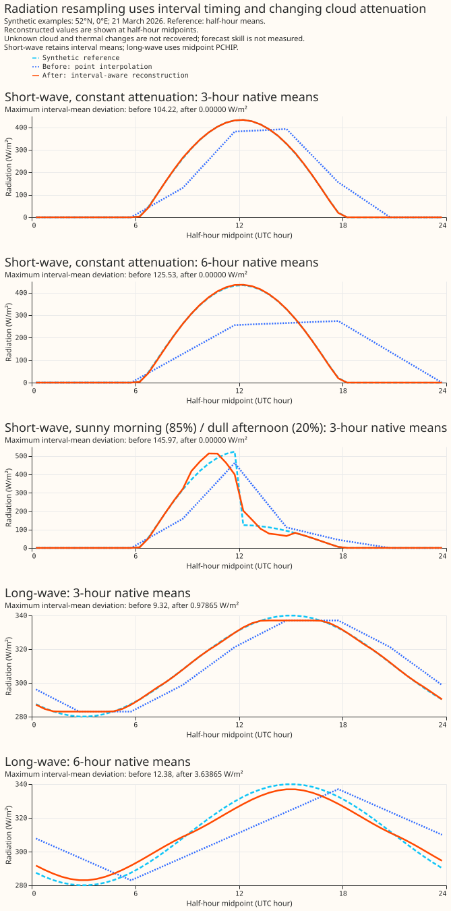

# NWP variable conventions

This page says how to read a value out of the `nwp` Delta table, and what the feature pipeline does
to it on the way to the model. Every ECMWF ENS variable we store is listed with the convention that
governs it: some values describe an instant, some describe the 3 or 6 hours before that instant, and
two are angles that wrap.

Everything here is a choice this project made, so a defect described on this page is a reason to
change our code. Damage the data arrives with is the separate subject of [Known ECMWF ENS
data-quality issues](ecmwf-ens-known-issues.md), which sets out how the two pages divide the subject
between them.

## The forecast step grid

ECMWF ENS is **not evenly spaced over the horizon**. Measured on the 2026-08-10 00Z run, and
identical in every run in the archive:

| step width | lead times | number of steps |
|---|---|---|
| — | 0 h (analysis) | 1 |
| 3 h | 3 h → 144 h | 48 |
| 6 h | 150 h → 360 h | 36 |

The change at **144 h — 6 days** matters most, because the primary user band is 3–10 days ([XGBoost
improvements](../roadmap/xgboost-improvements.md)), so days 6 to 10 of that band sit on the coarse
half of the grid.

## The three axes

A variable takes one convention from each of the three axes below. Most are instantaneous, linear
and numeric.

### Instantaneous versus period-ending

An **instantaneous** variable describes conditions at `valid_time` itself.

A **period-ending** variable is the *average rate over the interval that ends at `valid_time`*.
Dynamical.org de-accumulates these from ECMWF's cumulative source fields before we receive them.
Three variables are period-ending: `downward_short_wave_radiation_flux_surface`,
`downward_long_wave_radiation_flux_surface` and `precipitation_surface`. They are legitimately null
at lead 0, because there is no preceding interval.

Beyond 144 h the interval is **6 hours long**, so a 12:00 shortwave value is the mean over
06:00–12:00. That window covers much of the morning ramp, so the value is far below the
instantaneous irradiance at noon. What changes at day 6 is the averaging window, not the weather.

`PowerTimeSeries` uses the same convention — its `value` is the "average power over the preceding
30-minute period" — so the two sides of the NWP-to-power join agree, and features derived from
period-ending NWP should stay period-ending to match.

### Linear versus circular

`wind_direction_10m` and `wind_direction_100m` are **circular**: 359° and 1° are two degrees apart
in reality, and 358 degrees apart arithmetically. No arithmetic that assumes a number line —
interpolation, mean, gradient, quantile, standardised anomaly — is valid on them without special
handling. Every other numeric variable is linear.

### Numeric versus categorical

`categorical_precipitation_type_surface` is a category code, not a quantity, so it is aggregated by
area-weighted mode rather than averaged, and forward-filled rather than interpolated.

It appears to be instantaneous. The three period-ending variables are 100 % null at lead 0, because
there is no preceding interval for them to average; `categorical_precipitation_type_surface` is
fully populated there. That is good evidence but not proof, since a period field could in principle
be published at lead 0 anyway, so confirm against [ECMWF's parameter database
entry](https://codes.ecmwf.int/grib/param-db/260015) before relying on its timing. If it did
describe the preceding interval, forward-filling it would attribute one interval's precipitation
type to the following one.

## Every variable, and how to read it

The final column measures **what the 3 h → 6 h step change costs**: the error, at the held-out
intermediate steps, from reconstructing the 3-hourly part of the horizon out of a 6-hourly version
of itself using point interpolation, as measured before interval-aware radiation resampling.
`MAE/SD` normalises that error
by the variable's own spread, so the column is comparable across variables. Measured on the
2026-08-10 00Z run, scored over the 2,045,304 held-out steps within leads 3–144 h. For the
period-ending variables the 6-hourly product is *exactly* reproducible by averaging consecutive
pairs of 3-hourly means, so their figures are exact rather than an emulation. The two directions are
scored by mean circular distance — `|((reconstructed − truth + 180) mod 360) − 180|` — since a plain
subtraction of two angles is not a distance.

| variable | convention | unit | MAE at 6-hourly | MAE/SD |
|---|---|---|---|---|
| `downward_short_wave_radiation_flux_surface` | period-ending | W m⁻² | 111 | **0.44** |
| `wind_direction_10m` | instantaneous, **circular** | ° | 20.9 | — |
| `wind_direction_100m` | instantaneous, **circular** | ° | 19.4 | — |
| `downward_long_wave_radiation_flux_surface` | period-ending | W m⁻² | 6.5 | 0.27 |
| `wind_speed_100m` | instantaneous | m s⁻¹ | 0.75 | 0.30 |
| `wind_speed_10m` | instantaneous | m s⁻¹ | 0.57 | 0.28 |
| `precipitation_surface` | period-ending | kg m⁻² s⁻¹ | 9.6 × 10⁻⁶ | 0.19 |
| `dew_point_temperature_2m` | instantaneous | °C | 0.49 | 0.17 |
| `temperature_2m` | instantaneous | °C | 0.66 | 0.15 |
| `pressure_reduced_to_mean_sea_level` | instantaneous | Pa | 29 | 0.09 |
| `geopotential_height_500hpa` | instantaneous | m | 2.4 | 0.03 |
| `pressure_surface` | instantaneous | Pa | 29 | 0.02 |
| `categorical_precipitation_type_surface` | categorical | code | — | — |

The synoptic variables are unharmed by the coarser grid (MAE/SD 0.02–0.09). Shortwave radiation is
the worst affected numeric variable, at half again the next-worst (0.44 against `wind_speed_100m`'s
0.30). The two directions carry no MAE/SD because a standard deviation of a circular quantity is not
meaningful; their error is the mean circular distance instead.

## What the half-hourly resample does today

`_upsample_nwp_to_half_hourly` builds a 30-minute grid per `(nwp_init_time, ensemble_member,
time_series_id)` group. **Radiation follows a dedicated interval-aware path.** Other numeric
fields use point interpolation and the categorical field uses forward fill. Those generic paths
can fill interior source nulls; radiation preserves its source-missing windows.

`Nwp.continuous_var_names()` remains the numeric-variable set used by storage rounding and dashboard
plots. Resampling dispatch excludes both radiation columns locally, without changing that shared
classification.

### Wind direction is interpolated across the 0°/360° wrap

Interpolating 350° → 10° yields 180°: due south for a northerly wind. Measured on the 2026-08-10 00Z
run, over every consecutive native-step pair:

| step width | pairs straddling north (`_10m`) | pairs straddling north (`_100m`) |
|---|---|---|
| 3 h | 3.73 % | 3.50 % |
| 6 h | 8.30 % | 8.03 % |

Inside a straddling interval the error grows linearly with distance from the first step: at fraction
$t$ of the way across, the interpolated value is $360t$ degrees from the truth as a circular
distance. A straddling 3-hourly interval therefore holds five interpolated rows wrong by 60°, 120°,
180°, 120° and 60°. Only the midpoint is a full reversal; the mean error across the interval is
**108°** at 3-hourly spacing and **98°** at 6-hourly.

Across the whole horizon that affects **6.57 %** of interpolated `wind_direction_10m` rows and
**6.32 %** of `wind_direction_100m` rows — 5.80 % and 5.58 % of all half-hourly rows, since the
native steps themselves are correct. The error is not random: it always rotates the wind the long
way round, so a northerly is recorded as coming from the west, the south or the east, depending on
how far into the interval the row sits.

Both columns are in `conf/model/xgboost.yaml`'s `selected_features`, so this reaches the model.

<!-- pyml disable-next-line no-inline-html -->
<a id="period-ending-variables-are-interpolated-as-though-they-were-instantaneous"></a>

### Radiation resampling

**Both radiation fields describe the interval before their timestamp.** The production helper in
`ml_core.features._radiation` expands each native mean into half-hours inside that backward window.
The helper obtains widths from the ECMWF lead schedule: 3 hours through lead 144, then 6 hours,
including `(144, 150]`. Width never comes from the previous available value, which could span
missing windows.
The half-hour ending at a native timestamp has a reconstructed feature value, not the original
3/6-hour mean.

**Short-wave uses the sun's daily shape and interpolates cloud attenuation.** The helper evaluates
[fractional-year solar geometry](https://gml.noaa.gov/grad/solcalc/solareqns.PDF) from the US National
Oceanic and Atmospheric Administration (NOAA), including longitude and equation of time, then
Haurwitz clear-sky irradiance. Two 15-minute midpoint samples
supply each backward half-hour mean. Averaging these half-hours supplies the matching native-window
clear-sky mean. The native radiation divided by that mean is the clear-sky index, anchored at the
native window midpoint. Windows with a clear-sky mean of at least 1 W/m² supply indices.

**Interpolation stays within a supported daylight block.** The index varies linearly between
midpoints; before the first usable index and after the last, it holds the nearest index. Solar
night gaps on the half-hour grid separate daylight blocks, even when a short northern summer night
fits between two native windows that both contain daylight. Missing native windows split the source
support independently. Each window's index is available to every daylight block that window
contains, and target means multiply the interpolated index by the half-hour clear-sky mean.

**Every complete short-wave window conserves its supplied energy.** Short-wave target means are
rescaled so their mean equals the native mean; equivalently, the half-hour energy sum equals native
mean × native duration. This constraint can introduce boundary steps and does not recover unknown
sub-window cloud changes. The index is not clipped at 1.

**Fallbacks preserve energy when solar shaping is unusable.** If no usable index exists, distribute
the native energy in proportion to the half-hour clear-sky means within that window. If all those
means are zero, retain the source mean as a constant. A positive native mean whose timestamp falls
after sunset can still describe a window containing daylight. A positive fully-dark source window takes
the constant fallback, preserving energy rather than claiming both exact nighttime zero and
conservation. Zero-energy windows output zero.

**Long-wave uses a smooth spline through native-window midpoint means.** Piecewise Cubic Hermite
Interpolating Polynomial (PCHIP) interpolation preserves local trends without overshooting the
neighbouring means. The helper evaluates the spline at each half-hour midpoint, holding the nearest
mean before the first anchor and after the last. Two anchors give linear interpolation; a single
anchor gives a constant. Thermal radiation depends on atmospheric temperature, humidity, and
clouds, so long-wave uses no solar shaping.

**Long-wave prioritises smooth features over exact interval energy.** Native interval means act as
midpoint estimates; spline values evaluated at half-hour midpoints need not average back to each
original mean. The half-hour features feed an electricity forecasting model. The smoother long-wave
profile avoids imposing steps at every native boundary. Smoothness does not establish a
forecast-score gain or recover the
unknown thermal variation within an interval. See the [PCHIP
algorithm](https://docs.scipy.org/doc/scipy/reference/generated/scipy.interpolate.PchipInterpolator.html)
for the shape-preserving derivative rules.

**Missing source windows stay null in both fields.** Lead zero has no preceding window; a finite
lead-3 mean supports lead 0.5 through 3. Source nulls and absent native rows leave their own windows
null, including the final window. Unsupported off-schedule source timestamps supply no radiation
window, while other weather columns retain their existing path. No window borrows values from
another series, run, or ensemble member. Complete windows are reconstructed before cropping to the
existing output grid, so a visible tail never receives the whole window's energy.

**Training and inference use the same lazy helper.** Site metadata supplies coordinates for
short-wave, and geometry is reused across runs and members at matching site/time coordinates.
Long-wave needs no coordinates. Raw NWP storage and rounding remain unchanged.

**Regenerate engineered caches and retrain before deploying power-forecast models against these
feature semantics.** Corrected timing and smoother profiles do not establish a forecast-score gain.

**Synthetic examples show interval timing and changing cloud attenuation.** The figure uses an
invented coordinate at 52°N, 0°E on 21 March 2026. Short-wave reference means use independent pvlib
solar geometry and
70% of Haurwitz clear sky in the constant-attenuation examples. A further 3-hour example uses
85% before noon and 20% afterwards, representing a sunny morning and dull afternoon.
Long-wave reference means follow a prescribed smooth daily curve.
Aggregating the reference half-hours supplies identical native inputs to point interpolation and
the production feature pipeline. The plotted middle day has complete 3-hour or 6-hour windows;
nighttime values remain visible so displaced short-wave energy cannot disappear from the comparison.



**The constant-attenuation examples show the short-wave timing correction.** The energy centroid is
the average half-hour midpoint weighted by that half-hour's radiation energy. Point interpolation
delays the whole-day short-wave energy centroid by 1.25 hours with 3-hour inputs and 2.73 hours with
6-hour inputs. The new delays are under 12 seconds, with native-window mean errors below 0.000003
W/m². The reported delays and mean errors describe these synthetic examples, not forecast scores.

**The sunny-morning example retains each interval's forecast energy.** The reconstructed profile
retains the stronger morning and weaker afternoon. Interpolation and rescaling can smooth the noon
change or introduce boundary jumps; the native means cannot identify the true cloud-transition time.

**Long-wave PCHIP trades exact interval energy for a smooth profile.** Interval-mean deviations are
below 0.98 W/m² for 3-hour inputs and 3.64 W/m² for 6-hour inputs in the prescribed daily curve.
The smooth long-wave reference is one possible underlying curve; the native means cannot identify
the true thermal variation. The script prints every plotted deviation and centroid shift in
[its generated
report](https://github.com/openclimatefix/nged-substation-forecast/blob/main/studies/radiation_resampling/report.md).

Reproduce the figure and report from the repository root:

```bash
uv run python studies/radiation_resampling/plot_radiation_resampling.py
npx svgo@4 --multipass --precision=1 --final-newline docs/architecture/assets/radiation-resampling.svg
```

The archive confirms the period-ending reading. Forming the clear-sky index two ways over the
2026-08-10 00Z run (1671 cells × 51 members, ~2.8 M rows after restricting to those where clear-sky
irradiance exceeds 200 W m⁻², so the ratio is well conditioned) settles it. Cloud enhancement can
lift irradiance a few tens of percent above the clear-sky value, so an index a little over 1 is real
— but an index of 2 is not, least of all for a 6-hour mean over a whole H3 cell:

| step | `GHI / CS(valid_time)` p99 / max | `GHI / CS(mean over preceding step)` p99 / max |
|---|---|---|
| 3 h | 2.0 / 2.2 | 0.99 / **1.02** |
| 6 h | 2.3 / 3.0 | 0.96 / **1.03** |

The period-mean denominator sits at 1.0 to within the clear-sky model's own error in both halves of
the horizon; the instantaneous one implies irradiance twice what the sky can deliver. The exact tail
figures depend on the clear-sky model and the daylight cut-off, so treat the leading digit as the
result.

### Instantaneous variables lose diurnal amplitude

Linear interpolation between 6-hourly samples misses the daily temperature maximum, which falls at
around 15:00, between the 12:00 and 18:00 samples. The loss is measured by emulation, which controls
for lead time: comparing the native 3-hourly steps of days 1–6 against a 6-hourly subsample of those
same steps, the mean daily temperature range falls from **6.09 °C to 5.37 °C — an 11.9%
compression**.

This information loss has no exact interpolation fix. The diurnal cycle is not a pure sinusoid:
its asymmetric afternoon peak needs the second and third harmonics, and four samples a day is
already at the Nyquist limit for the second, so some amplitude is genuinely unrecoverable at
6-hourly spacing. A shape-preserving interpolant would recover more of it than a linear one, though
how much has not been measured. The compression feeds the effective-temperature, degree-day and
`windchill` features.

## Wind is stored as speed and direction, and why

The ingest computes wind speed and direction from ECMWF's native `u`/`v` components and discards the
components ([`convert_to_polars.py`](../api/dynamical_data/index.md)). Two properties of that choice
are worth knowing.

**The conversion happens after the spatial aggregation, which is the right order.** H3 cells are
built from `wind_u_*`/`wind_v_*`, and speed and direction are derived from the already-aggregated
components. Averaging *direction* over grid points would have the same wrap defect in space that the
resample has in time, and it never happens.

**The stored speed is therefore the magnitude of the cell's *vector* mean, not the mean of the grid
points' scalar speeds.** These differ — |E[**v**]| ≤ E[|**v**|] — and the gap grows wherever wind
direction varies across a cell. The second quantity is the one a turbine power curve wants, because
power responds to the speed at each point and the curve is strongly non-linear. The scalar mean
cannot be recovered from the archive: it is a different spatial reduction, so obtaining it requires
re-ingesting. The size of the gap has not been measured.

**Storing the components instead would cost roughly 6 % of the table.** The two forms carry the same
information, so this is mostly a storage question. The one behavioural consequence is that speed
becomes derived after interpolation, which changes its values slightly. Round-tripping speed and
direction to components and back, with the components rounded to the [13-bit
significand](../api/delta_store/index.md) the table stores, costs at most 6.8 × 10⁻³ ° of direction
and 2.4 × 10⁻³ m s⁻¹ of speed over a full run — the same order as the rounding the table already
applies, and far below anything a forecast responds to.

Written through the production path (same significand rounding, sort order, and writer properties),
the full column set both ways:

| run | speed + direction | u + v | change |
|---|---|---|---|
| 2026-08-10 00Z | 142.6 MB | 151.6 MB | +6.3 % |
| 2026-08-03 00Z | 144.6 MB | 152.8 MB | +5.7 % |

A wrapped angle turns out to compress *better* than the components, not worse. Over the whole table
— 1,726 Parquet files, 6.25 billion rows, 98.9 GB — each direction column costs 1.53 bytes per row
and the two together are 19.3% of all bytes, making direction the most expensive weather column we
store, ahead of temperature at 8.8%. Yet the components cost more still, because the significand
rounding collapses values into repeats that Parquet's dictionary and RLE encoding capture, and
`u`/`v`, being products of a speed and a trigonometric function, take about two and a half times as
many distinct values after rounding. It is the same mechanism that makes `BYTE_STREAM_SPLIT` lose on
this table.

Whether to accept that 6 % in exchange for making the wrap defect structurally impossible is being
decided in [Store wind as u/v
components](../roadmap/xgboost-improvements.md#store-wind-as-uv-components-rather-than-speed-and-direction).
