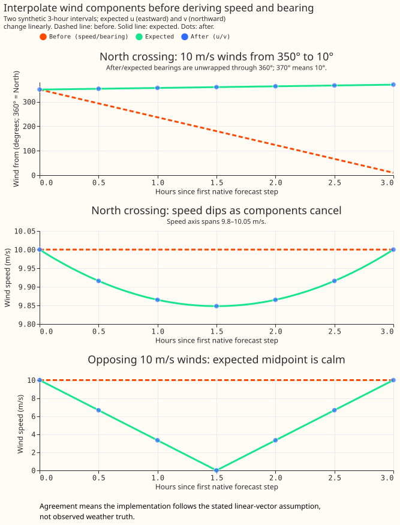

# NWP variable conventions

This page says how to read a value out of the `nwp` Delta table, and what the feature pipeline does
to it on the way to the model. Every ECMWF ENS variable we store is listed with the convention that
governs it: some values describe an instant, some describe the 3 or 6 hours before that instant, and
wind components are signed eastward and northward velocities.

Everything here is a choice this project made, so a defect described on this page is a reason to
change our code. Damage the data arrives with is the separate subject of [Known ECMWF ENS
data-quality issues](ecmwf-ens-known-issues.md), which sets out how the two pages divide the subject
between them.

## The forecast step grid

ECMWF ENS is **not evenly spaced over the horizon**. Measured on the 2026-08-10 00Z run, and
identical in every run in the archive:

| step width | lead times | number of steps |
|---|---|---|
| — | 0 h (analysis) | 1 |
| 3 h | 3 h → 144 h | 48 |
| 6 h | 150 h → 360 h | 36 |

The change at **144 h — 6 days** matters most, because the primary user band is 3–10 days ([XGBoost
improvements](../roadmap/xgboost-improvements.md)), so days 6 to 10 of that band sit on the coarse
half of the grid.

## The three axes

A variable takes one convention from each of the three axes below. Most are instantaneous, linear
and numeric.

### Instantaneous versus period-ending

An **instantaneous** variable describes conditions at `valid_time` itself.

A **period-ending** variable is the *average rate over the interval that ends at `valid_time`*.
Dynamical.org de-accumulates these from ECMWF's cumulative source fields before we receive them.
Three variables are period-ending: `downward_short_wave_radiation_flux_surface`,
`downward_long_wave_radiation_flux_surface` and `precipitation_surface`. They are legitimately null
at lead 0, because there is no preceding interval.

Beyond 144 h the interval is **6 hours long**, so a 12:00 shortwave value is the mean over
06:00–12:00. That window covers much of the morning ramp, so the value is far below the
instantaneous irradiance at noon. What changes at day 6 is the averaging window, not the weather.

`PowerTimeSeries` uses the same convention — its `value` is the "average power over the preceding
30-minute period" — so the two sides of the NWP-to-power join agree, and features derived from
period-ending NWP should stay period-ending to match.

### Linear versus circular

`wind_direction_10m` and `wind_direction_100m` are **circular**: 359° and 1° are two degrees apart
in reality, and 358 degrees apart arithmetically. No arithmetic that assumes a number line —
interpolation, mean, gradient, quantile, standardised anomaly — is valid on them without special
handling. The archive stores `wind_u_10m`, `wind_v_10m`, `wind_u_100m`, and `wind_v_100m`,
which are linear. Speed and bearing are derived features, not stored weather columns.

### Numeric versus categorical

`categorical_precipitation_type_surface` is a category code, not a quantity, so it is aggregated by
area-weighted mode rather than averaged, and forward-filled rather than interpolated.

It appears to be instantaneous. The three period-ending variables are 100 % null at lead 0, because
there is no preceding interval for them to average; `categorical_precipitation_type_surface` is
fully populated there. That is good evidence but not proof, since a period field could in principle
be published at lead 0 anyway, so confirm against [ECMWF's parameter database
entry](https://codes.ecmwf.int/grib/param-db/260015) before relying on its timing. If it did
describe the preceding interval, forward-filling it would attribute one interval's precipitation
type to the following one.

## Every variable, and how to read it

**Raw wind columns are instantaneous signed components at both stored heights.**
All four columns use metres per second and area-weighted H3 spatial means.

| current raw wind column | positive direction | timing |
|---|---|---|
| `wind_u_10m` | East | instantaneous |
| `wind_v_10m` | North | instantaneous |
| `wind_u_100m` | East | instantaneous |
| `wind_v_100m` | North | instantaneous |

**The following table is a historical diagnostic of the polar archive**, measured before component
storage. The wind rows describe derived quantities rather than the current raw column set.
The final column measures **what the 3 h → 6 h step change costs**: the error, at the held-out
intermediate steps, from reconstructing the 3-hourly part of the horizon out of a 6-hourly version
of itself the way the feature pipeline reconstructs half-hourly rows. `MAE/SD` normalises that error
by the variable's own spread, so the column is comparable across variables. Measured on the
2026-08-10 00Z run, scored over the 2,045,304 held-out steps within leads 3–144 h. For the
period-ending variables the 6-hourly product is *exactly* reproducible by averaging consecutive
pairs of 3-hourly means, so their figures are exact rather than an emulation. The two directions are
scored by mean circular distance — `|((reconstructed − truth + 180) mod 360) − 180|` — since a plain
subtraction of two angles is not a distance.

| variable | convention | unit | MAE at 6-hourly | MAE/SD |
|---|---|---|---|---|
| `downward_short_wave_radiation_flux_surface` | period-ending | W m⁻² | 111 | **0.44** |
| `wind_direction_10m` | instantaneous, **circular** | ° | 20.9 | — |
| `wind_direction_100m` | instantaneous, **circular** | ° | 19.4 | — |
| `downward_long_wave_radiation_flux_surface` | period-ending | W m⁻² | 6.5 | 0.27 |
| `wind_speed_100m` | instantaneous | m s⁻¹ | 0.75 | 0.30 |
| `wind_speed_10m` | instantaneous | m s⁻¹ | 0.57 | 0.28 |
| `precipitation_surface` | period-ending | kg m⁻² s⁻¹ | 9.6 × 10⁻⁶ | 0.19 |
| `dew_point_temperature_2m` | instantaneous | °C | 0.49 | 0.17 |
| `temperature_2m` | instantaneous | °C | 0.66 | 0.15 |
| `pressure_reduced_to_mean_sea_level` | instantaneous | Pa | 29 | 0.09 |
| `geopotential_height_500hpa` | instantaneous | m | 2.4 | 0.03 |
| `pressure_surface` | instantaneous | Pa | 29 | 0.02 |
| `categorical_precipitation_type_surface` | categorical | code | — | — |

The synoptic variables are unharmed by the coarser grid (MAE/SD 0.02–0.09). Shortwave radiation is
the worst affected numeric variable, at half again the next-worst (0.44 against `wind_speed_100m`'s
0.30). The two directions carry no MAE/SD because a standard deviation of a circular quantity is not
meaningful; their error is the mean circular distance instead.

## What the half-hourly resample does today

[Issue
#1156](https://github.com/openclimatefix/nged-substation-forecast/issues/1156)
plans an audit that measures how much each defect below changes the forecast score.

`_upsample_nwp_to_half_hourly` builds a 30-minute grid per `(nwp_init_time, ensemble_member,
time_series_id)` group, left-joins the native steps onto it, then **linearly interpolates every
column in `Nwp.continuous_var_names()`** and forward-fills the categorical one.

**Wind components are interpolated before speed and bearing are derived.** The feature pipeline
computes `sqrt(u² + v²)` and `(atan2(u, v) × 180/π + 180) mod 360` at half-hourly resolution.
The bearing describes where the wind comes from: North is 0°, East is 90°. Derivation happens
before forecast joins, analysis-proxy selection, weather lags, and rolling features. Wind chill
uses the derived 10 m speed even when speed is not explicitly requested.

**Exact calm keeps the formula's 180° result, although calm has no physical direction.** Null
components propagate to null polar features. Per-component bounds are −200 to 200 m/s as a
corrupt-feed guard; the contract does not impose a separate 200 m/s bound on vector magnitude.
The ingest averages u and v over the contributing grid points of each H3 cell. Different missing
footprints for u and v would imply different contributing sub-areas.

Period-ending radiation and precipitation still receive ordinary linear interpolation. Their timing
is a separate repair tracked by [issue #526](https://github.com/openclimatefix/nged-substation-forecast/issues/526).

### Interpolate components before deriving speed and bearing

**These known-answer examples check linear vector interpolation, not observed weather accuracy.**
Two synthetic 3-hour intervals assume that eastward u and northward v change linearly between
native forecast steps. Before interpolates endpoint speeds and bearings arithmetically. After
uses the production half-hourly feature pipeline; expected values come from independent analytic
trajectories. The same linear component rule applies to 6-hour native intervals.



**Interpolating the vector preserves the North crossing and allows opposing winds to cancel.**
The North-crossing midpoint is northerly, whereas the old arithmetic bearing is 180° (South).
Bearings in the figure are unwrapped through 360°; 370° means 10°. Speed at that midpoint is
9.848078 m/s, below the 10 m/s endpoints. Opposing 10 m/s vectors reach calm at the midpoint;
interpolated scalar speeds remain 10 m/s. Calm has no physical bearing, so the opposing-wind panel
plots speed only. These deterministic examples need no uncertainty interval and establish no
forecast-skill improvement.

Reproduce the figure and its checked CSV/report from the repository root:

```bash
uv run python scripts/diagnostics/plot_wind_interpolation.py
npx svgo@4 --multipass --precision=1 --final-newline \
  docs/studies/assets/wind-interpolation.svg
```

The numerical report and CSV are written under
`data/studies/wind_storage/interpolation-proof/`. The figure uses 10 m components; the production
expressions and regression tests cover both stored heights.

### Historical bearing interpolation crossed the 0°/360° wrap {#wind-direction-is-interpolated-across-the-0360-wrap}

**A historical audit found that ordinary bearing interpolation can reverse northerly wind.**
Interpolating 350° → 10° arithmetically yields 180°, whereas the midpoint of equal-speed
components points North. On the 2026-08-10 00Z polar archive, native-step pairs straddled North as
follows:

| step width | pairs straddling north (`_10m`) | pairs straddling north (`_100m`) |
|---|---|---|
| 3 h | 3.73 % | 3.50 % |
| 6 h | 8.30 % | 8.03 % |

The historical audit compared arithmetic bearings with a shortest-arc angular interpolation.
That diagnostic is not observed weather truth and is not generally the same as component
interpolation when endpoint speeds differ. Relative to the shortest-arc diagnostic, 6.57 % of
interpolated 10 m bearings and 6.32 % of interpolated 100 m bearings differed across the wrap.
The stored-component pipeline avoids arithmetic interpolation of bearings; downstream calculations
on derived bearings still require circular handling.

### Period-ending variables are interpolated as though they were instantaneous

The resample interpolates between `valid_time` stamps, which treats a backward-looking mean as an
instantaneous reading at the *end* of its window. The reconstructed day is therefore both flattened
and shifted late — by half the step width, so **3 hours** in the 6-hourly part of the horizon.
Reconstructing a clear-sky day (Haurwitz clear-sky irradiance at 52.5° N, 1° W, 10 August):

| step | reconstruction | peak W m⁻² | peak at |
|---|---|---|---|
| — | truth (instantaneous) | 816 | 12:00 |
| 3 h | today's resample | 756 | 15:00 |
| 6 h | today's resample | 590 | 18:00 |

Read the 6-hourly row carefully: the reconstruction is a near-flat plateau from 12:00 to 18:00, and
the argmax lands at 18:00 only because the two knots differ by about 6%. The honest summary is that
the modelled solar day is shifted about 3 hours late and its peak cut by a quarter, not that it
peaks at 18:00. Daily *energy* is preserved (7.18 against 7.20 kWh m⁻²) — it is the shape and the
timing that are wrong, which is what a PV site responds to.

The archive confirms the period-ending reading. Forming the clear-sky index two ways over the
2026-08-10 00Z run (1671 cells × 51 members, ~2.8 M rows after restricting to those where clear-sky
irradiance exceeds 200 W m⁻², so the ratio is well conditioned) settles it. Cloud enhancement can
lift irradiance a few tens of percent above the clear-sky value, so an index a little over 1 is real
— but an index of 2 is not, least of all for a 6-hour mean over a whole H3 cell:

| step | `GHI / CS(valid_time)` p99 / max | `GHI / CS(mean over preceding step)` p99 / max |
|---|---|---|
| 3 h | 2.0 / 2.2 | 0.99 / **1.02** |
| 6 h | 2.3 / 3.0 | 0.96 / **1.03** |

The period-mean denominator sits at 1.0 to within the clear-sky model's own error in both halves of
the horizon; the instantaneous one implies irradiance twice what the sky can deliver. The exact tail
figures depend on the clear-sky model and the daylight cut-off, so treat the leading digit as the
result.

### Instantaneous variables lose diurnal amplitude

Linear interpolation between 6-hourly samples misses the daily temperature maximum, which falls at
around 15:00, between the 12:00 and 18:00 samples. The loss is measured by emulation, which controls
for lead time: comparing the native 3-hourly steps of days 1–6 against a 6-hourly subsample of those
same steps, the mean daily temperature range falls from **6.09 °C to 5.37 °C — an 11.9%
compression**.

Unlike the other two defects this one has no exact fix. The diurnal cycle is not a pure sinusoid:
its asymmetric afternoon peak needs the second and third harmonics, and four samples a day is
already at the Nyquist limit for the second, so some amplitude is genuinely unrecoverable at
6-hourly spacing. A shape-preserving interpolant would recover more of it than a linear one, though
how much has not been measured. The compression feeds the effective-temperature, degree-day and
`windchill` features.

## Wind is stored as components {#wind-is-stored-as-speed-and-direction-and-why}

**The archive keeps u/v alone, accepting an 8.90 % increase in sampled Parquet bytes.**
A paired measurement of 24 full 00Z forecasts across 2025 used identical raw inputs, H3 weights,
rounding, sorting, and the production writer. Polar storage used 3.802 GB; u/v used 4.140 GB.
Adding scalar-mean speed at both heights raised the total to 4.881 GB, another 17.90 % over u/v.
The [seasonal storage measurement](../studies/forecasts/wind-storage.md) gives the generated
per-run tables and reproduction procedure. The percentages describe the sample, not an
archive-wide census. Historical measurements of two August 2026 runs found +6.3 % and +5.7 %;
the broader paired sample governs the storage decision.

**Vector-mean speed and scalar-mean speed measure different spatial reductions.**
The pipeline derives the magnitude of the area-weighted mean vector, |E[**v**]|. Averaging the
grid points' magnitudes gives E[|**v**|], which is at least as large before numerical rounding.
Opposing winds can cancel in the vector mean while retaining large scalar speeds. Scalar means
cannot be recovered from the stored vectors; obtaining scalar means requires the raw grid-point
data. Neither spatial reduction alone gives the mean output of a nonlinear turbine power curve.

**Typical spatial gaps are small, but the measured tails are substantial.** Before writer
rounding, the median scalar-minus-vector gap was about 0.0056 m/s at both heights. At 100 m, the
99th percentile was 0.405 m/s and the maximum was 15.059 m/s; the 10 m maximum was 12.495 m/s.
The maintainer chose u/v alone. Scalar-mean speed remains a possible forecasting experiment,
not a quantity established as irrelevant by the storage measurement.

## Migrate into a separate archive before switching readers

**A component schema requires a fresh destination; partition overwrite cannot migrate the archive.**
`write_nwp` rejects an existing table whose column set differs from the incoming frame, while
allowing dtype widening within the same column set.
`scripts/maintenance/rewrite_nwp_wind_components.py` reads an explicitly pinned local Delta
snapshot and reconstructs `u = -speed × sin(bearing)` and `v = -speed × cos(bearing)`.
Archived speeds and bearings have already been rounded, so reconstruction cannot recover the
original native components exactly. Writing the reconstructed components applies 13-bit
significand rounding as well. Wind validation bounds the round-trip error relative to the
archived polar values, not the original downloaded u/v. Exact equality applies to row keys and
non-wind columns.
The script writes through `write_nwp`, verifies exact non-wind columns and row keys, and records
quantization-aware speed and circular-bearing errors after readback. A sibling manifest records
completed partitions and source files. Reruns skip verified partitions; a newer pinned snapshot
adds new partitions and replaces source partitions whose files changed. Source partition removal
requires reconciliation. The source archive remains read-only.

```bash
uv run python scripts/maintenance/rewrite_nwp_wind_components.py \
  --source OLD_ARCHIVE --source-version VERSION \
  --destination NEW_ARCHIVE --limit 4
```

**Validate a seasonal pilot, then finish and catch up before cutover.** Remove `--limit` for the
complete build. Compare source and destination partition inventories, keys, member/lead/cell
coverage, and non-wind values. Pin a newer source version to catch up while the old archive keeps
serving, and confirm the live selected run exists in the destination. Switch the archive setting
and matching code together, retrain affected forecasting models and rebuild derived feature caches.
Keep the old archive, compatible code, and model artifacts for rollback. Never mix old and new
schemas in a single table.

**Study extracts must be rebuilt as matching versioned datasets.** The horizon extract and day-4
supplement require explicit source, Delta version, and new output directory. Both derive polar
values at native steps and record the same source identity; the supplement retains exact equality
checks on shared rows. Frozen historical polar extracts require the historical checkout and
source archive. A matched forecasting comparison of interpolation ordering remains pending;
the storage measurement does not establish forecast skill.
