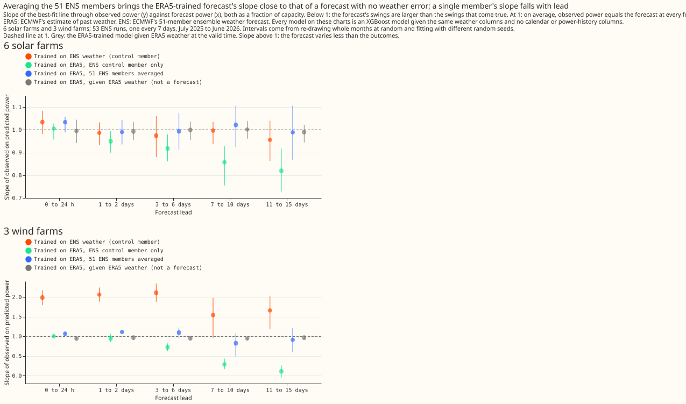
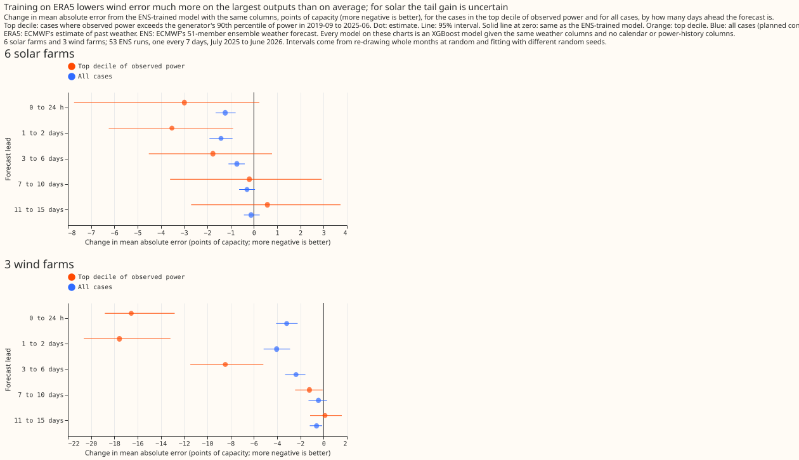

# Does an ERA5-trained weather-to-power model beat the same model trained on ENS?

**Verdict: supported up to day 6, not supported beyond.** Stage 1a (one XGBoost model per series,
trained on ERA5 and CAMS, no calendar and no power-history columns) applied to the 51 ENS members
and averaged has a smaller error than the same columns trained on ENS weather, for lead bands up to
6 days, for 6 solar farms and 3 wind farms, in one held-out year (fold A, 53 weekly runs). The
planned contrasts were revised after two scientific reviews, so they are not pre-registered. The
full write-up is the study README in `studies/stage1_pilot/README.md`.

## Absolute scores, all leads

Mean absolute error, points of capacity, with 95% intervals that resample whole validation months.

| arm | solar | wind |
| --- | --- | --- |
| `ens_trained` (reference) | 8.25 (6.18 to 10.72) | 17.09 (15.32 to 18.67) |
| `s1_memberavg` (ERA5-trained, 51 members averaged) | 7.67 (5.74 to 10.04) | 15.39 (13.26 to 17.21) |
| `climatology` | 8.62 (6.49 to 11.14) | 19.16 (16.49 to 21.50) |
| `c0` (production control, 24 production columns) | 8.74 (6.51 to 11.37) | 19.08 (17.25 to 20.71) |
| `era5_ceiling` (given ERA5 weather, not a forecast) | 5.98 (4.32 to 8.05) | 7.90 (7.14 to 8.70) |

## Planned contrasts (revised)

- **P1 (`s1_memberavg` minus `ens_trained`) is material up to day 6 for both technologies.** Wind
  -3.18, -4.04, and -2.37 points at 0 to 24 h, 1 to 2 days, and 3 to 6 days; solar -1.23, -1.41, and
  -0.73. At 7 to 10 and 11 to 15 days neither passes.
- **P2 (adding stage 1a's prediction as a column to `ens_trained`) is not material anywhere.** Solar
  -0.06 (-0.12 to -0.01), wind +0.02 (+0.01 to +0.03) over all leads.
- **Beyond day 6 stage 1a is within about 1 point of climatology.**

## What else the study found

- **Averaging the 51 members is associated with a much larger drop in error for the ERA5-trained
  model** (-0.70 solar, -2.23 wind) **than for the ENS-trained model** (-0.15, -0.22). With the
  control member alone, ERA5 training is associated with lower error at 0 to 2 days and higher error
  at 7 to 15 days.
- **Removing hour and day-of-year columns lowered the ENS-trained error by 1.13 (solar) and 3.40
  (wind) points** and the ERA5-trained error by 0.23 (solar) and 0 (wind). The first run's control,
  with 24 production columns, looked like it memorised calendar position.
## Gains in the tails (exploratory)

**For wind, the gain from ERA5 training is much larger on the largest outputs; for solar it is
larger in points at short leads but uncertain.** The tail is the cases where observed power exceeds
the series' 90th percentile of cleaned power in stage 1a's training window (20,020 solar and 9,747
wind cases per seed). The table gives `s1_memberavg` minus `ens_trained` in points of capacity, with
95% month-resampled intervals, against the same contrast on all cases.

| lead band | wind, top decile | wind, all cases | solar, top decile | solar, all cases |
| --- | --- | --- | --- | --- |
| 0 to 24 h | -16.54 (-18.82 to -12.81) | -3.18 | -2.99 (-7.73 to +0.23) | -1.23 |
| 1 to 2 days | -17.56 (-20.63 to -13.17) | -4.04 | -3.52 (-6.24 to -0.89) | -1.41 |
| 3 to 6 days | -8.46 (-11.47 to -5.18) | -2.37 | -1.76 (-4.52 to +0.78) | -0.73 |
| 7 to 10 days | -1.22 (-2.46 to -0.08) | -0.45 | -0.19 (-3.60 to +2.91) | -0.30 |
| 11 to 15 days | +0.12 (-1.17 to +1.56) | -0.61 | +0.58 (-2.70 to +3.73) | -0.12 |
| all leads | -6.14 (-7.66 to -4.33) | -1.70 | -1.05 (-3.93 to +1.25) | -0.57 |

- **Relative to each arm's own error, the wind gain is about 12% in the tail and 10% overall.** The
  top-decile error of `ens_trained` is 53.22 points and of `s1_memberavg` 47.08, against 17.09 and
  15.39 over all cases. At 0 to 24 h the tail gain is 42% of the error against 27% overall.
- **For solar the relative gain is smaller in the tail** (4% against 7% over all leads), and every
  solar tail interval over all leads and at 0 to 24 h and 3 to 6 days spans zero.
- **Tail errors are large for every forecast, and the weather input is associated with most of
  them.** `era5_ceiling` has a top-decile error of 13.16 (wind) and 18.43 (solar) points. Without a
  second model, both ERA5-trained and ENS-trained forecasts miss most of the largest wind outputs.
- **The control member alone gives the same tail result for wind** (-6.95, -8.39 to -5.23), so
  averaging the members is not needed for the tail gain, unlike the all-cases gain.
- Selecting on the observed value truncates the outcome, so slopes on this subset are not
  comparable across studies; only paired differences are reported. Tail pinball loss, exceedance
  Brier scores, and reliability for the probabilistic forecasts are in the stage 2 experiment.

## Failures and limits

- The first run compared against a control that memorised calendar position, and the headline was
  revised after two Opus reviews. The revised contrasts were chosen after seeing the first run.
- One held-out year, nine generators in two weather regions, fold A only, 24 decisions without a
  multiple-comparison correction.
- ENS is biased against ERA5 (10 m wind 13% to 15% slower, shortwave 7% brighter). Mapping ENS onto
  ERA5 before stage 1a is untested.

## Lessons for later experiments

- Give every arm the same feature columns, and add a control without calendar columns whenever the
  training rows repeat a valid time.
- Report the benchmark's absolute score and a climatology row beside every contrast.
- Predictions: the per-member predictions of every arm are under
  `data/studies/per_study/stage1_pilot/` (`stage1a/`, `ens_trained/`, `scores/`). They have not been
  written into `data/ml-experiments/00001-era5-trained-stage1a-vs-ens-trained/predictions/` with a
  manifest, because the `experiment_store` module of PR #1187 does not exist yet.
