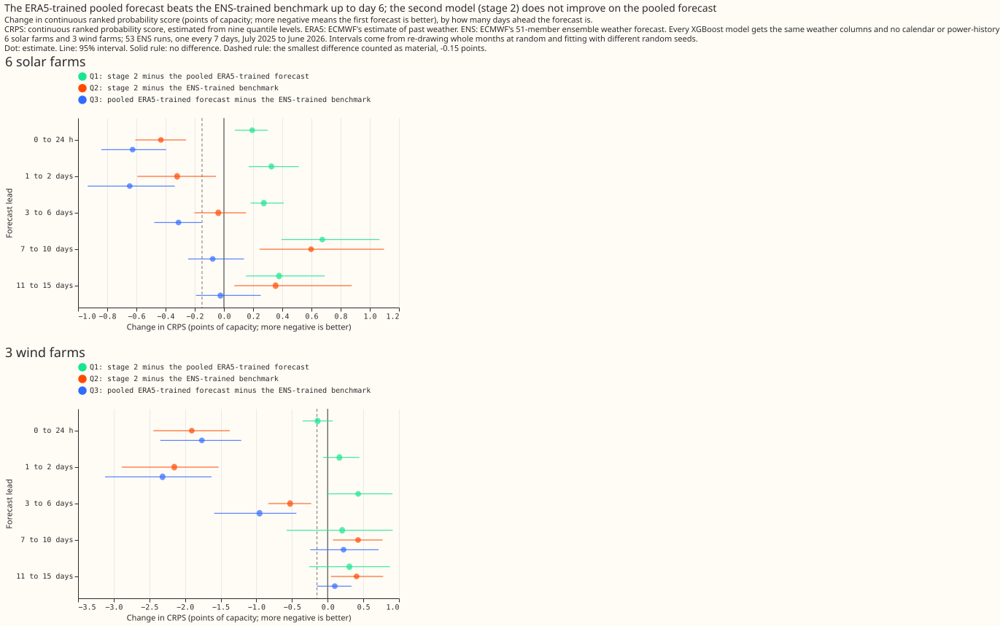

# Does a stage 2 calibrator beat the pooled stage 1a mixture?

We asked whether a second model, which corrects the spread of the forecast (its 5% to 95% band)
produced by a first weather-to-power model, makes solar and wind farm forecasts better than simply
pooling the first model's output over the 51 weather forecasts. We compared both with a model
trained directly on archived weather forecasts, for 6 solar farms and 3 wind farms over 53 weekly
forecast runs in one held-out year. Pooling the first model's output beat the model trained on
archived forecasts. The second model gave no improvement over pooling, and made the solar forecasts
worse.

**Verdict: the pooled ERA5-trained mixture beats the ENS-trained quantile model, and the stage 2
calibrator and learned blend did not improve on it, and were worse for solar.** Study 2b ran in one
held-out year (fold A, 53 weekly runs) for 6 solar farms and 3 wind farms. The full write-up is the
`Results` section of `studies/stage1_pilot/README_stage2.md`. ERA5 is a reanalysis, an estimate of
past weather. ENS is the European Centre for Medium-Range Weather Forecasts' ensemble forecast,
which has 51 members. The stage 2 calibrator is a second model that corrects the forecast quantiles
that stage 1a produces.

## Input columns

The columns are those of experiment 00001, with no calendar column and no power lag.

- **Solar farms (9 columns):** `shortwave`, `longwave`, `temperature_2m`,
  `dew_point_temperature_2m`, `pressure_surface`, `precipitation`, `wind_speed_10m`,
  `solar_zenith`, `solar_azimuth`.
- **Wind farms (6 columns):** `wind_speed_10m`, `wind_speed_100m`, `wind_dir_sin_10m`,
  `wind_dir_cos_10m`, `wind_dir_sin_100m`, `wind_dir_cos_100m`.
- **The calibrator** takes the stage 1a quantiles for one ensemble member plus the same columns.

## Absolute scores, all leads

CRPS in points of capacity.

| arm | solar | wind |
| --- | --- | --- |
| `climatology_q` (reference) | 5.65 | 13.03 |
| `a_ens_quantile` (benchmark) | 5.29 | 11.73 |
| `b_mixture_full` | 5.05 | 11.11 |
| `c_stage2_full_blp` | 5.45 | 11.37 |

## Planned contrasts

- **Q1 (stage 2 minus the mixture) is not material.** Solar +0.40 (+0.26 to +0.61), wind +0.26
  (-0.17 to +0.64).
- **Q2 (stage 2 minus the ENS-trained quantile arm) is material for wind only.** Wind -0.36 (-0.59 to
  -0.12), solar +0.17 (-0.03 to +0.50).
- **Q3 (mixture minus the ENS-trained quantile arm) is material for both.** Wind -0.62 (-0.99 to
  -0.26), solar -0.24 (-0.36 to -0.06). The gain sits in the first six days.

## What else the study found

- **For the mixture and stage 2 arms, the long ERA5 history changes the CRPS by 0.01 to 0.09
  points** against stage 1a trained on the ENS months only.
- **In the tail the ERA5-trained gain for wind is not larger than at the centre of the
  distribution.** The exceedance Brier scores of the 90th and 95th percentiles improve by 0.50 and
  0.27 over the ENS-trained arm.
- **The ENS-trained arm under-forecasts wind exceedances**, and stage 2's bins above 0.30 are also under-forecast.
- **The learned blend does not help reliably.** It changes the CRPS by +0.00 to +0.08 for stage 2.

## Failures and limits

- One fold, one weather product, single-member training rows, no power lags, no per-series
  calibrators, and 12 validation months.
- Quantile-mapping ENS onto ERA5 before stage 1a is untested.
- Long feature lists were not run in this experiment; experiment 00001 reports that comparison.

## Lessons for later experiments

- Report the pooled mixture beside any stage 2 arm, because the mixture is the reference stage 2
  has to beat.
- Predictions are under `data/studies/per_study/stage2_pilot/` and are not yet in
  `data/ml-experiments/` with a manifest.
