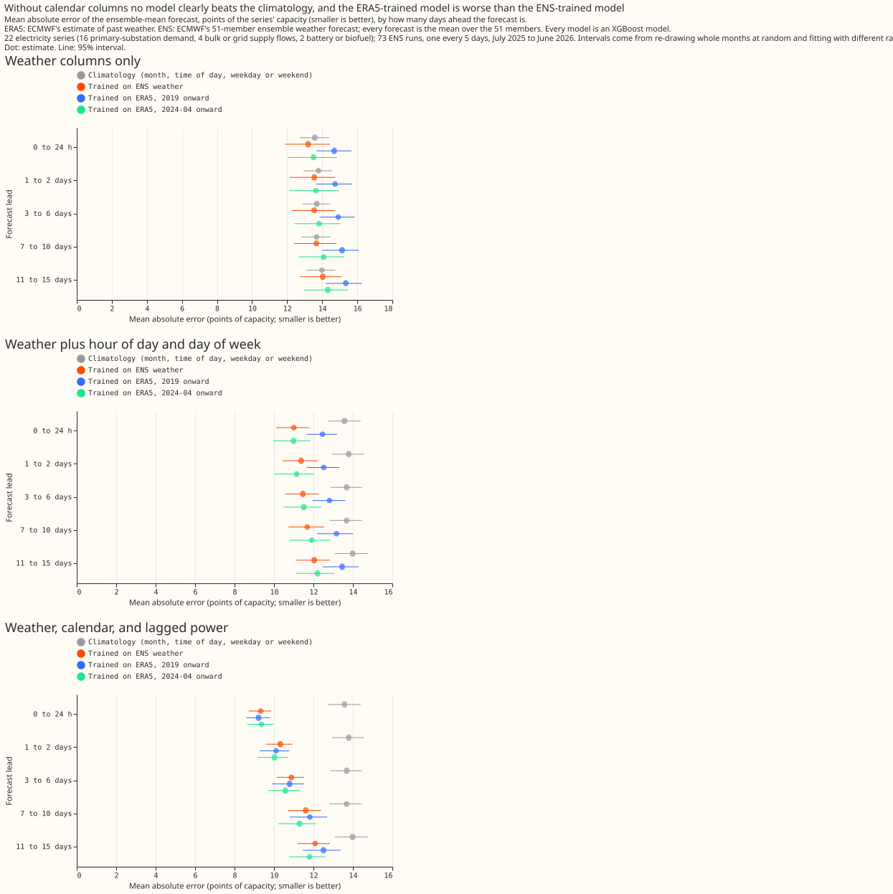

# Does an ERA5-trained weather-to-power model beat the same model trained on ENS, for demand?

We asked whether a model that turns weather into electricity demand is more accurate when it is
trained on estimates of past weather than when it is trained on archived weather forecasts. This
repeats for demand the test that experiment 00001 ran for solar and wind farms. We trained the model
both ways on 22 series that are not wind or solar farms (16 Primary substation demand series, 4
flows at bulk supply points and grid supply points, a battery, and a biofuel generator), scored both
on the same 51 weather forecasts, and repeated the comparison after adding the calendar and recent
power to both. Training on estimates of past weather gave the larger error.

**Verdict: not supported.** The ERA5-trained model has a larger error than the ENS-trained model for
these 22 series, both with weather only and with the calendar added. The plan below was written
before the first scored fit. The experiment repeats experiment 00001 for the 22 series of the fold A
frames that are not wind or solar farms. The write-up below the plan is filled in after the run.
ERA5 is a reanalysis, an estimate of past weather. ENS is the European Centre for Medium-Range
Weather Forecasts' ensemble forecast, which has 51 members.

## Plan

**Question.** Does stage 1a (one XGBoost model per series, trained on ERA5, applied to each of
the 51 ENS members' weather and averaged) forecast demand better than the same model trained on
ENS weather, and does the answer change when the calendar and lagged power are added to both?

**Series.** The 22 series of fold A that are not wind or solar farms, labelled D1 to D22: 16
disaggregated primary-substation demand series, 4 bulk-supply and grid-supply point flows, and 2
others (a battery and a biofuel generator). The results report the three groups separately. Each
series takes ERA5 weather from the nearest cell of the 121-cell stage 1 box.

**Row set and folds.** Validation 2025-07-01 to 2026-06-30, on the 73 runs of the row set
`fold_a_every5d_v1`: every fifth day at 00:00 UTC from 2025-07-01. The fold A frames of the
quick-wins study hold Tuesday runs only (row set `fold_a_tuesdays_v1`), which puts every case of the
0 to 24 h band on a Tuesday or Wednesday. The five-day step cycles the run's weekday, so every
lead band has about 14% of its cases on each weekday of the valid time. The ENS-trained arms train
on the control member of every daily run from 2024-04-01 to 2025-06-30, keeping valid times up to
2025-06-30. Both sets of rows come from `demand_build_ens.py`, which reads the ENS archive and uses
production's half-hourly resampling; for the 2025-07-01 run it reproduces the fold A frame's
weather columns and 24 h and 48 h lags exactly. Stage 1a trains on valid times from 2019-09 to 14
days before the
first run. Seeds 0, 1, and 2. A first fit on the Tuesday runs was run before this row set was
chosen and has not been scored; it is kept as a labelled reference.

**Weather columns, the same in every arm** (ENS serves each; ERA5 gives the same quantity):
`temperature_2m`, `dew_point_temperature_2m`, `shortwave`, `longwave`, `pressure_surface`,
`pressure_msl`, `precipitation`, `wind_speed_10m`, `wind_speed_100m`, and the precipitation-type
code (an integer 0 to 8). ERA5 shortwave is clipped at zero before use. No 500 hPa
geopotential height is used, because it is not on disk for ERA5.

**Variants.** Each variant gives every arm the same extra columns.

- **V0 (main):** the weather columns only. No calendar column and no power lag.
- **V1:** V0 plus the local hour of day and the local day of week.
- **V2:** V1 plus the power lags at 24, 48, 168, and 336 hours, null where the lag is no longer than
  the lead. The ENS-trained arm reads the lags from the fold A frames. For the ERA5-trained arm each
  training row draws one lead uniformly from 0.5 to 351 hours and nulls the lags that lead rules
  out.

**Arms.**

- **ens_trained:** the columns trained on the ENS control member, applied to each of the 51 members
  and averaged (the benchmark).
- **s1_memberavg:** the columns trained on ERA5, applied to each member and averaged.
- **s1_short:** as s1_memberavg, trained on ERA5 from 2024-04 only (isolates the training weather
  from the training length).
- **ens_trained_dedup (V1 and V2 only):** the ENS-trained arm on one row per valid time (the
  shortest lead). The ENS training frame repeats each valid time about 15 times, once per lead,
  which lets a model with calendar columns memorise the calendar position, as in 00001. The dedup
  arm is the guard.
- **s1_recency, s1_nocovid (V0 and V1; exploratory):** stage 1a with weights that halve every 2
  years of age, and stage 1a without 2020-03 to 2021-07.
- **climatology** (mean by local month and half-hour of the day) and **climatology_dow** (the same,
  separately for weekdays, Saturdays, and Sundays), 2019-09 to 2025-06-16.

**Planned contrasts** (mean absolute error, points of capacity; ensemble-mean forecast):

- **D1:** s1_memberavg minus ens_trained, V0.
- **D2:** s1_memberavg minus ens_trained_dedup, V1.
- **D3:** s1_memberavg minus ens_trained_dedup, V2.

Every other number is exploratory: the contrasts against `ens_trained` in V1 and V2, the
short-training and regime arms, the contrasts by series group, the top-decile contrasts, and the
climatology rows. The top decile is the cases where observed power exceeds the series' 90th
percentile of cleaned power in stage 1a's training window. Intervals resample whole validation
months and the three fitting seeds, as in 00001. Absolute scores are reported for every arm.

**Check before any fit.** The diurnal profile of ERA5's `ssrd` against the solar zenith is
compared with ERA5's hour-ending convention, and the result is reported in the write-up, in case
the label is shifted. The weather columns of ENS member 0 at short lead are compared with ERA5 at
the same valid time, as in 00001.

**To be added.** A CAMS arm: stage 1a with CAMS shortwave irradiance in place of ERA5's in
training only, as in 00001, at the 22 locations. The CAMS download is running; the arm is
reported when it finishes.

**Not tested here.** Where lagged power should enter a two-stage forecast, several weather
models, quantile forecasts, and a second fold.

## Input columns

Every arm gets the same columns within a variant. The columns are not production's.

- **Weather, 10 columns (V0):** `temperature_2m` (°C), `dew_point_temperature_2m` (°C), `shortwave`
  (W/m², mean over the half-hour), `longwave` (W/m²), `pressure_surface` (Pa), `pressure_msl` (Pa),
  `precipitation` (kg m⁻² s⁻¹), `wind_speed_10m` (m/s), `wind_speed_100m` (m/s), and
  `precipitation_type` (an integer code). ERA5 gives each from its nearest cell of the stage 1 box,
  with `ssrd` and `strd` divided by 3600, `tp` converted to a rate, and the wind speed taken from
  the components. ENS gives each directly, or from its wind components.
- **Calendar, 2 columns added in V1:** `hour_local` (fractional local hour of day) and
  `day_of_week_local` (Monday is 1).
- **Power lags, 4 columns added in V2:** `power_lag_24h`, `power_lag_48h`, `power_lag_168h`, and
  `power_lag_336h` in MW, null where the lag is no longer than the lead.
- **Not used:** the 500 hPa geopotential height, windchill, rolling weather means, sine and cosine
  time columns, the UTC offset, wind direction, the lead, and spread across the ensemble members.

## Checks before the fits

- **ERA5 `ssrd` label:** its correlation with the top-of-atmosphere cosine of the zenith is 0.899
  for the unshifted hour-ending label and 0.860 and 0.869 for labels one hour earlier and later. The
  label is not shifted.
- **ENS against ERA5 at the same valid time (member 0, lead under 36 h):** the continuous weather
  columns correlate 0.93 to 0.999. Precipitation correlates 0.67 and the precipitation-type code
  0.35. ENS also carries a code 12 that ERA5 never shows. Mean 10 m wind speed is 4.81 m/s in ENS
  and 5.46 m/s in ERA5, so the two sets of inputs differ in more than noise; this shift is a
  candidate explanation for the ERA5-trained loss that the study does not isolate.
- **Row set `fold_a_every5d_v1`:** every lead band has 14% of its cases on each weekday of the valid
  time. In the Tuesday-only set of the fold A frames, 0 to 24 h has 60% Tuesday and 40% Wednesday.
  The new extraction reproduces the fold A frame's weather and lag columns exactly for the run of
  2025-07-01.

## Absolute scores, all leads

Mean absolute error in points of capacity, over the 22 series, with 95% intervals that resample
whole validation months.

| arm | weather only (V0) | with calendar (V1) | with calendar and lags (V2) |
| --- | --- | --- | --- |
| `ens_trained` | 13.67 (12.36 to 14.80) | 11.62 (10.70 to 12.43) | 11.19 (10.38 to 11.89) |
| `ens_trained_dedup` | | 11.33 (10.34 to 12.20) | 15.44 (14.83 to 16.02) |
| `s1_memberavg` | 15.04 (13.91 to 15.95) | 13.00 (12.09 to 13.80) | 11.29 (10.36 to 12.06) |
| `s1_short` | 13.96 (12.56 to 15.15) | 11.71 (10.64 to 12.59) | 10.91 (9.94 to 11.66) |
| `climatology` | 13.92 (13.05 to 14.70) | | |
| `climatology_dow` | 13.76 (12.91 to 14.52) | | |

## Planned contrasts

- **D1 (ERA5-trained minus ENS-trained, weather only) is not material, and the sign is against the
  hypothesis.** All leads +1.37 (+0.68 to +2.17), 1 of 12 months better. Every lead band is
  positive.
- **D2 (ERA5-trained minus the one-row-per-valid-time ENS-trained arm, with calendar) is not
  material, and also positive:** +1.67 (+1.11 to +2.29).
- **D3 reads as material, and the reading is wrong.** The reference arm is the
  one-row-per-valid-time ENS-trained arm with lags, which scores 15.44 against 11.19 for the
  ENS-trained arm on all rows (+4.25, +3.58 to +4.99). Keeping only the shortest lead of each valid
  time leaves the lags present in nearly every training row, which is consistent with the model
  failing at leads where the lags are null (the arm scores 8.25 at 0 to 24 h and 18.01 at 11 to 15
  days). The fairer comparison, against the all-rows ENS-trained arm, is +0.10 (-0.26 to +0.50): no
  difference. The decision rule was written before the run, so D3 stays as planned, and the planned
  contrast is not evidence for ERA5 training.

## What else the study found

All rows below are exploratory.

- **The long ERA5 history is associated with the larger error.** Training on ERA5 from 2024-04 only
  is associated with an error lower by 1.07 (V0), 1.30 (V1), and 0.38 (V2) points against 2019
  onward. Weights that halve every 2 years are associated with an error lower by 0.50 and 0.53 (V0,
  V1), and dropping 2020-03 to 2021-07 with 0.18 and 0.23. The short-history model is within 0.3
  points of the ENS-trained model in V0 and V1, and 0.28 points better with lags (differences of
  level means; no paired interval was computed).
- **Weather alone has little skill for demand.** Weather-only models score 13.7 to 15.0, the
  climatology by weekday type 13.8. Adding the calendar is associated with an ERA5-trained error
  lower by 2.04 points, and adding lags with a further 1.71. The ERA5-trained weather-only model is
  worse than the climatology (+1.12, 0 of 12 months), and the ENS-trained one beats it by only 0.25.
- **The ENS-trained arm with calendar columns is slightly better with one row per valid time**
  (-0.29, -0.46 to -0.12), so the repeated valid times were associated with a slightly larger error
  here. The difference is -0.08 (-0.19 to +0.04) for the 16 primary-substation series and -1.42 for
  the 4 grid flows, so the grid flows carry it.
- **The ERA5-trained model gains on the largest values of primary demand.** In the cases where
  observed primary-substation demand exceeds the series' 90th percentile, the weather-only
  ERA5-trained error is 2.74 points lower (-3.56 to -2.22; 12 of 12 months), and the contrasts with
  calendar (-1.61) and with calendar and lags (-2.44) are also below zero. The decile is chosen
  after seeing the observed power, a post hoc subset to which the decision rule does not apply, and
  selecting on high observed power favours any model that predicts higher values. Across all 22
  series the top-decile contrast is not distinguishable from zero (-0.33, -0.93 to +0.22).
- **The loss is larger for the grid flows and for the battery and biofuel series.** D1 is +0.82 for
  the 16 primary-substation series and +2.56 for the 4 bulk and grid supply flows, and +3.35 for the
  battery and biofuel series. The grid-flow interval (+0.19 to +5.28) rests on 4 series.

## Is the long history's loss bad early data or drift? (post hoc)

**Bad early data explains almost none of the loss; the error falls steadily as the training start
moves later.** The ERA5-trained model was refitted with different training windows, in the weather
only and weather plus calendar variants (`demand_history_check.py`). The table gives each window's
error against the 2019-onward model, with 95% month-resampled intervals.

| training window | weather only | with calendar |
| --- | --- | --- |
| 2019 onward (reference) | 15.04 | 13.00 |
| first 6 months of each long series dropped | -0.09 (-0.12 to -0.05) | -0.11 (-0.18 to -0.05) |
| from 2020-09 | -0.07 (-0.12 to -0.01) | -0.15 (-0.21 to -0.08) |
| from 2021-09 | -0.37 (-0.49 to -0.25) | -0.42 (-0.53 to -0.31) |
| from 2022-09 | -0.90 (-1.28 to -0.57) | -0.91 (-1.24 to -0.62) |
| from 2023-09 | -1.32 (-1.81 to -0.90) | -1.49 (-1.88 to -1.11) |
| from 2024-04 | -1.07 (-1.76 to -0.48) | -1.29 (-1.81 to -0.83) |

- **The early months look normal.** Monthly levels and spreads of the three series with the largest
  gap show no flat runs and no implausible values. The first-6-months cut changes the error by about
  0.1 points.
- **Three series carry most of the gap.** Weather-only error for D6 and D1 (grid flows) and D8
  (primary demand) falls by 9.2, 3.9, and 8.6 points between the 2019 and the 2024-04 start. For 13
  of the 22 series the windows differ by less than 0.5 points.
- **The levels of those series shifted over the years.** D8's median power over capacity falls from
  about 0.75 to about 0.3, and D6's changes sign. This is consistent with changes in the electricity
  network or in embedded generation, which the study does not isolate.

## Failures and limits

- One held-out year, one fold, 73 runs. The 22 series include 6 that are not demand (4 flows, a
  battery, and a biofuel generator), which the groups report separately.
- D3's reference arm fails by construction. The three-variant design should have given the
  one-row-per-valid-time guard only to V1.
- The climatology falls back to the series' mean by half-hour of the day (and by day type, for
  `climatology_dow`), then to its overall mean, for a month a short series has no training data in.
- The ERA5 history includes 2020-03 to 2021-07, and the study does not separate the effects of the
  pandemic, growth in embedded generation, and changes of electricity network topology on the long
  history.
- No hyperparameter is tuned per arm: every model uses 500 boosting rounds with the same settings.
- A first fit on the Tuesday runs of the fold A frames was run before the row set was chosen and has
  not been scored.

## Lessons for later experiments

- Give a guard arm the variant it guards, and check that the guard arm's own error is sensible.
- A later experiment could test ERA5 training on recent years, or recency weights, with the
  short-history effect separated from demand drift.
- Report the weekday-by-lead balance of any row set whose runs share a weekday.
