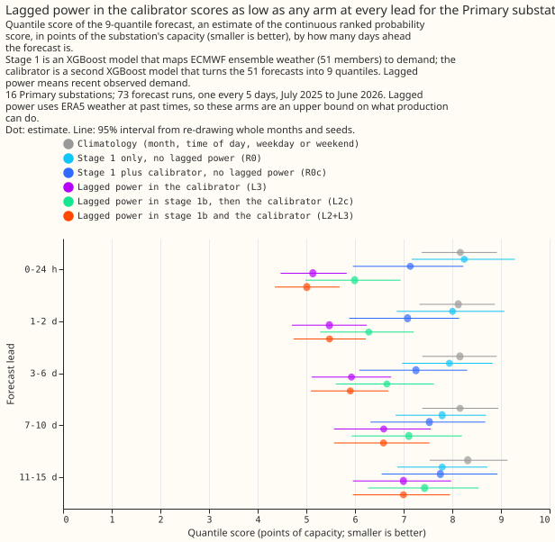
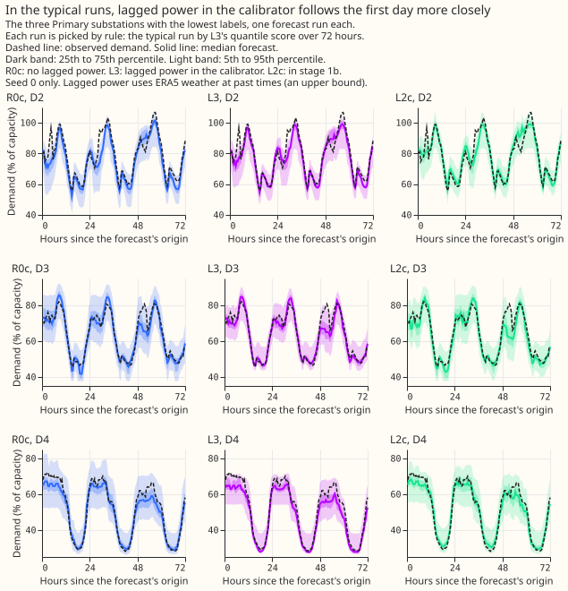
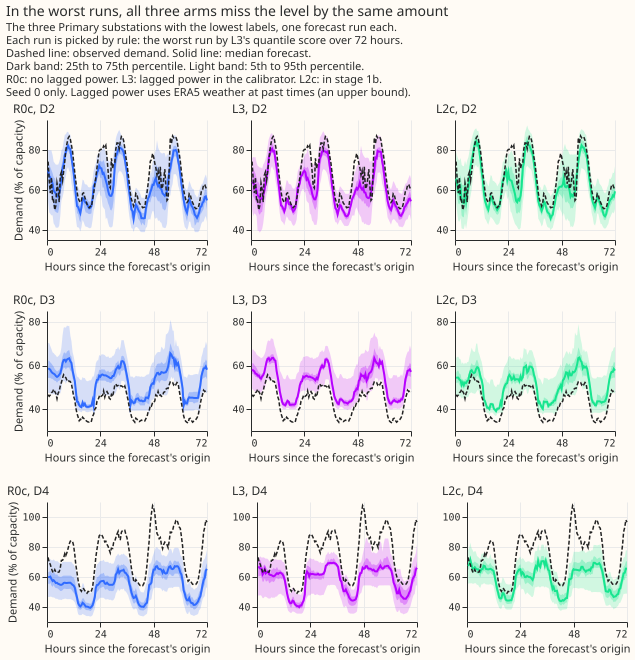

# Where should lagged power enter a two-stage demand forecast?

**Verdict: refuted.** For the 16 Primary substations, lagged power improved the forecast more when
it entered the stage 2 calibrator (L3) than when it entered stage 1b (L2c). The planned primary
contrast, L2c minus L3 for leads up to 48 hours, was +0.84 points of capacity (99% interval +0.28 to
+1.50), and 9 of the 12 validation months favoured L3. Refutation rests on the +0.15 bar and on an
interval wholly above zero, and both hold. The plan below was committed before any fit, and the
results above it were written after the run.

## Results

**Lagged power in the calibrator scored as low as any arm at every lead for the Primary
substations.** Up to 48 hours ahead, the quantile score (twice the mass-weighted pinball loss, an
estimate of the continuous ranked probability score, in points of capacity; smaller is better) was
5.31 for L3 and 5.25 for L2+L3, against 6.14 for L2c, 7.11 for the lag-free calibrated arm R0c, and
8.12 for stage 1a alone (R0). Over all leads the scores were 6.36, 6.34, 6.95, 7.47, and 7.88. The
advantage of L3 over R0c shrinks from 2.0 points in the first 24 hours to 0.8 points at 11 to 15
days, and stays below zero.

**All five planned contrasts were computed for the Primary substations.** Negative means the first
arm is better, and the intervals are at 99%.

- **C1 (primary), L2c minus L3:** +0.84 up to 48 h (+0.28 to +1.50), and +0.59 over all leads (+0.22
  to +1.06). The interval for C1 is above zero in every lead band, but L2c is better in 8 of the 16
  series up to 48 h, so the advantage of L3 is an average over mixed series.
- **C2, L3 minus R0c:** -1.80 up to 48 h (-2.72 to -1.00), negative in 12 of 12 months and 16 of 16
  series.
- **C3, L2c minus R0c:** -0.97 up to 48 h (-1.25 to -0.66), negative in 12 of 12 months and 16 of 16
  series.
- **C4, L2+L3 minus L2c:** -0.90 up to 48 h (-1.55 to -0.32).
- **C5, L2+L3 minus L3:** -0.06 up to 48 h (-0.15 to +0.03), so using both placements adds nothing
  detectable to L3 up to 48 h. In the first 24 hours the difference is -0.12 (-0.22 to -0.02), below
  the 0.15 bar.

**The plan's second prediction also failed.** The plan predicted that C1 would lie within plus and
minus 0.15 from the 3 to 6 d band onward. C1 was +0.73 (+0.28 to +1.25) at 3 to 6 days, +0.52 (+0.18
to +0.91) at 7 to 10 days, and +0.44 (+0.11 to +0.84) at 11 to 15 days, so stage 1b's persistence
does not fade into equality with the calibrator.

**The BSP and GSP results are descriptive, from two series each, and do not decide anything.** Up to
48 h, L3 scored 6.48 for the two bulk supply points and 15.21 for the two grid supply points,
against 6.32 and 15.50 for L2c. C1 was -0.17 (-0.54 to +0.20) for the bulk supply points and +0.29
(-0.42 to +0.82) for the grid supply points, so no difference between the placements was detected
there. The grid supply points' error is dominated by drift: stage 1a alone scored 21.1 over all
leads from the 2023-09 window and 26.4 from the 2019-09 window.

**A lag-free calibrator lowered the quantile score at short leads, and the calendar columns made no
detectable difference to stage 1a or stage 1b.** In the exploratory contrasts (95% intervals,
Primary), the lag-free calibrator lowered stage 1a's score by 1.02 up to 48 h (E4) and stage 1b's by
0.52 (E3). Those two arms are the only ones with an uncalibrated twin, and the intervals of both
gains include zero at some leads, for example E4 at 7 to 10 days. The calibrator raised the median's
mean absolute error up to 48 h, from 9.07 to 9.41 for stage 1a and from 7.57 to 8.17 for stage 1b.
Stage 1a alone scored 8.12 up to 48 h and day-type climatology 8.14, so stage 1a without a
calibrator is no better than climatology on this score. Dropping the calendar columns changed stage
1a's score by +0.07 (-0.23 to +0.34) up to 48 h (E12) and stage 1b's by -0.02 (-0.34 to +0.25)
(E13), and C1 was not repeated without the calendar columns. The 2023-09 training window beat the
2019-09 window for stage 1a by 0.95 (E10), and C1 keeps its sign from the 2019-09 window (+1.11,
E7). The ENS-trained reference R1 scored 7.69 up to 48 h, and L3 beat it by 2.38 (E14).

**In typical runs, the three arms follow the daily shape and differ mainly in the first day's
level.** The examples are seed 0 and the three lowest-labelled Primary substations, with each run
picked by L3's quantile score over 72 hours. In the worst runs, all three arms miss the level by
about the same amount, so recent power does not repair a persistent offset between the
weather-driven forecast and the substation. That rule for the worst run is unfavourable to L3.

## Caveats

- **The lagged arms are a ceiling.** The residuals at lag times use ERA5 weather at the lag time,
  which production does not have in time. L2, L2c, L3, and L2+L3 are an upper bound on what
  production can do.
- **Stage 1a's input columns come from experiment 00006.** The [input-feature
  sweep](https://github.com/openclimatefix/nged-substation-forecast/pull/1202) chose them on its
  selection fold before it scored any 2025-07 data, so this experiment's validation year did not
  influence them. This experiment used `days_to_christmas` as experiment 00006 listed it when the
  fits started. Experiment 00006 later weakened the evidence for that column: its confirmed set is
  the weather block, the clock columns, and `covid_indicator`, and the holiday flags were the most
  consistently supported calendar columns.
- **The 2023-09 start of the primary window was chosen after seeing results.** The start comes from
  experiment 00003 and from the confirmation year of experiment 00006, not from a selection year.
  The 2019-09 window gives the same sign for C1.
- **One column list was used for all 20 series.** Experiment 00006 suggests different lists for the
  BSP and GSP series, so their results may understate what a tuned list gives.
- **The reviews used Sonnet, not Opus, for the code.** The `ml-experiment` skill calls for Opus on
  the code of a complex experiment, and the maintainer asked for Opus only where vital.

## Lessons learned

- **Put recent power in the calibrator first.** For Primary substations, the calibrator with
  recent-origin inputs beat the calibrator plus stage 1b up to 48 h by 0.84 points, and using both
  placements lowered the quantile score by at most 0.12 points.
- **Calibrate stage 1a before judging lags.** At short leads the lag-free calibrator is worth about
  1 point of capacity on the quantile score, so a comparison against uncalibrated stage 1a
  overstates what lags add. It does not improve the median.
- **Check drift before comparing series groups.** The grid supply points' error falls by a fifth
  between the full history and the 2023-09 window, so a mean over series types would mostly measure
  drift.
- **Report the number of series that agree with each mean.** C1 favours L3 on average, and L2c is
  better in half of the series.

## Plan

**Question.** A two-stage forecast has two places to put recent observed power. Stage 1b adds a
learned correction to the weather-only forecast of stage 1a. Stage 2 calibrates the ensemble's
distribution and can take the recent power as inputs. Which placement gives the better
probabilistic forecast, and does using both placements together add anything?

**Series.** The 20 demand series of experiment 00003 whose `substation_type` in the
`TimeSeriesMetadata` table is Primary, BSP (bulk supply point), or GSP (grid supply point): 16
primary substations, 2 bulk supply points, and 2 grid supply points, labelled D1 to D22 as in 00003.
The battery and the biofuel generator of 00003 (D7 and D20, both of substation type EHV Customer)
are dropped, because the maintainer asked for substation series only. The inference is to these 20
series, which the bootstrap treats as fixed. NGED cares most about Primary substations, so the
**16 Primary substations are the headline of every score and contrast**. The 2 BSP and 2 GSP series
are reported separately, as descriptive results from two series each, and no mean over all three
types is a headline. The write-up reports the number of series on which each contrast has the sign
of its mean.

**Row set and folds.** The validation year is the 73 runs of `fold_a_every5d_v1`: European Centre
for Medium-Range Weather Forecasts (ECMWF) ensemble (ENS) runs at 00:00 UTC every fifth day from
2025-07-01 to 2026-06-30, as in 00003. Nothing is scored on or after 2026-07-01. The fitting seeds
are 0, 1, and 2. The XGBoost hyperparameters are those of 00003 (eta 0.05, depth 6, subsample 0.8,
500 rounds, no early stopping), with `colsample_bytree` and `colsample_bynode` both 1.0.

**Information available at forecast time.** A forecast initialised at `T` may use observed power
up to and including `T - 0.5 h`, the newest half-hour observation before `T`. This origin is
`T0`. Both placements use it. The write-up states this assumes no telemetry delay.

**Recent-origin inputs, identical for stage 1b and for the stage 2 calibrator.** For a target time
`t` and a lead `t - T`, the inputs are the stage 1a residual (observed power over effective capacity
minus the stage 1a forecast at the observed ERA5 weather) at `T0`, at `T0 - 1 h`, at `T0 - 3 h`, at
the latest time of day equal to `t`'s that is at or before `T0`, and at the latest time of the week
equal to `t`'s that is at or before `T0`. They also include the four power lags (24, 48, 168, and
336 hours before `t`) and the four lag anomalies (observed power at the lag time minus the stage 1a
forecast at that time), each null where the lag is no longer than the lead. Stage 1b and the
calibrator also receive the lead. Neither receives a calendar column. This gives the two placements
the same information, so a difference between them comes from where the information enters.

**Stage 1a input columns (from experiment 00006).** The 13 columns are: the nine weather
columns `shortwave`, `longwave`, `temperature_2m`, `dew_point_temperature_2m`,
`pressure_surface`, `precipitation`, `wind_speed_10m`, `solar_zenith`, and `solar_azimuth` (the sun
position at the midpoint of the half-hour); the local `hour_local` and `day_of_week_local`;
`covid_indicator` (1 from 2020-03-23 to 2021-07-19, otherwise 0, so 0 throughout validation); and
`days_to_christmas` (signed days to 25 December, clipped to plus and minus 14 days). Experiment
00006 chose this list for Primary substations on its selection year (2024-07 to 2025-06) and
confirmed it once on 2025-07 to 2026-06. It suggests different lists for BSP and GSP; this
experiment uses one list for all 20 series, and reports BSP and GSP separately as descriptive.
ERA5 supplies the weather columns at the series' nearest cell in training, and the ENS member
supplies them in forecasting. Experiment 00006 also found that weighting recent years more
improves its selection-fold error. This experiment keeps equal weights, and treats a
recency-weighted run as an exploratory extra, to be added only if the primary results leave a
question it could answer.

**Caveats on the column list and the window, added while the fits ran.** This experiment used
`days_to_christmas` as experiment 00006 listed it when the fits started. Experiment 00006 later
weakened the evidence for that column: its confirmed set is the weather block, the clock columns,
and `covid_indicator`, because `days_to_christmas` changes sign every late June and its gain is
small and uncertain. The 2023-09 start of the primary window comes from experiment 00003 and from
the confirmation year of experiment 00006 only, so it was chosen after seeing results and is not a
selection-year result. The fits do not change.

**Training windows.** Each ERA5-trained arm uses the training window starting at 2023-09
(primary) or at 2019-09 (exploratory). The 2023-09 start was chosen after seeing 00003, which found
that error falls as the start moves later, and the write-up says so wherever it is used. R0 is also
run from 2024-04. Stage 1a's final fit uses ERA5 valid times before 2025-06-17, 14 days before the
first validation run. Stage 1b's final fit uses targets up to 2025-06-30 23:30. Residuals after
2025-06-16 come from the final stage 1a, which has not seen them.

**Out-of-fold residuals.** Stage 1b and the calibrator are trained on residuals of stage 1a, which
must not be in-sample. Within each arm's training window, the ERA5 history before 2025-07-01 is
split into six time blocks. The residuals of a block come from a stage 1a fitted on the other
blocks, leaving a 15-day purge on each side of the held-out block. Those residuals are out of
sample for their own block but come from a model that has seen later blocks. The page states this.
Residuals at valid times from 2025-07-01 come from the final stage 1a.

**Arms.** All quantiles are 9 levels (0.05, 0.1, 0.25, 0.4, 0.5, 0.6, 0.75, 0.9, and 0.95).

- **R0:** stage 1a alone, lag-free, with the 9 empirical quantiles of the 51 member forecasts.
  Windows 2019-09, 2023-09, and 2024-04.
- **R0c:** stage 1a, then the lag-free stage 2 calibrator.
- **R1 (reference):** one XGBoost model on ENS weather, trained on the control member of every
  daily run from 2024-04-01 to 2025-06-30, with stage 1a's 13 columns and the four power lags
  nulled by lead. Training uses every lead of every run. Quantiles are the 9
  empirical quantiles of the 51 member forecasts. R1 repeats valid times across leads and has
  calendar columns, so it can memorise the calendar position (00001), and it is a reference only.
- **R2 (reference):** climatology by local month, half-hour of the day, and weekday or weekend, with
  the 9 quantiles of the training power pooled over the neighbouring months and half-hours, as the
  `ClimatologyForecaster` of the `baseline_forecasters` package defines its cells. It is trained on
  the window 2019-09 to 2025-06-16, and repeated once per seed.
- **L2:** stage 1a plus the stage 1b correction, uncalibrated. Stage 1b is one XGBoost model per
  series trained on ERA5 history with simulated origins: each target time draws four leads
  uniformly from 0.5 to 351 hours, which gives the training rows the full lead range. The target
  is the residual at the target time, and the inputs are the recent-origin inputs. The forecast is
  stage 1a for each member plus one correction computed once from observed power, then pooled over
  the members. Fading with lead is learned.
- **L2c:** L2's member forecasts, then the lag-free stage 2 calibrator. This is stage 1b with a
  calibrator that sees no lags.
- **L3:** lag-free stage 1a, then the stage 2 calibrator with the recent-origin inputs.
- **L2+L3:** L2's member forecasts, then the stage 2 calibrator with the recent-origin inputs.
- **No-calendar control:** R0 and L2 are repeated without `hour_local`, `day_of_week_local`, and
  `days_to_christmas` (window from 2023-09), to show how much of any gain is the calendar
  position. The sun position and the lockdown indicator stay.

**Stage 2 calibrator.** One multi-quantile XGBoost model per series (`reg:quantileerror` at the 9
levels; depth 4, eta 0.05, 300 rounds, no early stopping, power over effective capacity). Its inputs
are the stage 1 statistics over the 51 members (mean, standard deviation, and the 10th, 50th, and
90th percentiles), the lead, and, for L3 and L2+L3, the recent-origin inputs. It trains on every
third daily ENS run from 2024-04-01 to 2025-06-30, with valid times up to 2025-06-30 23:30 and all
51 members. The stage 1 inputs on these rows come from a quarterly forward chain: for each quarter
from 2024-04, stage 1a and stage 1b are fitted on ERA5 targets that end 15 days before the quarter
starts. No calendar column enters the calibrator. Output quantiles are sorted to remove crossings.

**Planned contrasts** (quantile score over all leads and by lead band, points of capacity; training
window from 2023-09; each read at 99% because five are planned). The five are defined on the 16
Primary substations. The same five are also computed for the BSP series and for the GSP series and
reported separately, with no decision attached and the multiplicity unchanged:

- **C1 (primary):** L2c minus L3. This is placement: both are calibrated and both receive the same
  inputs. The decision rule applies to cases of leads up to 48 hours.
- **C2:** L3 minus R0c (do the recent-origin inputs help at stage 2 at all).
- **C3:** L2c minus R0c (do they help through stage 1b at all).
- **C4:** L2+L3 minus L2c.
- **C5:** L2+L3 minus L3.

Exploratory, and labelled so: the contrasts against uncalibrated arms (L3 minus R0, L2 minus L3,
L2+L3 minus the better of L2 and L3, which take their reference from the validation data), the same
contrasts from the 2019-09 window, the contrasts by series group and by lead band, the equivalence
statement for leads from 3 days, and the mean absolute error of the median. Absolute scores of every
arm are reported by lead band with intervals.

**Verdict mapping.** Supported, refuted, or inconclusive by the decision rule above. A material
difference in the opposite direction (L3 better) is a refutation and is reported as such.

**Calendar guard.** Stage 1a trains on ERA5, which has one row per valid time. Stage 1b and the
calibrator have no calendar columns. The no-calendar control above covers stage 1a. No arm uses
early stopping, so no inner validation split is needed.

**Ceiling label.** Residuals at lag times use ERA5 weather at the lag time, which production does
not have in time. The write-up labels the L2, L2c, L3, and L2+L3 arms a ceiling.

**Reviews.** The plan, the code, and the write-up each get a fresh Sonnet reviewer, because the
maintainer asked for Opus only where vital. The `ml-experiment` skill calls for Opus on the code of
a complex experiment, so this is a deviation, and the pull request says so.

**Size.** Complex. The experiment stores predictions and a published page. It does not touch the
production serving path or any degradation rule. More than one design defensibly tests the
hypothesis. Its new code lives in `ml-experiments/`, which no other package imports.

## Not tested here

Generator series, a second fold, and several weather models.
