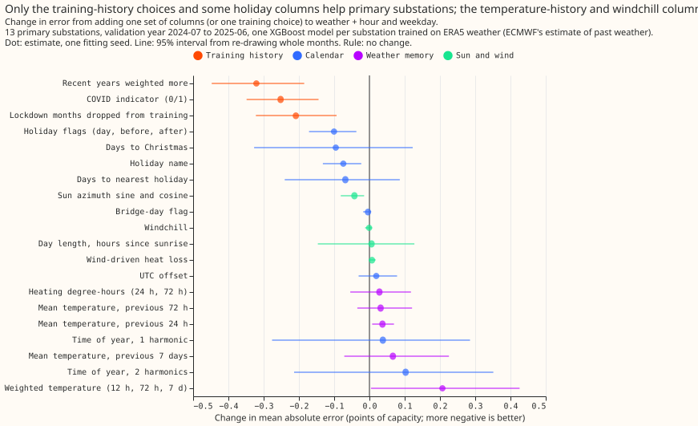
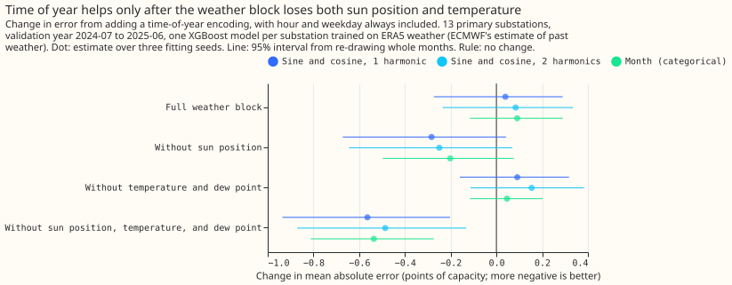
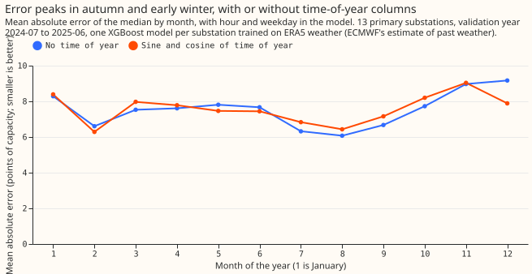
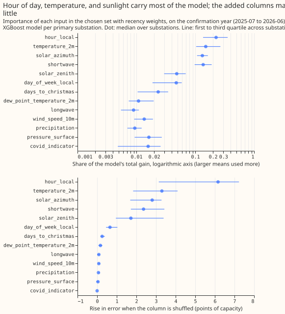

# Which inputs work best for the ERA5-trained demand model (stage 1a)?

**Verdict: supported on the decision rule, with the predicted size wrong.** For the Primary
substations, the clock (hour of day and day of week) is the largest single input against the
weather block alone, and no other single input beats it. The clock lowers the error by 0.55 points
of capacity on the selection year and 0.46 on the confirmation year, a third of the 1.5 points the
hypothesis predicted. Every other non-lag input lowers the error by less than the clock does, and
windchill changes it by less than 0.05 points, as predicted.

**Primary substations are the headline, because NGED cares most about them.** Every score below
is split by substation type, and no mean over all types is quoted as a result, because the two grid
supply points (GSP) have errors about four times those of the Primary substations and would
dominate it. A point is 1% of the series' effective capacity, and every score is the mean absolute
error of the median. The substations are labelled P1 to P16, B1 and B2, and G1 and G2; no
identifier, name, or coordinate appears on this page.

## What to use for each substation type

**The Primary set is the weather block, the clock, a COVID indicator, and the days to Christmas.**
Greedy forward selection on the selection year (2024-07 to 2025-06) was run for each substation
type, starting from the weather block W plus the clock, and stopped when the next addition gained
less than 0.1 points. The sets differ by type, and BSP (bulk supply points) and GSP have only two
series each:

| Substation type | Columns added to W plus the clock, in the order selected | Series |
| --- | --- | --- |
| Primary | COVID indicator, then days to 25 December (-0.25, then -0.14 points) | 13 |
| BSP | holiday flags: the day, the day before, and the day after (-0.16 points) | 2 |
| GSP | COVID indicator, days to the nearest holiday, heating degree-hours (-1.67, -0.24, -0.14 points) | 2 |

**The clock helps Primary substations and BSP but not GSP.** On the confirmation year the clock
changes the error by -0.46 for Primary (99.4% interval -0.61 to -0.30), -0.30 for BSP (-0.41 to
-0.17), and -0.08 for GSP (-0.43 to +0.27, against W).

**The Primary set was frozen before anything was scored on 2025-07 to 2026-06.** The first
selection, over all series, chose the days to the nearest holiday where the Primary-only selection
chose the days to Christmas, and the Primary-only set replaced it before the confirmation year was
scored. The discarded set scores slightly lower on the confirmation year (7.53 against 7.57 for
Primary, and 7.04 against 7.11 with recency weights), a difference inside the noise. The Primary
set's columns are `hour_local`, `day_of_week_local`, `covid_indicator` (1 from 2020-03-23 to
2021-07-19, and 0 in all later data, so it reads 0 at forecast time), and `days_to_christmas` (days
to 25 December, negative after it, clipped to 14 days either way). Only `days_to_christmas` is
outside the set of derived columns the stage 1 pilot already had. Each column is computable at
forecast time from the calendar alone.

**Dropping one group at a time from the Primary set shows the clock and the COVID indicator
matter most.** On the selection year, removing the clock raised the Primary error by 0.59 points
(95% interval +0.49 to +0.69), removing the COVID indicator by 0.30 (+0.20 to +0.40), and removing
the days to Christmas by 0.14 (-0.06 to +0.35), so the Christmas column is the least certain member
of the set (see the Christmas control below).

## Absolute scores on the confirmation year (2025-07 to 2026-06)

**Every Primary arm that adds columns to the weather block scores lower than the weather block
alone.** The table gives the mean absolute error of the median in points of capacity, with 95%
intervals that resample whole months, averaged over three fitting seeds, one XGBoost model per
series. The confirmation year scores 14 Primary, two BSP, and two GSP series. The selection year
scores 13, two, and two, and a series with under a year of history before a fold is left out of
that fold.

| Arm | Primary (14) | BSP (2) | GSP (2) |
| --- | --- | --- | --- |
| Climatology (month, half-hour, weekend) | 8.93 (8.61 to 9.28) | 13.11 (12.02 to 14.27) | 36.62 (33.86 to 39.24) |
| Weather block W | 8.31 (8.00 to 8.61) | 9.90 (9.01 to 10.85) | 30.05 (27.83 to 32.22) |
| W plus clock | 7.85 (7.48 to 8.23) | 9.60 (8.71 to 10.58) | 29.97 (27.83 to 32.02) |
| Primary set (W, clock, COVID, Christmas) | 7.57 (7.29 to 7.85) | 9.41 (8.57 to 10.26) | 26.47 (25.07 to 27.84) |
| Primary set, recent years weighted more | 7.11 (6.84 to 7.39) | 9.04 (8.36 to 9.74) | 23.98 (22.56 to 25.16) |
| Primary set, trained from 2023-09 | 6.71 (6.37 to 7.10) | 8.99 (8.44 to 9.52) | 21.73 (19.35 to 23.87) |
| Primary set, weighted, from 2023-09 | 6.68 (6.36 to 7.05) | 8.98 (8.44 to 9.50) | 21.51 (19.12 to 23.68) |
| BSP set (W, clock, holiday flags) | | 9.53 (8.57 to 10.59) | |
| GSP set (W, clock, COVID, nearest holiday, heating) | | | 27.71 (25.75 to 29.56) |

**The weather block, the weather block plus clock, and the Primary set each beat the climatology
for every substation type.** The paired 95% intervals exclude zero in every case. For Primary the
differences are -0.62 (-0.94 to -0.31) for W, -1.07 (-1.42 to -0.73) for W plus clock, and -1.36
(-1.67 to -1.08) for the Primary set. The other arms score below the climatology too, but without
a paired interval.

## Planned contrasts

**The contrasts P1 to P9 were fixed in the plan below before any fit.** The intervals for the
nine planned contrasts are Bonferroni-widened to 99.4%, and the table labels each interval's
level. All numbers are changes in the mean absolute error for Primary substations, so negative is
better, with three fitting seeds.

| Contrast | Year | Change | Interval | Material? |
| --- | --- | --- | --- | --- |
| P1: clock against W | selection | -0.55 | -0.71 to -0.41 (99.4%) | yes |
| P1: clock against W | confirmation | -0.46 | -0.61 to -0.30 (99.4%) | yes |
| P2: one harmonic of time of year, against W plus clock | selection | +0.04 | -0.40 to +0.37 (99.4%) | no |
| P3: holiday flags, against W plus clock | selection | -0.11 | -0.21 to -0.02 (99.4%) | yes, marginal: 0.106 against the 0.1 floor |
| P4: previous-24-hour mean temperature | selection | +0.04 | -0.01 to +0.08 (99.4%) | no (slightly worse) |
| P5: guarded windchill, against W | selection | +0.003 | -0.011 to +0.016 (99.4%) | no effect |
| P6: COVID indicator | selection | -0.26 | -0.40 to -0.10 (99.4%) | yes |
| P7: recency weights | selection | -0.32 | -0.49 to -0.13 (99.4%) | yes |
| P8: Primary set against W plus clock | selection | -0.40 | -0.73 to -0.10 (99.4%) | yes, but the set was chosen on this year |
| P8: Primary set against W plus clock | confirmation | -0.29 | -0.58 to +0.02 (99.4%); -0.50 to -0.07 (95%) | not at the planned level |
| P9: trained from 2023-09, against the full history | selection | -0.05 | -0.60 to +0.59 (99.4%) | no |
| P9: trained from 2023-09, against the full history | confirmation | -0.86 | -1.19 to -0.48 (99.4%) | yes |

**P8, the step from the clock to the Primary set, is supported at 95% but not at the planned
99.4% level on the confirmation year.** The COVID and Christmas columns together lower the
confirmation-year error by 0.29 points, and the planned-level interval touches zero.

**The 2023-09 start helps on the confirmation year and not on the selection year, for Primary
substations.** On the selection year the start trains on only ten months (2023-09 to 2024-06), and
adding it to the recency-weighted set changes the error by +0.17 (95% interval -0.18 to +0.57). On
the confirmation year it has 22 months and lowers the error by 0.86. For BSP the contrast is -1.48
(-2.75 to -0.30, 99.4%) on the selection year and -0.42 (-1.09 to +0.15) on the confirmation year.
For GSP it is -5.37 (-11.63 to -0.19) and -4.74 (-9.36 to -1.58). The explanation that the
long history carries drift is plausible and was not tested.

**P2, P4, and P5 predicted correctly that these columns do nothing.** P5 stays within 0.01 points
of zero, and P2 and P4 move the error up by 0.04 points. A second selection year (2023-07 to
2024-06, 13 Primary series) gives the same signs at 99.4%: P1 -0.50 (-0.66 to -0.34), P2 +0.07
(-0.44 to +0.47), P3 -0.07 (-0.26 to +0.03), P4 -0.04 (-0.12 to +0.03), P5 -0.005 (-0.021 to
+0.013), P6 -0.11 (-0.27 to +0.06), and P7 -0.42 (-0.61 to -0.24).

**The BSP and GSP selection-year contrasts mostly share the Primary signs, with wider intervals
from two series each.** P1 is -0.37 (-0.59 to -0.16) for BSP and -0.35 (-0.68 to +0.03) for GSP.
P3 is +0.01 for GSP against -0.11 for Primary, and P6 is -0.02 for BSP against -0.26 for Primary,
so the holiday flags and the COVID indicator do not carry across every type. P6 is -1.74 (-2.76 to
-0.69) for GSP.

## Which columns help and which do not

**No single input beats the clock against the weather block alone.** The add-one-in contrasts
against W on the selection year, for Primary substations, are -0.56 for the clock, -0.29 for
recency weights, -0.22 for the COVID indicator, -0.19 for dropping the lockdown months, and -0.11
or smaller for every other column.

**The training-history choices are as large as the best added column.** For Primary substations on
the selection year, against W plus clock, weighting recent years more (half-life 2 years) lowers
the error by 0.32 points, the COVID indicator by 0.25, and dropping the lockdown months from
training by 0.21. The graded lockdown indicator (1 for the national lockdowns, 0.5 for the
restrictions between them, from approximate dates) scores 7.130 against 7.142 for the 0/1
indicator, so grading adds nothing. On the confirmation year, weighting recent years lowers the
Primary error by 0.46 points (95% interval -0.53 to -0.38) more than the unweighted chosen set, and
training from 2023-09 lowers it by 0.86 more than the full history (see the table above for the
selection year). Adding recency weights to a 2023-09 start gains only 0.03 points (6.71 to 6.68),
and adding a 2023-09 start to recency weights gains 0.43 (95% interval -0.61 to -0.24).

**Two holiday columns help a little.** For Primary substations on the selection year, holiday flags
lower the error by 0.10 points (95% interval -0.17 to -0.04) and the holiday name by 0.07 (-0.13
to -0.02). The days to Christmas (-0.10, -0.33 to +0.12) and the days to the nearest holiday
(-0.07, -0.24 to +0.09) have intervals that include zero, so only the holiday flags and the holiday
name are supported. These intervals use one fitting seed and 12 months. The bridge-day flag changes
the error by -0.004 points.

**No weather-derived column helps Primary substations.** The 24-hour, 72-hour, and 7-day trailing
mean temperatures add +0.04, +0.03, and +0.07 points (the 24-hour mean is worse, with 95% interval
+0.01 to +0.07), the weighted temperatures (12 hours, 72 hours, 7 days) +0.21 (0.00 to +0.43),
heating degree-hours +0.03, the day length and hours since sunrise +0.01, the UTC offset +0.02, and
wind-driven heat loss +0.01. The mean of the 3 by 3 block of cells around the nearest cell, in
place of the nearest cell, changes the error by -0.01 points. Sun azimuth as sine and cosine
lowers it by 0.04 points (-0.08 to -0.02), too small to matter.

**Time of year adds nothing in the full weather block.** One harmonic of the day of the year adds
+0.04 points (-0.28 to +0.29), two harmonics +0.10, and the month as a categorical +0.09 against
the weather block plus clock.

**The masking ablation removes the columns that could carry the season, and time of year then
helps.** Time of year lowers the Primary error only when the weather block loses sun position and
temperature together: -0.56 points (95% interval -0.94 to -0.20) with one harmonic, -0.49 with two,
and -0.54 (-0.81 to -0.27) with the month as a categorical. Removing only the sun position gives
-0.28 (-0.67 to +0.04), and removing only the temperature and dew point gives +0.09 (-0.16 to
+0.32). This supports the explanation that the sun and temperature columns carry the season, for
the Primary substations only. A coarser encoding (one harmonic, or month) does no better than a
finer one, so the data give no sign that a fine day-of-year encoding lets the trees memorise
individual weeks of the training years. In the full weather block, the permutation importance of
the sun position and the temperature is large (see below).

**The error is highest in November, December, and January, with or without a time-of-year
column.** Without one, the Primary error on the selection year is lowest in July to September
(about 6.1 to 6.7) and highest in November (8.97), December (9.17), and January (8.29). The
one-harmonic column lowers December by 1.3 points (9.17 to 7.89) and raises July by 0.5 and
October by 0.5, without removing the seasonal shape.

## The Christmas column may also be a half-year flag

**`days_to_christmas` as built also flips sign every late June, so it separates January to June
from July to December.** The signed distance to the nearest 25 December is clipped at 14 days, and
outside the window the clipped value takes the sign of the nearest Christmas. A code reviewer
found this after the confirmation year had been scored, and the control was run on all three
folds. The column keeps its place in the frozen set, and the control is post hoc. Each row is the
change in Primary error against the weather block plus clock plus COVID indicator, with 95%
intervals and three fitting seeds:

| Encoding added | Selection year 2024-07 to 2025-06 | Second selection year 2023-07 to 2024-06 | Confirmation year |
| --- | --- | --- | --- |
| `days_to_christmas` as built | -0.14 (-0.36 to +0.06) | -0.18 (-0.44 to +0.09) | -0.13 (-0.36 to +0.11) |
| Days to Christmas inside a 14-day window, otherwise missing | -0.11 (-0.26 to -0.01) | -0.14 (-0.39 to +0.03) | -0.10 (-0.25 to +0.02) |
| Half-year flag only | -0.04 (-0.19 to +0.12) | -0.10 (-0.35 to +0.14) | -0.03 (-0.21 to +0.15) |
| One harmonic of time of year | -0.06 (-0.33 to +0.18) | +0.01 (-0.36 to +0.36) | -0.15 (-0.42 to +0.14) |
| Holiday flags | -0.10 (-0.17 to -0.04) | -0.06 (-0.17 to +0.02) | -0.07 (-0.14 to -0.02) |

**Most of the gain is from Christmas itself, and the gain is small and uncertain.** The windowed
column keeps three quarters of the gain of the column as built, and the half-year flag alone gains
under 0.1 on every fold. Only the holiday flags have intervals that exclude zero on two of the
three folds. The days to the nearest holiday (clipped at 7 days) has a milder version of the same
half-year step, because England has no bank holiday between late May and late August.

## Windchill changes nothing, so its production code can go

**Neither windchill formula changes the error.** The guarded Environment Canada formula changes
the Primary error by +0.003 points (-0.011 to +0.016, 99.4%) against W. Production's expression,
which has no guard on its valid range, changes it by -0.002 (95% -0.016 to +0.010) against W and
by -0.007 (-0.022 to +0.005) against W plus clock. For GSP the unguarded expression changes the
error by -0.045 (-0.14 to +0.04) against W, a wider interval from two series. The wind-driven heat
loss (wind speed times the shortfall of temperature below 15.5 °C) changes the Primary error by
+0.007 points. The test covers ERA5-trained XGBoost models on 13 to 14 Primary series and two each
of BSP and GSP. [Issue #1199 (Remove the windchill feature from the production feature code)](https://github.com/openclimatefix/nged-substation-forecast/issues/1199)
asks for the production windchill code to be removed.

## Pooled models against one model per series

**One XGBoost model per series scores lower than one XGBoost model per substation type on Primary
substations, by a small and unpaired margin.** A pooled model needs the series identifier as an
input. Without it, the pooled Primary model scores 11.79 on the confirmation year against 7.57 for
the per-series model, both with the Primary set, because the series have different levels of power
over capacity. With a categorical identifier and the same columns plus recency weights, the pooled
model scores 7.34 against 7.11 for the per-series model, and the 95% intervals overlap (7.08 to
7.65 and 6.84 to 7.40). A categorical identifier scores 0.23 points lower than an integer code
for Primary (7.34 against 7.57, with recency weights), and the two are identical for BSP and GSP,
which have two series each. The selection-year comparison points the same way (7.11 pooled
against 6.92 per series). No paired interval was computed, so the margin is not established, and
the feature sets were chosen with per-series models only.

## What the model uses

**Hour of day, temperature, and the sunlight columns carry most of the Primary XGBoost models.**
Across the 14 per-series models of the Primary set with recency weights, on the confirmation year,
shuffling `hour_local` raises the validation error by a median of 6.2 points, `temperature_2m` by
3.3, `solar_azimuth` by 2.8, `shortwave` by 2.4, `solar_zenith` by 1.7, `day_of_week_local` by
0.65, and `days_to_christmas` by 0.25. Gain shares, which favour columns with many distinct values,
put `hour_local` (median share 0.23) first, followed by `temperature_2m` (0.15), `shortwave`
(0.14), and `solar_azimuth` (0.13). `covid_indicator` scores 0.0 on permutation because it reads 0
in every validation month; its value is in quarantining the lockdown months during training. For
the pooled Primary XGBoost model (categorical identifier, recency weights), the series identifier
has the largest permutation importance (7.9, gain share 0.38), followed by `hour_local` (5.1),
`temperature_2m` (3.0), `shortwave` (2.9), `solar_azimuth` (2.3), `solar_zenith` (1.6),
`day_of_week_local` (0.7), and `days_to_christmas` (0.2). Importance is descriptive: the planned
contrasts, not these shares, are the evidence on whether a column helps. No shuffled-column noise
control was run.

## Example predictions

**The chosen set follows the daily and weekly shape of a typical substation, and misses the large
swings of the worst one.** The figure shows a week in July 2025 and a week in January 2026 for the
Primary substation with the median error (P12) and the one with the highest error (P2), on the
confirmation year. For P12 every forecast tracks the morning and evening peaks, the weekend dip,
and the January level, and the 5% to 95% band is narrow. For P2 the observed power repeatedly falls
to 10% to 40% of capacity for hours at a time, which none of the weather, clock, or holiday
columns explains. The cause is not tested here. The three point forecasts stay near 60% to 90%
of capacity, and the quantile band widens to cover the swings only partly.

## Probabilistic scores

**The nine quantile levels (0.05, 0.1, 0.25, 0.4, 0.5, 0.6, 0.75, 0.9, 0.95) give the same ranking
as the median.** On the confirmation year the mean pinball loss over the nine levels, in points of
capacity, falls from 2.80 (W) to 2.68 (W plus clock) to 2.42 (Primary set with recency weights) for
Primary, from 3.34 to 3.27 to 3.11 for BSP, and from 9.50 to 9.48 to 7.76 for GSP. The interval
from the 0.05 to the 0.95 level covers 85%, 84%, and 83% of the Primary observations for the three
arms, and 79%, 78%, and 81% for GSP, against a nominal 90%, so the quantiles are too narrow.
Calibration is the job of stage 2, not of this experiment.

## Failures and limits

- **The predicted size of the clock effect was wrong.** The experiment predicted at least 1.5 points
  from experiment 00003 and measured about 0.5. Experiment 00003 compared ENS-trained and
  ERA5-trained models over 22 series including battery and grid-flow series, so the two are not
  directly comparable.
- **P8 fails at the planned level on the confirmation year.** The COVID and Christmas columns
  together are supported at 95% only.
- **The `best_arm` is a winner's-curse pick.** It is chosen by confirmation-year score, so it is
  post hoc, and the two 2023-09 arms are tied.
- **BSP and GSP rest on two series each**, so their selected sets, and the BSP and GSP intervals,
  are noisy. The bootstrap resamples months and fitting seeds, not series, so these intervals are
  optimistic. The GSP error is dominated by drift, so a GSP set tuned on one year may not carry
  over.
- **The Bonferroni family is nine contrasts per substation type**, which is 27 tests across the
  three types.
- **The sweep used one fitting seed and 12 validation months**; the add-one-in intervals do not
  include seed variation, and 12 months is a short span for the holiday columns, which see one or
  two occurrences of each holiday per year.
- **The series set differs between folds.** Series with under a year of history before a fold's
  purge are left out of that fold: three of the 20 series on the selection year and two on the
  confirmation year, so fold-to-fold means are not directly comparable.
- **The target is power over the series' effective capacity from the whole history**, one constant
  per series. Per-series models are unaffected by a constant, and the pooled models see a mildly
  forward-looking scale.
- **The calendar columns use the period-ending stamp**, so one half-hour per day (00:00) gets the
  next day's weekday, holiday, and Christmas value. This is consistent between training and
  validation, so it adds noise and no leakage.
- **No hyperparameter was tuned per arm.** Every XGBoost model has 500 rounds, a learning rate of
  0.05, depth 6, subsample 0.8, and no column subsampling. The thread count differs between the
  per-series fits (one thread) and the pooled fits.
- **The first greedy run was scored on a partial results folder** (the add-one-in run had not
  finished) and was discarded and rerun on the complete folder.
- **A fit file is skipped if it exists, whatever the arm list.** Selection-year fits were made
  before the final inputs file was rebuilt for the graded and Christmas arms; a rebuild reproduced
  every existing column exactly (checked on all float columns), so the stored fits are current. The
  `candidates` stage of the first selection used the superseded all-series set and is not quoted.
- **The ERA5 weather and the power timestamps share one convention copied from experiment 00003**,
  and the copy reproduces 00003's ERA5 features to 0.0 on every weather column.

## How the numbers were made

The scripts are in `ml-experiments/00006-stage1a-demand-input-feature-sweep/`. `e00006_inputs.py`
builds the feature table, `e00006_sweep.py` runs each stage (add-one-in, greedy, drop-one-out,
masking, the Christmas control, and the finals), `e00006_report.py` writes the tables every number
on this page comes from, and `e00006_charts.py` and `e00006_examples.py` draw the figures. The
tables, predictions, and fits are under the private `data/ml-experiments/` folder. Planned
contrasts, the masking ablation, the graded lockdown arm, and the Christmas control use three
fitting seeds; the add-one-in, greedy, and drop-one-out stages use one.

## Untested ideas

From an Opus consultation, not tested because each needs outside data or hand-collected dates:
an embedded-solar proxy built from the clear-sky irradiance times the embedded PV capacity of each
grid supply point; school-term flags by nation; cooling degree-hours; the temperature change over
24 hours; a snow flag; relative humidity or apparent temperature; days since the last clock change;
sporting and broadcast events; and the substation-type and customer-mix fields. A follow-up could
also test a measured lockdown size (the Oxford stringency index or Google mobility) against the
recency weights, since recency weights beat the 0/1 indicator on Primary here.

## Lessons for later experiments

- **Choose the training window before adding columns.** Recency weights and a COVID indicator
  lower the Primary error by about half as much as the clock on the selection year, and a 2023
  start lowers it more than the clock on the confirmation year.
- **Use per-substation sets, and report each type separately.** The best set differs between
  Primary, BSP, and GSP, and the GSP error would swamp a mean over all types.
- **Add time-of-year columns only to a weather block that cannot already carry the season.**
- **Check that a calendar encoding does not also encode the season.** A signed distance to the
  nearest holiday clipped at a few days is a half-year flag outside the window.
- **Report a Bonferroni-widened interval for each pre-registered contrast.** The P8 contrast reads
  as supported at 95% and not at the planned level.

## Plan

**Question.** This experiment does not forecast. It trains on ERA5 weather and scores on held-out
ERA5 months, predicting the observed power at the same valid time. The question is which non-lag
inputs make the best weather-to-power model. Every input must also be computable at forecast time,
for the next 15 days, from the calendar and from forecast weather. No observed-power lag is used.

**Series.** The 20 series of `TimeSeriesMetadata` whose `substation_type` is in
`SUBSTATION_TYPES`: 16 Primary substations (P1 to P16), 2 bulk supply points (B1, B2), and 2 grid
supply points (G1, G2). Generators, batteries, and the HV and EHV customer series are excluded.
Power is the cleaned power (`scan_cleaned_power`, unflagged rows), divided by the series' effective
capacity from the fold A frames. Labels come from a seeded permutation inside the experiment; no
identifier, name, or coordinate is published.

**Weather.** ERA5 from the 121-cell stage 1 box, at the cell nearest each series, resampled to the
half-hourly period-ending grid with the same convention as experiment 00003 (`ssrd` and `fdir`
clipped at zero; accumulations are totals over the hour ending at the stamp). The script copies
that convention because an experiment may not import another study's folder, and checks its
output against 00003's stored ERA5 features for the same series. One arm replaces the nearest cell
by the mean of the 3 by 3 block of cells around it.

**Weather block W (9 columns):** `shortwave`, `longwave`, `temperature_2m`,
`dew_point_temperature_2m`, `pressure_surface`, `precipitation`, `wind_speed_10m`, `solar_zenith`,
and `solar_azimuth`. Every column is a function of forecast weather and the clock, so it is
available at forecast time.

**Folds.** The experiment feeds the lag experiment 00005, which validates on 2025-07 onwards, so
no choice may be influenced by that year. **Selection fold:** validate on 2024-07-01 to
2025-06-30, train on ERA5 from 2019-09-01 to one week before validation (and, for the recent-start
variants, from 2023-09). A second selection fold validates on 2023-07-01 to 2024-06-30 if time
allows. Every add-one-in, greedy, and drop-one-out decision uses the selection folds only. The
chosen feature set is then frozen and written into this page before anything is scored on
2025-07-01 to 2026-06-30. **Confirmation fold:** the frozen set, the weather block W, and W plus the
clock are scored once on 2025-07-01 to 2026-06-30, training up to one week before it, and reported
as confirmation and not as selection. No valid time on or after 2026-07-01 is scored.

**Models.** Two configurations, each run for every arm.

1. One XGBoost model per series.
2. One XGBoost model per substation type (Primary, BSP, GSP) with the series identifier as an
   input, both as a categorical column and as an integer code. The two encodings are run for W and
   for the best set only.

XGBoost settings are identical in every arm: `eta` 0.05, `max_depth` 6, 500 rounds, `subsample` 0.8,
`colsample_bytree` 1.0, `colsample_bynode` 1.0 (column subsampling would give a wider set a free
win). The first pass uses the absolute-error objective, whose fitted value is the median. The 9
quantile levels (0.05, 0.1, 0.25, 0.4, 0.5, 0.6, 0.75, 0.9, 0.95) are run for the finalists, and
the pinball loss is reported then. The first pass uses one seed; the finalists use three.

**Arms** (each adds the listed columns to W, one at a time, then in groups):

- **Clock:** `hour_local`, `day_of_week_local`.
- **Time of year:** sine and cosine of the local day of the year, with one harmonic and with two.
  The encoding is periodic, so a new year reuses the same values.
- **Holiday, five arms:** the holiday name as a categorical (England and Wales, from the `holidays`
  package); the holiday flag with day-before and day-after flags; the signed days to the nearest
  holiday, clipped at 7; the signed days to 25 December, clipped at 14; a bridge-day flag (a working
  day between a holiday and a weekend). Holidays are known years ahead.
- **Trailing temperature, four arms:** the mean temperature over the previous 24 hours; 72 hours; 7
  days; and exponentially weighted means with half-lives of 12 hours, 72 hours, and 7 days. The
  window ends at the valid time. At forecast time the window straddles analysis and forecast
  weather and would be built from one member's trajectory.
- **Heating degree-hours:** the mean over 24 and 72 hours of the excess of 15.5 °C over the
  temperature.
- **Sun position:** day length and hours since sunrise (local); and the sine and cosine of the
  azimuth. Sun elevation is 90 degrees minus the zenith, a monotone function a tree treats as the
  same column, so it is not tested.
- **UTC offset:** 0 or 1 hour.
- **Windchill:** the Environment Canada formula, equal to the temperature above 10 °C or below 4.8
  km/h, and the product of the wind speed and the shortfall of temperature below 15.5 °C. Both are
  implemented inside the experiment script only.
- **COVID:** a 0/1 indicator for 2020-03-23 to 2021-07-19, reading 0 in every validation month; an
  arm that excludes those training rows; and an arm with recency sample weights (half-life 2 years).
- **Spatial mean:** the 3 by 3 block mean replaces the nearest cell for every weather column.

**Extra inputs from an Opus consultation.** Taken: the exponentially weighted temperatures, the
heating degree-hours, the spatial block mean, the bridge-day flag, and the replacement for
windchill. Not taken, and listed in the write-up as untested: an embedded-solar proxy (needs an
outside capacity series), school terms (dates must be collected by hand), cooling degree-hours,
temperature change over 24 hours, snow, humidity, days since the clock change, sporting events, and
the substation-type fields.

**Planned contrasts** (mean absolute error of the median, points of capacity, one model per series;
the interval resamples whole validation months). P1 to P7 are scored on the selection fold. P8 and
P9 are scored on the confirmation fold, and P8 is the one contrast the frozen set must pass.

- **P1:** W plus clock minus W.
- **P2:** W plus clock plus one harmonic minus W plus clock.
- **P3:** W plus clock plus the holiday flags minus W plus clock.
- **P4:** W plus clock plus the 24-hour trailing mean minus W plus clock.
- **P5:** W plus windchill (the formula) minus W.
- **P6:** W plus clock plus the COVID indicator minus W plus clock.
- **P7:** W plus clock with recency weights minus W plus clock.
- **P8:** the frozen set selected on the selection fold minus W plus clock.
- **P9:** the selected set trained from 2023-09 minus the same set trained from 2019-09.

Every other number is exploratory and labelled so: the add-one-in arms against W and against W plus
clock, the drop-one-out, the pooled configurations, the second selection fold, and the breakdowns by
type, hour, and season. A month-by-half-hour climatology (`ClimatologyForecaster`) is the reference
row. Absolute scores are reported for every arm.

**Not tested here.** Lagged power, forecasting from ENS weather, and downloaded COVID series
(Oxford stringency, Google mobility).

## Changes to the plan

**The plan below is as committed before the first fit, with these changes made afterwards.**

- **Selection and confirmation folds.** Selection used the validation years 2024-07 to 2025-06 and,
  for a replication, 2023-07 to 2024-06; the confirmation year (2025-07 to 2026-06) was scored once
  after the Primary set was written into this page. The plan's original wording scored the main
  fold first.
- **The set was selected on the Primary series.** The first all-series selection was replaced
  before the confirmation year was scored.
- **Added arms:** the BSP and GSP sets, a graded lockdown indicator, a masking ablation of the time
  of year, production's unguarded windchill, and the Christmas-window control.
- **Drop-one-out** ran on the Primary set on the selection year only.
