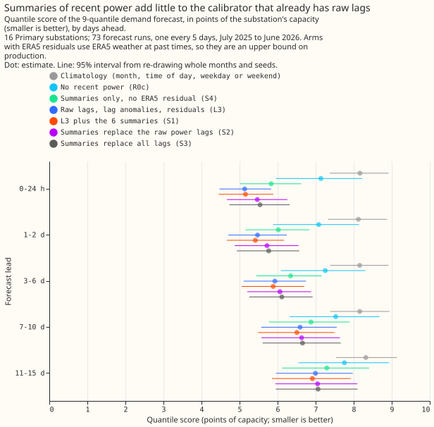

# Do summaries of recent power help the stage 2 calibrator?

**Verdict: inconclusive.** Adding the six summaries to 00005's L3 calibrator changed the quantile
score for leads up to 48 hours by -0.02 points of capacity (98.75% interval -0.14 to +0.13), so the
prediction of at least -0.15 failed and the interval does not exclude zero. The plan below was
committed before any fit, and the results above it were written after the run.

## Results

**Adding the summaries to L3 did not change the score by a resolvable amount.** Up to 48 hours
ahead, the Primary substations' quantile score (twice the mass-weighted pinball loss, an estimate of
the continuous ranked probability score; smaller is better) was 5.31 for L3, 5.29 for S1, 5.59 for
S2, 5.65 for S3, 5.93 for S4, 7.11 for R0c, and 8.14 for day-type climatology. Over all leads the
scores were 6.36, 6.29, 6.46, 6.49, 6.73, 7.47, and 8.21. The refitted L3 matched 00005's L3 exactly
to two decimals (5.31 up to 48 h, 6.36 over all leads), so the pipeline reproduces 00005.

**All four planned contrasts, Primary substations.** Negative means the first arm is better, and the
intervals are at 98.75%.

- **C1 (primary), S1 minus L3:** -0.02 up to 48 h (-0.14 to +0.13), 7 of 12 months and 8 of 16
  series negative. Over all leads -0.06 (-0.18 to +0.06). The gain grows with lead, reaching -0.08
  at 7 to 10 days (-0.22 to +0.02), and no band excludes zero.
- **C2, S2 minus L3:** +0.29 up to 48 h (+0.11 to +0.51), 0 of 12 months negative. Replacing the raw
  power lags with summaries is worse at short leads, and the loss shrinks to +0.04 at 7 to 10 days.
- **C3, S3 minus L3:** +0.35 up to 48 h (+0.15 to +0.58), 0 of 12 months negative.
- **C4, S4 minus R0c:** -1.18 up to 48 h (-1.83 to -0.58), 12 of 12 months and 16 of 16 series
  negative, and -0.74 over all leads (-1.19 to -0.37). Summaries alone, without any ERA5 residual,
  recover about two thirds of the 1.80 points that L3 gains over R0c (exploratory E3).
- **Exploratory, S1 minus S2:** -0.31 up to 48 h (95% interval -0.45 to -0.19), so the raw power lags
  are worth keeping even when the summaries are present.

**The prediction's second clause, a gain within plus and minus 0.15 from 3 to 6 days onward, held
for C1.** C1 was -0.04 (-0.16 to +0.07) at 3 to 6 days, -0.08 (-0.22 to +0.02) at 7 to 10 days, and
-0.08 (-0.23 to +0.09) at 11 to 15 days. That clause could not change the verdict.

**The BSP and GSP results are descriptive, from two series each.** Up to 48 h, C1 was +0.10 (-0.08
to +0.31) for the two bulk supply points and -0.25 (-0.69 to +0.23) for the two grid supply points.
C4 was -0.04 (-0.23 to +0.15) for the bulk supply points and -1.57 (-3.09 to -0.62) for the grid
supply points, where drift dominates the error.

## Caveats

- **C1 to C3 are ceilings.** L3, S1, S2, and S3 use ERA5 weather at lag times in their residual
  columns, which production does not have in time. Only S4 uses recent power alone, and its gain
  over R0c is the deployable result. S4 still uses the stage 1 statistics of 00005's stage 1a, whose
  inputs are ERA5-trained.
- **C2 and C3 change several inputs at once.** Each drops inputs and adds the summaries, so a loss
  cannot be attributed to either change.
- **The residuals are partly in-sample when the calibrator trains.** This is shared with 00005 and
  affects L3, S1, S2, and S3 alike.
- **The same-weekday summary goes stale with lead.** It covers the previous week's day at leads
  under a day and a day about a week old at leads near 6 to 7 days. The 48 half-hours start at
  UTC midnight, so each window holds the previous day's last half-hour stamp and 47 of the target
  day's own half-hours.
- **The reviews used Sonnet.** The plan and the code each had one fresh Sonnet review. The code
  review found no lookahead: it overwrote power and residual with 99 from the origin onward and
  found every input unchanged.

## Lessons learned

- **Keep the raw power lags.** Replacing them with summaries cost 0.29 points up to 48 h.
- **Summaries are a cheap forecast-time substitute for lagged residuals.** Daily minimum, mean, and
  maximum power alone beat no recent power by 1.18 points up to 48 h.
- **An effect of 0.15 points is near this design's resolution.** The C1 interval is 0.27 points
  wide, so a larger fold or more series would be needed to resolve it.

## Plan

**Question.** Experiment 00005 found that recent power helps most when the stage 2 calibrator
receives it (arm L3), as four raw power lags (24, 48, 168, and 336 hours before the target), the
four stage 1a residuals at those lag times (the lag anomalies), and five residuals measured at the
newest observation. Raw lags are single half-hours and are noisy. This experiment asks whether the
minimum, mean, and maximum of a whole day of power are a better summary.

**Series, rows, and folds.** The same as 00005. The headline is the 16 Primary substations. The 2
bulk supply points and 2 grid supply points are reported separately as descriptive results. The
rows are the 73 runs of `fold_a_every5d_v1` (ECMWF ENS runs at 00:00 UTC every fifth day from
2025-07-01 to 2026-06-30), with nothing scored on or after 2026-07-01. The fitting seeds are 0, 1,
and 2. The stage 1a models and the calibrator's training statistics are 00005's, read from its work
folder without refitting, so every arm sees identical stage 1 inputs. Training window from 2023-09.

**The six summaries.** All are computed from observed power over effective capacity, using only
observations up to the newest half-hour before the forecast's initialisation time `T`. Missing
half-hours are ignored, and a window with fewer than 24 observed half-hours gives null. Weekdays
are UTC weekdays.

- **Last 24 hours:** the minimum, mean, and maximum of the 48 half-hours ending at `T - 0.5 h`.
- **Same weekday:** the minimum, mean, and maximum of the 48 half-hours of the most recent UTC
  calendar day that falls on the target's weekday and whose last half-hour is no later than
  `T - 0.5 h`. For a lead of under a day this is the previous week's day; for a longer lead it is
  the latest complete such day.

Neither summary depends on weather, so both are available at forecast time. The five residuals and
the four lag anomalies use ERA5 weather at the lag time, which production does not have in time, so
every arm that keeps them is a ceiling, as 00005's lagged arms were.

**Arms.** All use the calibrator of 00005 (one multi-quantile XGBoost model per series, depth 4, eta
0.05, 300 rounds, the 9 levels, inputs of the 51 members' mean, standard deviation and 10th, 50th,
and 90th percentiles, and the lead). No arm has a calendar column.

- **L3 (base):** 00005's recent-origin inputs. Refitted here, to check that the pipeline reproduces
  00005's scores.
- **S1 (add):** L3 plus the six summaries.
- **S2 (replace power lags):** the five residuals, the four lag anomalies, and the six summaries.
  The four raw power lags are dropped.
- **S3 (summaries replace all lags):** the five residuals and the six summaries. No raw lag and no
  lag anomaly.
- **S4 (power summaries only, no ERA5 residual):** the six summaries and no residual. This is the
  only arm whose recent-power inputs are fully available at forecast time.
- **R0c, R2:** 00005's lag-free calibrator and day-type climatology, as references.

**Planned contrasts** (quantile score, points of capacity, Primary substations, read at 98.75%
because four are planned):

- **C1 (primary):** S1 minus L3.
- **C2:** S2 minus L3 (do summaries beat raw power lags).
- **C3:** S3 minus L3 (do summaries beat all the lag columns).
- **C4:** S4 minus R0c (do summaries help when no ERA5 residual is available).

C1 to C3 are scored over leads up to 48 hours (the decision scope) and by lead band. C2
and C3 are bundle contrasts: each drops inputs and adds the summaries, so a loss cannot be
attributed to either change. The exploratory contrast S1 minus S2 isolates the raw power lags.
Because L3 and S1 keep the ERA5 residuals, C1 to C3 are ceilings, and a supported verdict
reads "supported as a ceiling"; C4 is the contrast that can support a claim about production.
The same four are computed for the BSP and GSP series and reported as descriptive. The second
clause of the prediction (the gain from 3 to 6 d onward) is descriptive and cannot change
the verdict. The 98.75% level is a uniform Bonferroni convention across the four contrasts,
although only C1 decides the verdict. The rule is asymmetric on purpose: a difference between
0 and +0.15 is inconclusive. C1 uses the refitted L3, which runs through the same code as S1.
The refit must reproduce 00005's L3 score up to 48 h within 0.05 points; if it does not, the
write-up says so and the cause is investigated before any result is reported. The same-weekday
summary goes stale as the lead grows (a week old at short leads, about a day old at 6 to 7
d), so results are reported by lead band. Everything else, such as S4 minus L3 and S1 minus
S2, is exploratory, read at 95%, and labelled so. The write-up reports the number of series
(by series sign) and of months that agree with each mean, and the absolute score of every
arm by lead band.

**Calendar guard.** The calibrator has no calendar column, and no arm uses early stopping, so no
inner split is needed.

**Reviews.** A fresh Sonnet reviewer reads the plan, another reads the code for leakage (the
summaries must use only data before `T`, and the same-weekday window must end before `T`), and
another checks the write-up against the printed report.

**Size.** Medium. (1) Storage: new prediction sets under `data/ml-experiments/`, nothing in the
production tables. (2) The production serving path is not touched. (3) No degradation rule is
touched. (4) More than one design could test the hypothesis, such as adding or replacing, and the
arms cover both. (5) The new code is a copy of 00005's calibrator with one added input function; its
callers are all inside this folder. The mutation pass does not apply, because no production logic
changes.

## Not tested here

Summaries of weather, generator series, a second fold, and summaries in stage 1b.
