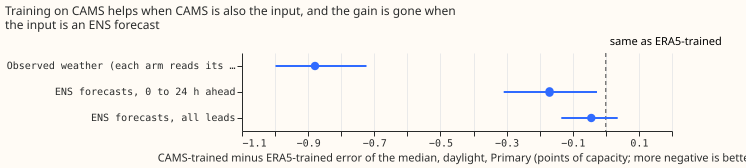
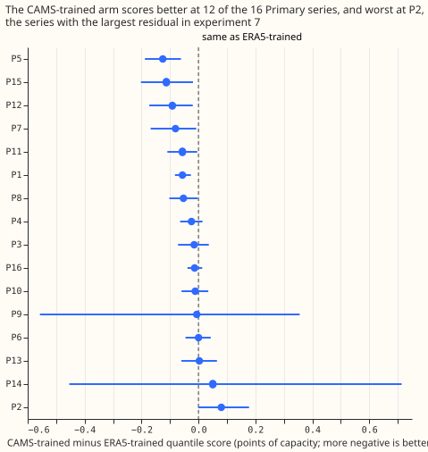

# Does a stage 1a trained on CAMS irradiance beat one trained on ERA5 shortwave, for demand?

**This experiment is the second stage of P2 in the [research plan](../research-plan.md).**
Experiment 00007 found that a fixed correction on CAMS irradiance removes 46.6% of the next year's
daylight squared residual of the ERA5-trained stage 1a (98.33% interval 38.4% to 53.1%), that a
fixed bias alone removes 39.1%, and that one substation sets the pooled figure (18.2% without it).
The result was inconclusive. This experiment trains stage 1a on CAMS at the training times and
scores it on ENS.

## Size

- **What gets stored:** prediction sets and tables under this experiment's private folder. Nothing
  enters a Delta table.
- **Production serving path:** not touched.
- **Degradation rule:** not touched.
- **Designs that would test the hypothesis defensibly:** two. Replacing ERA5 shortwave by CAMS at
  the training times, planned here, is the simpler. Keeping ERA5 for training and quantile-mapping
  the ENS shortwave onto CAMS at application would also be defensible, and was not run here.
- **Callers that need searching for:** none. The scripts copy the patterns of
  `ml-experiments/00005-*` and `ml-experiments/00006-*` and read their inputs.

The experiment is medium: it adds a data source to training and a method not yet run in this
repository, and touches nothing stored for production. It gets a Sonnet review of the plan, one of
the code, and one of the write-up. The earlier `advice` lists were read: this plan follows "Train a
demand stage 1a from 2023-09" (00005), "Use the weather block, hour, weekday, and the COVID
indicator" (00006), "Report a pooled share with and without the substation that has the largest
residual" (00007), and "Compare irradiance read at the substation's own location, such as CAMS, with
ERA5 shortwave" (00006). The plan departs from "Weight recent years more" (00006), so that the
ERA5-trained arm matches 00005's `r0_from2023`. The residuals of experiment 00007 came from a
forecast that used recency weights, so 00007's evidence transfers to this plan only approximately.

## Design

**Two main arms differ in one input, which changes in three ways at once.** Both are one XGBoost
model per series, with 00005's settings (500 rounds, depth 6, learning rate 0.05, squared error,
three seeds), trained on valid times from 2023-09-01 to before 2025-06-17. The columns are 00006's
chosen set, as frozen in 00005: ERA5 shortwave, longwave, temperature, dew point, surface pressure,
precipitation, and 10 m wind speed; solar zenith and azimuth; local hour and weekday; the COVID
indicator; and the days to Christmas. The `era5` arm reads ERA5 shortwave at the series' H3 cell.
The `cams` arm reads CAMS irradiance at the series' own location instead (the download in [PR #1201
(Download and validate CAMS irradiance at the demand series'
locations)](https://github.com/openclimatefix/nged-substation-forecast/pull/1201)). The CAMS column
differs from the ERA5 column in the product (satellite-derived against reanalysis), the location
(the series' own point against the mean of its H3 cell), and the time handling (hourly values held
across two half-hours). At validation, both arms read the ENS member's shortwave. Every other
weather column stays ERA5 in training and ENS in validation. A third arm, `era5-hourly`, is an
exploratory control: ERA5 shortwave averaged over each hour and held across its two half-hours, so
that contrast X1 (`era5-hourly` minus `era5`) shows how much of the difference comes from the time
handling alone.

**CAMS is hourly and the grid is half-hourly.** A CAMS value is the mean over the hour ending at its
stamp. Both half-hours of that hour take the value. Hourly holding differs from the half-hourly
construction of ERA5 shortwave, and the Results section states the difference.

**Each arm gives 9 quantiles from the 51 ENS members.** The stage 1a XGBoost model is applied to
every member and the quantiles are the empirical quantiles of the 51 forecasts, as in 00005's `r0`
arms. There is no calibrator, no stage 1b, and no lagged power, so no weather has to exist at lag
times. CAMS is used in training only and is never needed at forecast time.

**The scored rows are those of 00005.** The rows are the 73 runs of `fold_a_every5d_v1` for the 20
series, restricted to valid times with an observed power and before 2026-07-01. The 16 Primary
series are the headline, and the substation that sets 00007's pooled figure (P2) is one of them. The
2 bulk supply point and 2 grid supply point series are reported separately and decide nothing.
Intervals resample whole validation months and the three seeds. The climatology row is 00005's `r2`.

**Two planned contrasts, both on Primary substations over all leads.** C1 compares the arms
(CAMS-trained minus ERA5-trained). C2 repeats C1 without the substation that sets 00007's pooled
figure. The 0.2-point threshold of the research plan is kept for C1. In 00005, a contrast between
two stage 1a variants on Primary substations over all leads had a 95% interval about 0.2 points
wide on each side (E11: +0.075, -0.060 to +0.265), so 0.2 is the size of the noise and not below it.
C2 uses half that size because removing a substation removes much of the gain 00007 saw. The 97.5%
level is a Bonferroni correction across the two.

**The rule has limited power, and an inconclusive result is likely.** The 95% interval of E11
reached 0.135 below and 0.19 above its estimate, so the 97.5% half-width of C1 will be near 0.2
points. A true gain of exactly 0.2 points would then clear "interval wholly below zero" about half
the time, and refuting a gain of 0.2 needs an estimate near zero or worse. The write-up reports
the interval half-width obtained.

**Exploratory contrasts are read at 95%.** They are: C1 by lead band and for daylight and night
valid times separately (the gain should come in daylight); C1 for the bulk supply points and the
grid supply points; C1 for each Primary series; C1 leaving out each Primary series in turn; and the
quantile score of the ERA5-trained arm against the climatology. A deterministic diagnostic at the
observed weather also compares the two arms at the validation hours, with the ERA5-trained arm
reading ERA5 and the CAMS-trained arm reading CAMS, as in 00007's residuals. The diagnostic shows
what training on CAMS gains when CAMS is also the input, which no forecast can supply. A table of
the mean daylight shortwave of CAMS, ERA5, and the ENS members by month shows the scale mismatch
the CAMS-trained arm meets at validation.

**Leakage and calendar checks.** Both arms train on valid times before 2025-06-17, 14 days before
the first validation run, so no fit sees a validation hour. There is no early stopping. Both arms
carry the same calendar columns, so a contrast between them cannot come from calendar
memorisation.

**Known limits.** CAMS irradiance is estimated from satellite images and ERA5 shortwave comes from a
reanalysis, so the two carry different cloud fields, and the CAMS-trained arm sees ENS shortwave, a
forecast with its own bias and spread, which is the mismatch the experiment tests. Validation is one
year (2025-07 to 2026-06), which is also 00006's confirmation year, so 12 months bound the
interval's resolution. The 20 series and 73 runs are 00005's choice and were not re-selected.

## Results

**The hypothesis is refuted: training stage 1a on CAMS irradiance lowers the Primary quantile score
by 0.035 points, a sixth of the 0.2 points the plan required.** The refutation is of a gain of the
planned size. A small gain is present in daylight and at short range. C1 is -0.035 (97.5% interval
-0.070 to +0.001), so the data exclude a gain of 0.2 points. C2, without the substation that set
00007's pooled figure (P2), is -0.043 (-0.081 to -0.004), so the small gain does not rest on that
substation. In both contrasts the CAMS-trained arm is better in 10 of 12 months, and in 12 of the
series (of 16 for C1, of 15 for C2). The refit of the ERA5-trained arm reproduces experiment 00005's
`r0_from2023` exactly (a mean absolute difference of 0.000 in all 9 quantiles over 2,898,789 rows),
so the benchmark is the same forecast that experiment scored.

| Arm | Primary quantile score | BSP | GSP | Primary error of the median |
| --- | --- | --- | --- | --- |
| ERA5-trained | 7.88 (6.92 to 8.75) | 8.60 | 21.08 | 9.49 |
| CAMS-trained | 7.84 (6.89 to 8.73) | 8.56 | 20.98 | 9.46 |
| ERA5 held hourly (control) | 7.87 (6.92 to 8.75) | 8.62 | 21.06 | 9.47 |
| Climatology (00005's `r2`) | 8.21 (7.45 to 8.97) | 9.43 | 24.41 | 11.30 |

All scores are in points of capacity, over all leads, with 95% month-and-seed intervals for the
Primary quantile score. The absolute intervals are wide because every arm's error rises and falls
together from month to month, which pairing removes from a contrast.

**The gain is small, its interval just reaches zero, and it is concentrated in daylight and in the
first 6 days.** In daylight the contrast is -0.089 (95% interval -0.149 to -0.034), and at night it
is +0.001 (-0.041 to +0.031), which fits a gain that comes from the irradiance input. By lead band
it is -0.072 up to 1 day, -0.080 for 1 to 2 days, -0.063 for 3 to 6 days, -0.021 for 7 to 10 days
(-0.057 to +0.019), and -0.004 for 11 to 15 days. The gain is larger for the 2 grid supply points
(-0.104, -0.211 to -0.006) than for the 2 bulk supply points (-0.044, -0.150 to +0.041), and the 4
series are too few to say more.

**A mismatch at application is a likely reason for the small gain, and this experiment does not test
it.** At the observed weather, with each arm reading its own irradiance, the CAMS-trained arm's
daylight error of the median is 10.46 points against 11.34 (-0.88, 95% interval -1.00 to -0.72).
With ENS forecasts as input the same contrast is -0.17 up to 1 day (-0.31 to -0.03) and -0.04 over
all leads (-0.13 to +0.04). The mean daylight shortwave of the 16 Primary series is 261 W/m² for
both CAMS and ERA5 in the training period and 263 and 262 in the validation year, against 281 for
the ENS members (7% higher). Neither arm saw that bias in training. The bias varies by month, and
the ENS forecast's own cloud errors would also dilute a gain, so the shortwave comparison is a
candidate cause only. A bias-corrected ENS shortwave would test it.

**Hourly holding of the irradiance cannot be separated from the difference at this resolution.**
Holding ERA5 shortwave hourly changes the score by -0.012 (X1, -0.064 to +0.030). The CAMS-trained
arm against the hourly-held ERA5 arm is -0.022 (X2, -0.075 to +0.038), so the remaining difference
of the bundle cannot be split between product and location at this resolution.

**Failures and limits.** Series P2 scores worse with CAMS (+0.080, -0.001 to +0.178); the series P5,
P15, and P12 gain the most (-0.125, -0.113, and -0.092). Series P9 and P14 have only 8 and 10 months
of data, so their intervals are very wide. The plan guessed that the interval half-width of C1 would
be near 0.2 points, and it came out at 0.035, so the 0.2-point threshold was far above the
resolution of the data and a smaller gain could have been resolved. Intervals resample the
initialisation months of the runs, which equal validation months except for runs near a month's end.
Validation is one year (2025-07 to 2026-06), the confirmation year of experiment 00006. The
experiment does not test quantile-mapping the ENS shortwave onto CAMS, which the shortwave
comparison suggests.

Scripts: `ml-experiments/00009-cams-trained-stage1a-vs-era5-trained-demand/` (`e00009_fit.py`,
`e00009_score.py`, `e00009_charts.py`).
