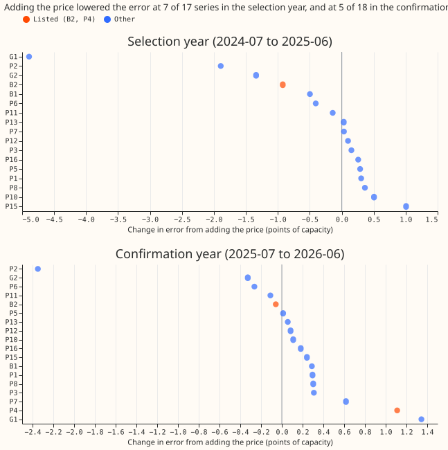

# Does the lagged electricity price help the demand model at substations with batteries?

**Verdict: inconclusive.** Adding the Elexon price from 7 days earlier did not lower the error of
the stage 1a demand model at the substation hosting the largest battery (B2) with an interval that
excludes zero, and the gain seen in the selection year disappeared in the confirmation year. The
pre-registered mechanism test (C4) failed in the selection year and pointed the wrong way in the
confirmation year, so the experiment cannot support a price response by batteries.

**Absolute scores** (mean absolute error of the median, points of capacity, 3 seeds; 95% intervals
are in the results tables):

| Scope and year | BASE | PRICE | CONTROL | SHUFFLED |
| --- | --- | --- | --- | --- |
| B2, selection | 10.98 | 10.05 | 10.91 | 10.21 |
| Other series (16), selection | 9.79 | 9.40 | 9.78 | 9.47 |
| Primary, selection | 6.97 | 7.01 | 7.03 | 7.04 |
| B2, confirmation | 10.12 | 10.06 | 9.89 | 10.09 |
| P4, confirmation | 4.22 | 5.33 | 4.16 | 4.42 |
| Other series (16), confirmation | 9.35 | 9.41 | 9.13 | 9.29 |
| Primary, confirmation | 7.11 | 7.15 | 6.92 | 7.04 |

## What the contrasts say

- **C1, price against base, B2:** -0.92 (-2.10 to +0.07) in the selection year, so not material
  (the interval includes zero). In the confirmation year -0.06 (-0.38 to +0.23).
- **C2, price against demand and wind, B2:** -0.86 (-2.10 to +0.21) in the selection year, so not
  material, and +0.18 (-0.08 to +0.41) in the confirmation year.
- **C3, price against shuffled price, B2:** -0.16 (-0.53 to +0.17). The shuffled price gives about
  five sixths of the gain, so most of the selection-year gain does not depend on the price's value
  at the right time.
- **C4, gain at the listed series minus gain at the others:** -0.55 (-1.43 to +0.20) in the
  selection year, and +0.47 (+0.06 to +0.91) in the confirmation year, where the listed series got
  worse by more than the others.
- **The gain was concentrated at the series with the largest errors, not at the listed series.** In
  the selection year the largest gains were at G1 (-4.89), P2 (-1.89), and G2 (-1.34). In the
  confirmation year G1 got worse by +1.34 while P2 still gained -2.35.

## Failures and deviations

- **P4 could not be fitted in the selection year,** because it has only 14,615 half-hours of
  training data before the purge, under the 17,520 the fit requires. The listed group in the
  selection year is B2 alone. P4 was fitted in the confirmation year, and the price made it worse
  by +1.11 (+0.23 to +2.85). Two further series have too little history in both years, so 17
  series were fitted in the selection year and 18 in the confirmation year, not 20.
- **No month-by-half-hour climatology row was scored,** which the `ml-experiment` skill asks for.
- **The refuted branch of the decision rule was unreachable,** as the power check predicted.
- **No Opus review was run;** a Sonnet review of the plan and one of the code ran, as the
  manager's brief asked. The code review found that the shuffled arm read prices from later weeks;
  that was fixed before any fit.

## Lessons

**The selection-year gain at B2 came mostly from a calendar-structure effect, not the price
signal.** Price columns taken from a week earlier gave most of the gain. The experiment did not
test why, so the gain may come from the price level, the weekly rhythm, or the extra columns alone. The advice list
in the front matter carries the actions.

## Why the price, and why only a lag

**Future prices are hard to predict, so the inputs are prices already published.** A battery that
charges when the price is low and discharges when it is high moves a substation's demand by an
amount the weather and the clock do not explain. The model sees this only if it is given the price.
The price at the same half-hour 7 days earlier is published well before any forecast issue time,
so it exists at forecast time for every lead up to 7 days.

## Price source (step 1, done)

**The price is the `APXMIDP` provider's price in Elexon's Market Index Data.** The data pull is in
`data/ml-experiments/00010-elexon-price-lags-stage1a-demand/prices/` and its `README.md` is the
lineage note. Findings, all from `e00010_fetch_prices.py`:

- **Cost and licence:** the Elexon Insights API needs no key and no payment. The script accepts no
  licence in anyone's name.
- **Coverage:** 134,357 of 136,416 half-hours (98.5%) from 2019-01-01 to 2026-10-12. 36 whole days
  are empty, all between 2019-01-09 and 2021-04-28. 54 more days are partial, 45 of them before
  2021-06. From 2024-04-14 the series is complete.
- **Product mix:** the other provider, `N2EXMIDP`, reports volume 0 in all but 385 of its 134,249
  rows, so only `APXMIDP` is usable. The API does not say which products feed the `APXMIDP` index.
  The plan therefore calls it the EPEX short-term half-hourly index, as `studies/market_downloads`
  does, and does not claim it is the day-ahead price.
- **Zero volume:** 175 `APXMIDP` rows report volume 0 (64 in 2019, 50 in 2021, 18 in 2022, 15 in
  2023, 11 in 2025, 12 in 2026, 5 in 2020). The experiment sets the price on those rows to missing.
- **Values:** -102.92 to 1,983.66 GBP per MWh, the maximum on 2021-09-09. No nulls, and the longest
  run of an unchanged price is 30 half-hours.

**The CONTROL columns need a second pull.** The demand outturn and fuel-mix downloads already in
`data/studies/downloads/market/` cover only 2025-09 to 2026-09, so the same free Insights API
pull is repeated for 2019 to 2026 before any fit, with the same validation.

**Training years with missing prices are not dropped.** XGBoost handles a missing value natively.
`price_lag7d` is missing when its half-hour is missing or has zero volume. The minimum and maximum
are missing when fewer than 40 of the 48 half-hours are available. About 23 half-hours in the
validation and confirmation years have a zero-volume price, so a few rows there carry missing
price columns; the report counts them. No lead beyond 7 days is scored.

## Design

**The base is experiment 00006's Primary input set**: the weather block (ERA5, read at the series'
nearest grid cell), hour and weekday, the COVID indicator, and the days to Christmas inside a 14-day
window, trained with recency weights (half-life 2 years). Folds, XGBoost settings (no column
subsampling), seeds, and the 7-day purge are those of 00006.

| Arm | Adds to BASE |
| --- | --- |
| BASE | nothing |
| PRICE | `price_lag7d` (price at the same half-hour 7 days earlier), `price_min_lag7d` and `price_max_lag7d` (the minimum and maximum over the 48 half-hours ending at the valid time minus 7 days, so nothing post-dates the valid time minus 7 days) |
| CONTROL | three columns with no price in them, matching PRICE's count: GB national demand outturn (Elexon `INDO`) at the same half-hour 7 days earlier, wind generation (Elexon `FUELHH`) at the same half-hour 7 days earlier, and the range of demand minus wind over the 48 half-hours ending 7 days earlier |
| SHUFFLED | the three PRICE columns, all taken from one other week of the same weekday and half-hour, drawn with a fixed seed from 1 to 4 weeks further back than the true lag (a negative control) |

**Weather and timing caveat.** The weather block is ERA5 read at the valid time, as in 00006, so
every score is a ceiling for the same reason 00005's was: ERA5 arrives about 5 days late. The
columns this experiment adds are available at forecast time because
they are at least 7 days old.

**Calendar memorisation control.** Hour and weekday are in BASE (as in 00006), so the price
columns can stand in for the calendar. SHUFFLED keeps the calendar structure and removes the
price's information, and it is the control for that.

## Planned contrasts

All are differences in mean absolute error of the median, in points of capacity, over the
selection year (2024-07 to 2025-06) and then, once, the confirmation year (2025-07 to 2026-06),
with a month-resampled interval at the 98.3% level that the decision rule sets.

- **C1:** PRICE − BASE.
- **C2:** PRICE − CONTROL (what the price adds beyond national demand and wind).
- **C3:** PRICE − SHUFFLED (what the price adds beyond the calendar structure of the price columns).
- **C4:** the gain PRICE − BASE at the two listed series minus the gain at the other 18, with the
  months resampled (a verdict contrast, as the decision rule says).

## The listed substations, chosen before any fit

**The list comes from NGED's Embedded Capacity Register (August 2026 release), which is
independent of the outcome.** A series is listed if the register's connected storage rows under
the series' name sum to a maximum export capacity of at least 5% of the series' effective capacity.
The 5% threshold is a round number chosen before the sums were run; P4 passed it by 0.1 points,
which is why the plan reports it only beside B2. The register has no commissioning dates, so a
listed battery may have been absent for part of the training years or of the selection year, and
batteries also earn from balancing and frequency response, not only the index price. A gain at B2
is therefore weak evidence of a battery response. The register names the primary, bulk supply point,
and grid supply point
each row connects to. The
result for the 20 series 00006 scored:

- **Listed: B2, a bulk supply point,** with 9.5 MW of connected storage against 47.6 MW of effective
  capacity (20%).
- **Listed: P4, a primary,** with 0.37 MW of connected storage against 7.1 MW (5.1%, just over the
  threshold).
- **Not listed:** the two grid supply points (10.5 MW of connected storage against 384 MW, and 7.4
  against 171 MW, under 5%), the other bulk supply point (0.75 against 55 MW), and the other 15
  primaries (at most 0.19 MW each, against 3 to 18 MW).

**The listed group has two members, one of them with a 0.37 MW battery, so the mechanism cannot be
tested well with this series set.** C4 compares two listed series with the rest. The verdict
therefore needs C4, and the register in the embedded-battery and unmetered-battery studies adds no
further series: the unmetered-battery study's screen found no battery at any of its eight primaries,
including the two the register lists with connected storage, so no other series can be named from
data independent of the outcome. P4's battery is 0.37 MW. The advice for a later experiment is to
repeat the test on a
series set with more battery sites. No series is added after seeing results.

## Power check, run before any fit

**B2's 98.3% interval will be about 0.3 to 0.4 points wide on each side, so the refuted branch
cannot be reached.** The check resampled the 12 validation months of one seed of two close arms from
experiment 00006's stored fits at B2 (the clock-only arm against the clock, COVID indicator, and
days-to-Christmas arm), a difference of typical size. The half-width was 0.40 points, and 0.30 for
a larger difference. The decision rule's rule therefore applies: the refuted branch is dropped, and
the verdict is `supported` or `inconclusive`. A gain at B2 needs to be about 0.4 points or more to
be material.

## Resources and sizing

**Sizing, one line per `plan-issue` trigger.** Stores: only private predictions and a price
parquet, no production table. Serving path: not touched. Degradation rule: not touched, but a
production port would need one (price missing means the columns go missing, which XGBoost handles).
More than one defensible design: yes (which price, which lags), so the plan fixes them here.
Code whose callers could not be named without searching: no. This is medium.

**Slot C:** 8 cores, GPU share of 8 GB, one fit at a time. The fits are the 00006 per-series fits
for four arms on two folds. Reviews: Sonnet reviews the plan, the code, and the write-up.

**Earlier advice.** Follows the experiment 00006 advice to use its Primary set and recency weights.
Departs from none of it.
