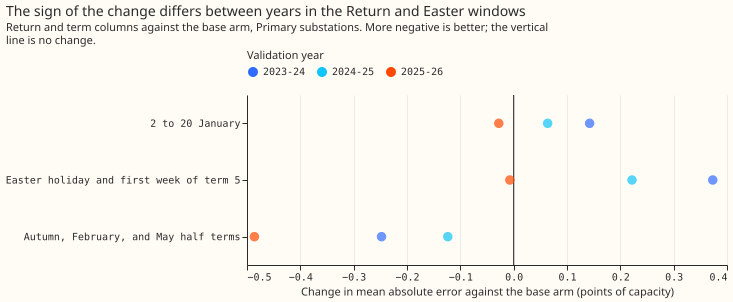
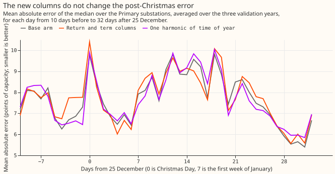

# Do school-term and return-to-work columns lower the stage 1a demand error after Christmas, at Easter, and in school holidays?

**Verdict: refuted, by the decision rule as pre-registered.** For the Primary substations, the
return-to-work and school-term columns did not lower the error in the weeks after Christmas or at
Easter. The half-term change of -0.29 points has an interval that includes zero.

**The refutation clause of the rule is looser than intended, and the intended reading gives
"inconclusive".** The clause required the upper bounds of C1, C2, and C3 to exceed -0.25, -0.15, and
-0.15, which every interval that includes zero satisfies, and so does an interval such as -1.4 to
+0.2. Ruling out a gain of half the predicted size needs the lower bound above those values.
Read that way, the data rule out a gain of 0.25 points in the January window (lower bound -0.17).
They do not rule out a gain of 0.15 points at Easter (lower bound -0.19) or over the half terms
(-0.68), so the intended reading is inconclusive for those two windows. The verdict field keeps the
rule as written.

**All 20 series lie in a box that is essentially Lincolnshire, so the term calendar is Lincolnshire
County Council's recommended calendar.** Primary substations are the headline, with 13, 13, and 14
series in the three validation years. Every score is the mean absolute error of the median, in
points of capacity.

## Planned contrasts

**None of C1 to C3 is a gain, and C5 and C6 fail.** The whole-year point estimate of -0.02 is inside
the predicted 0.1, but its interval is not. The table gives the change for the return and term
columns together (Both) against the base arm, for Primary substations, with each year's change.
The level is 99.2%, and each interval resamples 7-day blocks of days after averaging the three
fitting seeds. The intervals understate the uncertainty, because neighbouring days share weather
and each window has three occurrences.

| Contrast | Change | Interval | 2023-24 | 2024-25 | 2025-26 | Base error | Result |
| --- | --- | --- | --- | --- | --- | --- | --- |
| C1: 2 to 20 January | +0.06 | -0.17 to +0.30 | +0.14 | +0.06 | -0.03 | 8.44 | Not a gain |
| C2: Easter | +0.20 | -0.19 to +0.59 | +0.37 | +0.22 | -0.01 | 7.17 | Not a gain |
| C3: half-term holidays | -0.29 | -0.68 to +0.07 | -0.25 | -0.12 | -0.49 | 7.73 | Not a gain (interval includes zero) |
| C4: summer holiday (descriptive) | -0.02 | -0.25 to +0.21 | -0.40 | +0.09 | +0.24 | 6.51 | No harm detected for Primary |
| C5: whole year | -0.02 | -0.11 to +0.07 | | | | 7.18 | Does not hold (lower bound -0.11 is outside -0.1) |
| C6: against Placebo A, three windows | -0.03 | -0.25 to +0.19 | +0.11 | -0.05 | -0.13 | 7.73 | Fails |
| C6: against Placebo B, three windows | -0.04 | -0.19 to +0.11 | +0.12 | -0.05 | -0.18 | 7.74 | Fails |

**Both is not 0.2 points better than either shifted calendar, so C6 fails.** The shifted calendars
score the same as the base arm (Placebo A +0.00, -0.13 to +0.12, and Placebo B +0.01, -0.18 to
+0.20, pooled over the three windows), so for Primary substations the extra columns show no
detectable effect.

## Which columns, and what else was measured

**The return column shows no detectable effect in January, and the term columns' half-term effect
cannot be separated from a smooth seasonal curve.** The table gives descriptive contrasts against
the base arm for Primary substations, and none was part of the decision. The return column is
missing outside its window, so its zero effect at Easter and in half terms holds by construction.

| Arm | 2 to 20 January | Easter | Half-term holidays |
| --- | --- | --- | --- |
| Return column only | +0.02 (-0.20 to +0.23) | +0.01 (-0.00 to +0.02) | -0.00 (-0.03 to +0.04) |
| Term columns only | +0.04 (-0.25 to +0.25) | +0.20 (-0.18 to +0.56) | -0.28 (-0.66 to +0.06) |
| One harmonic of time of year | -0.05 (-0.32 to +0.15) | +0.16 (-0.28 to +0.51) | -0.46 (-1.02 to +0.05) |

**Primary error is higher in the weeks after Christmas than just before, and the arms differ only
in single days.** The lines are means of three days. The base arm's error is 6 to 8 points before
Christmas and 7 to 10 from 8 to 26 days after it, averaging 8.4 from 2 to 20 January. Over the
Christmas weeks (15 December to 7 January), Both is +0.12 points against the base arm (-0.21 to
+0.61), and +0.64 in 2023-24, above the 0.1 tolerance the plan set. On the four days before
Christmas Day, Both is 0.5 to 1.1 points worse than the base arm. The one harmonic of time of year
tracks the base arm more closely.

**The arm with the full history and the COVID indicator scored higher on the whole year than the
base arm.** The Reference arm (the base columns plus the COVID indicator, trained from 2019-09-01)
scores 7.44 for Primary substations against 7.18 for the base arm: +0.26 (99.2% interval +0.12 to
+0.43). The two arms differ in the start date and in the COVID indicator, so the gap cannot be
assigned to either alone. For GSP the Reference arm scores lower (-0.48, -1.05 to +0.05), and for
BSP higher (+0.17, 0.02 to 0.33). Over the three windows pooled, Both scores -0.21 (-0.50 to +0.04)
against the Reference arm. Experiment 6 found a lower Primary error for a 2023-09 start on its
confirmation year (-0.86) and no change on its selection year (-0.05). The arm was planned as a
descriptive reference, so it does not belong to the decision.

| Arm | Primary | BSP | GSP |
| --- | --- | --- | --- |
| Climatology (month, half-hour, weekend) | 8.55 | 12.48 | 35.79 |
| Reference (full history, COVID indicator) | 7.44 | 9.06 | 27.82 |
| Base | 7.18 | 8.89 | 28.30 |
| Return column | 7.18 | 8.91 | 28.37 |
| Term columns | 7.16 | 9.11 | 28.96 |
| Return and term columns | 7.15 | 9.11 | 28.94 |
| Placebo A (calendar from 17 days earlier) | 7.22 | 9.12 | 28.87 |
| Placebo B (calendar from 17 days later) | 7.16 | 8.97 | 28.75 |
| One harmonic of time of year | 7.19 | 8.96 | 28.99 |

**The columns do not help BSP and GSP either, and a shifted calendar raises the GSP error.** The
table gives whole-year error over the three validation years. In the 2 to 20 January window, Both
is +0.35 (-0.50 to +1.48) for BSP and +1.30 (-0.99 to +3.84) for GSP. In the summer holiday, Both
raises the BSP error by 1.31 (+0.47 to +2.80), so the Primary result for C4 does not carry to BSP.
Placebo A raises the GSP error over the three windows by 1.29 (+0.19 to +2.43), from two series. The
BSP group has one or two series per year and the GSP group two, so none of their intervals is
decisive.

## Limits

- **Few occurrences per window.** The January, Easter, and summer windows have one occurrence per
  year, and the half-term window has three short holidays per year. A real effect of 0.3 points
  needs an interval narrower than the 0.5 to 0.8 points these windows give.
- **Midnight half-hours.** `hour_local` and `day_of_week_local` describe the day that starts at
  `valid_time`, and the term and return columns describe the day the period ends in. The two differ
  only for the half-hour ending at 00:00.
- **Series set.** A series needs a year of observed half-hours after 2021-09-01, so the three
  validation years score 13, 13, and 14 Primary series, and a Primary series that experiment 6
  scored can be absent.
- **ERA5 weather.** The stage 1a XGBoost model is fitted and scored on ERA5, so a gain here need not
  carry over to forecast weather. The term and return columns are known in advance.
- **Post hoc work.** The intended reading of the refutation clause is post hoc. Every number above
  is from the pre-registered arms and windows, and `e00011_report.py` prints each of them.

## Lessons for later experiments

- **The return and term columns show no detectable gain on top of the Christmas column.** The
  2 to 20 January error averages 8.4 points for the base arm, and Both differs from it by +0.06.
- **A half-term effect needs more occurrences to test.** The Easter and half-term windows gave
  intervals about 0.8 points wide.
- **A shorter training history, or the COVID indicator, deserves its own test.** The arm with the
  full history and the COVID indicator scored 0.26 points higher on the whole year.

## Pre-registered plan

**This part of the page is the plan as committed before any fit.** It fixes the arms, the windows,
and the contrasts. It continues experiment 00006, which found that a windowed days-to-Christmas
column lowers the Primary error by 1.8 points from 15 December to 7 January, and which left Easter
and the school holidays without a column.

### Size

**The size is complex, because the experiment adds data and admits more than one defensible
design.**

- **What gets stored:** one new committed file of hand-collected term dates, and private
  predictions. No schema in `packages/contracts/` changes.
- **Production serving path:** not touched. The columns are candidates for a later model release.
- **Degradation rule:** not touched.
- **More than one defensible design:** yes. The window lengths, the encoding of a term boundary
  (a flag, signed day counts, or both), and the control all admit alternatives. This page fixes one.
- **Code whose callers cannot be named without searching:** no. The fitting code is a copy of
  experiment 00006's, with new column groups.

### Which earlier advice this plan follows

- **Followed:** window the day counts and leave them missing elsewhere (00006, Christmas control);
  score a new calendar column on special-day windows as well as the whole year; add a control before
  crediting a signed or cyclic calendar column; split every score by substation type, and make
  Primary the headline.
- **Departed from:** 00006's recommended set includes the COVID indicator and the full history. This
  experiment trains every arm from 2021-09-01, because school-term dates before the 2021-22
  academic year are not collected. The indicator is then constant at zero and is dropped. One
  reference arm keeps the full history, to show what the shorter history costs.

### Data: Lincolnshire County Council's term dates

**All 20 series lie in a box that is essentially Lincolnshire, so one calendar covers them.** The
`latitude` and `longitude` columns of the metadata place every Primary, BSP, and GSP series between
52.7 and 53.3 degrees north and -0.2 and 0.33 degrees east, in the East Midlands licence area. The
box edge near 52.7 degrees north and 0.2 degrees east lies close to Norfolk, and no series was
checked against the local authority boundary. The planned split "by nation and by local authority"
therefore has one nation (England) and one local authority. The calendar is Lincolnshire County
Council's recommended calendar, which binds community and voluntary-controlled schools. Academies
and voluntary-aided schools set their own dates, often within a day or two of it. The columns are
therefore a proxy for the calendar of the schools near a substation, not a count of pupils in
school.

**The dates are in the CSV file `lincolnshire_term_dates.csv` in the experiment's code folder, with
sources and licence in the README beside it.** The first and last day of 30 terms (2021-22 to
2025-26) were read by hand from the council's web pages and two school calendars. The 2024-25 year,
which is the validation year of the second fold, rests on one school's copy of the council's
calendar, confirmed against the amendment the council's page states. `e00011_term_dates.py`
validates the file. The checks cover six terms per year, order and overlap, a weekday start, term
length, holiday length, Christmas and Easter inside a holiday, and the 2025-26 dates against two
other calendars. All 30 terms pass. Only 2025-26 has a second source to check against.

**The 2024-25 calendar was amended after its first publication.** An older copy gives term 5
starting on 22 April and term 6 on 3 June 2025. The file holds the amended dates, and a forecast
made before the amendment would have seen the older ones. The difference is one day at each of two
boundaries, so it is noted and not modelled.

### Columns

**Every column is computed from the local date alone and is known months ahead.** The council
publishes the current and the next school year, so each column exists at forecast time. The
experiment uses no lagged weather or power.

| Column | Definition |
| --- | --- |
| `school_term_flag` | 1 from a term's first to last day (weekends inside a term included), else 0 |
| `days_from_term_start_w` | Signed days to the nearest term's first day, kept within 13 days either way, else missing |
| `days_from_term_end_w` | The same for a term's last day |
| `days_from_return_w` | Signed days from the first working day of the year (the first weekday that is not a bank holiday in England), kept from 7 days before to 14 days after, else missing |
| `placebo_a_*` | The same four columns read from the real calendar 17 days earlier |
| `placebo_b_*` | The same four columns read from the real calendar 17 days later |

### Arms

**All arms train from 2021-09-01 except the reference arm, use three fitting seeds, and use
`reg:absoluteerror` with the settings of experiment 00006.** Folds are the three validation years of
experiment 00006 (2023-07 to 2024-06, 2024-07 to 2025-06, and 2025-07 to 2026-06), each trained to a
week before it starts.

| Arm | Columns |
| --- | --- |
| Base | W, hour, weekday, `days_to_christmas_window` |
| Return | Base plus `days_from_return_w` |
| Term | Base plus `school_term_flag`, `days_from_term_start_w`, `days_from_term_end_w` |
| Both | Base plus the Return and Term columns |
| Placebo A | Base plus the four `placebo_a_` columns |
| Placebo B | Base plus the four `placebo_b_` columns |
| One harmonic | Base plus one harmonic of the day of the year (a smooth-season control) |
| Reference | Base, trained from the full history with the COVID indicator, as in 00006 |
| Climatology | Month, half-hour, and weekend flag, trained on each fold's window |

**The placebo arms control for extra columns and for calendar memorisation.** Each has the same
number and shape of columns as Both. If its gain matches Both's, the gain comes from the tree having
more calendar columns to split on and not from the real dates. A shifted calendar can also be
worse than no calendar, because it marks working days as holidays, so Placebo A and Placebo B
against Base are reported next to C6, and a placebo that is worse than Base weakens C6's support.
The one-harmonic arm adds two columns, not four, so its comparison with Both is reported without a
decision. It tests whether a smooth seasonal curve already explains a gain.

### Windows

**Windows are fixed by local date, and each has three occurrences, one per fold.**

- **Return window:** 2 to 20 January.
- **Easter window:** from the first day of the Easter holiday (the day after term 4 ends) to the
  sixth day of term 5.
- **Half-term holidays:** the autumn, February, and May half-term holidays, from the day after a
  term ends to the day before the next begins (nine holidays across the three folds).
- **Summer holiday:** from the day after term 6 ends to 2 September.
- **Whole year:** every day of the validation year.

### Planned contrasts

**There are six planned contrasts, all for Primary substations, against the Base arm unless
stated.** The level is 99.2% (a Bonferroni correction of 95% across six). Each window interval first
averages the three fitting seeds, then resamples 7-day blocks of local days. Neighbouring days share
weather, so the interval still understates the uncertainty, and the rule that the sign must agree in
all three folds is the stricter gate. C5 uses the month-resampling bootstrap of `studies.bootstrap`.

| Contrast | Arms | Where | Prediction |
| --- | --- | --- | --- |
| C1 | Both against Base | Return window | At most -0.5 |
| C2 | Both against Base | Easter window | At most -0.3 |
| C3 | Both against Base | Half-term holidays | At most -0.3 |
| C4 | Both against Base | Summer holiday | No prediction; reported as a check for harm |
| C5 | Both against Base | Whole year | Interval inside -0.1 to +0.1 |
| C6 | Both against Placebo A, and against Placebo B | C1, C2, and C3 windows pooled | At most -0.2 for each |

**The report also gives, without a decision attached:** Return and Term separately; Both against
One harmonic and against Reference; the Christmas weeks (15 December to 7 January), where Both
should not be worse than Base by more than 0.1; the BSP and GSP series (two each); and absolute
scores for every arm, with the climatology row repeated once per seed. Return and Term are close to
collinear in the training years, because the first working day of the year and the first day of
term 3 differ by 0 or 1 day until 2024, so their separate contrasts cannot be told apart in fold 1.

### Known limits

- **Fold 1 trains on 1.8 years, and one of its Januaries is unusual.** It trains on 2021-09 to
  2023-06, which holds two Januaries. January 2022 falls under the England Plan B guidance to work
  from home, which the COVID indicator (ending 2021-07-19) does not cover. Fold 1 is expected to
  show the weakest return-to-work effect, and the Reference arm, trained from the full history,
  shows whether the 2021 start is the cause.
- **The stage 1a model is fitted and scored on ERA5.** ERA5 is an estimate of past weather, so a
  gain here need not carry over to forecast weather at serving time. The columns themselves are
  known in advance. The experiment uses no lagged weather or power.
- **The Christmas figure behind the Return-window prediction is not rechecked here.** The research
  plan quotes 00006 errors of 9.3 to 10.3 points from 5 to 8 January, against a base of 9.8 to 10.5.
  Experiment 00006's page does not state those figures, so the report recomputes the Base error in
  the Return window and quotes that.
- **The row set is new.** `era5_val_3folds_2023_07_to_2026_06_v1` covers three years of valid times
  and does not match the row set of 00006's pilot (`era5_val_2024_07_to_2025_06_v1`).

### Resources and reporting

**The fits use the 10 cores of the experiment manager's slot B on the CPU.** `e00011_fit.py` copies
the structure of `e00006_fit.py`. Reading experiment 00006's private feature table is allowed, and
the new columns join on the local date at fit time. The experiment scores no valid time on or after
2026-07-01. Predictions are written with `experiment_store.write_predictions` under row set
`era5_val_3folds_2023_07_to_2026_06_v1`.
