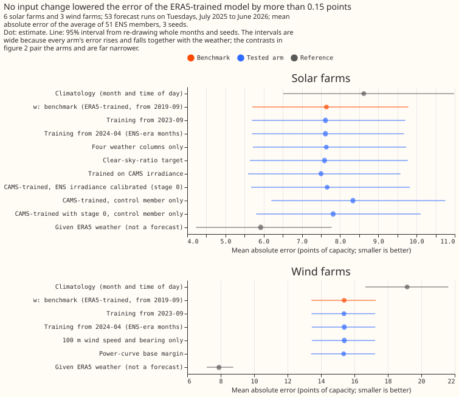

# Which inputs and which training start work best for the solar and wind stage 1a model?

We asked which inputs and which training start date give the most accurate weather-to-power model
for solar and wind farms. We tried four changes, which were training on a satellite estimate of
sunlight, a first step (stage 0) that maps forecast sunlight onto that estimate, predicting solar
output as a share of the output the farm would give under a cloudless sky, and starting the wind
model from the turbine power curve, together with later training start dates. None lowered the error
by the 0.15 points of capacity that we counted as a gain. A point of capacity is 1% of a farm's
effective capacity, roughly its usual maximum output.

**Verdict: inconclusive.** None of the four planned input changes (CAMS-trained stage 1a, the stage
0 model, the clear-sky-ratio target for solar, and the power-curve base margin for wind) lowered the
error by the 0.15 points the plan counted as a gain, and the interval of the CAMS-trained arm (C1)
did not rule a gain out. The training start moved the error by less than 0.3 points, and the weather
block by less than 0.15 points for wind (C10) and unresolved for solar (C9). ENS is the European
Centre for Medium-Range Weather Forecasts' ensemble forecast, ERA5 is its reanalysis of past
weather, and CAMS is the Copernicus Atmosphere Monitoring Service's satellite irradiance estimate.
Arm `w` reproduces experiment 00001's scores exactly (7.641 for solar and 15.386 for wind). The page
is proposal P17 in the [research plan](../research-plan.md). Stage 1a is an XGBoost model per series
that turns weather into power.

## Results

- **Absolute scores, all leads (points of capacity):** solar `w` 7.64, `cams` 7.50, `csr` 7.59,
  `start_2023` 7.62, `start_2024` 7.62, `small_block` 7.64, `cams_stage0` 7.66, climatology 8.62,
  and a ceiling of 5.92 (the arm `w` given ERA5 weather, which is not a forecast). Wind `w` 15.39,
  `base_margin` 15.36, `start_2023` 15.37,
  `start_2024` 15.39, `speed_block` 15.39, climatology 19.15, and ceiling 7.90. Seed spread is
  at most 0.007 points.
- **C1, CAMS-trained minus ERA5-trained (solar):** -0.140 (99.5% interval -0.277 to -0.044). The
  interval lies below zero, but the estimate misses the -0.15 threshold, so the rule scores it
  unresolved. The gain is largest within 24 h (-0.35) and shrinks to -0.06 beyond day 7.
- **C2, stage 0 minus plain CAMS-trained (solar):** +0.160 (-0.017 to +0.382). The stage 0 model
  lowers the error of the control member alone, from 8.34 to 7.82, and leaves the error of the
  51-member average 0.16 points higher, from 7.50 to 7.66, with an interval that includes zero. For
  seed 0 and the control member, a fit that stops before the last 6 weeks maps ENS shortwave to CAMS
  with a mean absolute error of 120 W/m2, against 123 W/m2 for the raw ENS value, and the bias
  grows in size, from +19.5 to -27.6 W/m2.
- **C3 and C4:** the clear-sky-ratio target changes solar by -0.048 (-0.093 to +0.024), and the
  power-curve base margin changes wind by -0.030 (-0.061 to -0.007). Both are equivalent to `w`
  within the 0.15-point band.
- **C5 to C8, training start:** every estimate lies between -0.026 and +0.005, with intervals inside
  -0.19 to +0.10, so a start in 2023-09 or 2024-04 is equivalent to 2019-09 within 0.3 points.
- **C9 and C10, weather block:** four solar columns against nine is -0.003 (-0.158 to +0.131),
  unresolved because the interval reaches slightly past the 0.15 band. Three wind columns against six
  is +0.008 (-0.147 to +0.138), equivalent.
- **Decision rule:** supported needs a gain among C1 to C4. Refuted needs the lower bound of all four
  above -0.15, and C1's lower bound is -0.277. The verdict is therefore inconclusive.

## Failures and limits

- **The first fit crashed after training** on a missing `lead_hours` column in the validation
  frames and then on a mixed Float32 and Float64 stack. Both were fixed before any score was read.
- **The claims rest on 6 solar farms and 3 wind farms in one validation year,** and on one weather
  region each. The absolute-error intervals are 4 to 6 points wide. The paired contrasts have
  intervals 0.05 to 0.4 points wide, so a gain under 0.15 points is resolved only for the contrasts
  with the narrowest intervals.
- **No selection year exists for ENS-applied scores,** so each contrast was scored once on fold A.
  The experiment did not combine winners.
- **The wind farms' ERA5 cells hold no temperature or pressure,** so windchill and air density were
  not tested for wind.
- **The stage 0 model trains on the control member alone,** so it cannot learn the spread of the
  other 50 members.

## Lessons

- **Input changes to a stage 1a model that already reads the ERA5 weather block moved the solar and
  wind error by hundredths of a point, except CAMS training (-0.14) and stage 0 (+0.16).** The
  differences between arms are far smaller than the gap to the ERA5 ceiling (1.7 points for solar,
  7.5 for wind). The ceiling reads ERA5 weather at forecast time, so the gap mostly reflects the
  change of weather source, and the changes tested closed little of it.
- **A correction of ENS weather was worth scoring on the member average.** The control member alone
  improved by 0.52 points under stage 0, and the 51-member average was 0.16 higher.

## Size

**The size is complex, because the experiment adds a new method (a stage 0 model, a clear-sky-ratio
target, and a base margin) and admits more than one defensible design.**

- **What gets stored:** private predictions only. No schema in `packages/contracts/` changes.
- **Production serving path:** not touched. The winners are candidates for a later model release.
- **Degradation rule:** not touched.
- **More than one defensible design:** yes. The definition of clear-sky power, the form of the power
  curve, and the inputs of the stage 0 model all admit alternatives. This page fixes one.
- **Code whose callers cannot be named without searching:** no. The fitting code copies the
  patterns of `studies/stage1_pilot/stage1_fit_stage1a.py` and of experiment 00009.

## Which earlier advice this plan follows

- **Followed:** every arm gets the same columns unless the arm is the contrast (00001); the
  benchmark's absolute score and a climatology row are reported beside every contrast (00001); a
  CAMS-trained stage 1 is tested against ERA5-trained with irradiance applied from ENS (00006,
  00007).
- **Departs from:** 00006 selected on one year and confirmed on the next, using ERA5 weather as the
  input. This experiment scores once, on fold A applied to ENS members, because no earlier ENS year
  exists for the farms (the ENS-era data starts in 2024-04, and the pilot scored fold A only). The
  contrasts are pre-registered and each is scored once, so nothing is selected on the scoring year.
  The experiment does not combine winners, and so claims no effect of a combination.
- **Cannot follow:** the production recipe's windchill needs temperature at the wind farms' ERA5
  cells, which is not on disk, so windchill is not tested for wind. For solar, windchill is not a
  physical input.

## Setup

**Rows and series.** The 6 solar farms (labels A to F) and 3 wind farms (W1 to W3) of
`fold_a_tuesdays_v1`: 53 runs on Tuesdays, valid times from 2025-07-01 to 2026-06-30. Anonymised
labels only appear in the write-up.

**Training.** One XGBoost model per series and seed (0, 1, 2) with 00005's hyperparameters, no
calendar column and no power lag. Training uses cleaned power (the pilot's settling rule) at valid
times before 2025-06-17, 14 days before the first run. Every arm starts in 2019-09 except the two
start arms.

**Weather at training and at forecast time.** Training reads ERA5 at the farm's cell (and, for CAMS
arms, CAMS irradiance at the farm). Application reads ENS members. CAMS is therefore needed only
for training, and no weather source is read at lag times because no arm has a lag.

## Arms

| Arm | Technology | What differs from `w` |
|---|---|---|
| `w` | both | Benchmark: solar 9 columns, wind 6 columns, from 2019-09 |
| `start_2023` | both | Training from 2023-09-01 |
| `start_2024` | both | Training from 2024-04-01, the ENS-era months |
| `small_block` | solar | 4 columns: `shortwave`, `temperature_2m`, `solar_zenith`, `solar_azimuth` |
| `speed_block` | wind | `wind_speed_100m` and the two 100 m bearing columns only |
| `csr` | solar | Target is power over clear-sky power, weighted by clear-sky power; the forecast is the predicted ratio times clear-sky power |
| `base_margin` | wind | XGBoost `base_margin` from a monotone power curve of 100 m wind speed fitted on the arm's training rows |
| `cams` | solar | CAMS irradiance replaces ERA5 shortwave in training; ENS shortwave is applied |
| `cams_stage0` | solar | `cams`, with each ENS member's shortwave first mapped to CAMS by the stage 0 model |

**Clear-sky power.** Clear-sky irradiance comes from `pvlib`'s simplified Solis model with its
default aerosol and water-vapour settings, evaluated at the solar zenith. Clear-sky power is a
farm-specific constant times that irradiance. The constant is the 99th percentile of power over
clear-sky irradiance, over the arm's training rows with clear-sky irradiance of at least 300 W/m2.
Training rows with clear-sky power below 1% of capacity are dropped, and the ratio is clipped to 0
to 2. The weight is the square of clear-sky power, because the power error is the clear-sky power
times the ratio error, so a squared power error weights the squared ratio error by the square of
clear-sky power.

**Power curve.** Mean power fraction in 0.5 m/s bins of 100 m wind speed, made non-decreasing by a
running maximum, and interpolated linearly. The curve is fitted on ERA5 speeds and added, as the
`base_margin` of the prediction matrix, to each ENS member's 100 m speed, so any bias between ERA5
and ENS speeds shifts the margin. The fit script checks that the margin changes the predictions.

**Stage 0.** A small XGBoost model (depth 4, 200 rounds, learning rate 0.05, pooled over the 6 solar
farms, no farm identifier) maps ENS shortwave, longwave, 2 m temperature, 2 m dew point, solar
zenith and azimuth, and lead hours to CAMS irradiance. It trains on the control member's rows from
2024-04-01 to before 2025-06-17, daylight rows only, and applies to every member. The control member
alone trains it, because the ENS training frame holds that member only. The mapping is therefore
conditional on the control run and learns nothing about the perturbed members' spread, so C2 mixes
a bias correction with any distortion of the spread. C2 is also reported on the control member
alone.

## Planned contrasts

Each is the arm's mean absolute error of the member average minus the reference arm's, in points of
capacity, over all leads. The level is 99.5%.

| Id | Technology | Arm | Reference |
|---|---|---|---|
| C1 | solar | `cams` | `w` |
| C2 | solar | `cams_stage0` | `cams` |
| C3 | solar | `csr` | `w` |
| C4 | wind | `base_margin` | `w` |
| C5, C6 | solar, wind | `start_2023` | `w` |
| C7, C8 | solar, wind | `start_2024` | `w` |
| C9 | solar | `small_block` | `w` |
| C10 | wind | `speed_block` | `w` |

Every table also gives the scores per technology and per lead band (0 to 24 h, 1 to 2 days, 3 to 6
days, 7 to 10 days, 11 to 15 days), with a note that the claims rest on 6 solar and 3 wind farms.

## Checks before the contrasts are read

- **Reproduction.** Arm `w` must reproduce experiment 00001's `s1_memberavg` score to within 0.05
  points per technology. If not, the pipeline has changed and the experiment stops.
- **Leakage review.** A reviewer reads the code for leakage, for every fit and for stage 0 stopping
  before 2025-06-17, and for the clear-sky constant and power curve using training rows only.
- **Stage 0 sanity.** A fit that stops before 2025-05-06 is scored on the next 6 weeks (a block of
  valid times, not a random split, because one valid time recurs across leads), and its error
  against CAMS is printed beside the raw ENS shortwave's error.

## Resolution limit

Nine series in two weather regions cannot resolve gains under about 0.3 points of capacity.
Intervals are wide, and an equivalence is reported only when the interval lies inside -0.3 to +0.3.
