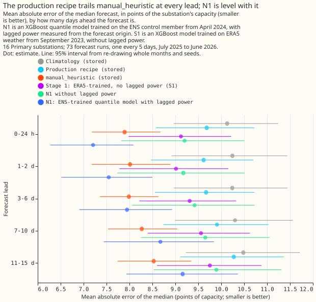
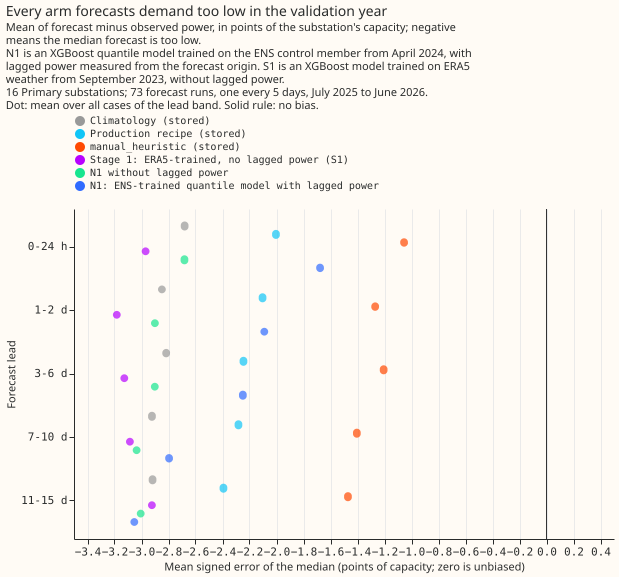

# Where does Primary substation demand stand against the stored baselines?

**Verdict: inconclusive.** The upgraded single-stage model N1 does not beat `manual_heuristic` with
an interval that excludes zero. For the 16 Primary substations, N1's mean absolute error of the median
is 8.45 points of capacity over all leads against 8.23 for `manual_heuristic`: C1 is +0.22 (99%
interval -0.54 to +0.97). Up to 48 hours N1 scores 7.38 against 7.95, which meets the planned 0.5-point
size (-0.57) but not the interval (-1.33 to +0.27). The part of the hypothesis about the production
recipe holds: it loses to `manual_heuristic` by +1.69 points (C3, +0.98 to +2.59), at every lead and
in 12 of 16 series. **The gate for P7 and P8 is not passed, so P7 compares the staged chain with
`manual_heuristic` as well as with N1.** A point is 1% of the series' effective capacity. The
substations are not named.

## What the arms score

Every arm is scored on the same 768,073 cases per seed (Primary substations; 965,723 cases for all
20 series), on the 73 runs of `fold_a_every5d_v1`. Intervals resample whole months and the three
seeds; the stored baselines have no seed, so each is repeated three times.

| Arm | All leads | Up to 48 h | 3 days or more |
|---|---|---|---|
| `manual_heuristic` | 8.23 | 7.95 | 8.31 |
| N1 | 8.45 | 7.38 | 8.71 |
| N1 without lagged power | 9.60 | 9.19 | 9.71 |
| Stage 1 trained on ERA5 (S1) | 9.48 | 9.07 | 9.59 |
| Production recipe | 9.92 | 9.65 | 10.02 |
| `climatology` | 10.33 | 10.19 | 10.36 |

The quantile score (an estimate of the continuous ranked probability score) tells the same story:
`manual_heuristic` 5.89, N1 6.33, the production recipe 9.52, and `climatology` 7.46. For the two
bulk supply points N1 scores 11.3 against 12.3 for `manual_heuristic`, and for the two grid supply
points 27.4 against 29.8, on the error of the median; two series per type resolve no interval.

## Why the production recipe loses to `manual_heuristic`

**The gap is the same size at every lead, so it does not come from missing persistence at short
leads.** C3 is between +1.60 and +1.79 in every lead band, and the production recipe is worse in
all 12 months. Two causes account for it.

- **A level offset.** Every arm forecasts the validation year too low (figure 3). The mean error of
  the median is -2.3 points for the production recipe and -1.3 for `manual_heuristic`, because
  `manual_heuristic` copies the last weeks of observed power and the other arms learned from April
  2024 to June 2025. Post hoc, subtracting each arm's own per-series mean error (an oracle, since it
  uses the validation year) lowers the production recipe's error to 8.95 and `manual_heuristic`'s to
  7.87, so the offset explains about 0.6 of the 1.69 points.
- **No recent power.** The remaining 1.1 points match the information that `manual_heuristic` uses
  and the production recipe lacks. N1 without lagged power scores 9.60, 0.32 better than the
  production recipe (E7, 95% interval -0.76 to +0.27), so the quantile loss, the 00006 columns, and
  the recency weights recover no detectable error. Lagged power recovers 1.15 (C4, -2.16 to -0.58).

## Other findings

- **N1 without lagged power does no better than S1** (C5 +0.12, -0.41 to +0.61), so training on ENS
  instead of ERA5 changes the error of the median by less than the interval can show. The planned
  clause that N1 without lags recovers half the production gap beyond 3 days fails: C5 is +0.13
  against C3's +1.71.
- **Pooling the 51 members helps slightly.** N1 beats the control member alone by 0.05 points
  (E3, 95% interval -0.08 to -0.03).
- **The calendar columns matter little.** Removing hour, weekday, and days to Christmas raises
  the error by 0.17 (E4, +0.09 to +0.25) and does not change the quantile score (+0.01).
- **N1 beats 00005's ENS-trained model with lags as inputs** by 0.50 points (E5, -0.64 to -0.36),
  from lags measured at the origin instead of nullified at short leads.

## Post hoc

**The level-offset diagnostic above is post hoc.** It was added after the verdict, uses the
validation year to estimate the offset, and changes no pre-registered contrast. A deployable version,
a correction from the last 14 days of observed error, is a candidate for P8.

## Limits

- **The telemetry delay is assumed.** Every N1 result is conditional on the newest usable value
  being 3.5 hours before the origin.
- **N1 trained on 15 months, not from 2023-09,** because the stored ENS archive starts on
  2024-04-01. C5 mixes ENS against ERA5 training with the shorter window.
- **16 series and 12 months** leave 99% intervals of about plus or minus 0.8 points, wider than the
  planned 0.5-point effect.

## Plan, written before any code ran

## Plan: sizing

- **Stored data:** prediction sets only, under `data/ml-experiments/`; no production table changes.
- **Production serving path:** not touched.
- **Degradation rule:** not touched.
- **Defensible designs:** more than one. N1's weather pooling, the telemetry delay, and the lag
  definitions are choices; each is fixed below before a fit.
- **Callers:** the scripts copy 00005's helpers and read its stored predictions, which the author of
  this plan could name without searching.

Size: complex. The plan gets two Sonnet reviews (Opus is kept for work that is truly vital), the code
gets two Sonnet reviews (leakage and the fit stopping at `train_end`; then correctness), and the
write-up gets one.

## Plan: arms

All arms are scored on the 73 runs of `fold_a_every5d_v1`, on the rows every arm holds and an
observed power value, for valid times before 2026-07-01. Primary substations (16 series) are the
headline; BSP and GSP (2 series each) are reported separately and never averaged in.

- **MH, CL, PROD (stored):** `manual_heuristic`, `climatology`, and the production recipe
  (`xgboost_baseline`, fold `mid_2025_to_mid_2026`) read from the `power_forecasts` Delta table;
  the quantiles of each arm's members. They have no seed, so each is repeated once per seed.
- **S1 (00005's `r0_from2023`):** stage 1, ERA5-trained from 2023-09, no lags, pooled over the 51
  members. R1 (`r1`) and R2 (`r2`) are reported as references.
- **N1:** one XGBoost model per series with the 9-level quantile loss, trained on the ENS control
  member of every daily run from 2024-04-01 (the start of the stored ENS archive, so 2023-09 is not
  available to ENS-trained arms), valid times up to 2025-06-30 23:30. Columns: the 00006 Primary set
  (weather block, solar position, hour, weekday, COVID indicator, windowed days to Christmas), the
  lead in hours, and three lags measured from the forecast origin. Recency weights use a half-life
  of 2 years, anchored at 2025-06-30 (the last training valid time), not at each row's own date.
  The fit runs a fixed 500 rounds with no early stopping and no validation split. A training row is
  kept only when its valid time is on or before 2025-06-30 23:30, and every lag of a training row
  lies before that row's origin.
- **Pooling.** The 51 members' 9 quantiles each give 459 values with equal member weights and the
  9-level atom masses; the forecast quantiles are the weighted quantiles of those values at the 9
  levels, sorted so none cross. A model trained on the control member and applied to perturbed
  members adds its own spread to the ensemble's spread, so the bands may be too wide, which raises
  the quantile score. N1-control, N1 applied to the control member alone, checks this
  (exploratory).
- **N1-nolag:** N1 without the lag columns (isolates the lags, and ENS-trained against ERA5-trained
  once compared with S1).
- **N1-nocal:** N1 without hour, weekday, and days to Christmas (the no-calendar control).

**The three lags.** The origin `T` is the NWP run time plus 9 hours. The newest usable observation
is the latest half-hour at or before `T` minus 3.5 hours. NGED's files cover 6-hour windows, and the
live ingest downloads each window 3 hours after it ends, so at 09:00 UTC the 03:00 to 06:00 window
has just arrived. The plan keeps one half-hour of margin, so the newest value is the one stamped
05:30. The lags are the power at that newest half-hour, the power at the latest earlier time with
the same half-hour of day as the valid time, and the power at the latest earlier time with the same
weekday and half-hour. All three are zero-lookahead by construction. The telemetry delay is an
assumption, not a measurement of NGED's delay; the live ingest's download time is the only evidence
in the repository. Every N1 result is conditional on the 3.5-hour figure, and no sensitivity run is
planned.

**Deviation from P6.** P6 names a 2023-09 start for N1. The stored ENS archive starts on 2024-04-01,
so N1 trains on 15 months where S1 trains on 22. C5 therefore mixes the effect of training on ENS
with the effect of the shorter window. The stored arms have no seed, so each is repeated once per
seed as the skill requires; the three copies are identical, and the intervals resample months.

**Diagnosis of the production gap.** The stored forecasts are split by lead band and series; the
gap between production and `manual_heuristic` is decomposed into bias (mean error) and the rest;
and the ladder PROD, S1, N1-nolag, N1 shows which step recovers the gap.

## Plan: planned contrasts (99%, Primary substations)

- **C1:** N1 minus `manual_heuristic` (primary).
- **C2:** N1 minus PROD.
- **C3:** PROD minus `manual_heuristic` (the gap to diagnose).
- **C4:** N1 minus N1-nolag (what origin lags add).
- **C5:** N1-nolag minus S1 (ENS-trained quantile against ERA5-trained, both lag-free).

The planned contrasts are read at 99% over all leads, over leads up to 48 hours, and over leads of
3 days or more. Every other contrast is exploratory and read at 95%, including each lead band.

## Plan: past weather

N1 uses ENS weather in training and in scoring, so no past weather is used at lag times. The lags
are of power, observed before the origin.
