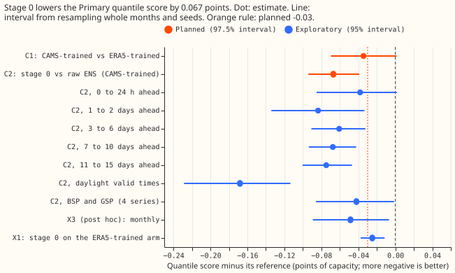

# Does a stage 0 that maps ENS irradiance onto CAMS help the CAMS-trained demand model?

We asked whether correcting forecast sunlight before a demand model reads it improves the forecast.
The demand model was trained on a satellite estimate of sunlight, but the weather forecasts it
receives when it is used give more daytime sunlight than that estimate (281 against 263 watts per
square metre, averaged over daytime). We mapped the forecast sunlight onto the satellite estimate,
separately for each of the 51 ensemble members, and measured the change in error. The error fell by
0.067 points of capacity (1% of a series' effective capacity), but mismatches remained in individual
months.

**This experiment is P20 of the [research plan](../research-plan.md), the follow-up to [experiment
00009](../00009-cams-trained-stage1a-vs-era5-trained-demand/result.md).** Experiment 00009 found
that a stage 1a trained on CAMS irradiance lowered the Primary quantile score by only 0.035 points
when fed ENS shortwave, and measured the ENS daylight shortwave at 281 W/m² against 263 for CAMS.
This experiment tests that offset as a cause. Stage 1a is an XGBoost model per series that turns
weather into power. The quantile score measures how well the forecast quantiles fit what happened,
and smaller is better.

## Size

- **What gets stored:** prediction sets and tables under this experiment's private folder. Nothing
  enters a Delta table.
- **Production serving path:** not touched.
- **Degradation rule:** not touched.
- **Designs that would test the hypothesis defensibly:** three. Empirical quantile mapping,
  planned here, keeps the spread of the 51 members. A regression of CAMS on ENS would pull every
  member towards the conditional mean and shrink the spread. A single multiplicative factor would
  fix only the mean offset.
- **Callers that need searching for:** none. The scripts live in this experiment's folder, and they
  reuse the code and the fitted models of 00009.

The only trigger that fires is the second design: the experiment adds a method that more than one
design could implement. It therefore gets one review of the plan, one of the code, and one of the
write-up, all by Sonnet. The earlier `advice` lists were read. This plan follows "Keep the stage 1a
training weather in ERA5 until a CAMS-trained arm has been tried with the ENS shortwave
bias-corrected" and "Score any irradiance-input change by lead band as well as in total" (00009),
and sets its threshold of -0.03 points near the 97.5% half-width of 00009's C1 (0.035 points).
A gain of that size is at the edge of what the rows can resolve.

## Design

**No stage 1a model is refitted.** The ERA5-trained and CAMS-trained boosters of 00009 (20 series,
three seeds) are loaded as they are. Only the input they read at validation changes, so C2 differs
from 00009's CAMS-trained arm in one input: the ENS shortwave column.

**Stage 0 is an empirical quantile mapping from ENS shortwave to CAMS irradiance.** The mapping is
fitted on the training times before 2025-06-17 (14 days before the first validation run), from the
stage 1 pilot's ENS training table (one ensemble member per run, 456 runs from 2024-04-01; the
script prints which member and reports it, since the control member is not exchangeable with the
perturbed ones), filtered to `valid_time` before 2025-06-17 (not to init time, because the table
runs to 2025-06-30), with an assertion on the maximum valid time. The table holds 22 series, and the
mapping uses only the 20 modelled ones paired with CAMS held half-hourly at the series' own point.
The pairs are pooled over the 20 series and binned by lead band (the five bands of 00009) and by
solar zenith (6 bins of equal cosine width, daylight only, zenith below 80°). Within a bin, 99
quantiles of the ENS values are matched to the same quantiles of the CAMS values, and the mapping is
piecewise linear between them and clamped to the end points outside the fitted range. A bin with
fewer than 1,000 pairs borrows the mapping of its neighbouring zenith bin. At validation, each
member's value is mapped on its own, so the 51 members keep their spread. Night rows pass through
unchanged. CAMS is needed only at training times, never at forecast time.

**The stage 0 output is checked before stage 1a reads it.** The mismatch table lists the mean
daylight shortwave of CAMS, raw ENS, and corrected ENS by month of the validation year, with the
ratio to CAMS, plus the mean spread of the 51 members before and after.

**Two planned contrasts, kept separate, both on Primary substations over all leads.** C1 is the
CAMS-trained arm on raw ENS minus the ERA5-trained arm, recomputed here from 00009's models on the
same rows; a value differing from 00009's -0.035 by more than 0.005 is reported and read as the
noise floor of GPU prediction. C2 is the stage 0 contrast. The threshold of -0.03 is a little under
the half-width of 00009's interval, so a gain of that size is at the edge of what the rows resolve.

**Exploratory contrasts are read at 95%.** They are: C2 for the four bulk supply point and grid
supply point series together (the CAMS values exist for all 20 series, which 00009 used); C2 by lead
band and for daylight and night separately; X1, a quantile mapping of ENS onto ERA5 shortwave at
the same cells, fed to the ERA5-trained arm, minus that arm on raw ENS (does a stage 0 help
whichever product stage 1a trained on); and C2 for each Primary series.

**One post hoc variant, labelled as such.** After the planned run showed monthly mismatches, X3
and X4 add a stage 0 fitted separately for each calendar month (same bins, same cutoff, and the
all-year mapping where a month and lead band has too few pairs), applied to the CAMS-trained arm.
The planned contrasts and the verdict rule are unchanged.

**Leakage and calendar checks.** Stage 0 sees no valid time from 2025-06-17 on. Stage 1a models are
00009's, trained before the same date. No calendar column is added.

**Known limits.** CAMS is held hourly while the ENS shortwave is interpolated to half-hours, which
the marginal mapping ignores. The mapping is fitted on 14 months, is unconditional on the day's
weather, and corrects the offset in distribution, not the forecast error of an individual member.
The training table holds one member per run, assumed exchangeable with the other 50.

## Results

**The verdict is inconclusive by the pre-registered rule, although C2 itself beats the planned
size.** Stage 0 lowers the Primary quantile score of the CAMS-trained arm by 0.067 points of
capacity (C2, 97.5% interval -0.094 to -0.039, half-width 0.028), more than the -0.03 the plan
required, and in 12 of 12 months and 14 of 16 series. The rule also required that the corrected ENS
shortwave stay within 5% of CAMS in every month, and the bias check failed. C2 is not a small gain:
its interval lies wholly beyond the planned threshold, and only the bias check prevents a verdict of
supported. C1 reproduces experiment 00009's -0.035 (-0.070 to +0.001) exactly, and the repeated
raw-input quantiles differ from 00009's by 0.000 in every level over 3,074,760 rows each.

| Arm | Primary quantile score | BSP | GSP | Primary error of the median |
| --- | --- | --- | --- | --- |
| ERA5-trained, raw ENS | 7.88 (6.92 to 8.75) | 8.60 | 21.08 | 9.49 |
| CAMS-trained, raw ENS | 7.84 (6.89 to 8.73) | 8.56 | 20.98 | 9.46 |
| CAMS-trained, stage 0 | 7.78 (6.84 to 8.64) | 8.51 | 20.94 | 9.44 |
| ERA5-trained, stage 0 (X1) | 7.85 (6.91 to 8.73) | 8.60 | 21.07 | 9.47 |
| CAMS-trained, monthly stage 0 (post hoc, X3) | 7.80 (6.87 to 8.66) | 8.56 | 20.96 | 9.45 |
| Climatology (00005's `r2`) | 8.21 (7.45 to 8.97) | 9.43 | 24.41 | 11.30 |

All scores are in points of capacity, over all leads, with 95% month-and-seed intervals for the
Primary quantile score. The CAMS-trained arm with stage 0 is 0.102 points better than the
ERA5-trained arm (-0.143 to -0.059), three times 00009's gain.

**Stage 0 fixes the year's mean mismatch but not each month's.** Over the validation year, the
mean daylight ENS shortwave is 6.2% above CAMS as published and 0.0% above after stage 0 (320.9 and
302.1 against 302.1 W/m²). By month, the published ratio runs from 0.92 to 1.26, and after stage 0
from 0.81 (December) to 1.13 (July), so the 5% monthly bound failed. The member spread of the
shortwave after stage 0 is 1.27 times its published value (1.13 to 1.31 by month), outside the 10%
the plan expected.

**The prediction was right on the size of the gain and wrong on its lead times and on the member
spread.** C2 fell inside the predicted 0.03 to 0.10 band, and the year's mean daylight ratio to CAMS
reached 1.000. The predicted concentration in the first 6 days did not appear: the first day has
the smallest gain (-0.038), and 7 to 15 days gain as much as 3 to 6 days. The member spread changed
by 27% against a predicted 10%. The offset before correction was 6.2%, a little under the 7% that
experiment 00009 reported.

**The gain is in daylight and at every lead from 1 day on.** In daylight the contrast is -0.168 (95%
interval -0.229 to -0.114) and at night it is 0.000. By lead band it is -0.038 up to 1 day (-0.085
to +0.002), -0.084 for 1 to 2 days, -0.061 for 3 to 6 days, -0.068 for 7 to 10 days, and -0.075 for
11 to 15 days, so the gain does not fade at long leads as 00009's did. The interval for the first
day reaches +0.002, so a gain there is probable and not resolved. Over the 4 bulk and grid supply
point series together it is -0.042 (-0.086 to -0.001), too few series to say more. Stage 0 also
helps the ERA5-trained arm (X1, -0.025, -0.038 to -0.012), so part of the gain is a general
correction of the ENS shortwave, and the CAMS-trained arm gains 0.077 more than the ERA5-trained arm
after both have stage 0 (X2, -0.111 to -0.040).

**Post hoc, a monthly mapping did no better.** Fitting one mapping per calendar month from the
single training year of pairs gives X3 -0.049 (-0.089 to -0.007) against raw ENS and X4 +0.019
(-0.015 to +0.053) against the all-year stage 0, and the monthly ratios to CAMS stay between 0.82
and 1.12 (figure 1).

**Stage 0 hurts one Primary series and rests on one training member and one year.** Series P6 scores
worse with stage 0 (+0.053, 0.037 to 0.073), and series P9, with 8 months of data, gains the most
(-0.354). The training table held one ensemble member per run, the control member, so the mapping
assumes the 50 perturbed members share its distribution. CAMS is held hourly while ENS shortwave is
interpolated to half-hours, which the mapping ignores. The 14 months of pairs give April to June two
years and the other months one. Validation is one year (2025-07 to 2026-06).

Scripts: `ml-experiments/00014-cams-trained-stage1-with-stage0-ens-correction-demand/`
(`e00014_fit.py`, `e00014_post_hoc.py`, `e00014_score.py`, `e00014_charts.py`).
