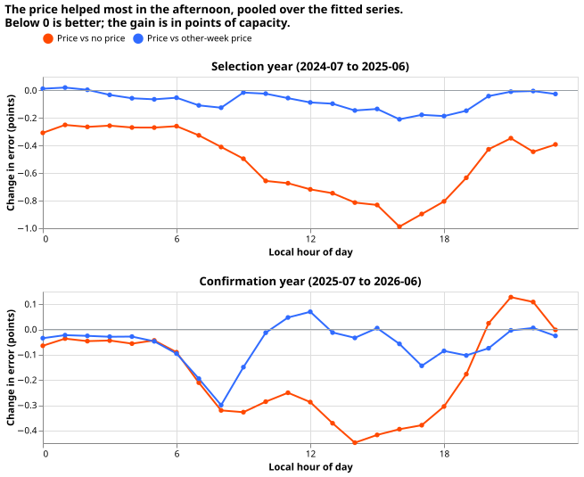
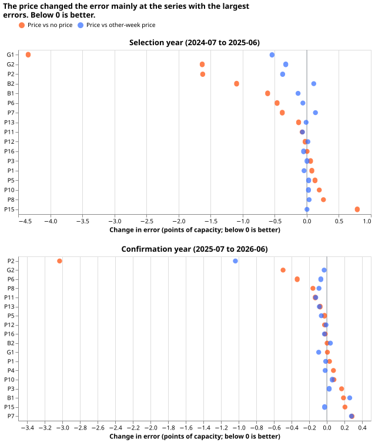

# Does the same-time electricity price help a stage 1 demand model explain power?

**Verdict: inconclusive.** The same-time price lowered the pooled error in the selection year, but a
price from another week reproduced most of that gain, and the gain did not repeat in the
confirmation year. Follows
[experiment 10](../00010-elexon-price-lags-stage1a-demand/result.md), which tested the price from
7 days earlier at two battery sites and was inconclusive.

**Absolute scores** (mean absolute error of the median, points of capacity, 3 seeds, pooled over
17 fitted series in the selection year and 18 in the confirmation year):

| Scope and year | BASE | PRICE | SHUFFLED | CONTROL | CLIMATOLOGY |
| --- | --- | --- | --- | --- | --- |
| Pooled, selection | 9.86 | 9.34 | 9.41 | 9.35 | 12.38 |
| Pooled, confirmation | 9.11 | 8.93 | 8.99 | 8.50 | 12.36 |
| B2, selection | 10.98 | 9.88 | 9.77 | 10.08 | 15.46 |
| B2, confirmation | 10.12 | 10.13 | 10.09 | 9.23 | 15.01 |

## What the contrasts say

- **C1 passed in the selection year only.** −0.52 (−0.88 to −0.11), with 10 of 12 months below
  zero. In the confirmation year C1 is −0.18 (−0.50 to +0.08), with 6 of 12 months below zero.
- **C2 failed.** The price against the other-week price is −0.07 (−0.17 to +0.03) in the selection
  year and −0.06 (−0.18 to +0.07) in the confirmation year, so the point estimate misses the
  −0.1 threshold and the interval includes zero. The other-week price carries the week's price
level, and the point estimates say it matches 0.45 of the 0.52 points. That match has no interval of
its own, and the C2 interval allows the share to lie between about 0.35 and 0.55 points, so the gain
probably comes largely from any price column and not from the price at time t.
- **C3, price against national demand and wind:** −0.01 (−0.39 to +0.41) in the selection year and
  +0.43 (−0.03 to +0.86) in the confirmation year. Both intervals include zero, so national demand
and wind did no worse than the price. Only at B2 in the confirmation year does the interval exclude
zero (+0.90, 0.55 to 1.21, in favour of national demand and wind).
- **C4, by hour (selection year):** −0.27 (0 to 4), −0.56 (8 to 12), −0.78 (12 to 16), −0.83 (16 to
  20), and −0.40 (20 to 24). In the confirmation year the gain is −0.30 (8 to 12), −0.38 (12 to
  16), −0.31 (16 to 20), and +0.07 (20 to 24). The prediction that the gain peaks from 16:00 to
20:00 held in the selection year only. The predicted pooled gain of 0.1 to 0.3 points was exceeded
in the selection year (0.52) and met in the confirmation year (0.18).
- **B2:** −1.09 (−2.25 to −0.10) in the selection year, where the other-week price gave about the
  same (−1.20 against BASE). In the confirmation year B2 gained 0.00.
- **By series:** in the selection year the price removes 0.11 to 0.19 of the squared residual at B1,
  B2, G1, G2, P2, and P6, and 0.05 or less at the other 11. Beside the other-week price it removes
  a further 0.06 or less at those six, so at most of them the price-level signal accounts for most
of the gain. B2 is the exception: the other-week price gained 0.11 points more than the price did.
Eight of the 11 other series get no gain at all, P15 (+0.79) and P8 (+0.26) the worst. At G1 the
price lowers the error by 4.34 points, and by 0.54 points more than the
  other-week price does. In the confirmation year only P2 (0.21) and P6 (0.15) keep a gain, and P2
  gains 1.04 points more than from the other-week price.

## Failures and deviations

- **Some series have too little training history** (17,520 half-hours before the purge), so 17
  series were fitted in the selection year and 18 in the confirmation year, as in experiment 10.
- **The decision rule gives `inconclusive`:** C1 and C2 did not both pass in the selection year,
  and the refuted branch needed the C1 interval wholly above −0.1 in both years, which it was
  not. The result is not a small gain by the skill's definition, because C2's interval includes
zero.
- **The residual breakdowns do not give out-of-fold residuals over the whole history,** which the
  later experiment needs.
- **No Opus review was run.** Sonnet reviewed the plan and the code; the code review found no
  bug. The shuffled price is built over the whole history, so a training row within 4 weeks of the
  fold's end can carry a price from the purge or validation weeks. The shuffled column holds a price
and no target, so no outcome leaks.

## Purpose

**The stage 1 demand model is a tool for a later experiment, not a forecaster.** The model maps the
observed price and
weather at time t to power at time t. A later experiment could feed it the prices of the past to
estimate the power that should have been metered, and so measure how unusual the actual lagged power
was. That use needs two facts from this experiment: whether the price adds information beyond the
weather and the clock, and in which hours and at which series it adds it. The ERA5 weather and the
price at time t are both observed, so every score here is at observed values and none is a forecast
skill.

## Design

**The base is the experiment 00006 Primary input set**: the weather block (ERA5 at the series'
nearest grid cell), hour and weekday, the COVID indicator, and the days to Christmas inside a 14-day
window, with recency weights (half-life 2 years). Folds, XGBoost settings (no column subsampling),
purge, and the series fitted are those of experiment 10. A series needs 17,520 training half-hours
before the purge to be fitted in a fold, so the count fitted is reported for each fold.

| Arm | Adds to BASE |
| --- | --- |
| BASE | nothing |
| PRICE | `price_now`: the `APXMIDP` price of the half-hour ending at `valid_time`; missing if the half-hour is missing or has zero volume |
| SHUFFLED | `price_now` taken from another week of the same weekday and half-hour, 1 to 4 weeks away in either direction, drawn with a fixed seed (a negative control) |
| CONTROL | GB national demand outturn (`INDO`) and wind output (`FUELHH`) at the same half-hour, the non-price national signals the price follows |
| CLIMATOLOGY | not a fit: the month-by-half-hour median of the fold's training window, as `ClimatologyForecaster` computes it |

**Weather and price source.** The weather is ERA5, which arrives about 5 days late, so the stage 1
demand model cannot run at forecast time. The ERA5 dependence is intended, because the model scores
past power. The price is
the experiment 10 pull of `APXMIDP`, 98.5% complete and fully complete from 2024-04-14. Training
rows before 2021 can have a missing price, which XGBoost handles natively.

**Rows and row sets.** All arms are scored on the same validation rows. A half-hour with a missing
price is still predicted, because XGBoost treats the missing value natively. The climatology row
drops a row whose calendar cell holds no training sample. The selection year's row set is
`era5_val_2024_07_to_2025_06_v1`, and the confirmation year's is `era5_val_2025_07_to_2026_06_v1`.

**Timing.** The Elexon `time` column is the UTC start of the half-hour, and the join uses
`valid_time` minus 30 minutes in UTC. The shuffled price moves a whole week at a time, so the
shuffle can misalign a half-hour by one hour in the weeks that contain a clock change.

**What a pass means.** The price follows national demand and wind. A pass of C1 and C2 therefore
shows that the price carries information beyond the weather and the clock, and C3 says whether it
carries any beyond national demand and wind. Without C3 the price may only be a proxy for national
conditions, so the write-up states C3 beside the verdict.

**Calendar memorisation.** BASE has hour and weekday, so the price column could stand in for the
calendar. SHUFFLED keeps the price's calendar structure and removes its information, and C2 is the
contrast that controls for it.

## Planned contrasts

All are differences in mean absolute error, in points of capacity, over the selection year (2024-07
to 2025-06) and then, once, the confirmation year (2025-07 to 2026-06), with a month-resampled
interval, pooled over the fitted series and the 3 seeds.

- **C1 (verdict):** PRICE − BASE.
- **C2 (verdict):** PRICE − SHUFFLED.
- **C3 (descriptive):** PRICE − CONTROL.
- **C4 (descriptive):** C1 by local hour of day, in 4-hour blocks.

**With 12 months, a month-resampled interval is close to the range of the monthly differences.** The
report therefore also prints the 12 paired monthly differences of C1 and C2 and the number of months
with the sign the prediction gives, and the write-up reads the interval together with them.

**Residual breakdowns, descriptive.** For each local hour and each series, the report gives the
mean absolute error of BASE and PRICE, and the share of BASE's squared residual that PRICE removes.
The squared share is the number the later experiment needs. Beside each cell the report gives PRICE
− SHUFFLED,
the noise floor that a cell of this size shows with an uninformative price. The report uses absolute
residuals as the headline and the squared share as a second view. The B2 gain is reported beside the
pooled gain.

## Sizing

**Sizing, one line per `plan-issue` trigger.** Stores: private predictions only. Serving path: not
touched. Degradation rule: not touched. More than one defensible design: yes (which price columns,
which controls), fixed above. Code whose callers could not be named without searching: no, the code
reuses experiment 10's. This is medium: one Sonnet plan review, one Sonnet code review, one Sonnet
write-up review.

**Limits.** The later experiment needs out-of-fold residuals over the whole history. This experiment
scores two validation years only, so it shows that the price helps and where, and it does not
produce those residuals.

**Resources.** Slot B, 8 CPU cores, one thread per fit, no GPU.

**Earlier advice.** Follows experiment 10's advice to keep a shuffled-price control and a
climatology row. Departs from its advice to test on series with large batteries, because the
maintainer's design pools all series and reports B2 beside the pool.
