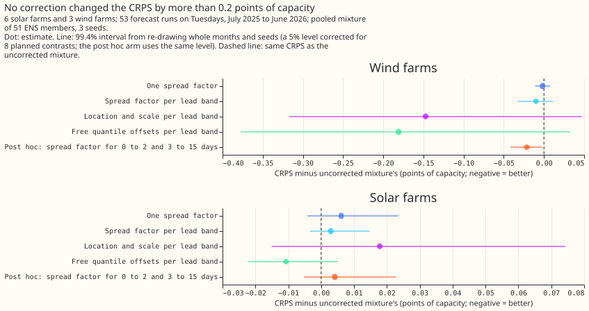

# Does a correction bring the pooled mixture's 5% to 95% band to 90% coverage for solar and wind?

We asked whether a small correction can make the 5% to 95% band of a solar or wind forecast contain
the measured output 90% of the time. We widened or narrowed the band by a factor, in several
variants, and measured how often it contained the output in five groups of lead times. For solar,
one factor brought the share from 94% to 95% down to about 90% in every group with no change in
accuracy. For wind, no planned variant worked in the first two groups, and only a variant added
after seeing the data did.

**Verdict: partly supported.** For solar, the planned spread factor brings the 5% to 95% band of the
pooled mixture from 94% to 95% coverage to about 90% in every lead band, at no change in the CRPS.
For wind, no planned arm brings the first two lead bands within 2.5 points of 90. A post hoc arm
that pools the lead bands into two groups does. ENS is the ECMWF ensemble, ERA5 its reanalysis of
past weather, CRPS the continuous ranked probability score, and stage 1a an XGBoost model per series
trained on ERA5. The page is proposal P12 in the [research plan](../research-plan.md), and the
corrected pooled mixture of 00002's ERA5-trained stage 1a, with no new fit, is the input.

## Results

- **Uncorrected solar over-covers in every band.** Coverage is 95.3%, 94.5%, 95.1%, 94.3%, and 94.7%
  from the first band to the last, against a target of 90%. The prediction said 2 to 3 points above
  90 in at least one band, and the result is 4 to 5 points in all five.
- **Uncorrected wind over-covers in the first two days only.** Coverage is 95.3%, 94.4%, 90.4%,
  89.5%, and 90.1%, as predicted.
- **Solar: `spread`, `spread_band`, and `free_quantile` reach 90%.** Every band lies within 2.5
  points of 90 (for example `spread` at 91.8%, 89.9%, 91.4%, 89.5%, and 90.5%). The CRPS changes by
  +0.006 for `spread` (C2, 99.4% interval -0.004 to +0.024), +0.003 for `spread_band` (C4), and
  -0.011 for `free_quantile` (C8, -0.022 to +0.005). The fitted single factor is 0.90 to 1.00,
  median 0.95.
- **Wind: no planned arm reaches 90%.** The closest planned arms in the first band are `locscale`
  (93.4%) and `spread_band` (94.7%), and in the second band `spread_band` (91.1%) and
  `free_quantile` (92.0%). The factor per band is 0.90 for both bands but exists in only 3 months
  (0 to 24 h) and 8 months (1 to 2 days), because the 5,000-case minimum is reached late. The single
  factor is 1.00 to 1.05 (C1 -0.002, C3 -0.010).
- **Wind: the location-and-scale arm undershoots 90% in the middle bands.** Its coverage is 93.4%,
  86.7%, 83.9%, 87.9%, and 88.6%, so it lies outside 2.5 points of 90 in the second and third bands
  and is further from 90 than no correction in the third to fifth bands. Its CRPS change is a
  separate result: C5 is -0.147 with an interval of -0.317 to +0.047.
- **Wind: the free quantile arm changes the CRPS by -0.181.** The interval is -0.377 to +0.032
  (C7), so it includes zero.
- **Prediction against result.** The prediction that the spread factor per lead band and the
  location-and-scale arm bring every wind band within 2.5 points of 90 is wrong for both arms. The
  prediction that no arm changes the CRPS by more than 0.1 points is wrong for wind `locscale`
  and `free_quantile` (C5 and C7), although both intervals include zero.
- **Post hoc, wind: a spread factor on two lead groups reaches 90%.** Coverage is 92.5%, 90.7%,
  91.0%, 91.1%, and 91.5%, and the CRPS change is -0.021 (-0.042 to -0.002), a small gain: the
  interval excludes zero and the estimate is under the 0.05-point threshold of the decision rule.
  The arm was chosen after the planned results were seen, and the decision rule does not cover it.
- **Reference arms.** The beta-transform blend of 00002 has the lowest wind CRPS (10.92, against
  11.11 uncorrected) and 90.0% to 94.6% wind coverage. The stage 2 calibrator is worse than no
  correction on CRPS for both technologies (solar 5.43, wind 11.29).
- **Absolute CRPS** (points of capacity, all leads): solar uncorrected 5.03, `spread` 5.03,
  `locscale` 5.04, climatology 5.63; wind uncorrected 11.11, `spread` 11.11, `free_quantile` 10.93,
  climatology 13.03. Seed spread is at most 0.002 for the arms listed.
- **Verdict.** The decision rule gives one outcome per technology: supported for solar and refuted
  for wind. "Partly supported" names that split.

## Failures and limits

- **The claims rest on 6 solar farms and 3 wind farms in one validation year.** Farms of one
  technology differ: in 00002's scores wind farm coverage ranged from 88% to 95%, and a factor per
  technology cannot remove that.
- **The first month cannot be corrected, and the short wind bands stay uncorrected for most of the
  year.** Over the months with a per-band fit, coverage for solar `spread_band` is 87.1% to 90.9%,
  and for wind `spread_band` is 93.3% in the first band and 89.0% in the second. The solar 0 to
  24 h value is below the 2.5-point limit, so the solar result in that band is less firm than the
  all-months figures suggest.
- **The explanations for the wind result are untested.** Too few cases for the per-band fit is
  consistent with the short fit history, but where the 0 to 24 h per-band fit exists its coverage
  is still 93.3%. No arm compared pooled and per-band fits over the same months.
- **The ENS validation year is the only year the stored mixture covers,** so each correction is
  scored once and not selected on a second year.

## Lessons

- **A single factor near 0.95 brought solar coverage within 2.5 points of 90 in every band with no
  detectable CRPS change.** The upper bound of the CRPS interval is +0.024.
- **The location-and-scale calibrator per lead band was less reliable than a spread factor.** Its
  CRPS interval is 0.36 points wide and its coverage undershoots 90% in two wind bands. Whether a
  larger sample would fix it is untested.
- **Pooling the lead bands into two groups reached 90% for wind in this sample.** The arm was chosen
  after seeing the planned results, so a later experiment should test it on another year.

## Size

**The size is complex, because the experiment adds new methods and admits more than one defensible
design.**

- **What gets stored:** private predictions only. No schema in `packages/contracts/` changes.
- **Production serving path:** not touched. The calibrators run on stored quantiles after the fact.
- **Degradation rule:** not touched.
- **More than one defensible design:** yes. The correction can scale about the median or about each
  quantile, and can be fitted globally or per lead band.
- **Code whose callers cannot be named without searching:** no. The mixture arithmetic copies
  `studies/stage1_pilot/stage2_common.py`, and the stored member quantiles are experiment 00002's.

## Which earlier advice the plan followed

- **Followed:** pool the ERA5-trained quantiles over the ECMWF ensemble (ENS) members before any
  calibrator (00002); report the pooled mixture beside every calibrated arm (00002); fit the
  correction on earlier validation months only, as 00002's beta-transform blend does.
- **Departs from:** nothing. No arm uses lagged power, so the advice on lagged power does not apply.
- **Not tested:** the PV ratio target and the wind `base_margin` that the research plan lists for
  this proposal. Experiment 00012 found the two within 0.05 points of its benchmark (C3, C4), and
  both change stage 1a and not its calibration.

## Setup

**Rows and series.** The 6 solar farms (labels A to F) and 3 wind farms (W1 to W3) of
`fold_a_tuesdays_v1`: 53 runs on Tuesdays, valid times from 2025-07-01 to 2026-06-30, every valid
time with an observed power. Labels are anonymised in the write-up.

**Inputs.** Stage 1a is an XGBoost model per series, trained on ERA5 weather and fitted before
2025-06-17, so every validation case is out of sample. The stage 2 calibrator of 00002 is not used
here. The 9 quantile levels (5%, 10%, 25%, 40%, 50%, 60%, 75%, 90%, 95%) of each of the 51 ENS
members, from the ERA5-trained stage 1a of experiment 00002 (`full` variant), pooled into a mixture
as in 00002 separately for each fitting seed (0, 1, 2); each seed is corrected and scored on its
own. ERA5 is used only in training, so no past weather enters at forecast time, and no arm uses a
lag or a calendar column.

**Fitting the corrections.** The cases of a scored month are the runs whose initialisation time
falls in that month. Each arm is fitted per technology on the cases with valid times before the
first run of the scored month, so that a fit sees no outcome later than the earliest forecast it is
applied to. A fit uses only non-trivial cases, those whose uncorrected 95% quantile exceeds 1% of
capacity, and trivial cases (night-time solar zeros) are left uncorrected. A fit needs at least
5,000 earlier non-trivial cases (per lead band for the band arms); with fewer the arm returns the
uncorrected mixture, so the first months of the year, which cannot be fitted, are scored
uncorrected. The write-up states which months and bands this affects, gives the number of earlier
runs beside each fit's case count (one run supplies a few hundred cases that share one weather
situation), and reports coverage over the corrected months alone as well as over all months.

## Arms

| Arm | Correction of the mixture's quantiles `q` and median `m` |
|---|---|
| `none` | None |
| `spread` | `m + k (q - m)`, one `k` per technology, the value on a grid of 0.60 to 1.60 in steps of 0.05 whose coverage is nearest 90% |
| `spread_band` | The same, with one `k` per technology and lead band |
| `locscale` | `m + a + k (q - m)`, one `(a, k)` per technology and lead band, minimising the mean CRPS on a grid (`a` from -0.05 to +0.05 in steps of 0.01, `k` as above) |
| `free_quantile` | `q_t + d_t`, where `d_t` is the t-quantile of the observed power minus `q_t` over the fitted cases, per technology, lead band, and level |

The `locscale` fit draws at most 30,000 of the fitting cases, at random with a fixed seed, to limit
the cost of its grid search. Each corrected quantile is clipped to 0 to 1 of capacity and the nine
are then sorted.

## Planned contrasts

Each is the arm's CRPS minus that of `none`, in points of capacity, per technology, over all leads
(the lead-band tables are descriptive).

| Id | Technology | Arm |
|---|---|---|
| C1, C2 | wind, solar | `spread` |
| C3, C4 | wind, solar | `spread_band` |
| C5, C6 | wind, solar | `locscale` |
| C7, C8 | wind, solar | `free_quantile` |

## Checks before the contrasts are read

- **Reproduction.** `none`, averaged over the three seeds, must reproduce 00002's `b_mixture_full`
  mean CRPS to within 0.05 points per technology (11.11 for wind and 5.05 for solar), or the
  experiment stops.
- **Leakage review.** A reviewer reads the code to confirm that no fit reads a case whose valid time
  is not before the first run of the scored month.

## Post hoc arm

`spread_two_groups` (script `e00016_posthoc.py`) fits one spread factor per technology and lead
group (0 to 2 days, 3 to 15 days) by the `spread` rule. It is outside the pre-registered contrasts,
and its CRPS contrasts H1 and H2 are descriptive.

## Resolution limit

The data are 9 series in two weather regions and one validation year. The write-up reads coverage
differences of a few percentage points per technology and descriptively, and shows coverage with a
month-resampled 95% interval.
