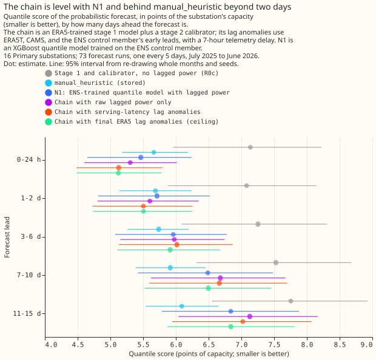

# Does the staged chain beat the single-stage model for Primary substation demand?

We asked whether a chain of two forecasting stages beats a single-step model for demand at
Primary substations (substations that step power down to the local distribution network), when both
use only the data a live service would have, including the real delay in NGED's power readings. We
scored the chain, the single-step model, and a simple baseline on the same 73 forecast runs. The
chain scored 0.08 points of capacity worse than the single-step model and 0.52 worse than the
baseline, and neither difference was clear of zero, so the chain is not supported for demand.

**Verdict: inconclusive.** With lag anomalies built only from weather that would be available at
forecast time, and with NGED's real telemetry delay, the quantile score of the staged chain (an
ERA5-trained stage 1 followed by a stage 2 calibrator that also reads recent power, as lag anomalies
and stage 1 residuals) is not distinguishable from N1's: 6.41 against
6.33, and C1 is +0.08 points of capacity (99.17% interval -0.11 to +0.25). The chain's point
estimate is above `manual_heuristic`'s 5.89 by +0.52 (-0.25 to +1.25, C3). Neither interval excludes
zero. The decision rule needed both to be wholly below zero by at least 0.3, so the staged design is
not supported for demand on this evidence. The prediction, that the chain would score 0.3 to 0.8
below N1, was missed. A point is 1% of the series' effective capacity. The substations are not
named. N1 is the single-stage XGBoost quantile model trained on the ensemble weather forecast (ENS)
of the European Centre for Medium-Range Weather Forecasts. `manual_heuristic` is a stored baseline
that forecasts from the power at the same time of day in earlier weeks and years.

## What the arms score

Every arm is scored on the same 768,073 cases per seed (Primary substations; 965,723 for all 20
series), on the 73 runs of `fold_a_every5d_v1`. Intervals resample whole months and the three
seeds. Quantile score (an estimate of the continuous ranked probability score), smaller is better:

| Arm | All leads | Up to 48 h | 3 days or more | Median error, all leads | Bias | Coverage |
|---|---|---|---|---|---|---|
| `manual_heuristic` | 5.89 | 5.68 | 5.94 | 8.23 | -1.34 | 80.9% |
| N1 | 6.33 | 5.59 | 6.51 | 8.45 | -2.60 | 80.1% |
| Chain, final ERA5 lag anomalies (ceiling) | 6.28 | 5.32 | 6.50 | 8.47 | -1.99 | 86.2% |
| Chain, serving-latency lag anomalies (S) | 6.41 | 5.32 | 6.66 | 8.64 | -2.12 | 86.1% |
| Chain, S with a spread factor of 1.15 | 6.37 | 5.31 | 6.61 | 8.64 | -2.12 | 90.0% |
| Chain, raw lagged power only | 6.46 | 5.45 | 6.70 | 8.64 | -2.22 | 86.3% |
| Chain, S at 3.5 hours of delay | 6.28 | 5.16 | 6.54 | 8.52 | -2.30 | 86.3% |
| Stage 1 and calibrator, no lagged power (R0c) | 7.46 | 7.11 | 7.56 | 10.02 | -3.45 | 85.8% |
| `climatology` | 7.46 | 7.39 | 7.49 | 10.33 | -2.87 | 83.0% |
| Production recipe | 9.52 | 9.38 | 9.58 | 9.92 | -2.28 | 9.7% |

Bias is the mean of the median forecast minus the observed power, in points of capacity. Coverage is
the share of observations inside the 5% to 95% band.

## The six planned contrasts

Quantile score, Primary substations, 99.17% intervals; negative means the first arm is better.

- **C1 (primary), chain minus N1:** +0.08 over all leads (-0.11 to +0.25), -0.27 up to 48 h (-0.62
  to +0.03), +0.15 beyond 3 days (-0.07 to +0.36).
- **C2, chain minus R0c:** -1.05 over all leads (-1.64 to -0.58), -1.79 up to 48 h. Experiment 00005
  measured -1.80 over leads up to 48 hours with final ERA5 and no delay.
- **C3, chain minus `manual_heuristic`:** +0.52 (-0.25 to +1.25), -0.36 up to 48 h (-0.89 to +0.12),
  +0.72 beyond 3 days (-0.14 to +1.54).
- **C4, chain minus the final-ERA5 ceiling:** +0.13 (+0.02 to +0.25), so serving sources lose 0.13.
- **C5, chain minus raw lagged power only:** -0.04 (-0.12 to +0.07), -0.14 up to 48 h (-0.30 to
  -0.03). Lag anomalies add little to the lags themselves.
- **C6, spread factor minus no factor:** -0.04 (-0.08 to -0.00). The factor `k` was 1.15, chosen on
  calibration rows only, and lifts the coverage from 86.1% to 90.0%.

## Exploratory contrasts (95% intervals)

- **The CAMS swap and the proxy change the score by 0.01 or less.** The chain with and without CAMS
  shortwave differ by +0.01 over all leads (E1, 0.00 to +0.01) and by +0.01 up to 48 h (+0.01 to
  +0.03), so the swap is a tiny worsening. The proxy alone against the serving mix differs by 0.00
  (E2).
- **Telemetry delay matters up to 48 hours.** The chain with final ERA5 and the 7-hour delay scores 0.05
  better than with a 0.5-hour delay over all leads (E3, -0.17 to +0.05), but 0.11 worse up to 48 h. With
  3.5 hours of delay, as N1 had, the chain beats N1 up to 48 h by 0.43 (-0.72 to -0.15, E5) and is
  level with it over all leads (-0.04, -0.18 to +0.07). The extra 3.5 hours cost 0.13 (E7).
- **The production recipe is far behind.** The chain beats it by 3.11 (E4).

## Limits

- **ERA5T is emulated by final ERA5**, and the CAMS values are the real history rather than the
  value available on the day, so C4 may understate the cost of serving latency.
- **One calibrator and spread factor per substation type**; N1 has no calibration, so its 80%
  coverage is part of its score.
- **Calibration residuals are at most 3 months from a model's fit**, while validation residuals
  come from a final model up to 12 months old. The page did not measure the residual scale by months
  since fit.
- **16 series and 12 months** leave 99.17% intervals of about plus or minus 0.2 for the paired
  contrasts and plus or minus 0.8 against `manual_heuristic`.
- **Every arm under-forecast the validation year** by 1.3 to 3.5 points (the bias column), so the
  scores above mix bias with the other error.
- **The review used Sonnet, not Opus,** because the maintainer asked for Opus only where vital.

## Lessons learned

- **The staged design is not supported for demand on this evidence.** The chain is not
  distinguishable from N1, and its point estimate is above `manual_heuristic`'s. Its point estimates
  are lower only up to 2 days, with intervals that include zero.
- **Raw lagged power carries most of the lag signal.** Lag anomalies add 0.04 over all leads.
- **Telemetry delay and weather source matter at different leads.** Delay matters up to 48 hours (E7
  +0.16, C4 0.00), and the weather source beyond 3 days (C4 +0.16, E7 +0.12).
- **A spread factor helps.** Coverage rose from 86% to 90% and the quantile score fell by 0.04.

## Plan, written before any code ran

## Plan: sizing

- **Stored data:** prediction sets under `data/ml-experiments/`; no production table changes.
- **Production serving path:** not touched.
- **Degradation rule:** not touched.
- **Defensible designs:** more than one. The weather source at each lag time, the telemetry delay,
  and the spread factor each have more than one defensible form; each is fixed below before a fit.
- **Callers:** the scripts copy the helpers of experiments 00005 and 00013, which the author of this
  plan could name without searching.

Size: complex. The plan gets one Sonnet review, the code gets two Sonnet reviews (leakage and the
fit stopping at the fold's end; then correctness), and the write-up gets one. Opus is not used,
because the maintainer asked for Opus only where vital.

## Plan: what differs from experiment 00005

Experiment 00005 measured the lag gain with a ceiling, because the lag anomaly (observed power at a
lag time minus stage 1's expectation at that time) used final ERA5 weather at past times and a
forecast origin with no telemetry delay. This experiment changes three inputs and nothing else in
the chain.

- **Telemetry delay.** NGED's files cover 6-hour windows ending at 02:00, 08:00, 14:00, and 20:00
  UTC, and in this project's downloaded-files list each file lands 3.0 hours after its window ends
  (median over the 26,697 files from 2026-03-26). The forecast origin is 09:00 UTC, 9 hours after
  the 00:00 UTC ENS run. The newest observed half-hour usable at the origin is therefore the one
  ending 02:00 UTC, 7 hours before the origin. Experiment 00013 assumed 3.5 hours. A lag is usable
  only when its time is at or before that newest half-hour.
- **Weather at lag times.** Stage 1's expectation at a lag time uses one of four weather sources,
  all emulated from data on disk, and every source respects what serving has at 09:00 UTC. ERA5T is
  emulated by final ERA5 and is available for times at least 5 days before the origin. CAMS
  irradiance (hourly, at the series' location) is available up to 00:00 UTC of the origin day. The
  analysis proxy is the ENS control member of the freshest run that had started by the lag time
  (lead 0 to 24 hours, so a run's first day), as `weather_utils.analysis_proxy` defines it, and is
  available to the origin. ERA5T differs slightly from final ERA5, and the emulation ignores that.
- **Lag times.** The anomalies and residuals use the times 24, 48, 168, and 336 hours before the
  valid time, the newest usable half-hour and the ones 1 and 3 hours before it, and the latest
  earlier time with the valid time's half-hour of day and of week. A lag is null when its time is
  after the newest usable half-hour (origin minus 7 hours), so the 24-hour lag is unusable at leads
  up to 17 hours.
- **Which stage 1 models.** Calibration origins use the forward-chain stage 1 model of their
  quarter, and validation origins use the final model, both from experiment 00005. A chain model stops
  15 days before its quarter starts, and an origin reads lag times no earlier than 14 days before
  itself, so every expectation is out of sample. The experiment refits
  nothing in stage 1.

## Plan: arms

All arms use stage 1a from experiment 00005 (`from2023`: ERA5-trained from 2023-09, 13 columns)
the same ENS statistics (mean, standard deviation, 10th, 50th,
and 90th percentile of the 51 members, plus the lead), and the same stage 2 calibrator
(multi-quantile XGBoost, depth 4, 300 rounds, 9 levels, per series, trained on every third daily run
from 2024-04-01 to 2025-06-30). They differ only in the recent-origin inputs. Seeds are 0, 1, and 2.

- **CH-none:** raw recent power only: the newest usable power, the power 1 and 3 hours before it,
  the power at the same time of day and of week, and the four power lags (24, 48, 168, and 336
  hours), no lag anomalies.
- **CH-S (serving):** the same inputs plus the stage 1 residuals and lag anomalies. A lag time at
  least 5 days before the origin takes ERA5T. A later one up to 00:00 UTC of the origin day takes
  the analysis proxy with its shortwave replaced by CAMS. A later one still takes the analysis
  proxy. This is the arm whose contrasts decide the verdict.
- **CH-S-noCAMS:** as CH-S, without the CAMS swap.
- **CH-P (proxy):** the analysis proxy at every lag time.
- **CH-E (ceiling, real delay):** final ERA5 at every lag time, with the 7-hour delay.
- **CH-S-delay3.5:** as CH-S with the 3.5-hour delay that experiment 00013 gave N1 and
  `manual_heuristic`, so C1 and C3 can be read at equal telemetry freshness. It is exploratory.
- **CH-E-nodelay (replicates 00005's L3):** final ERA5 and a 0.5-hour delay, as 00005 had.
- **CH-S-spread:** CH-S quantiles with the spread scaled about the median, `q50 + k (q - q50)`, by
  one factor `k` for the Primary substations (and one each for the bulk and grid supply points).
  `k` is chosen from the grid 1.00 to 1.60 in steps of 0.05 on held-out calibration rows: a
  calibrator fitted on the calibration runs before 2025-01-01 scored on the runs from 2025-01-01 to
  2025-06-30 by quantile score. The scored arm uses the full-window
  calibrator and that `k`. No validation row influences `k`. N1 gets no equivalent tuning, so C6 is
  descriptive and the verdict never rests on it.
- **References from stored predictions:** N1 (00013), `manual_heuristic`, `climatology`, and the
  production recipe (00013), and R0c, the lag-free calibrated stage 1 (00005), each repeated once
  per seed where unseeded.

## Plan: planned contrasts

Quantile score over all leads and by lead band, on the 16 Primary substations, 99.17% intervals.

- **C1 (primary):** CH-S minus N1.
- **C2:** CH-S minus R0c (the lag-free calibrated stage 1; 00005 measured -1.80 with ERA5 and no
  delay).
- **C3:** CH-S minus `manual_heuristic`.
- **C4:** CH-S minus CH-E (what the serving sources cost against final ERA5 at the same delay).
- **C5:** CH-S minus CH-none (what lag anomalies add to raw lagged power).
- **C6:** CH-S-spread minus CH-S, on the quantile score; coverage is read beside it.

Exploratory (95%): CH-S minus CH-S-noCAMS, CH-S minus CH-P, CH-E minus CH-E-nodelay (the cost of the
real telemetry delay), CH-S minus the production recipe, and the same contrasts for the two bulk
supply points and the two grid supply points, which are descriptive.

## Plan: bias

Every arm in experiment 00013 under-forecast the validation year by 1.3 to 3.1 points. The page
reports the mean signed error of the median for every arm and lead band, and the mean absolute error
after subtracting each arm's per-series mean signed error (an oracle on the validation year, labelled
post hoc), so the drift is not mistaken for a difference between arms.

## Plan: design confounds

- **Training data differs by design.** Stage 1 trains on ERA5 from 2023-09, which predates the ENS
  archive that N1 trains on (from 2024-04). That difference is part of the staged design under
  test, not a defect.
- **Column choice.** Experiment 00006 chose stage 1's 13 columns on its own selection year
  (2024-07 to 2025-06), before any 2025-07 data was scored.
- **Residual scale.** Calibration residuals come from models at most 3 months past their fit, and
  validation residuals from a final model up to 12 months past its fit. The write-up reports the
  residual scale by months since fit.

## Plan: leakage and cleanliness

- Nothing is scored on or after 2026-07-01.
- Lag times, ERA5, CAMS, and proxy rows are all at or before the newest usable half-hour, which is at
  or before the origin minus 7 hours; a unit check asserts this on every case, and also each
  source's cutoff: ERA5T times at least 5 days before the origin, CAMS times up to 00:00 UTC of the
  origin day, and proxy values from a run started by the lag time.
- Stage 1 models are never refitted. The calibrator trains on valid times up to 2025-06-30 23:30.
- The spread factor `k` uses calibration runs only.
- No calendar column enters the calibrator, as in 00005.

## Plan: ceiling labels and caveats

- CAMS irradiance enters an ERA5-trained stage 1 as shortwave; the two products differ in bias and
  scale, so the CH-S-noCAMS contrast shows whether the swap helps.
- The ENS archive starts on 2024-04-01, so calibration origins in the first 5 days have null
  proxy-window lags.
- ERA5T is emulated by final ERA5.

## Not tested here

Solar and wind series, a second fold, other weather models, and a recency-weighted stage 1.
