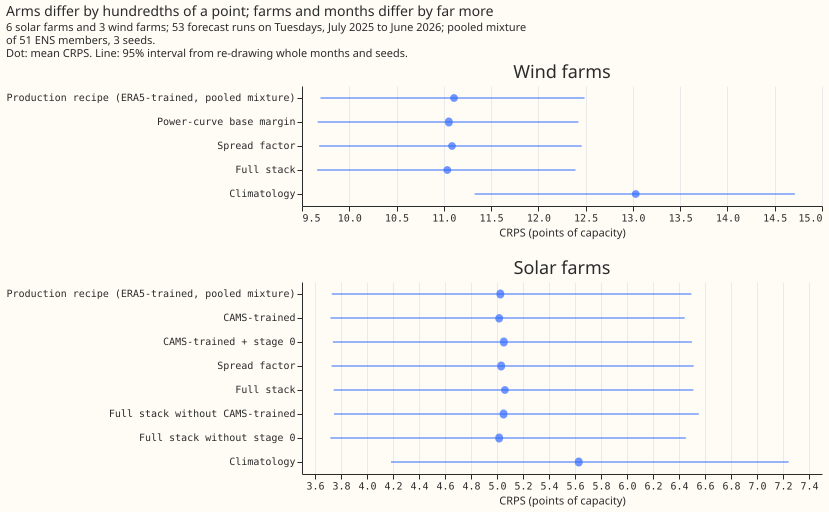
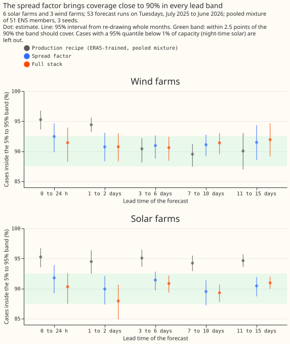

# Do the candidate changes for solar and wind add up to a better pooled mixture?

We asked whether combining the small improvements found earlier for solar and wind farm forecasts
gives a better forecast than the current method. We built the full combination, removed each
improvement in turn, and measured the accuracy of the forecast range. For wind, the combination
improved accuracy by 0.071 points of capacity, and a starting guess taken from the turbine power
curve supplied most of it. For solar, no improvement helped detectably.

**Verdict: partly supported.** For wind, the full stack (a power-curve base margin and a spread
factor) lowers the continuous ranked probability score (CRPS) by 0.071 points of capacity, and the
base margin carries the gain. For solar, no component detectably helped and the full stack was 0.035
points higher, with an interval that does not rule out a gain of 0.075. ENS is the European Centre
for Medium-Range Weather Forecasts ensemble, ERA5 its reanalysis of past weather, and CAMS the
Copernicus Atmosphere Monitoring Service's satellite irradiance estimate. The production recipe (arm
`base`) is the pooled ERA5-trained mixture of experiment 00002. This is proposal P22 of the
[research plan](../themes/calibration-and-uncertainty/plan.md). This experiment combines the changes
that [experiment 00012](../00012-solar-wind-stage1a-inputs-cams-and-training-start/result.md),
[experiment 00014](../00014-cams-trained-stage1-with-stage0-ens-correction-demand/result.md), and
[experiment 00016](../00016-pooled-mixture-calibration-solar-wind/result.md) flagged as candidates
or small gains, and drops each in turn. Gains of this size may not add, because the CAMS-trained
stage 1a XGBoost model and the stage 0 mapping act on the same ENS irradiance bias.

## Size

- **What gets stored:** private prediction sets and tables only. No schema in `packages/contracts/`
  changes.
- **Production serving path:** not touched.
- **Degradation rule:** not touched.
- **More than one defensible design:** yes. The stage 0 form (a regression, as in 00012, or a
  quantile mapping, as in 00014), the spread-factor grouping, and the form of the wind base margin
  for a multi-quantile objective all admit alternatives. This page fixes one of each.
- **Code whose callers cannot be named without searching:** no. The scripts copy the patterns of
  experiments 00012, 00014, and 00016, which an experiment may not import.

The size is complex, so the plan, the code, and the write-up each get a Sonnet review.

## Which earlier advice this plan follows

- **Followed:** keep the training start at 2019-09 and leave out the clear-sky-ratio target (00012);
  pair a CAMS-trained stage 1a with a stage 0 mapping onto the same irradiance and check the member
  spread afterwards (00014); scale the solar mixture's quantiles by one factor, and the wind
  mixture's on two lead groups (under 72 h, and 72 h or more), refitted monthly on earlier cases
  (00016); report absolute scores and the climatology beside every contrast (00001).
- **Departs from:** 00012's stage 0 was a regression on the control member, which gave no gain on
  the member average. This plan uses 00014's empirical quantile mapping, which kept the member
  spread. Fitting stage 0 on the whole ensemble is not possible, because the ENS training table
  holds member 0 only.

## Design

**Rows and series.** The 6 solar farms and 3 wind farms of
`fold_a_tuesdays_v1`: 53 runs on Tuesdays with valid times from 2025-07-01 to 2026-06-30, three
seeds. Only labels appear in the write-up.

**Stage 1a quantile model.** One XGBoost model per series and seed with the 9-level multi-quantile
objective of experiment 00002 (500 rounds, `eta` 0.05, depth 6), the same columns as 00001 (9 for
solar, 6 for wind), no calendar and no power-lag column, trained on cleaned power at valid times
from 2019-09 to before 2025-06-17. The pooled mixture treats the 51 members' 9 quantiles as
equal-weight atoms, as in 00002.

**Weather source at forecast time.** ENS members only. ERA5 and CAMS are read at training only, so
nothing needs to exist at forecast time that is late (ERA5 arrives about 5 days late). No arm has a
lag column.

**Fit windows.** Every fit uses cleaned power and ERA5 or CAMS weather at valid times before
2025-06-17: the stage 1a quantile models, the wind power curve (refitted for each seed on the
series' own training rows), and the stage 0 mappings. Training reads the ERA5 100 m wind speed and
forecasting reads the ENS speed, which the base margin inherits. A margin makes XGBoost ignore its
base score, and the same margin goes to all 9 levels, so the predicted quantiles are sorted
afterwards. The code guards that the margin changes the predictions.

**Spread factor.** Each arm refits its own factor on its own earlier cases (a factor from
experiment 00016 would not fit different quantiles). A fit needs at least 5,000 non-trivial earlier
cases (cases whose uncorrected 95% quantile exceeds 1% of capacity); a month or lead group without
a fit stays uncorrected. The first month never has earlier cases, and the short wind lead groups
fit late in the year, which bounds what any spread-factor contrast can show. The two wind lead
groups were chosen after experiment 00016's results and are validated here on the same year.

**Stage 0 checks (descriptive).** The write-up reports, for each solar arm with a stage 0 mapping,
the ratio of the mapped ENS daylight shortwave to the target irradiance by month, and the member
spread before and after, as experiment 00014 did.

**Components.**

| Component | Technology | What it changes |
|---|---|---|
| CAMS-trained | solar | The shortwave column of training rows is CAMS irradiance at the farm, not ERA5 shortwave |
| Stage 0 | solar | An empirical quantile mapping per lead band and zenith bin (00014's design) maps each ENS member's shortwave onto the irradiance the stage 1a trained on, CAMS for a CAMS-trained arm and ERA5 for an ERA5-trained arm. The mapping is fitted on the control member's pairs with valid times before 2025-06-17, pooled over the 6 farms (the run asserts the latest valid time) |
| Base margin | wind | The 100 m wind-speed power curve (binned mean power, running maximum) is the booster's base margin for all 9 quantiles |
| Spread factor | both | The quantiles are scaled about the median by the factor nearest 90% coverage of the 5% to 95% band, fitted for each scored month on non-trivial cases with valid times before the first run of that month. Solar uses one factor, wind one for leads under 72 h (the first two lead bands) and one for longer leads |

**Arms.**

| Arm | Solar | Wind |
|---|---|---|
| `base` | ERA5-trained, raw ENS | ERA5-trained, raw ENS |
| `cams` | CAMS-trained | n/a |
| `cams_s0` | CAMS-trained, stage 0 | n/a |
| `margin` | n/a | base margin |
| `base_spread` | `base` + spread factor | `base` + spread factor |
| `full` | `cams_s0` + spread factor | `margin` + spread factor |
| `full_no_cams` | ERA5-trained, stage 0 onto ERA5, spread factor (drops the CAMS-trained pair of training and stage 0 target) | n/a |
| `full_no_s0` | `cams` + spread factor | n/a |

Dropping the spread factor from the full stack gives `cams_s0` (solar) and `margin` (wind). Dropping
the base margin from the wind stack gives `base_spread`.

## Planned contrasts

The experiment plans 12 contrasts. Each is the arm named first minus the arm named second, scored
per technology.

| Id | Solar | Id | Wind |
|---|---|---|---|
| S1 | `full` - `base` (headline) | W1 | `full` - `base` (headline) |
| S2 | `cams` - `base` | W2 | `margin` - `base` |
| S3 | `cams_s0` - `cams` | W3 | `base_spread` - `base` |
| S4 | `base_spread` - `base` | W4 | `base_spread` - `full` (drop the margin) |
| S5 | `full_no_cams` - `full` (drop CAMS) | W5 | `margin` - `full` (drop the spread factor) |
| S6 | `full_no_s0` - `full` (drop stage 0) | | |
| S7 | `cams_s0` - `full` (drop the spread factor) | | |

The write-up also reports each arm's absolute CRPS and its 5% to 95% coverage by lead band, with the
climatology row of experiment 00002.

## Results

- **Absolute CRPS, all leads (points of capacity).** Solar: recipe 5.03, `cams` 5.02, `cams_s0` 5.05,
  `base_spread` 5.03, `full` 5.06, `full_no_cams` 5.05, `full_no_s0` 5.02, climatology 5.63. Wind:
  recipe 11.11, `margin` 11.05, `base_spread` 11.09, `full` 11.04, climatology 13.03. The seed
  spread is 0.001. The recipe reproduces experiment 00002 (solar 5.03 against 5.05, wind 11.11
  against 11.11).
- **Wind.** W1, full minus recipe: -0.071 (-0.133 to -0.014), a gain (at most -0.05, interval below
  zero). W2, base margin alone: -0.055 (-0.110 to -0.007). W3, spread factor alone: -0.021 (-0.043
  to -0.002). Dropping the margin from the stack raises the CRPS by 0.050 (W4, +0.005 to +0.098), so
  the margin stays. Dropping the spread factor raises it by 0.016 (W5, -0.004 to +0.036), so the
  spread factor does not stay by the rule.
- **Solar.** S1, full minus recipe: +0.035 (-0.075 to +0.116), inconclusive. S2, CAMS-trained: -0.009
  (-0.127 to +0.072). S3, stage 0 on top of CAMS-trained: +0.036 (-0.093 to +0.208). S4, spread
  factor: +0.006 (-0.004 to +0.025). Dropping CAMS (S5), stage 0 (S6), or the spread factor (S7)
  changes the CRPS by -0.010, -0.044, and -0.008, so no component stays.
- **Coverage.** The spread factor brings the 5% to 95% band to 87.9% to 92.5% in every lead band
  for both technologies, against 94.3% to 95.3% for the solar recipe and 89.5% to 95.3% for the wind
  recipe.

- **Stage 0 check.** Over the validation year, the mapped ENS daylight shortwave is 0.988 of CAMS
  (raw ENS: 1.045), but the monthly ratio ranges from 0.83 (November) to 1.10 (July), and the mean
  member spread is 25% wider than before the mapping.
- **Prediction against result.** The CAMS-trained gain (S2, predicted near -0.08) came out at
  -0.009, and stage 0 (S3, predicted +0.05 to -0.07) at +0.036, inside its range. For the full
  stack, the solar prediction (-0.10, plausible range +0.02 to -0.20) was wrong in sign. The wind
  prediction (-0.04, reaching only a small gain) was too cautious: the stack reached the gain
  threshold. The solar spread factor was predicted to be dropped, and was.

## Failures and limits

- **The claims rest on 6 solar farms and 3 wind farms in one validation year.** The solar paired
  intervals are 0.19 to 0.30 points wide, so a gain under 0.1 points is not resolved for solar.
- **Stage 0 was fitted on the ENS control member's pairs only,** pooled over the 6 farms, and
  corrects the year's mean but not individual months.
- **The wind spread-factor groups** (under 72 h, and 72 h or more) were chosen after experiment
  00016's results and are validated here on the same year. The first month, and the short wind
  groups for most of the year, have too few earlier cases for a fit and stay uncorrected.
- **Coverage uses the recipe's non-trivial cases for every arm,** while each arm's spread factor
  is fitted on the arm's own earlier non-trivial cases.
- **No post hoc tweak was run.** A stage 0 that keeps the member spread would need a refit of the
  CAMS-trained stage 1a models, which were not saved.

## Lessons

- **A change that helps the mean absolute error of the member average need not help the pooled
  mixture's CRPS.** CAMS-trained solar moved the first by -0.14 in experiment 00012 and the second
  by -0.009 here.
- **Stage 0 lowered the Primary demand quantile score by 0.067 in experiment 00014 and did not
  lower the solar CRPS here.** The mapping widened the daylight spread of the 51 members by about a
  quarter over the year, which may be why the pooled mixture did not improve.
