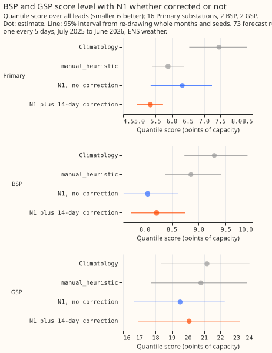

# Experiment 21: which error correction works best, and does it help BSP and GSP demand?

**Verdict: inconclusive for bulk supply points (BSP) and grid supply points (GSP), and the 14-day
additive correction stays the best variant.**
N1 is the single-stage quantile model trained on the ECMWF ensemble (ENS) control member. The
correction does not lower the BSP and GSP quantile score: C1 is +0.36 points of capacity (99.375%
interval -0.19 to +0.98) on 4 series. It does lower the Primary score with power 2 days old: C3 is
-0.99 (-1.82 to -0.18), the same size as the -0.99 that experiment 19 found with power 3.5 hours old.
Against `manual_heuristic` the corrected forecast scores -0.68 on BSP and GSP (C2, -1.57 to +0.26;
mean absolute error of the median -1.47, -2.36 to -0.63). No variant beat the 14-day additive
correction. A point is 1% of the series' effective capacity. Scores are on 73 forecast runs, one
every 5 days, from July 2025 to June 2026, with ENS weather. The generators are not named.

## What the arms score

Quantile score over all leads (mean signed error of the median in brackets; negative means the
forecast is too low).

| Arm | Primary (16) | BSP (2) | GSP (2) |
|---|---|---|---|
| `climatology` | 7.46 (-2.87) | 9.29 (+1.16) | 21.18 (-9.67) |
| `manual_heuristic` | 5.89 (-1.34) | 8.86 (+0.76) | 20.81 (-4.80) |
| N1 | 6.33 (-2.60) | 8.06 (+0.01) | 19.52 (-5.17) |
| N1 plus 14-day correction | 5.34 (-0.52) | 8.22 (+0.08) | 20.08 (-1.93) |

## Findings

- **A bias correction cannot help where N1 has no bias.** N1's two BSP series have a mean error of
  +0.01 points, so the correction only adds noise to those series
  (E2, +0.16, -0.09 to +0.39). The two GSP
  series are biased low by 5.2 points, the correction removes 3.2 of that, and the quantile score
  still rises (E3, +0.56, -0.29 to +1.45). The 4 series leave intervals too wide to separate the two
  types.
- **Over all leads, a delay of 2 days costs nothing.** The correction with 3.5-hour-old power scores
  the same as with 2-day-old power for Primary (E4, -0.0003, -0.018 to +0.019) and for BSP and GSP
  (E5, +0.02, -0.10 to +0.14). Up to 48 hours, fresher power helps a little (E4 -0.07, -0.11 to
  -0.03; E5 -0.19, -0.35 to -0.05).
- **A 7-day window is worse (C4, +0.19, +0.11 to +0.28) and a 28-day window is level or slightly
  better (C5, -0.07, -0.15 to +0.01).** No window qualifies to replace 14 days under the decision
  rule. A longer window is worth testing with monthly retraining in place.
- **The multiplicative form is much worse (C6, +2.28, +0.50 to +5.46).**
  Its mean error of the median is
  -3.4 points against -0.5 for the additive form.
- **A per-half-hour shift (C7, +0.02, -0.04 to +0.06) and recency weights (C8, +0.04, -0.00 to +0.09)
  change nothing.**
- **The corrected forecast beats `climatology` on BSP and GSP** (E11, -1.09, -1.70 to -0.42), and
  N1 alone is level with `manual_heuristic` on Primary substations over all leads (E10, +0.44, -0.10
  to +0.93), but worse at leads of 3 days or more (+0.57, 0.00 to +1.10).

## Predictions against outcomes

- **Missed:** the correction was predicted to lower the BSP and GSP score by at least 0.5 points; it
  raised it by 0.36 (C1).
- **Met:** the Primary gain was predicted at 0.6 to 0.9 points; it was 0.99 (C3).
- **Partly missed:** the 28-day window and the per-half-hour form were predicted to lose; each was
  level with the 14-day form, and the 28-day window was nominally the best variant.

## Limits

- **BSP and GSP have 2 series each.** The 99.375% interval on C1 is 1.2 points wide, wider than any
  gain the correction could plausibly give.
- **Errors are measured at short lead and applied at long lead.** Each past half-hour's error uses
  the forecast of the run current at that time, at a lead of 0 to 5 days, and the correction is
  applied up to 15 days ahead.
- **Runs with under 3 days of history get no correction.** That is 44 of 1,460 runs per seed for
  the 14-day variants (73 runs times 20 series); the 7-day and 28-day windows and the 3.5-hour delay
  differ by a few runs.
- **The rows are runs every 5 days, not daily.** Experiment 19's limit on daily forecasts applies.

## Plan, written before any code ran

### Plan: sizing

- **Stored data:** prediction sets only, under `data/ml-experiments/`; no production table changes.
- **Production serving path:** not touched.
- **Degradation rule:** not touched. A run with under 3 days of history gets no correction.
- **Defensible designs:** more than one. The variants are the question; each is fixed below.
- **Callers:** the scripts copy 00019's `corrections_for` and scoring, which the author could name
  without searching.

**Selection.** C4 to C8 test five variants at threshold 0, so replacing A14 by the best qualifying
variant carries a selection effect that only the Bonferroni correction covers.

Size: medium. No model is fitted, because every arm post-processes the stored predictions of N1
from experiment 00013, which covers all 20 series. One Sonnet review of the plan, one of the code
(leakage and the delay), and one of the write-up.

### Plan: arms

All arms are scored on the cases of `fold_a_every5d_v1` that every arm holds, with an observed value
and a valid time before 2026-07-01. The corrected arms apply to N1's three seeds. A correction
shifts or scales all 9 quantiles of a run and re-sorts them. No spread factor is applied, so that
the correction is isolated.

**The correction.** For each run with origin `T`, the window is the `W` days that end 2 days before
`T`. For each half-hour in the window, the forecast is the median of the latest earlier run that
began before it (the rule of 00019, which checks that no forecast comes from a run that began after
its half-hour). The error is the observed power over capacity minus that median. A run with under 3
days of paired history gets no correction.

- **A14:** add the mean error over a 14-day window to every quantile (00019's correction, with the
  delay changed from 3.5 hours to 2 days).
- **A7, A28:** the same with a 7-day and a 28-day window.
- **M14 (Primary substations only, where power stays positive):** multiply
  every quantile by the ratio of the window's mean observed power to its mean forecast median,
  clipped to 0.5 to 2.0; no correction when the mean median is under 0.01 of capacity.
- **H14:** add, to each valid time, the mean error of the window's half-hours with the same
  Europe/London half-hour of day; a cell with fewer than 3 pairs gets the window's overall mean error.
- **R14:** the 14-day mean error with weights `0.5 ** (age_days / 3.5)`, age counted back from the
  window's end, so the newest days weigh most.
- **A14-fast:** A14 with 00019's 3.5-hour delay, to measure what the 2-day delay costs
  (exploratory).
- **References:** N1, `manual_heuristic`, `climatology`, all uncorrected. A stored arm has no seed,
  so it is repeated once per seed.

**Delay.** A run at origin `T` uses only power stamped at or before `T` minus 2 days and a
half-hour (97 half-hours), so the correction needs power that is 2 days old. The run's code asserts
this bound. The delay is much longer than the 3.5 hours of 00013's lags.

**Lead mismatch.** Each past half-hour's error is measured against the forecast of the run with the
latest origin at or before that half-hour, so the correction measures errors at leads of 0 to 5
days, and applies the result at leads up to 15 days. A bias that grows with lead is under-corrected.

**Bias** is the mean signed error of the median, reported by arm and by group (Primary, BSP, GSP),
beside the quantile score and the mean absolute error of the median.

**Groups.** BSP and GSP have 2 series each. The planned contrasts pool the 4 and the tables also
show each type. A resolved interval for either type alone is not expected.

### Plan: past weather

No past weather is used; the correction reads observed power only, and N1's weather is ENS in
training and scoring.
