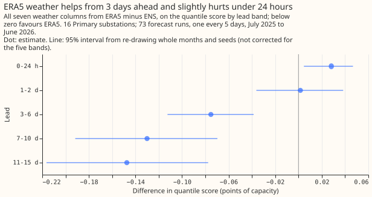

# Experiment 22: how much would Primary demand gain from ERA5 weather in place of ENS weather?

We asked how much better the demand forecast for Primary substations (substations that step power
down to the local distribution network) would be if its weather input were an estimate of past
weather instead of a weather forecast. The answer is an upper limit on what better weather products
could bring, because estimates of past weather arrive about 5 days late and cannot be used live. We
swapped the weather in the best demand forecast and scored 16 Primary substations over 73 forecast
runs. The estimates of past weather lowered the error by only 0.10 points of capacity, so the
0.3-point gain we had predicted is ruled out.

**Refuted: ERA5 weather lowered the quantile score by 0.10 points of capacity (99.38% interval -0.16
to -0.04), so the 0.3-point gain the decision rule asked for is ruled out.** The rows are the 16
Primary substations and 73 forecast runs of experiment 00019, scored with its full stack (N1 with a
half-life of 0.5 years, the 14-day correction, the spread factor of 1.15). The ENS arm scores 5.32
and the all-variable ERA5 arm scores 5.22, in points of capacity (1 point is 1% of a series'
effective capacity). `manual_heuristic` scores 5.89 on the same rows. The ENS arm matches experiment
19's stored stack to within 0.0003 points. ERA5 reaches us about 5 days late, so no serving system
could use it: the arm is a ceiling for a weather product as accurate as ERA5. ENS is the European
Centre for Medium-Range Weather Forecasts' ensemble forecast, which has 51 members. The quantile
score measures how well the forecast quantiles fit what happened, and smaller is better.
`manual_heuristic` is a stored baseline that forecasts from the power at the same time of day in
earlier weeks and years.

| Weather column from ERA5 | Quantile score minus ENS arm (99.38% interval) |
|---|---|
| All seven columns | -0.100 (-0.162 to -0.044) |
| Shortwave radiation | -0.084 (-0.130 to -0.043) |
| Longwave radiation | -0.016 (-0.028 to -0.008) |
| Temperature at 2 m | -0.013 (-0.039 to +0.011) |
| Dew point at 2 m | -0.003 (-0.010 to +0.002) |
| Surface pressure | +0.008 (-0.007 to +0.025) |
| Precipitation | -0.006 (-0.012 to -0.0002) |
| Wind speed at 10 m | -0.001 (-0.008 to +0.005) |

**Shortwave radiation carries nearly all of the gain.** The seven single-column gains sum to -0.115
against -0.100 for all columns together. Temperature, which the plan expected to lead, gave -0.013
with an interval that includes zero. Precipitation is near zero in both sources, so its interval
excluding zero is not a finding.

**The all-variable ERA5 arm helps only from 3 days ahead.** The gain by lead band is -0.075 at 3 to
6 days (95% interval -0.112 to -0.039), -0.130 at 7 to 10 days (-0.192 to -0.070) and -0.147 at 11
to 15 days (-0.216 to -0.078). It is +0.028 at 0 to 24 hours (+0.005 to +0.047) and +0.002 at 1 to 2
days (-0.036 to +0.038), so ERA5 is not better than ENS inside 2 days. The ENS arm scores 4.50 at 0
to 24 hours and 5.75 at 11 to 15 days. The band intervals are not corrected for five bands.

## Limits

- **The N1 XGBoost model was trained on ENS control-member weather and not on ERA5.** ERA5 differs
  from ENS in bias (for example, its mean shortwave is 132.6 against 139.1 W/m² over the validation
  year), so a model trained on ERA5 might gain more.
- **The 5% to 95% band covers 86% with ERA5 against 85% with ENS, and the 10% to 90% band covers 74%
  against 76%.** The
  spread factor was fitted for ENS and was not refitted.
- **Each arm's correction history comes from that arm's own forecasts.** An ERA5 arm has therefore
  also had its past errors corrected with ERA5 weather.

## Plan, written before any code ran

- **Model.** Each series' N1 model with the half-life of 0.5 years is refitted as in experiment
  19, on the ENS control member up to 2025-06-30, because that experiment stored no fitted models.
  The 14-day correction and the 1.15 spread factor are applied as in experiment 19.
- **Arms.** The ENS arm feeds the 51 ENS members as in experiment 19. The all-variable ERA5 arm
  replaces the seven weather columns (shortwave, longwave, temperature, dew point, surface
  pressure, precipitation, wind speed at 10 m) with ERA5 at the valid time; the same value enters
  every member, so the 51 members collapse to one. Seven single-variable arms replace one column and
  keep the ENS members for the other six. The correction history of each arm comes from that arm's
  own past forecasts.
- **Weather source and availability.** ERA5 reaches us about 5 days late, so it does not exist at
  forecast time. The arms therefore give a ceiling for a weather product with ERA5's accuracy, and
  no deployable system could reach it.
- **Training and serving mismatch.** The model is trained on ENS control-member weather. ERA5
  differs from ENS in bias (for example radiation), so the ERA5 arms may understate the gain from a
  model trained on ERA5; retraining on ERA5 is not tested.
- **Rows.** The 73 runs of `fold_a_every5d_v1` and valid times before 2026-07-01, as in 00019. Leads
  are
  banded 0-24 h, 1-2 d, 3-6 d, 7-10 d, 11-15 d, reported exploratorily.
- **Leakage checks.** The fit stops at 2025-06-30 23:30; lags and the correction use observations
  at least 3.5 hours before the origin; the ERA5 values are those of the valid time only.

### Sizing

- **Stored data:** prediction sets only.
- **Production serving path:** not touched.
- **Degradation rule:** not touched.
- **Defensible designs:** one; it is a permutation of the serving weather.
- **Callers:** the scripts copy 00019's helpers.

Size: simple, with one Sonnet review of the code and one of the write-up.

### Earlier advice

Followed: test the correction on the winning recipe (00019); read the ENS control in the same way as
00013. No departure.
