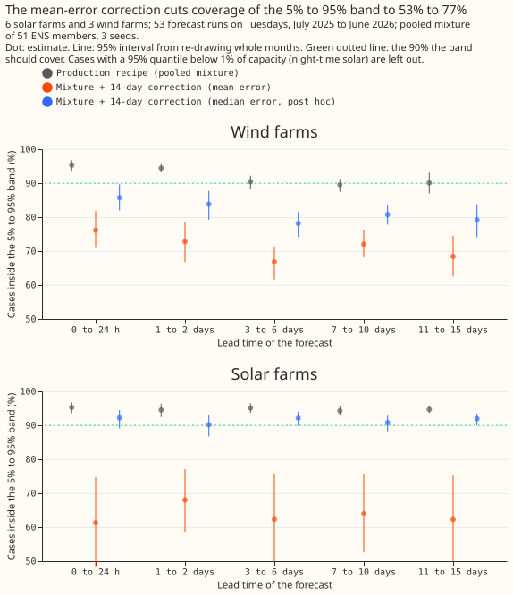

# Does recent observed power help solar and wind forecasts?

We asked whether recent measured power helps forecasts of solar and wind farm output, as it helps
forecasts of demand. We gave the second step of the forecast the power from earlier times and
summaries of it, and separately applied a correction based on the previous 14 days of errors, for 6
solar farms and 3 wind farms. Recent power changed the accuracy by less than about 0.1 points of
capacity, and the 14-day correction made the forecast about 0.4 points worse.

**Verdict: inconclusive, with no sign of a benefit.** Lagged power and summaries of recent power
left the stage 2 calibrator's continuous ranked probability score (CRPS) unchanged for 6 solar farms
and 3 wind farms, to within the resolution of about 0.1 points of capacity. The pre-registered
14-day correction raised the CRPS of the pooled mixture by about 0.4 points for both technologies.
This is proposal P18 of the [research plan](../research-plan.md), with the 14-day correction of
[experiment 00017](../00017-training-window-and-retraining-rule-drift-demand/result.md) and
[experiment 00019](../00019-primary-demand-stack-vs-manual-heuristic/result.md) added. ENS is the
European Centre for Medium-Range Weather Forecasts ensemble. The stage 2 calibrator is a second
model that corrects the forecast quantiles that stage 1a produces.

## Size

- **What gets stored:** private prediction sets only. No schema in `packages/contracts/` changes.
- **Production serving path:** not touched.
- **Degradation rule:** not touched.
- **More than one defensible design:** yes (the form of the calibrator and of the correction), and
  the plan fixes one of each by copying experiments 00005 and 00019.
- **Code whose callers cannot be named without searching:** no.

The size is medium: one Sonnet review of the code, which found no leakage and no index error, and
one of this write-up.

## Which earlier advice this plan follows

- **Followed:** compare lagged arms against a calibrated arm without lags (00005); keep the raw lags
  and add summaries beside them (00008); pool the members before scoring and report the pooled
  mixture beside every stage 2 arm (00002); use only forecast-time inputs at lag times, namely
  observed power at least 3.5 hours old and the earlier forecasts' own errors.
- **Departs from:** none.

## Design

**Rows.** The 6 solar farms and 3 wind farms of `fold_a_tuesdays_v1`: 53 Tuesday runs with valid
times from 2025-07-01 to 2026-06-30, three seeds.

**Weather source at forecast time.** ENS members only, through the ERA5-trained stage 1a quantile
models of experiment 00002. ERA5 is a reanalysis of past weather that arrives about 5 days late, and
no arm reads it at a lag time. Recent observed power is usable once it is 3 hours old plus the
half-hour it spans, as in experiment 00019.

**Calibrators.** One multi-quantile XGBoost model (9 levels, depth 4, 300 rounds, the settings of
experiment 00005) per technology, seed, and arm, trained on the ENS control member's rows with
out-of-fold stage 1a quantiles from 2024-07 to 2025-06 (the calibration table of experiment 00002),
with the observed power over effective capacity as the target. The calibrator takes the member's 9
stage 1a quantiles, the lead in hours, and the recent-power columns of its arm. The calibrator has no
calendar column. The calibrator is applied to each of the 51 members, and the calibrated quantiles
are pooled into a mixture as in experiment 00020.

**Recent-power columns.** Lagged power is the newest usable value, the value at the valid time's
half-hour on the latest earlier usable day, and the same on the latest earlier usable week
(experiment 00019's three lags). Summaries are the minimum, mean, and maximum of the 48 half-hours
ending at the newest usable value, and of the latest earlier usable day on the target's weekday
(experiment 00008); a window needs at least 24 observed half-hours.

**14-day correction.** For the run at time `t`, the correction is the mean of observed power minus
the mixture's median over earlier runs' non-trivial cases (95% quantile above 1% of capacity) with a
valid time in `[t - 14 d, t - 2 d]`, taking for each series and valid time the latest earlier run's
forecast. Fewer than 500 such cases means no shift. The run's non-trivial quantiles are shifted by
the correction, clipped to 0 to 1, and sorted.

| Arm | What it is |
|---|---|
| `mixture` | the pooled ERA5-trained mixture (the production recipe) |
| `cal0` | calibrator with no recent-power column |
| `cal_lags` | calibrator + lagged power |
| `cal_sums` | calibrator + summaries |
| `cal_both` | calibrator + lagged power + summaries |
| `mix_c14` | `mixture` + 14-day correction (mean error) |
| `cal_both_c14` | `cal_both` + 14-day correction (mean error) |
| `mix_c14_median` | post hoc: `mixture` + 14-day correction using the median of the errors |

## Results

- **Absolute CRPS, all leads (points of capacity).** Solar: `mixture` 5.03, `cal0` 5.30, `cal_lags`
  5.29, `cal_sums` 5.32, `cal_both` 5.30, `mix_c14` 5.46, `cal_both_c14` 5.89, climatology 5.63.
  Wind: `mixture` 11.11, `cal0` 11.41, `cal_lags` 11.43, `cal_sums` 11.53, `cal_both` 11.52,
  `mix_c14` 11.52, `cal_both_c14` 12.34, climatology 13.03. The seed spread is at most 0.005. The
  mixture reproduces experiment 00002 (solar 5.03 against 5.05, wind 11.11 against 11.11).
- **C1, lagged power in the calibrator (decides).** Solar -0.012 (-0.122 to +0.088), wind +0.012
  (-0.090 to +0.146): inconclusive, because the interval cannot rule out a gain of 0.05 or a loss of
  0.1. By lead band the point estimate is positive (worse) in the first two lead bands, under 3
  days, for both technologies, so the lags did not help at the short leads where recent power should
  matter most.
- **C2 and C3, summaries.** Summaries alone: solar +0.023 (-0.122 to +0.143), wind +0.115 (-0.051
  to +0.307). Adding them to the lagged calibrator: solar +0.015 (-0.057 to +0.063), wind +0.098
  (+0.009 to +0.213), so for wind they made the calibrator worse.
- **C4, the calibrator against the recipe.** Solar +0.276 (+0.152 to +0.417), wind +0.417 (-0.095 to
  +0.971). The calibrators are worse than the pooled mixture before lags are added: `cal0` scores
  0.27 (solar) and 0.31 (wind) points above `mixture`.
- **C5, the 14-day correction on the mixture (decides).** Solar +0.437 (+0.215 to +0.664), wind
  +0.413 (-0.003 to +0.924): refuted by the decision rule for both technologies, since the lower
  bound is above -0.05 and the interval is not wholly below zero. C6, the correction on the
  calibrator, is worse again: solar +0.590, wind +0.814.
- **Prediction against result.** The predicted wind gain from lagged power (-0.10) and solar gain
  (-0.05) did not appear. The correction was predicted to move the CRPS by under 0.05, and moved it
  by +0.44 and +0.41.

- **Coverage.** The mixture covers 94.3% to 95.3% (solar) and 89.5% to 95.3% (wind). The mean-error
  correction cuts coverage to 53% to 68% (solar, `mix_c14` and `cal_both_c14`) and 67% to 77%
  (wind).
- **Why the correction hurts (post hoc).** Observed power minus the median is positive on average
  for a right-skewed, zero-bounded target even when the quantiles are calibrated, so the mean error
  is a bias that the correction then adds to every quantile. Using the median of the errors instead
  (`mix_c14_median`, P1, read at 95%) gives solar +0.010 (-0.005 to +0.037) and wind -0.064 (-0.198
  to +0.082) with coverage of 90% to 92% (solar) and 78% to 86% (wind): no gain, but no loss. This
  was run after seeing the C5 result; it leaves the pre-registered contrasts and verdict unchanged.

## Failures and limits

- **A resolution limit.** With 6 solar farms and 3 wind farms, the C1 intervals are 0.21 (solar) and
  0.24 (wind) points wide, so a lag effect under about 0.1 points is not resolved.
- **The calibrator is trained on 12 months of the ENS control member only.** The control-trained
  calibrator applied to each member is worse than no calibrator, so C1 measures lags in a weaker
  baseline than the recipe. A calibrator trained on pooled members was not tested.
- **The 14-day correction has validation runs only** (one a week), so its window holds at most two
  runs. A daily history, as in experiment 00019, was not available.
- **The 14-day correction on the calibrated arms uses the mean error only.** Only the mixture was
  corrected with the median error.

## Lessons

- **Weather explains these farms' output well enough that recent power adds nothing detectable
  at leads from 0 to 15 days,** unlike Primary substation demand in experiment 00005.
- **A correction built from the mean error assumes a symmetric error.** The assumption held for
  Primary demand in experiments 00017 and 00019 and does not hold for a farm's output.
