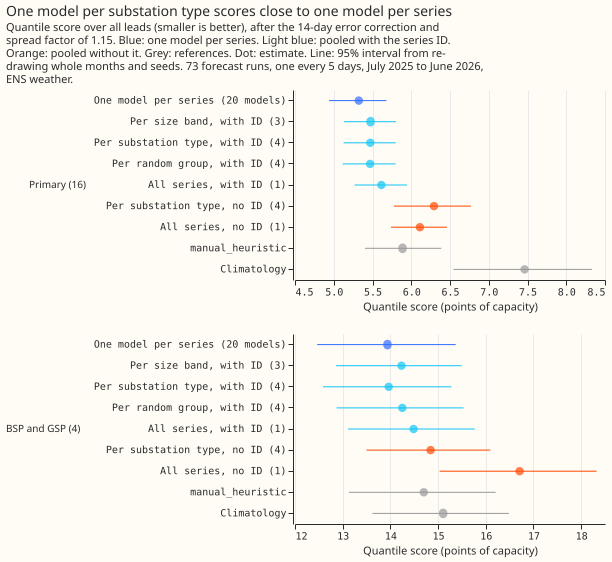

# Experiment 24: which groupings of substations can share one XGBoost model?

We asked how many separate XGBoost models are needed to forecast demand: one per substation, one per
group of similar substations, or a single model for all. We compared groupings by substation type
and by size, with one model per series as the reference, on 16 Primary substations (substations that
step power down to the local distribution network) and 4 bulk and grid supply points over 73
forecast runs. Sharing one model across a group cost 0.15 points of capacity, and one model for all
series cost 0.29.

**Supported: pooling the series into 3 or 4 models costs 0.15 points of capacity against one model
per series, and one model across all series costs 0.29.** Scores are the quantile score over all
leads, in points of capacity (1 point is 1% of a series' effective capacity), after the 14-day error
correction and the spread factor of 1.15 (the stack of experiment 19), with ENS weather, on 73
forecast runs from July 2025 to June 2026. On the 16 Primary substations, one model per substation
type with the series identifier (4 models) scores 5.47 against 5.32 for 20 per-series models, and C1
is +0.15 (99.44% interval +0.03 to +0.26), inside the 0.30 margin. One model per size band (3
models) scores the same (C3, +0.15, +0.05 to +0.26). One model across all series (1 model) does not
meet the margin (C2, +0.29, +0.19 to +0.42). By the pre-registered rule the winner is the size
bands, because it has the fewest models among the arms inside the margin, but the size-band and
by-type pools score the same to two decimal places. ENS is the European Centre for Medium-Range
Weather Forecasts' ensemble forecast, which has 51 members. The quantile score measures how well the
forecast range fits what happened, and smaller is better.

| Arm | Models | Primary (16) | BSP and GSP (4) | Saved size (MB) |
|---|---|---|---|---|
| One model per series | 20 | 5.32 | 13.94 | 435 |
| Per size band, with ID | 3 | 5.47 | 14.23 | 73 |
| Per substation type, with ID | 4 | 5.47 | 13.96 | 94 |
| Per random group of 5, with ID | 4 | 5.47 | 14.25 | 95 |
| All series, with ID | 1 | 5.61 | 14.49 | 26 |
| Per substation type, no ID | 4 | 6.29 | 14.84 | 88 |
| All series, no ID | 1 | 6.11 | 16.71 | 22 |
| `manual_heuristic` | | 5.89 | 14.70 | |
| `climatology` | | 7.46 | 15.11 | |

**The series identifier is essential.** Dropping it raises the score by 0.82 for the by-type pools
(C7, +0.46 to +1.23) and by 0.85 for the all-series pool (C8, +0.72 to +1.00). Without the
identifier the by-type pools score worse than `manual_heuristic` on Primary substations (+0.41,
+0.15 to +0.69, exploratory, 95%).

**On the Primary substations, which series share a model hardly matters.** A random partition into
4 groups of 5 of all 20 series scores 5.47 on the 16 Primary substations, the same as the by-type
pools (5.47). On all 20 series the by-type pools beat the random partition by 0.06 (C9, -0.13 to
-0.01), and on the 4 BSP and GSP series by 0.29 (13.96 against 14.25, exploratory). Size bands (3
models), by-type pools (4), and random groups (4) all lose 0.15 on Primary, so the data show a step
between 1 model and 3 or 4 models, not an effect of the grouping.

**The error correction helps pooled models less.** Without the correction, by-type pools beat
per-series models by 0.30 on Primary (exploratory, -0.56 to -0.03, 95%): 6.04 against 6.34. The
correction lowers per-series models by 1.0 points (6.34 to 5.32) and by-type pools by 0.6 (6.04 to
5.47), so the corrected pools lose 0.15. The difference between the two reductions has no interval,
so this finding is exploratory.

**All-series pooling costs most on the BSP series.** By-type pools are worse than per-series models
on 15 of the 20 series (largest loss 0.57, largest gain 0.68). The all-series pool is worse on 18,
and the BSP series lose 0.80 (0.64 to 1.00, exploratory, 95%). The 4 BSP and GSP series cannot
separate the by-type pools from per-series models (+0.03, -0.15 to +0.15).

**The pooled stacks still beat `manual_heuristic` on Primary substations.** By-type pools: -0.42
(-0.68 to -0.19). All-series pool: -0.27 (-0.56 to -0.03). Per-series models: -0.56 (-0.82 to
-0.33).

## Cost

| Arm | Models | Fit seconds, one seed | Rows per model |
|---|---|---|---|
| One model per series | 20 | 465 | one series |
| Per size band | 3 | 432 | 6 to 7 series |
| Per substation type | 4 | 184 | 2 to 8 series |
| Per random group | 4 | 550 | 5 series |
| All series | 1 | 161 | 20 series |

The fit seconds are not comparable between arms. Other sessions loaded the machine during the size
band and random group fits (the by-type and random fits train 4 models on similar row counts and
took 184 and 550 seconds), so only the model counts and the saved sizes are reliable. The saved
size falls from 435 MB to 22 to 95 MB with pooling.

## Predictions against outcomes

- **Met:** by-type pools were predicted within plus or minus 0.3 points of per-series (+0.15), and
  the all-series pool 0.2 to 1.0 worse (+0.29, at the low end). The prediction that the loss falls
  mostly on BSP and GSP was not confirmed: the Primary-only contrast is +0.29, and the BSP and GSP
  contrast is +0.55 with an interval from -0.00 to +0.95 (exploratory).
- **Met:** dropping the identifier raised the all-series score by 0.2 to 1.0 (+0.85).
- **Missed:** dropping the identifier was predicted to raise the by-type score by at most 0.2; it
  raised it by 0.82.
- **Met:** size-band pools fell between the by-type and all-series pools (level with by-type).
- **Met, barely:** the random partition scored worse than by type on all 20 series (by 0.06), and
  level with it on the 16 Primary series.

## Limits

- **Only 20 series.** BSP and GSP have 2 each, so their per-type pools are tiny and their intervals
  are wide. The verdict rests on the 16 Primary series, and an extrapolation to 2,500 series is not
  tested.
- **The intervals resample months and seeds, not series,** so they say nothing about new series.
- **Pooled models have a fixed 500 rounds and depth 6,** so their capacity per series falls as the
  pool grows. The experiment did not scale the rounds, so the all-series loss may be partly a
  capacity effect.
- **The correction history comes from runs 5 days apart** (experiment 19's limit), and 26 of 1,460
  series-runs had no history and got no correction.
- **Effective capacity is one fixed number per series,** shared by every arm, so it cannot
  explain a difference between arms.
- **The plan had one Sonnet review and the code had one;** the project's credit setting kept Opus
  for other work.

## Plan, written before any code ran

### Plan: sizing

- **Stored data:** prediction sets only, under `data/ml-experiments/`.
- **Production serving path:** not touched.
- **Degradation rule:** not touched.
- **Defensible designs:** more than one; the groupings, the pooled models' columns, and the
  per-series reference are fixed below before any fit.
- **Callers:** the scripts copy 00019's fit and 00021's scoring, which the author could name without
  searching.

Size: complex, because more than one design tests the hypothesis. One Sonnet review of the plan, one
of the code (leakage, the fit stopping at 2025-06-30, the correction's history bound), and one of
the write-up. Opus is kept for work that is truly vital.

### Plan: arms

**Recipe.** Every model is 00019's single-stage quantile model: the 9-level quantile loss on the ENS
control member, 00006's columns, the lead in hours, and the three power lags measured from the
forecast origin (00013's 3.5-hour telemetry delay). The recency half-life is 0.5 years (00017), the
training data are daily runs from 2024-04-01 with valid times up to 2025-06-30 23:30, and the model
is frozen there. Targets and lags are power over effective capacity, so series of different sizes
share one scale. Predictions pool the 51 ENS members into the 9-quantile mixture. The 14-day
additive error correction and the spread factor of 1.15 (00019's stack, correction history measured
with 00019's 3.5-hour delay) are then applied per series to each arm's quantiles.

**Series.** The 20 demand series of 00013 and 00021: 8 Primary substations that meter in MW, 8
Primary substations that meter in MVA, 2 BSP, and 2 GSP.

**Groupings.** The models differ only in which series a model trains on.

| Arm | Models | Rows per model |
|---|---|---|
| `own`: one model per series | 20 | one series |
| `type_id`: one per substation type (BSP, GSP, Primary-MW, Primary-MVA), with the identifier | 4 | 2, 2, 8, 8 series |
| `type_noid`: the same without the identifier | 4 | as above |
| `all_id`: one model across all series, with the identifier | 1 | 20 series |
| `all_noid`: the same without the identifier | 1 | 20 series |
| `size_id`: one per capacity band (terciles of effective capacity, 7, 7, and 6 series), with the identifier | 3 | 7, 7, 6 series |
| `random_id`: one per group of a random partition of the 20 series into 4 groups of 5 (seed 24, drawn before any fit), with the identifier | 4 | 5 series each |

The identifier is the series' integer code (0 to 19, fixed by site order) as a categorical column
(`enable_categorical`, XGBoost's default `max_cat_to_onehot`); every code is in the range of every
model, and a code the model never saw goes to the default direction.
`own` has no identifier because each model sees one series. The size bands use only each series'
effective capacity, a fixed property of the series, and the random partition is the control that
separates "similar series share a model" from "fewer models". Primary substations' units (MW or MVA)
come from the metadata table. Each arm is fitted for seeds 0, 1 and 2. References:
`manual_heuristic` and `climatology` stored by 00013.

**Cost.** For each arm the experiment records the number of models and the wall-clock fit seconds
(training only, GPU, after checking the CPU load), summed over models for one seed, and the size of
the saved models.

### Plan: leakage and scoring checks

- The scoring script asserts the correction's history bounds as 00019's and 00021's do: every
  observation in a correction is at or before the origin minus 7 half-hours, and the forecast for a
  past half-hour comes from a run that began at or before it.
- Training rows end at 2025-06-30 23:30 and only the control member is used; the scripts assert
  both.
- The validation rows are `fold_a_every5d_v1` (73 runs, every 5 days, valid times before
  2026-07-01), with ENS weather. Past weather is not used at lag times.
- A check compares `own` with 00019's N1H (same recipe): the two should agree within the seed spread
  of 00019's N1H on the 16 Primary series.
- No calendar control is added: the calendar columns of 00006's set are in every arm, so the
  contrasts compare groupings, not the value of the calendar.

### Plan: earlier advice

Followed: 00006's columns, 00017's half-life of 0.5 years, 00019's 14-day correction and spread
factor of 1.15 (stack, not tested separately here), 00021's finding that the correction is unproven
for BSP and GSP (reported per type, not assumed to help), and a climatology row. Departure: the
half-life is tested on a frozen model, which 00019 found neutral.

### Plan: limits stated in advance

- **BSP and GSP have 2 series each,** so their per-type intervals are wide and the by-type pools for
  them are tiny pools of 2 series; the verdict is driven by the 16 Primary series.
- **Only 20 series,** so conclusions about 2,500 series are an extrapolation, and the intervals
  resample months and seeds, not series, so they say nothing about new series.
- **Capacity per series falls as a pool grows.** Every model has 500 rounds and depth 6 whatever its
  row count, so a pool of 20 series gets less capacity per series than a per-series model; the
  experiment does not scale the rounds.
- **The 14-day correction removes level bias,** which is the main error of a badly pooled model, so
  the stack can hide pooling effects; the uncorrected contrasts are exploratory.
- **Effective capacity is a fixed property of each series** (as in every earlier demand experiment),
  and the targets and lags are scaled by it.
- **Review:** the plan is sized complex but had a Sonnet review only, as the project's credit
  setting asks.
- **The correction's history comes from 5-day-spaced runs** (00019's limit).
