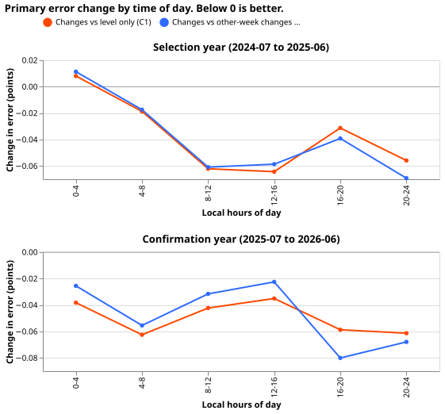
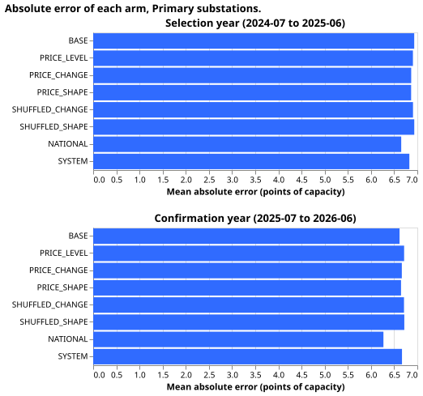

# Does the change in the intra-day price help a stage 1 demand model explain power?

**Verdict: small gain, and too small to use.** On Primary substations, price changes beat the price
level alone and beat other-week changes in both years, with intervals wholly below zero, but by 0.04
to 0.05 points of capacity against the pre-registered 0.1. The system price gained 0.05 to 0.08 over
the level. National demand and wind, with no price, scored 0.22 and 0.40 points below the price
change arm. Follows [experiment 15](../00015-same-time-price-stage1-demand/result.md).

**Absolute scores, Primary substations** (mean absolute error of the median, points of capacity, 3
seeds, 13 series in the selection year and 14 in the confirmation year):

| Arm | Selection | Confirmation |
| --- | --- | --- |
| BASE | 6.933 | 6.616 |
| PRICE_LEVEL | 6.905 | 6.715 |
| PRICE_CHANGE | 6.868 | 6.665 |
| PRICE_SHAPE | 6.866 | 6.648 |
| SHUFFLED_CHANGE | 6.907 | 6.712 |
| SHUFFLED_SHAPE | 6.934 | 6.719 |
| NATIONAL | 6.652 | 6.268 |
| SYSTEM | 6.828 | 6.669 |
| CLIMATOLOGY | 8.527 | 8.928 |

## What the contrasts say

- **C1, changes against level only (verdict):** -0.037 (-0.056 to -0.018) in the selection year and
  -0.050 (-0.083 to -0.018) in the confirmation year. 11 of 12 months are below zero in each year.
- **C2, changes against other-week changes (verdict):** -0.039 (-0.070 to -0.015) and -0.047 (-0.086
  to -0.006). Both estimates miss the -0.1 threshold, and both intervals lie wholly above -0.1, so a
  gain of 0.1 points is ruled out. The rule's "refuted" and "small gain" clauses both apply and it
  states no precedence. The verdict is `small gain`, because the skill reserves that label for an
  interval that excludes zero in the predicted direction below the threshold. Both pre-registered
  predictions missed: the gain of 0.15 to 0.4 points did not appear, and PRICE_CHANGE did worse than
  NATIONAL.
- **C3, changes against national demand and wind:** +0.216 (+0.020 to +0.468) and +0.397 (+0.167 to
  +0.633). National demand and wind are better in both years.
- **C4, shape against changes:** -0.002 (-0.043 to +0.040) and -0.017 (-0.063 to +0.024). The extra
  shape columns add nothing to the changes. Shape against other-week shape is -0.068 (-0.125 to
  -0.009) and -0.071 (-0.138 to -0.024).
- **C5, level against no price:** -0.028 (-0.159 to +0.112) and +0.099 (-0.047 to +0.248). Both
  intervals include zero, so the level alone shows no help. In the confirmation year PRICE_CHANGE
  (6.665) is still above BASE (6.616).
- **C6, system price against level only:** -0.077 (-0.105 to -0.048) and -0.046 (-0.078 to -0.018),
  as large as or larger than the price change gain.
- **C7, by time of day:** in the selection year there is no gain from 00:00 to 08:00, and the 16:00
  to 20:00 block (-0.031, interval -0.069 to +0.009) is smaller than the 08:00 to 16:00 and 20:00 to
  24:00 blocks (-0.056 to -0.064). The prediction of a peak at 16:00 to 20:00 did not hold. On the
  days with the top 5% largest half-hourly price move, C1 is +0.100 (-0.046 to +0.312) in the
  selection year and -0.251 (-0.332 to -0.189) in the confirmation year, so the day-level result did
  not repeat.
- **BSP and GSP, four series, each read alone:** no consistent sign. C1 in the confirmation year is
  -0.114 (-0.214 to -0.025) at B2 and +0.938 (+0.141 to +1.902) at G1, and the other two intervals
  include zero. NATIONAL beats PRICE_CHANGE at all four series in the confirmation year.

## Failures and limits

- **Some series have too little history,** so 13 of the 16 Primary series were fitted in the
  selection year and 14 in the confirmation year. All 2 BSP and 2 GSP series were fitted in both
  years.
- **Nine days of system price are missing at the source** (47 of 48 periods); the experiment treats
  them as missing. Market Index Data holds exact duplicate rows, which are harmless.
- **The shuffle shifts in UTC,** so the weekday and half-hour match is off by one local hour in the
  weeks around a clock change.
- **Market Index Data is a proxy for the intra-day price.** The tick-by-tick intraday price that
  jumps after an interconnector trip is paid for and was not tested, so this result does not rule
  out an effect of that price.
- **The model uses the price at the target half-hour,** so no score is a forecast skill.
- **Reviews:** Sonnet plan and code reviews, triaged on the pull request. No Opus review was run.

## Design

**Stage 1 here is an explanatory model, not a forecaster.** It maps the ERA5 weather, the clock, and
information about the price at time t or earlier to power at time t. Every column uses only values
at or before the target half-hour. The price at t is published only after the half-hour, so no
score is a forecast skill.

**The base is experiment 00006's Primary input set with the 0.5-year recency half-life of
experiment 00017.** Folds, purge, XGBoost settings (no column subsampling), the 20 series (16
Primary, 2 BSP, 2 GSP), the seeds (0, 1, 2), and the minimum training history are those of
experiment 00015. The 14-day error correction and the rest of experiment 00019's stack are stage 2
steps and are not part of stage 1, so they are left out.

| Arm | Adds to BASE |
| --- | --- |
| BASE | nothing |
| PRICE_LEVEL | `price_now`: Market Index Data (`APXMIDP`) at the target half-hour |
| PRICE_CHANGE | `price_now`, and `d1`, `d2`, `d4`, `d12`: price(t) minus price(t-k half-hours) |
| PRICE_SHAPE | `price_now`, price minus its trailing 24-hour mean, rank within the trailing 24 hours, half-hours since the last spike (price above the trailing-24-hour mean plus 2 standard deviations, capped at 48), and the 6-hour range |
| SHUFFLED_CHANGE | the real `price_now`, and `d1`, `d2`, `d4`, `d12` read at another week's same weekday and half-hour |
| SHUFFLED_SHAPE | the real `price_now`, and PRICE_SHAPE's other four columns read at another week's same weekday and half-hour |
| NATIONAL | GB demand and wind at t, their `d1`, and demand's `d4` (5 columns) |
| SYSTEM (descriptive) | `price_now`, the system price, the net imbalance volume, and the one-half-hour changes of both |
| CLIMATOLOGY | not a fit: month-by-half-hour median of the fold's training window |

**Rolling columns use only the past.** The rolling mean, standard deviation, rank, and range are
trailing windows that end at t. `check_no_lookahead` in `e00025_inputs.py` removes the future rows of
the series and fails if any added column changes. The report prints the share of rows with each
added column missing, for every arm, because the real and shuffled columns have different gaps and
XGBoost can learn from a gap. No row is dropped for a missing column. The join uses the half-hour's
start, `valid_time` minus 30 minutes, and the script asserts that `valid_time` is the period end.

**A shuffled arm keeps the real price level and takes the changes from another week.** The shift is
1 to 4 weeks either way, drawn per week and per seed, so the arm keeps the week's price level and
the calendar structure and loses the match between the changes and the target half-hour. Keeping
the real `price_now` makes C2 isolate the change columns. A training row whose shifted time would
fall after the training end shifts backwards instead, so no price from the purge or validation
weeks enters training; a row with no source on either side gets missing values.

**Prices.** Market Index Data is the experiment 10 pull, 2019 to 2026, with a zero volume treated as
missing. The system price (single price since 2015) and the net imbalance volume come from Elexon
DISEBSP, fetched free for 2019-09-01 to 2025-08-31 with `studies/market_downloads/fetch_gb_prices.py`
and joined to the 2025-09 to 2026-09 pull already on disk. Market Index Data is a proxy for the
intra-day price: it is an index of short-term trading, published after the period, and it is not
the tick-by-tick intraday price in which an interconnector trip shows. The tick price is paid for
and is not used. Weather is ERA5, which arrives about 5 days late, so no arm can run at forecast
time. The system price is a second, free signal of fault stress. A SYSTEM gain is not causal,
because the system price partly reflects the demand that the substations carry.

## Planned contrasts

All are differences in mean absolute error in points of capacity, over the selection year (2024-07
to 2025-06) and then, once, the confirmation year (2025-07 to 2026-06), with month-resampled
intervals, pooled over the series of one substation type and the 3 seeds. The types are scored
separately and never pooled.

- **C1 (verdict, Primary):** PRICE_CHANGE - PRICE_LEVEL.
- **C2 (verdict, Primary):** PRICE_CHANGE - SHUFFLED_CHANGE.
- **C3:** PRICE_CHANGE - NATIONAL.
- **C4:** PRICE_SHAPE - PRICE_CHANGE, and PRICE_SHAPE - SHUFFLED_SHAPE.
- **C5:** PRICE_LEVEL - BASE (the experiment 00015 check).
- **C6:** SYSTEM - PRICE_LEVEL.
- **C7:** C1 by 4-hour block of local time, in the 16:00 to 20:00 peak, and on the days with the top
  5% absolute half-hourly price change.
- **BSP and GSP:** C1 to C6 for each of the 4 series separately, with no type-level interval,
  because each type has two series. The page makes no claim comparing these types with Primary.

## Sizing

- **Stores:** private predictions and a private download of system prices; nothing is committed.
- **Serving path:** not touched.
- **Degradation rule:** not touched.
- **More than one defensible design:** yes (which price columns, which controls), fixed above.
- **Code whose callers could not be named without searching:** no, the code copies experiment
  00015's.

This is complex because it adds a data source and more than one defensible design. Reviews: one
Sonnet plan review, one Sonnet code review, one Sonnet write-up review. Opus is not used, by the
manager's instruction on credits.

**Resources.** Slot A: 12 cores, one process per fit with one thread, no GPU.

**Earlier advice.** Follows 00015's advice to keep an other-week price control and to try national
demand and wind, and 00017's advice to use a 0.5-year half-life. Departs from 00019's stack because
this is stage 1 only.
