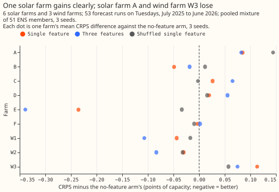

# Does a recent effective-capacity feature lower the solar and wind forecast error?

We asked whether telling a solar or wind forecast each farm's recent effective capacity lowers its
error. We added a feature stating that capacity to the forecast and compared the error with and
without it, for 6 solar farms and 3 wind farms. The feature moved the error by -0.018 points of
capacity (1% of a farm's effective capacity, roughly its usual maximum output) for solar and +0.013
for wind. The data could not tell either change from no effect, and could not rule out the
0.03-point gain that would justify using the feature.

**Verdict: inconclusive.** A feature stating each farm's recent effective capacity moved the
continuous ranked probability score (CRPS) by -0.018 points of capacity for solar and +0.013 for
wind, and the intervals include both no effect and the 0.03-point threshold. The experiment is
proposal P30 of the [research plan](../research-plan.md). The farms are 6 solar farms and 3 wind
farms. ENS is the European Centre for Medium-Range Weather Forecasts ensemble, ERA5 its reanalysis
of past weather, and CAMS the Copernicus Atmosphere Monitoring Service's satellite irradiance
estimate.

## Size

- **What gets stored:** private prediction sets and tables only. No schema in `packages/contracts/`
  changes.
- **Production serving path:** not touched. A port would add a daily table of capacity features.
- **Degradation rule:** not touched.
- **More than one defensible design:** yes. The statistic, the window, the weather variable that
  ranks the steps, and how training rows get a forecast origin all admit alternatives. This page
  fixes one of each.
- **Code whose callers cannot be named without searching:** no. The scripts copy the patterns of
  experiments 00020 and 00023.

The size is complex. One Sonnet reviewer reviewed the plan, and its findings (a season-preserving
shuffle, a matched shuffled copy of the single feature, a Bonferroni family of the 4 decisive
contrasts, a threshold of 0.03, and a training lead drawn from the validation leads) are applied.
The reviewer's rescaling design was rejected, because it tests a correction and not a feature. One
Sonnet reviewer reviews the code and one the write-up (Sonnet in place of Opus, as the credit
budget requires).

## Which earlier advice this plan follows

- **Followed:** test solar changes with a control that shares the column count (00020); keep
  `colsample_bytree` at 1.0 in every arm, because column subsampling gives a wider arm a free win;
  use the power-curve base margin for wind (00020); train on ERA5 from 2019-09 with no calendar
  column (00012); report absolute scores beside contrasts and the climatology row.
- **Departs from:** none. Experiment 00023 found recent power useless as a calibrator input, but it
  gave the calibrator the newest lags, not a capacity statistic, and the calibrator was weaker than
  the recipe.

## Design

**Rows and series.** The 6 solar farms and 3 wind farms of `fold_a_tuesdays_v1`: 53 Tuesday runs
with valid times from 2025-07-01 to 2026-06-30, three seeds. Only anonymised labels appear.

**Stage 1a quantile model.** The experiment 00020 recipe: one XGBoost model per series and seed with
the 9-level multi-quantile objective (500 rounds, `eta` 0.05, depth 6, `colsample_bytree` 1.0),
trained on cleaned power at valid times from 2019-09 to before 2025-06-17, applied to the 51 ENS
members and pooled into a mixture. Inputs: the 9 solar or 6 wind columns of experiment 00020, plus
the arm's capacity features. No calendar column and no lag column.

**The cutoff.** Every capacity feature is a function of a series and a cutoff day: the UTC day
that contains the forecast origin minus 5 days. The windows are whole trailing UTC days that end
before the cutoff day starts. The 5 days are ERA5's delay; CAMS is assumed no faster. Power is
cleaned power over effective capacity, so a feature is a fraction of capacity. One function computes
the daily table of features for a series, and a unit test truncates all inputs after the cutoff and
asserts that the features do not change.

**Training rows have no forecast origin.** The ERA5-trained model sees one row per valid time. Each
training row gets a lead drawn at random (seeded) from the leads of the validation frames, its
origin is the valid time minus that lead (the validation origin is `power_fcst_init_time`), and its
features are the daily table's row for that origin's cutoff day. A serving row uses its real origin,
so the feature is as stale in training as in serving. The effective capacity used to normalise power
is the whole-record 99th percentile that every arm already uses, so it is the same in all arms.

**Weather that ranks the steps.** CAMS shortwave at the farm for solar, and ERA5 100 m wind speed
for wind. Both are past weather read at a cutoff 5 days old, so training and serving read the same
product and nothing is late at forecast time.

**Features.** A top-decile feature is null when its window has fewer than 100 usable steps or its
top decile holds fewer than 10. A ratio feature is null under 10 usable steps. A percentile of all
power is null when under half the window's steps are observed. XGBoost handles nulls, and the
write-up reports each feature's null share by month.

| Name | Technology | Definition |
|---|---|---|
| `top_decile_28d` | solar | 99th percentile of power over daylight steps (solar zenith under 85 degrees) in the top 10% of CAMS shortwave within the window, 28 days |
| `top_decile_7d`, `top_decile_90d` | solar | the same over 7 and 90 days |
| `power_to_cams_q90_28d` | solar | 90th percentile of power divided by CAMS shortwave in kW per square metre, over steps with CAMS above 200 W per square metre, 28 days |
| `top_decile_last_year` | solar | `top_decile_28d` for the 28-day window centred 365 days before the cutoff day |
| `top_decile_28d` | wind | 99th percentile of power at the steps in the top 10% of ERA5 100 m wind speed, 28 days |
| `p995_28d`, `p995_90d` | wind | 99.5th percentile of all usable power, 28 and 90 days |
| `power_to_wind3_q75_28d` | wind | 75th percentile of power divided by the cube of speed, over steps with speed from 3 to 8 m/s, 28 days |
| `p995_last_year` | wind | `p995_28d` for the window centred 365 days before the cutoff day |

A feature that needs a window before 2019-09 is null, so the 90-day and last-year features are null
for the first 90 and 365 days of training and never null at serving; the model sees nulls only early
in training.

**A static capacity control is not included.** The design brief proposed one, but each series has
its own model, so a per-series constant column carries no information.

**Arms.** Equal column counts are not possible, so each shuffled control carries the columns of the
arm it matches.

| Arm | Extra columns |
|---|---|
| A0 | none (benchmark) |
| A2 | `top_decile_28d` |
| A3 | `top_decile_28d`, `top_decile_7d`, `top_decile_90d` (solar); `top_decile_28d`, `p995_28d`, `p995_90d` (wind) |
| A4 | A2 + `power_to_cams_q90_28d` (solar) or `power_to_wind3_q75_28d` (wind) |
| A5 | A2 + the last-year feature |
| A6 | A3's columns, from the shuffled table |
| A7 | A2's column, from the shuffled table |

The shuffle permutes, within each series, whole calendar months among the same calendar month of
other years before 2025-06 (every June among Junes), and a day takes its month's replacement day by
day of month. The seasonal marginal remains, so a control that gains must be gaining from season
and not from capacity. Months from 2025-06 on take a random same-calendar-month source before
2025-06, so no validation power enters a training row.

## Planned contrasts

Each contrast is the arm named first minus the arm named second, per technology (12 in all).

| Id | Contrast | What it tests |
|---|---|---|
| C1 | A2 - A0 (decides) | does a trailing capacity feature help |
| C2 | A2 - A7 (gates C1) | does the feature beat a season-preserving shuffle of itself |
| C3 | A3 - A6 | do several windows beat the same number of shuffled columns |
| C4 | A3 - A2 | do several windows help |
| C5 | A4 - A2 | does a second kind of statistic add (exploratory: it differs in kind from the top-decile feature) |
| C6 | A5 - A2 | does the same window a year earlier add (exploratory: a seasonal reference) |

The write-up reports each arm's absolute CRPS, the climatology row, a per-farm breakdown (gains are
expected to concentrate in the few months with a loss of capacity).

## Limits stated in advance

- **The pre-registered estimate was that the sample resolves about 0.1 points for solar.**
  Experiment 00020's solar paired intervals were 0.19 to 0.30 points wide, so the threshold of 0.03
  is below what 6 farms resolve unless a feature effect is concentrated.
- **The intervals resample initialisation months, not farms,** so the true uncertainty is larger
  than reported.
- **The cutoff of 5 days applies to power as well as weather,** a deliberate simplification that
  dilutes a signal about a recent loss.
- **The prior study found few real losses of capacity,** so little can be learned from most months.

## Results

- **Absolute CRPS, all leads (points of capacity).** Solar: A0 5.026, A2 5.008, A3 5.012, A4 4.990,
  A5 4.991, A6 5.057, A7 5.049, climatology 5.629. Wind: A0 11.053, A2 11.066, A3 11.015, A4 11.005,
  A5 11.091, A6 11.072, A7 11.056, climatology 13.029. The seed spread is at most 0.034. A0
  reproduces experiment 00020 (solar 5.03, wind 11.05).
- **C1, the single feature minus no feature (decides).** Solar -0.018 (-0.162 to +0.096), wind
  +0.013 (-0.054 to +0.101): inconclusive for both, because each interval holds zero and a gain
  of 0.03.
- **C2, the single feature minus its shuffled copy (gates C1).** Solar -0.041 (-0.324 to +0.131),
  wind +0.010 (-0.099 to +0.137). The shuffled solar copy A7 is 0.023 worse than A0, so the shuffle
  hurt a little, but no interval excludes zero.
- **C3 to C6 (descriptive).** Three features minus their shuffled copies: solar -0.045 (-0.314 to
  +0.134), wind -0.057 (-0.195 to +0.066). Three features minus one: solar +0.005, wind -0.052
  (-0.110 to +0.004). Shape feature added to the single feature: solar -0.017 (-0.188 to +0.085),
  wind -0.061 (-0.107 to -0.025), the only interval wholly below zero. Last-year feature added:
  solar -0.016, wind +0.024.
- **Per farm.** The single feature changed the CRPS of solar farm E by -0.235 points and of wind
  farm W1 by -0.044, and raised it for solar farm A by +0.085 and wind farm W3 by +0.113. The
  shuffled copy changed farm E by -0.034. The per-farm figures have no intervals, and farm E is one
  farm of six.

- **Coverage.** The 5% to 95% band of every feature arm covers up to 2.7 points less than A0's
  (solar 92.2% to 95.0%, wind 87.4% to 92.6%, against 94.3% to 95.3% and 89.4% to 93.7%).
- **Null shares over the validation year.** The solar 7-day feature is null on average 24% of
  days (44% at the worst farm); every other feature is null under 2% of days.
- **Prediction against result.** The solar single-feature effect (-0.02) matched the estimate. The
  wind effect (-0.03, within its stated range) came out at +0.01. The shuffled copy was predicted to
  move the CRPS by under 0.02 and moved solar by +0.023. Extra windows, a shape feature, and a
  last-year feature were predicted to move the CRPS by under 0.03 beyond the single feature, and for
  wind two of them moved it by more (C4 -0.052, C5 -0.061).

## Failures and limits

- **The observed interval widths show the sample resolves about 0.15 points for solar and 0.1 for
  wind.** The decisive intervals are
  0.26 (solar) and 0.16 (wind) points wide, so a gain of the predicted size is not resolved.
- **Intervals resample months, not farms.** The per-farm figure shows the spread between farms is
  larger than the contrast.
- **The wind shape feature's gain is exploratory.** C5 is one of 12 contrasts and sits outside the
  4 that set the interval level.
- **No post hoc tweak was run.**

## Lessons

- **A trailing capacity feature is not worth its serving step on this evidence.** The two decisive
  contrasts straddle zero, and the farm that gained most is one of six.
- **The cubic power-to-speed feature is worth a separate test for wind.** The cubic power-to-speed
  feature is the only feature with an interval wholly below zero among the descriptive contrasts (C5
  is one of 12), and it needs no weather product beyond the wind speed already used.
