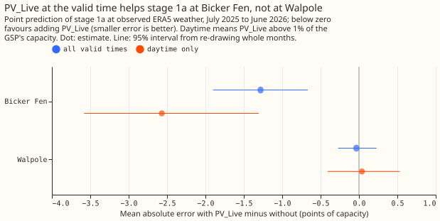

# Does PV_Live at the lag times help the stage 2 forecast of GSP demand?

We asked whether Sheffield Solar's estimate of solar generation at the earlier times used as inputs
(the lag times, such as 24 and 48 hours before the forecast origin) helps the second step of a
demand forecast at two grid supply points. We gave the second step that estimate and compared its
error with the same step without it, over 73 forecast runs. The estimate lowered the error by at
most 0.08 points of capacity, and every interval included zero, so a gain of 0.3 points or more is
ruled out for these two series.

**Verdict: refuted for the two grid supply points (GSPs), Walpole and Bicker Fen.** Giving the stage
2 calibrator Sheffield Solar's PV_Live estimate at the lag times lowered the quantile score by at
most 0.08 points of capacity, and every interval includes zero. The best planned contrast, C1
(PV_Live level minus no PV_Live, all leads), is -0.08 (98.33% interval -0.26 to +0.08). The three
intervals all lie above -0.30, so a gain of 0.3 points or more (the decision threshold) is excluded
at 98.33% for these two series, and the intervals say nothing about other GSPs. Scores are on 73
forecast runs, one every 5 days, July 2025 to June 2026, with ENS weather, in points of capacity (1%
of the series' effective capacity). Attribution: Sheffield Solar PV_Live, CC BY 4.0. The stage 2
calibrator is a second model that corrects the forecast quantiles that stage 1a produces. The
quantile score measures how well the forecast quantiles fit what happened, and smaller is better.

## Results

| Arm | Quantile score, all leads | Up to 48 h | C, all leads (98.33%) |
|---|---|---|---|
| A0, no PV_Live | 19.04 | 15.21 | |
| A1, PV_Live level | 18.97 | 15.24 | C1 -0.08 (-0.26 to +0.08) |
| A2, PV_Live share | 18.98 | 15.28 | C2 -0.06 (-0.22 to +0.09) |
| A3, delta plus PV_Live | 19.01 | 15.21 | C3 -0.03 (-0.13 to +0.09) |
| A3m, delta minus PV_Live (post hoc) | 18.99 | 15.19 | -0.05 (-0.17 to +0.03, 95%) |
| Day-type climatology | 24.40 | 24.51 | |

- **A0 reproduces experiment 00005's `l3` arm** for these 2 GSPs exactly (difference 0.000).
- **No series or lead band has an interval wholly below zero.** The season and hour split below has
  no intervals. The
  largest nominal gain is at midday in March to May and September to November (A3 minus A0, -0.44
  over 31,365 rows; exploratory, no interval), and December to February is nominally worse (+0.08
  to +0.09).
- **The sign check failed.** On summer middays the delta correlates with PV_Live at +0.45 at Bicker
  Fen and -0.26 at Walpole, and the delta plus PV_Live correlates at +0.85 and +0.20. Adding PV_Live
  did not remove the solar part of the delta, so A3 did not separate solar from other demand as the
  plan assumed. The post hoc arm A3m (subtracting PV_Live) scored the same as A0 (-0.05, -0.17 to
  +0.03), so the sign does not explain the null result.
- **PV_Live was usable for most positions.** The 24-hour lag is never usable under the 1-day
  settling delay, the 48-hour lag only for leads under 1 day, and the 168-hour lag up to 6 days.
  The same-time-of-day and same-time-of-week positions are always usable.

## S1: stage 1a with PV_Live at the valid time (exploratory)

Adding PV_Live's level at the valid time lowered stage 1a's mean absolute error at observed ERA5
weather at Bicker Fen, by 1.28 points over all valid times (95% interval -1.90 to -0.67) and 2.57
points in daylight (-3.58 to -1.31), and not at Walpole (-0.03, -0.27 to +0.23; daylight +0.04,
-0.41 to +0.53). The valid-time value is not known at the forecast origin, so this does not show a
gain for the forecast.

## Predictions against outcomes

- **Missed:** the plan predicted a 0.5-point gain from the adjusted delta; C3 was -0.03.
- **Missed:** the plan expected intervals too wide to resolve 0.3 points; the 98.33% intervals are
  0.22 to 0.34 points wide, and each excludes -0.30.
- **Partly missed:** gains were predicted mostly at midday in summer; the nominal gain is -0.14 at
  midday in June to August and -0.44 in the other months of spring and autumn, with no intervals.
- **Missed:** A1 and A2 were predicted to gain 0.2 points; they gained 0.08 and 0.06.

## Limits

- **Availability shares** count a present PV_Live level over all validation cases of seed 0, so
  A3 has slightly fewer usable values where the delta is missing.
- **Two series.** The intervals resample months and seeds, not series, so the result describes
  Walpole and Bicker Fen only.
- **PV_Live is fully revised.** The download holds the latest estimate, and its `updated_at`
  column is the bulk download time. The 1-day settling delay is an assumption, so every arm is a
  ceiling for PV_Live as well as for ERA5 at the lag times.
- **The delta uses ERA5 weather at the lag times**, which arrives about 5 days late. The comparison
  across arms is unaffected, because every arm shares the delta.
- **The calibrator is fitted on 15 months** of runs every third day, which may be too little for it
  to learn a subtraction (A1 and A2) from raw columns.

## Plan, written before any code ran

### Plan: sizing

- **Stored data:** prediction sets only, under `data/ml-experiments/`; no production table changes.
- **Production serving path:** not touched.
- **Degradation rule:** not touched. A missing PV_Live value is a missing input of the calibrator.
- **Defensible designs:** more than one (which PV_Live transform to give the calibrator). The
  transforms are the arms, fixed below.
- **Callers:** the scripts reuse experiment 00005's calibrator, which the author could name without
  searching.

Size: medium. One Sonnet review of the plan and one of the code.

### Plan: arms

Series: Walpole (series D6) and Bicker Fen (series D1), the two GSPs of the 20 demand series, matched
to PV_Live's `WALP_B` and `BICF_1`. The calibrator is experiment 00005's `l3` arm for the primary
training window (from 2023-09): stage 2 XGBoost models, one per series and seed, on the stage 1a
member statistics, the lead, and the recent-origin inputs, with 00005's hyperparameters. The stage
1a statistics, the out-of-fold ERA5 predictions, and the observed-power lags are read from experiment
00005's stored work folder, so no stage 1a is refitted for the calibrator arms.

- **A0:** the `l3` inputs, no PV_Live.
- **A1, PV_Live level:** `l3` plus PV_Live's `generation_mw` divided by the series' effective capacity
  at six positions: the lags of 24, 48, 168, and 336 hours, and the same time of day and the same
  time of week as the target, at the newest usable day and week.
- **A2, PV_Live share:** `l3` plus `generation_percent_of_capacity` divided by 100 at the same six
  positions. The share is of PV_Live's own installed capacity, so it stays comparable as capacity
  grows.
- **A3, PV_Live-adjusted delta:** `l3` plus, at the same six positions, the delta of that position
  (the observed power minus the stage 1a prediction at ERA5 weather, over capacity) plus A1's
  PV_Live level. The sum separates solar from other demand at the lag time.
- **S1, stage 1 variant (exploratory, no verdict):** the final stage 1a model of each GSP and seed
  refitted with PV_Live's level at the valid time as one more input, against the same model without
  it. Both are scored by the mean absolute error of the point prediction at observed ERA5 weather
  over the validation year (July 2025 to June 2026). The observed PV_Live value at the valid time is
  not known at the forecast origin, so S1 says only whether stage 1a understands the GSP's solar
  better, and not what a forecast gains.

**Known at the forecast origin.** A lag position counts only when it is a past half-hour that
the PV_Live estimate had time to settle. PV_Live revises each half-hour's estimate as more
data arrive, and the download keeps only the latest estimate, so the experiment uses a conservative
delay: a PV_Live value is usable at origin `T` only when its half-hour ended at least 1 day before
`T`. Power and the stage 1a delta at the lag positions keep experiment 00005's rule (before `T`), so
A1 to A3 use PV_Live values 1 day older than the newest delta. The script asserts the bound.

**Positions and missing values.** Each PV_Live position is chosen by the PV_Live rule alone (the
half-hour ended at least a day before the origin), so a PV_Live column can be present where the
experiment 00005 lag is missing, and the reverse. A3 pairs each PV_Live value with the delta at the
same position, computed from the observed power and stage 1a whether or not experiment 00005's own
lag rule allows it. The write-up reports the share of cases with a usable value per lead band. The
24-hour lag position is never usable. The `updated_at` column of the download is the time of the
bulk download and not the time of each revision, so the settling delay cannot be checked from the
data. PV_Live revises its estimates, so validation inputs are fully revised values, and every arm is
a ceiling for PV_Live as well as for ERA5.

**Sign check.** The write-up checks, on summer middays, that the adjusted delta is less correlated
with PV_Live than the plain delta is. An hour-of-day and season split of A3 minus A0 is exploratory.

**Past weather.** The delta uses stage 1a's prediction at ERA5 weather at the lag times, as in
experiment 00005. ERA5 arrives about 5 days late, so every arm is a ceiling for the delta; PV_Live is
a measurement and has no such gap. The comparison across arms is unaffected, because every arm
shares the same delta.

**Rows and seeds.** The 73 runs of `fold_a_every5d_v1`, valid times before 2026-07-01, 3 seeds
that A0 to A3 share. Calibration runs are experiment 00005's (every third day from 2024-04-01 to
2025-06-30), and no model is fitted on PV_Live values after 2025-06-30.

**Resolution.** Two series give two independent clusters. Intervals resample months and seeds, not
series, so a result describes these two GSPs and may not carry to other GSPs. The plan expected the
interval to resolve gains of roughly 1 point of capacity, not 0.3.

### Plan: references

Day-type climatology (`r2`) and A0, both from experiment 00005 or refitted identically.

Attribution: Sheffield Solar PV_Live, CC BY 4.0.
