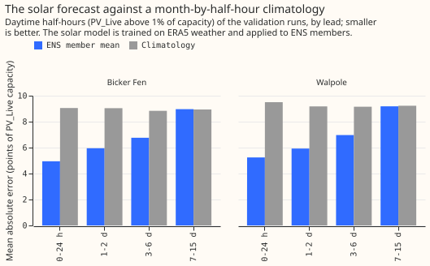

# Does a forecast of the GSP's PV_Live solar generation help the stage 2 demand forecast?

**Verdict: inconclusive.** Giving the stage 2 calibrator a forecast of the grid supply point's
(GSP's) solar generation lowered the quantile score by 0.14 points of capacity, below the 0.30 bar,
and the interval includes zero. C1 (solar forecast minus no solar forecast, all leads) is -0.14 (95%
interval -0.34 to +0.04), and up to 48 hours it is +0.04 (-0.32 to +0.31). The true PV_Live value at
the target time, an oracle, lowered the score by 0.50 (C2, -0.91 to -0.12), and the whole gain is at
leads of 7 to 15 days. Scores are in points of capacity (1% of the series' effective capacity) on 73
forecast runs, one every 5 days, July 2025 to June 2026, with ENS weather, for Walpole and Bicker
Fen. Attribution: Sheffield Solar PV_Live, CC BY 4.0.

## Results

| Arm | Quantile score, all leads | Up to 48 h | 7 to 15 d vs B0 (95%) |
|---|---|---|---|
| B0, no solar column | 19.04 | 15.21 | |
| B1, solar forecast | 18.91 | 15.25 | -0.21 (-0.40 to -0.05, exploratory) |
| B2, true PV_Live (oracle) | 18.54 | 15.22 | -0.71 (-1.14 to -0.30, exploratory) |

- **B1 is worse than the oracle B2** by +0.36 over all leads (+0.12 to +0.61, exploratory), and the
  difference is at 7 to 15 days (+0.50, +0.22 to +0.79).
- **The gain from the solar forecast is at Walpole.** Each GSP alone, exploratory: C1 at Walpole is
  -0.28 (-0.54 to -0.04) and at Bicker Fen +0.02 (-0.16 to +0.16). The plan guessed the larger gain
  would be at Bicker Fen.
- **Cases scored:** 50,498 per seed at Walpole and 46,178 at Bicker Fen, those with a PV_Live value
  at the target time.

## The solar forecast's own score

On daytime half-hours of the validation runs, the member mean's mean absolute error was 4.95 to 5.24
points of PV_Live capacity in the first 24 hours, 5.9 to 6.0 at 1 to 2 days, 6.8 to 7.0 at 3 to 6
days, and 9.0 to 9.2 at 7 to 15 days. The month-by-half-hour climatology scored 8.8 to 9.5 in every
band, so the forecast beats it up to day 6 and ties it after. The member mean was too high by +1.75
to +3.01 points in every band and both GSPs, so the ERA5-trained model is biased on ENS weather. The
calibration-period error by chain quarter ran from 7.1 to 9.2 points, with no quarter standing out.

## Predictions against outcomes

- **Met:** C1 was predicted at -0.15 (plausible 0 to -0.5) and was -0.14.
- **Met:** C2 was predicted at -0.5 (-0.1 to -1.5) and was -0.50.
- **Missed:** a larger gain at Bicker Fen; the solar forecast helped at Walpole only (exploratory).

## Limits

- **Two series.** The intervals resample months and seeds, not series, so the result describes
  Walpole and Bicker Fen only.
- **The oracle gain is at long leads, where the target value is far from the origin,** and B2 has
  one added column against two for B1, so B1 minus B2 is not a clean comparison.
- **PV_Live is fully revised,** and the scores are against revised values.
- **The delta at lag times uses ERA5 weather,** so every arm is a ceiling for the lagged inputs.

## Plan, written before any code ran

### Plan: sizing

- **Stored data:** prediction sets and the solar forecast's statistics, under
  `data/ml-experiments/`; no production table changes. - **Production serving path:** not touched. -
  **Degradation rule:** not touched. A missing solar forecast would be a missing input. -
  **Defensible designs:** more than one (the solar model's inputs and the summary given to stage 2).
  Both are fixed below. - **Callers:** the scripts copy experiment 00005's archive reader and
  calibrator and experiment 00027's PV_Live loader, which the author could name without searching.

Size: medium. One Sonnet review of the plan, one of the code, and one of the write-up.

### Plan: the solar forecast

**Target:** the latest revision of PV_Live's `generation_percent_of_capacity` divided by 100 (the
share of PV_Live's own capacity), because the share stays comparable as capacity grows. The chain's
15-day gap exceeds any settling time, and the scores below are against the revised values.
**Model:** one XGBoost model per GSP and seed, with experiment 00005's stage 1a hyperparameters,
trained on ERA5 weather at the valid time. **Inputs (weather only):** `shortwave`, `longwave`,
`temperature_2m`, `dew_point_temperature_2m`, `pressure_surface`, `precipitation`, `wind_speed_10m`,
and the solar zenith and azimuth, which are geometry and not weather. No calendar column and no
power lag. **Training window:** 2019-09-01, the start of the ERA5 and PV_Live grid, to before
2025-06-17 for the final model (the cut-off of experiment 00005's stage 1a). The solar model starts
earlier than the demand model's 2023-09 because its relationship is physical and has no demand
drift, and a window from 2023-09 would leave the first chain models without a summer. Calibration
runs use a forward chain: the model for each quarter from 2024-04 is trained on valid times that end
15 days before the quarter starts, so no calibration case sees a model trained on its own period.

**Applied to ENS as in experiment 00012:** each of the 51 members is run through the model at the
valid time, on the same half-hourly resampling that experiment 00005's statistics use. The summary
given to stage 2 is the member mean and standard deviation of the forecast share at the target time;
two columns keep the stage 2 inputs few. The forecast is known at the forecast origin, because it
uses ENS weather only.

**The solar forecast's own score**, before any demand effect, on the validation runs: the mean
absolute error of the ensemble mean and the quantile score of the 51 member quantiles, in points of
PV_Live's capacity, by lead band, against a month-by-half-hour climatology of PV_Live's share
trained on the same window. The report adds the member mean's bias against PV_Live by lead band
and its error by chain quarter, to show the ERA5-trained model's behaviour on ENS weather.

### Plan: arms

Series, calibrator, rows, seeds, and hyperparameters are those of experiment 00027's A0.

- **B0:** stage 2 without PV_Live.
- **B1:** B0 plus the solar forecast's mean and standard deviation at the target time.
- **B2 (oracle):** B0 plus the true PV_Live share at the target time, which is not known at the
  forecast origin. B2 has one added column and B1 has two, so B2 need not score below B1.

**Past weather.** The delta at lag times uses ERA5 weather as in experiments 00005 and 00027, so
every arm is a ceiling for the lagged inputs; the solar forecast uses ENS weather only, and the
PV_Live training target is a measurement that exists at training time.

**Rows.** Every arm is scored on the cases that have a PV_Live value at the target time and a solar
forecast, and the report states the number of cases per GSP.

**Resolution.** Two series, so the intervals describe these two GSPs. Experiment 00027's intervals
were 0.2 to 0.35 points wide at 98.33%, and the same width is expected here.

Attribution: Sheffield Solar PV_Live, CC BY 4.0.
