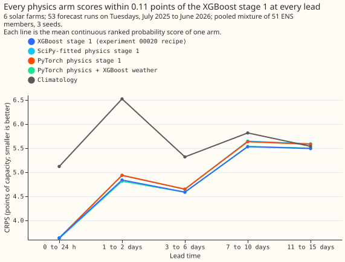
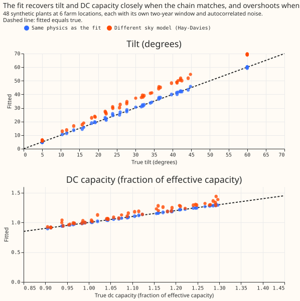

# Does a differentiable physics stage 1 beat the XGBoost stage 1 for solar farms?

**Verdict: refuted.** No physics arm lowered the continuous ranked probability score (CRPS) of the
XGBoost stage 1, and the PyTorch physics stage 1 alone scored 0.079 points of capacity worse (98.75%
interval +0.029 to +0.135).

This page is proposal P31 in the [research plan](../research-plan.md). ENS the ECMWF ensemble, ERA5
the ECMWF reanalysis, and CAMS the Copernicus Atmosphere
Monitoring Service's satellite irradiance estimate. Farms appear only under anonymous labels A to F.

## Survey of the earlier PV fits (step 1)

**The best fitted PV model in the earlier studies was a five-parameter physical model with free
orientation, and it still trailed XGBoost.** The [beam-diffuse
study](../../studies/beam-diffuse-split.md) fitted tilt, azimuth, capacity, an inverter limit, and a
temperature coefficient per farm with a Powell optimiser. On CAMS irradiance it scored 6.28% of P99
output against 5.24% for XGBoost, and an XGBoost calibration that saw the weather closed most of the
gap. The [solar BMU study](../../studies/solar-bmu-disaggregation.md) found that a free orientation
held out better than a fixed or tracking plant, and recovered simulated plants' tilt with a +9.6
degree bias. **Chosen:** the SciPy free-orientation fit (`studies.pv_fit`) as the `scipy` arm, and
for the PyTorch model the ideas the differentiable-physics page proposes: priors on tilt, azimuth,
DC capacity, and the AC-to-DC ratio, a smooth clip, and a posterior for intervals. The SciPy model
is the strongest earlier fit, so it is the fair comparison for the new model.

## Results

- **Absolute CRPS, all leads (points of capacity):** XGBoost stage 1 5.026 (95% interval 3.729 to
  6.494), hybrid 5.026, PyTorch physics 5.105, SciPy physics 5.110, climatology 5.629. Seed spread
  is at most 0.001.
- **C1 PyTorch physics minus XGBoost:** +0.079 (+0.029 to +0.135). **C2 hybrid minus XGBoost:**
  -0.000 (-0.015 to +0.018). **C3 PyTorch minus SciPy:** -0.005 (-0.020 to +0.010). **C4 SciPy minus
  XGBoost:** +0.084 (+0.029 to +0.148). C1 and C2 both have lower bounds above -0.05, so the
  decision rule gives refuted.
- **Stage 1 alone:** the member-average physics power has a mean absolute error of 7.44 points
  (SciPy) and 7.53 (PyTorch), against 7.64 for experiment 00012's XGBoost stage 1a on the same rows.
  The physics point forecast is as good, and the gap in CRPS comes from the spread the XGBoost layer
  builds on one physics column.
- **Coverage of the 5% to 95% band:** SciPy 96.6%, PyTorch 96.5%, hybrid 94.8%, XGBoost 94.7%.
- **Fitted parameters** (labels A to F; the metadata holds no tilt or azimuth): PyTorch tilts are
  18.0 to 25.2 degrees for five farms and 35.0 (interval 26.1 to 42.8) for farm E, azimuths are
  within 1.3 degrees of due south, DC capacity 0.93 to 1.22 and AC limit 0.84 to 1.00 of effective
  capacity. SciPy values are within 3 degrees of tilt and 0.07 of capacity of those. The tilts and
  azimuths agree with the beam-diffuse study's 14 to 27 degrees and within 5 degrees of south.

## Synthetic test (result)

- **Same physics, 36 on-prior plants:** tilt bias +0.11 degrees, azimuth -0.03, DC capacity -0.001,
  and 90% interval coverage of 92%, 100%, 97%. AC limit coverage 86%, DC:AC ratio 89%. This passes
  the pre-registered coverage rule (at least 80% for DC, AC, and ratio). Twelve off-prior plants
  (tilt 5 or 60, azimuth 110 or 250) give tilt bias -0.05 and azimuth bias +0.76 degrees.
- **Different chain (Hay-Davies sky):** tilt bias +6.2 degrees (+3.8 off-prior), 0% tilt coverage,
  DC capacity bias +0.041 (8% coverage). The intervals reflect noise and not the mismatch of the
  physics, so they are overconfident under mismatch.

## Failures and limits

- **6 farms, one validation year:** gains under about 0.1 points cannot be resolved.
- **The synthetic noise is additive and homoscedastic,** and the different-chain version changes
  only the sky-diffuse term. The likelihood is a tempered pseudo-Huber and not a normalised
  likelihood, so posterior widths are approximate.
- **No post hoc tweak was run.**

## Lessons

- **Fitted PV physics is a competitive point forecast and a poor replacement for the XGBoost
  stage 1 in the quantile pipeline.** The XGBoost stage 1 sees ENS irradiance, temperature, and
  cloud-related columns that the physics model does not.
- **The orientation and capacity the PyTorch model recovers are plausible** and agree with the SciPy
  fit, so the physics is useful for interpretation and for checking a farm's metadata.

## Arms

| Arm | Stage 1 | Stage 2 |
|---|---|---|
| `base` | 00020's XGBoost quantile stage 1 on nine ERA5 weather columns | Pooled mixture over 51 members |
| `scipy` | Fitted PV model from `studies.pv_fit` (free orientation, SciPy), run on each member's shortwave | One XGBoost quantile model per farm on the physics power only, members pooled |
| `torch` | New PyTorch physics model with priors | The same layer as `scipy` |
| `torch_hybrid` | The `torch` output | XGBoost quantile model on the physics power plus the nine weather columns |
| `climatology` | None | Month-by-half-hour climatology |

**Fitting.** Physics parameters are fitted once per farm to metered power at rows before
2025-06-17, using CAMS shortwave and ERA5 temperature (CAMS exists for only part of the history,
so rows without it are left out). Prior means and widths come from general knowledge about Great
Britain's plants (`studies.pv_fit.LOOSE_PRIORS`), not from any fit to these farms. The stage 2 layer
trains on physics power driven by ERA5
shortwave (`base`'s weather source), and is applied to ENS members' shortwave. CAMS arrives about 1
day late and ERA5 about 5 days, but neither is read at forecast time (the arms read ENS shortwave
and ENS temperature), because no arm uses a lag.

**PyTorch PV model.** The AC limit is the DC capacity times the AC-to-DC ratio (below 1). The model
applies an Erbs split of global into beam and diffuse, isotropic-sky transposition onto a
plane of fitted tilt and azimuth, a temperature derate, a DC capacity (a multiple of effective
capacity), and a soft clip at DC capacity over an AC-to-DC ratio. Parameters have normal priors
and a mean-field normal posterior fitted by stochastic variational inference (Adam, GPU).

## Synthetic test (step 2)

Thirty-six synthetic plants (6 farm coordinates times 6 parameter draws: tilt 10 to 45 degrees,
azimuth 150 to 210 degrees, DC capacity 0.9 to 1.3, AC-to-DC ratio 0.7 to 1.0) are driven by the
real training irradiance and temperature of their coordinates, each with its own random two-year
window and noise draw (autocorrelated noise, 4% of capacity). Two versions run: **same physics**
(the PyTorch PV model's own chain), and **different chain** (the Hay-Davies sky from `pvlib` in
place of the isotropic sky, so the fit cannot reproduce the data exactly). The write-up gives each
parameter's bias and 90% interval coverage, each plant's clipping share, and the fit's mean absolute
error.

## Checks before the contrasts are read

- **Leakage.** Every fit, including the physics parameters, stops before 2025-06-17. A reviewer
  reads the code for this.
- **No calendar columns** in any stage 2 layer; the hybrid's nine columns are `base`'s.
- **Reproduction.** `base` is read from 00020's stored predictions, and its solar CRPS is checked
  against 5.05 within 0.05.

## Size

**Complex, because the experiment adds a new method and admits more than one defensible design.**

- **What gets stored:** private predictions only.
- **Production serving path:** not touched.
- **Degradation rule:** not touched.
- **More than one defensible design:** yes (the transposition model, the prior widths, whether the
  stage 2 layer reads the weather).
- **Code whose callers cannot be named without searching:** no; the code copies experiment 00020's
  patterns and calls `studies.pv_physics`, `studies.pv_fit`, and `studies.experiment_store`.

## Which earlier advice this plan follows

- **Followed:** `base`'s absolute score and a climatology row sit beside every contrast (00012,
  00020); no calendar columns (skill rule); a contrast is read against a threshold set by the cost
  of the change (00020).
- **Departs from:** 00012's advice to test CAMS-trained solar on more farms; this experiment keeps
  the 6 farms, so it cannot resolve gains under about 0.1 points.

## Resolution limit

6 farms in one region and one validation year resolve gains of roughly 0.1 points of capacity.
