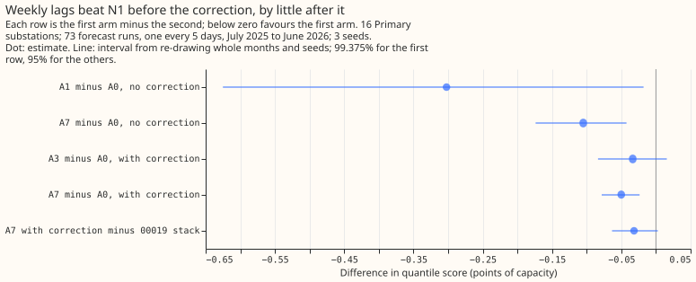

# Which lagged power columns lower the error of Primary substation demand forecasts?

We asked which earlier readings of power, taken at the same time of day in previous weeks or years,
lower the error of a demand forecast for Primary substations (substations that step power down to
the local distribution network). We gave a single-step model 3 lags, the 6 weekly lags, the 7 annual
lags, or all 13, and compared the quantile scores for 16 Primary substations. Adding all 13 changed
nothing, the weekly lags alone helped a little, the annual lags hurt, and a 14-day error correction
then removed the weekly gain. An arm added after the run, which gives the mean and median of the
weekly values, scored lowest of all.

**Verdict: inconclusive.** Giving N1 all 13 lags of `manual_heuristic` as separate columns does not
lower its quantile score: C3 is -0.01 points of capacity (99.375% interval -0.45 to +0.43). The 6
weekly analogues alone lower the score by 0.30 (C1, -0.63 to -0.02), the 7 annual analogues raise it
by 0.29 (C2), and the 14-day error correction then removes the weekly gain. A post hoc arm, N1 plus
the mean and median of the weekly analogues, scores 0.05 below N1 with the correction (-0.08 to
-0.02), the lowest score of any arm. A point is 1% of the series' effective capacity. N1 is the
single-stage XGBoost quantile model trained on the ensemble weather forecast (ENS) of the European
Centre for Medium-Range Weather Forecasts.

## What the arms score

Every arm is scored on the same cases of the 16 Primary substations, on the 73 runs of
`fold_a_every5d_v1`. Intervals resample whole months and seeds.

| Arm | Quantile score | With 14-day correction | Median error | With correction |
|---|---|---|---|---|
| A0: N1, 3 lags | 6.33 | 5.34 | 8.45 | 7.34 |
| A1: plus 6 weekly lags | 6.03 | 5.43 | 8.14 | 7.44 |
| A3: 3 summaries of the 13 lags | 6.48 | 5.31 | 8.64 | 7.27 |
| A7 (post hoc): weekly mean and median | 6.22 | 5.29 | 8.30 | 7.27 |
| 00019 stack | | 5.32 | | 7.35 |
| `manual_heuristic` | 5.89 | | 8.23 | |
| `climatology` | 7.46 | | 10.33 | |

A2 (all 13 lags), A4 (recent values), and A5 (same-day-type analogues) were fitted for seed 0 only,
and score 6.32, 6.30, and 6.25 without the correction and 5.53, 5.54, and 5.48 with it, against 6.33
and 5.34 for A0.

## Contrasts

The planned contrasts are read at 99.375%. Only C1 has 3 seeds; C2 to C8 use seed 0 only, so their
intervals resample months and not seeds.

- **C1, A1 minus A0:** -0.30 (-0.63 to -0.02). Gain without the correction; with it, A1 scores 0.09
  above A0 (E2, +0.01 to +0.18).
- **C2, A2 minus A1:** +0.29 (+0.13 to +0.49). The annual analogues lose.
- **C3, A2 minus A0 (primary):** -0.01 (-0.45 to +0.43). Not a gain.
- **C4, A3 minus A2:** +0.17 (-0.11 to +0.46). Summaries do no better than columns.
- **C5, A4 minus A2:** -0.01 (-0.05 to +0.03). Recent values add nothing.
- **C6, A5 minus A2:** -0.06 (-0.10 to -0.03). A gain, but small.
- **C7, A2 minus `manual_heuristic`:** +0.43 (-0.00 to +0.93).
- **C8, A2 minus A0, both with the correction:** +0.19 (+0.09 to +0.30). The annual and weekly
  columns hurt once the correction is applied.

Exploratory: A3 with the correction scores 0.03 below A0 with it (E12, -0.08 to +0.02); A7 with it
scores 0.05 below (E15, -0.08 to -0.02) and 0.03 below the 00019 stack (E16, -0.06 to +0.00).

## Cuts, post hoc, and limits

- **Cut for time:** A2, A4, and A5 have seed 0 only; A6, the residual lag, was not run. The gain
  threshold for A6 therefore stays untested.
- **Post hoc:** A7 was added after seeing that the annual columns hurt. Its contrasts (E14 to E17)
  are not pre-registered.
- **Untested explanation:** the 7 annual columns are highly correlated and N1 trains on only 15
  months, so the model may fit the year-ago level; no arm tested this.
- **One validation year and 16 series:** every interval resamples the months of that one year.

## Plan, written before any code ran

## Plan: sizing

- **Stored data:** prediction sets only, under `data/ml-experiments/`; no production table changes.
- **Production serving path:** not touched.
- **Degradation rule:** not touched.
- **Defensible designs:** more than one for the lag definitions; each is fixed below before a fit.
- **Callers:** the scripts copy 00013's and 00019's helpers, which the plan's author could name
  without searching.

Size: simple, because arms A1 to A5 permute the input columns of N1 with no new data and no new
method. Arm A6 stores past forecasts as a model input, so it is exploratory. Review: one Sonnet
reviewer reads the code for leakage and for the fit stopping at the training end, and one Sonnet
reviewer checks the write-up against the printed report. The earlier advice that this plan follows:
compare every Primary arm against `manual_heuristic` (00013); add lagged power measured from the
forecast origin (00013); report the interval over validation months (00013). It departs from none.

## Plan: arms

Each arm is N1 (00013: the 00006 columns, the lead in hours, recency half-life 2 years, 500 rounds,
the 9-level quantile loss, trained on the ENS control member from 2024-04-01 to 2025-06-30)
with a different lag block. `colsample_bytree` and `colsample_bynode` are 1.0 in every arm, so a
wider
arm has no subsampling advantage. Every lag is read from the observed power of the same series on
the
dense half-hourly grid and is null (NaN) when its grid index is later than the newest usable
observation, 3.5 hours before the forecast origin (00021's and 00013's telemetry delay). No lag
column looks past that index, in training or in validation.

| Arm | Lag columns |
|---|---|
| A0 (N1, 00013's stored fits) | 3: the newest usable value, and the latest earlier same-half-hour and same-weekday values |
| A1 | A0 plus the 6 weekly analogues: power at the valid time minus 1, 2, 3, 4, 5, and 6 weeks |
| A2 | A1 plus the 7 annual analogues: power at the valid time minus 49 to 55 weeks (the 13 lags of `manual_heuristic` plus A0's 3) |
| A3 | A0 plus 3 summaries of A2's 13 lags: the mean and the median of the usable weekly analogues, and the mean of the usable annual analogues |
| A4 | A2 plus 3 recent values: the mean of the 12 half-hours ending at the newest usable one, and the values 2 and 4 half-hours before it |
| A5 | A2 plus 3 same-day-type analogues: power at the same half-hour on the latest 3 earlier days of the valid time's day type (weekday against weekend or bank holiday, from the England holiday calendar) |
| A6 (exploratory) | A2 plus the mean residual of the last 14 days (actual minus the A2 median forecast of each half-hour, taken from cross-fitted fits of A2 over 3 blocks of training months) |

A lag of a fixed number of weeks is null whenever the lead is long enough for it to fall after the
newest usable observation, so the 1-week analogue is null beyond about 6.9 days of lead, which is
also what the pipeline's `_nullify_leaky_lags` does. A0 already holds the latest day and the latest
week analogue at any lead, so A4 and A5 test only what is added beyond them. Every arm is also
scored with the 14-day error correction of 00019 (the mean error of the arm's median over the 14
days up to the newest usable observation, added to every quantile), and the report shows each arm
with and without it. The 00019 stack is rebuilt from 00019's stored N1H fits. The arms are fitted
for seeds 0, 1, and 2, and a climatology and the stored baselines are repeated per seed as in 00013.

## Plan: planned contrasts

The eight contrasts in the decision rule are read over all leads at 99.375%. Every other contrast
(each lead band, BSP and GSP, with and without the correction, A6, against the 00019 stack) is
exploratory, read at 95%. BSP (2 series) and GSP (2 series) are descriptive and never averaged
into the Primary figure.

## Plan: past weather

No past weather is used at lag times; the lags are of power, observed before the origin.
