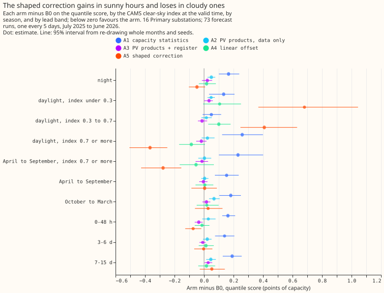
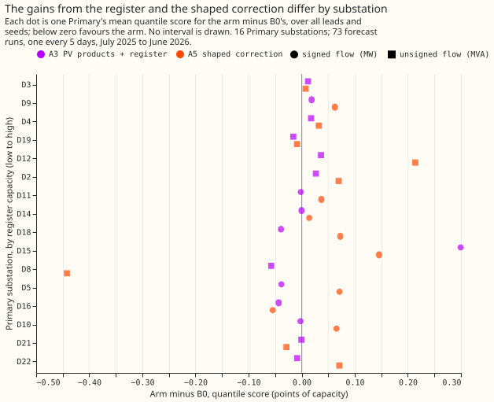

# Experiment 31: do embedded-solar capacity features lower the error of Primary demand forecasts?

**Inconclusive: none of the capacity features lowers the all-lead quantile score of Primary demand
forecasts, and the two arms that came closest cannot be separated from zero.** B0 is the 00019
stack without its half-life: N1 with the 14-day correction and the 1.15 spread factor. Scores are
the quantile score over all leads, in points of capacity (1 point is 1% of a series' effective
capacity), on 16 Primary substations, 73 forecast runs every 5 days from July 2025 to June 2026,
with ENS weather. B0 scores 5.32. A3 (PV products using the register) scores 5.32, A5 (the shaped
correction) 5.33, A4 (the linear offset) 5.33, and the shuffled control A6 5.31. A1 (capacity
statistics as columns) scores 5.49 and A2 (PV products from data alone) 5.35, which are losses.

| Arm | Quantile score | Median error | Contrast with B0 (99.17% interval) |
|---|---|---|---|
| B0, the 00019 stack | 5.32 | 7.34 | |
| A1 capacity statistics | 5.49 | 7.59 | C1 +0.167 (+0.091 to +0.243) |
| A2 PV products, data only | 5.35 | 7.39 | C2 +0.036 (+0.002 to +0.074) |
| A3 PV products with the register | 5.32 | 7.35 | C3 +0.006 (-0.022 to +0.033) |
| A4 linear offset | 5.33 | 7.34 | C4 +0.012 (-0.051 to +0.081) |
| A5 shaped correction | 5.33 | 7.35 | C5 +0.016 (-0.069 to +0.100) |
| A6 shuffled control of A3 | 5.31 | 7.33 | C6, A3 minus A6: +0.018 (-0.002 to +0.033) |
| `manual_heuristic` | 5.89 | 8.23 | |
| `climatology` | 7.46 | 10.33 | |

**The verdict follows the pre-registered rule.** No arm reached "port" or "small gain". A1 and A2
are losses (intervals wholly above zero), A3 is a null with a half-width of 0.03, and A4 and A5 are
nulls with half-widths of 0.07 and 0.08, wider than the 0.05 that would have excluded a gain of that
size, so the verdict is inconclusive and not refuted.

**The shaped correction trades gains in sunny hours for losses in cloudy ones.** These are 95%
breakdowns, which decide nothing. A5 lowers the score by 0.37 in daylight at a clear-sky index of
0.7 or more over the year (-0.51 to -0.25), and by 0.28 in April to September at that index (-0.43
to -0.15; B0 scores 5.63 there). It raises the score by 0.68 at a clear-sky index under 0.3 (+0.37
to +1.04) and by 0.41 between 0.3 and 0.7. Over April to September as a whole A5 is level with B0
(+0.004). At leads under 48 hours A5 lowers the score by 0.07 (-0.13 to -0.02), but the shuffled
control A6 lowers it by 0.05 (-0.08 to -0.02), so that gain is not specific to the shaped
correction. The slope of the 14-day residuals on PV output was fitted in 1,380 of 1,460 series-runs
(20 series times 73 runs, including the BSPs and GSPs) and averaged -0.11 over all runs, so the
substations hold PV that N1 under-allows for. One possible explanation of the cloudy-hour losses,
untested here, is that the ENS irradiance forecast is biased against the CAMS irradiance the slope
was fitted on, which would make the correction too large on cloudy forecasts.

**The register adds little at Primaries.** The median data estimate of PV capacity at a Primary was
about 0.33 of effective capacity (0.35 data only, 0.33 with the register, on validation origins)
against a register median of 0.08, so the weights favour the data estimate. A3 minus A2 is -0.030
(-0.061 to -0.007, 10 of 12 months negative), so the register improves on the data-only arm, but A3
is not distinguishable from the shuffled control (C6), so the gain is not evidence of capacity
information. The estimator recovered an injected capacity ramp in the known-answer check (F1's
error under 0.0011 share of capacity on 2 directional Primaries, measured after subtracting each
series' un-injected F1, against a standard error of about 0.05).

**At the 2 GSPs, true PV_Live generation lowers the score by 0.82.** B0 scores 19.95 and the oracle
A7 19.13 (A7 minus B0 -0.82, 95% interval -1.06 to -0.55; 12 of 12 months). The 2 BSPs and 2 GSPs
are descriptive; A3 and A5 move them by less than 0.3 points, and no contrast is drawn.

## Limits

- **One validation year gives 12 month blocks,** so A4 and A5 cannot exclude a gain of 0.07 to 0.08
  points.
- **A4 refits only the 8 directional Primaries,** so C4 is pooled over 16 and diluted by half; the
  8 non-directional Primaries reuse B0. Their folded readings (PV above demand) also enter F1 to
  F5, which no arm corrects.
- **CAMS publication delay was not measured.** The features assume CAMS is available 48 hours
  before the origin, as the ECMWF notice of February 2026 says ("up to yesterday").
- **The register is a prior at Primaries by assumption:** rows of 1 MW or more are treated as
  metered, because no larger solar farm is listed under a Primary in the metadata table.
- **Not run:** the no-fit baseline (`manual_heuristic` on gross demand minus modelled PV), and the
  weekly lags of 00030 in every arm.
- **No tweak after the first run:** the plan allowed one post hoc change; the sunny and cloudy split
  of A5 suggests calibrating ENS irradiance to CAMS first, which the next experiment can test.

## Plan, written before any code ran

## Plan: sizing

- **Stored data:** prediction sets and a daily feature table under `data/ml-experiments/`.
- **Production serving path:** not touched.
- **Degradation rule:** not touched.
- **Defensible designs:** more than one (feature, offset, or correction; several estimators). The
  arms below test each family once.
- **Callers:** the scripts copy 00019's helpers and read its stored N1 fit, which the author could
  name without searching.

Size: complex, because more than one design defensibly tests the hypothesis and the experiment adds
a data source (the ECR). Plan, code, and write-up each get one Sonnet review.

## Earlier advice followed and departed from

- **Followed:** compare against N1 with the 14-day correction and the 00019 stack, not N1 alone
  (00030); keep `colsample` at 1.0; report absolute scores beside contrasts; guard against one
  substation setting the pooled figure (00007).
- **Departed from:** 00030's weekly mean and median lags are not in B0, because 00030 has not
merged;
  a follow-up can add them to every arm.

## Method

**Capacity enters as a trailing estimate that changes over time, or as a linear offset.** N1 fits
one
model per series, so a per-series constant gives the trees nothing. Every feature is computed at
each
forecast origin from power and irradiance observed up to 48 hours before the origin, so the same
function serves training rows and validation rows.

- **Per-unit PV, `p_unit`:** AC output of a generic fleet per MW of AC capacity
  (`studies.pv_physics.plant_power_mw`, tilt 35 degrees, azimuth 180 degrees, DC 1.15 MW, AC 1.0 MW,
  times a 0.86 system derate; untuned). Fitted constants (the shrinkage weights and prior variance)
  use training origins only, which are those before 2025-07-01; validation origins run from
  2025-07-01 to 2026-06-30. At lag times the irradiance is CAMS GHI at the substation's
  location, which ECMWF publishes with a delay of at most 2 days (an ECMWF notice of February 2026
  says "up to yesterday"; older pages say 2 days), so it exists before the 48-hour cut-off. The
  latency was not measured; if it exceeds 48 hours, the features would need the ENS analysis proxy,
  and the write-up says so. At valid
  times the irradiance is the ENS member's `shortwave`.
- **The ECR enters differently by series type (maintainer refinement, 2026-10-15).** A Primary
  series is "Disaggregated Demand": NGED has already subtracted its metered generators, so the ECR
  rows with their own meter are not in the series. The ECR is therefore only a prior for a Primary,
  never a floor. The prior is the ECR solar capacity of the rows that have no meter of their own:
  every connected solar row on the `Register Part 1 50kW - <1MW` sheet. The rows of 1 MW or more
  are assumed to be metered, because the metadata table lists none of the larger solar farms under a
  Primary, and NGED's list of meters is not available to confirm it. The `Primary` name must match
  exactly
  after `studies.name_matching.normalise` (no fuzzy matching), and the prior is zero where no row
  matches. A BSP or GSP series is "Raw Flow": the metered generators below it are not subtracted,
  so the ECR solar capacity of every row below the substation (by `bulk_supply_point` or
  `grid_supply_point` name, using `Substations.csv` for the hierarchy) is a floor on the PV in the
  series. The decision per ECR row is printed by the script. The August 2026 snapshot is used at
  every date, a small look-ahead that can only inflate the ECR arms. BSP and GSP series are
  descriptive.
- **Features, 28-day windows ending at the origin minus 48 hours, daylight half-hours (sun above 15
  degrees):**
    - F1 `cap_slope_28d`: minus the slope of power on `p_unit`, with fixed effects for local hour by
      day type (weekday, or weekend or bank holiday). Null with fewer than 8 days.
    - F2 `sunny_minus_cloudy_28d`: mean power on sunny days (daily clear-sky index at least 0.7)
      minus cloudy days (at most 0.3), matched by hour and day type, over the matching difference
      in mean `p_unit`, sign flipped.
    - F3 `cap_change_yoy`: F1 minus F1 for the window 364 days earlier.
    - F4 `unreg_cap`: `c - e`, where `e` is the ECR capacity of the series (prior or floor, above)
      and `c` is the capacity estimate. For a Primary, `c` is `c_fit` (F1) pulled towards `e` by
      inverse-variance weights, with the prior variance fitted on training origins only, and
      clipped at zero; it may fall below `e`. For a BSP or GSP, `c = max(c_fit, e)`.
    - F5 `cap_total`: `c`. In the data-only variant `c = c_fit`, clipped at zero, and `e` is unused.
    - F6 `pv_hat`: `c * p_unit_ENS(valid)`. F7 `lag_gross_2d`: the power at the latest earlier time
    with the
      valid time's half-hour of day that is at least 48 hours before the origin, plus
      `c * p_unit_CAMS(that time)`. F8 `pv_ecr_hat`: `e * p_unit_ENS(valid)`.
- **Known-answer checks before real data:** (a) inject `-c(t) * p_unit_CAMS(t)` with `c` rising
  linearly from 0 to 20% of capacity into two directional Primaries and check that F1, F2, and F4
  recover `c(t)` within one standard error; (b) at the two GSPs compare `c` with PV_Live's installed
  capacity over the same months (trend only).

## Arms

Rows `fold_a_every5d_v1`, ENS weather, seeds 0 to 2, N1's 00013 configuration. Every arm carries
the 14-day correction and the 1.15 spread factor, as B0 does.

| Arm | Change from B0 | Extra columns |
|---|---|---|
| B0 | The 00019 stack | 0 |
| A1 | Capacity statistics F1, F2, F3 | 3 |
| A2 | Data-only PV products F6, F7 (`c = c_fit`) | 2 |
| A3 | PV products with the ECR (prior or floor by series type): F6, F7, F8 | 3 |
| A4 | Linear offset: `base_margin = -c * p_unit_ENS(valid)`, `c` with the ECR as above; directional Primaries only | 0 |
| A5 | The flat 14-day mean replaced by `a + b * p_unit` fitted on the same residuals; `b = 0` with fewer than 3 distinct sunny origin-run dates (daily clear-sky index at least 0.7) in the window, and `b` not sign-clipped; no refit | 0 |
| A6 | Shuffled control of A3: `c` permuted across origin dates within series and calendar month, with F6 and F7 recomputed from the shuffled `c`; F8 keeps the true `e` | 3 |
| A7 | Oracle at the 2 GSPs: B0 plus PV_Live at the valid time | 1 |

A5 tests a sunshine-shaped correction of the median's remaining error, not capacity: the residuals
come from runs whose forecasts already contain some PV signal. A4 reuses B0 on the 8 non-directional
Primaries, which fold when PV exceeds demand.

Plus a no-fit baseline: `manual_heuristic` on gross demand minus `c * p_unit_ENS(valid)`.

## Departures from the design

- **No temperature covariate in F1.** An archive of ENS analysis temperature at lag times would be
  daily for training runs and 5-daily for validation runs, so training and validation would differ.
  F3 cancels most of the seasonal confound instead.
- **No outcome-based half-hour selection on non-directional MVA series.** Selecting half-hours by
  observed power biases the slope, so every daylight half-hour is used in A1 to A3 as well; the
  folded readings are a stated limit, not a result, and the write-up splits directional from
  non-directional series. The 99.17% interval's half-width is the one the refuted rule reads.

## Evaluation

Primary first (16 series), absolute scores beside contrasts. BSP (2) and GSP (2) are descriptive and
never averaged into the Primary figure. Breakdowns, all exploratory at 95%: clear-sky-index bins at
the valid time (night, under 0.3, 0.3 to 0.7, at least 0.7); sunny against cloudy days; April to
September against October to March; lead bands 0 to 48 h, 3 to 6 d, 7 to 15 d; per substation
ordered by ECR capacity over effective capacity, split by directional MW and non-directional MVA;
the
pooled contrast without the series of largest B0 error and without D8, D12, and D22. The clear-sky
index is used to bin only, never as an input.

## Limits to expect

One validation year gives 12 month blocks, so a 0.05-point effect may be undetectable. The ECR
prior is wrong in both directions at Primaries (an unmetered row may be missing or unregistered, and
the snapshot includes future connections). The ENS forecast
irradiance is biased against CAMS, so a capacity estimated on CAMS mis-scales when applied to ENS.
