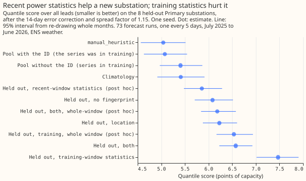

# Experiment 32: do substation fingerprints improve a pooled demand model?

We asked whether giving one shared demand model a short numerical description of each substation,
such as its location or its recent power statistics, improves forecasts for substations of the same
type. We added each description to the shared model of experiment 00024, scored 16 Primary
substations (substations that step power down to the local distribution network) over 73 forecast
runs, and also scored a substation held out of training. No description helped by more than 0.02
points of capacity, and the descriptions made the forecast worse for the held-out substation.

**Inconclusive by the pre-registered rule, and no fingerprint helped: adding location,
training-window statistics, or recent-window statistics to the by-type pooled model changed the
Primary quantile score by at most 0.02 points of capacity, and the fingerprints made a held-out
substation worse.** Scores are the quantile score over all leads in points of capacity (1 point is
1% of a series' effective capacity), after the 14-day error correction and spread factor 1.15, with
ENS weather, on 73 forecast runs from July 2025 to June 2026. The by-type pool with the series
identifier scores 5.47 on the 16 Primary substations ([experiment
24](../00024-pooling-groupings-demand-xgboost/result.md); per-series models score 5.32). Adding the
identifier's fingerprints leaves the score at 5.47 to 5.50 (C1 to C4). The rule needed C3 or C4
below -0.10 or both cold-start contrasts below zero, and none happened. The rule's "refuted" needs
C1 to C4, C7, and C8 all at or above zero, and the lower limits of C1 to C4 are all below zero
(-0.002, -0.008, -0.047, and -0.049). The verdict is therefore "inconclusive", even though the data
exclude a gain above 0.01 points for C1 and C2 and above 0.05 points for C3 and C4. In this page ENS
is the ECMWF ensemble, BSP and GSP are bulk supply points and grid supply points, and Primary
substations meter in MW (megawatts) or MVA (megavolt-amperes).

| Arm | Primary (16) | BSP and GSP (4) |
|---|---|---|
| A0: no identifier, no fingerprint | 6.29 | 14.84 |
| A1: identifier | 5.47 | 13.96 |
| A2: identifier and location | 5.47 | 13.97 |
| A3: identifier and training-window statistics | 5.47 | 13.97 |
| A4: identifier and recent-window statistics | 5.50 | 14.15 |
| A5: identifier and both | 5.49 | 14.16 |
| A6: training-window statistics, no identifier | 5.48 | 13.96 |
| `manual_heuristic` | 5.89 | 14.70 |
| `climatology` | 7.46 | 15.11 |

**Training-window statistics can replace the identifier for series the pool saw in training.** A6
scores 0.81 points better than no identifier and no fingerprint (C6, -1.21 to -0.46), and 0.01
points worse than the identifier (C5, +0.00 to +0.02), well inside the 0.15-point margin. The seven
statistics identify a series as well as the identifier does.

**Recent-window statistics did not help for series the pool saw in training.** C3 is +0.02 (-0.05 to
+0.10) and C4 is +0.02 (-0.05 to +0.10). A possible reason, not tested here, is that the 14-day
error correction already follows the recent level. On the 4 BSP and GSP series A4 scores 14.15
against 13.96 for A1 (exploratory). The share of experiment 24's 0.15-point gap to per-series models
closed by A4 or A5 is zero: both are 0.02 points worse than A1.

**A fingerprint did not carry a substation held out of the pool.** For 8 held-out Primary
substations (one seed), the pool with no fingerprint and no identifier scores 6.08, against 5.07 for
the pool with the identifier that had seen the substation (+1.01, 0.86 to 1.15, exploratory 95%).
Training-window statistics make the held-out score worse by 1.39 (C7, +0.99 to +1.91), and
training-window plus recent-window statistics by 0.49 (C8, +0.31 to +0.75). Location is worse by
0.14 (+0.02 to +0.28, exploratory). The uncorrected models are far worse: 21.3 with
training-window statistics against 6.3 with none, with a bias of -23.7 points of capacity, so the
correction removes most of the damage. Two causes are likely, and this experiment did not
test either directly. A pool of 7 other series holds only 7 distinct training-window fingerprints,
which the trees can use as 7 identifiers. The held-out substation's statistics also cover 28 days
of summer against 15 months for the pool's, and the post hoc arm below suggests this mismatch
accounts for most of the C7 damage.

**Post hoc, recent-window statistics alone helped a held-out substation, and a fairer
training-window fingerprint did not.** These arms were added after the first run and decide
nothing. Recent-window statistics without the training-window block score 5.86 against 6.08 with no
fingerprint (-0.23, -0.29 to -0.16, 95%, 12 of 12 months). Taking the held-out substation's
training-window statistics over the whole window instead of 28 days lowers the C7 arm from 7.47 to
6.54 and the C8 arm from 6.57 to 6.18, the first still above 6.08 with no fingerprint (+0.45, +0.30
to +0.64) and the second not distinguishable from it (+0.10, -0.00 to +0.21).

## Predictions against outcomes

- **Met:** location (C1) and training-window statistics (C2) added nothing beyond the identifier
  (+0.00 for each).
- **Met:** the training-window statistics without the identifier scored within 0.15 points of the
  identifier (C5, +0.01).
- **Missed:** recent-window statistics were predicted to lower the score by 0.05 to 0.15 points
  (C3, +0.02).
- **Missed:** training-window statistics were predicted to lower the held-out score by 0.2 to 0.5
  points (C7, +1.39), and recent-window statistics to lower it by a further 0.05 to 0.2 (C8, worse
  than none by 0.49).

## Limits

- **Only 16 Primary series, and 7 other series in a held-out substation's pool.** The intervals
  resample months and seeds, not series, so they say nothing about substations outside the sample.
  The cold-start result is specific to a pool this small.
- **The cold-start contrasts use one seed and 8 held-out substations.** Their intervals resample
  months only.
- **The held-out substation's training-window statistics cover 28 days ending 2025-06-30,** a
  summer window, while the pool's cover 15 months. The post hoc whole-window arms suggest this
  mismatch explains most of the C7 damage and some of the C8 damage.
- **Arms A0 and A1 are experiment 24's stored predictions,** fitted in a different run with the same
  code and seeds, with a check that the series, runs, and valid times match.
- **The training-window statistics are fixed at 2025-06-30 for the whole validation year,** so a
  deployed model that retrained would hold fresher values.
- **Latitude and longitude let a pool of 7 series look up its nearest neighbour,** which is
  optimistic for location in a pool of 2,500.
- **The plan had one Sonnet review and the code one;** the project's credit setting kept Opus for
  other work.

## Plan, written before any code ran

### Plan: sizing

- **Stored data:** prediction sets under `data/ml-experiments/` only.
- **Production serving path:** not touched; the recent-window statistics would add a serving step if
  they win.
- **Degradation rule:** not touched.
- **Defensible designs:** more than one (which statistics, which window, which held-out series), so
  the columns and the held-out series are fixed below before any fit.
- **Callers:** the scripts copy 00024's fit and scoring, which the author can name without
  searching.

Size: complex. One Sonnet review of the plan, one of the code (leakage, the origin-minus-2-days
bound, the fit stopping at 2025-06-30, the held-out series absent from training), and one of the
write-up. The project's credit setting keeps Opus for work that is truly vital.

### Plan: arms

**Recipe.** Every model is 00024's by-type pooled model (4 groups: BSP, GSP, Primary-MW,
Primary-MVA): the 9-level quantile loss on the ENS control member, 00006's columns, the lead in
hours, the three origin lags, recency half-life 0.5 years, training valid times up to 2025-06-30
23:30, 500 rounds, depth 6, `colsample_bytree` 1.0 in every arm (so the arms' different column
counts cannot favour one arm), and the 14-day correction and spread factor 1.15 after prediction.
Experiment 30's lag columns are not added: its verdict was inconclusive, and keeping 00024's recipe
lets A0 and A1 reuse 00024's stored predictions (same code, same seeds).

**Fingerprint columns.** All computed from power over effective capacity.

- **Static (S):** latitude and longitude.
- **Training window (T):** over valid times 2024-04-01 to 2025-06-30, the mean, standard deviation,
  5th and 95th percentiles, the mean over the period-ending stamps 10:00 to 15:30 UTC minus the mean
  over the stamps 00:00 to 04:30 UTC, the weekend mean minus the weekday mean, and the half-hour of
  the daily peak of the mean daily profile. Seven columns, fixed at 2025-06-30 for the whole
  validation year, so their staleness is part of the test.
- **Recent window (R):** over the 14 days ending at the forecast origin minus 2 days, the mean,
  the standard deviation, and the daytime-minus-night mean (as in T). Three columns, recomputed
  for every forecast origin in training and in validation; missing when fewer than 3 days hold
  observations. The 2-day gap is a safety margin on top of the 3.5-hour telemetry delay.

**Arms (warm, 16 Primary and 4 BSP/GSP series, seeds 0 to 2).**

| Arm | Columns added to the 00024 recipe |
|---|---|
| A0 | none, no identifier (00024 `type_noid`) |
| A1 | identifier (00024 `type_id`) |
| A2 | identifier and S |
| A3 | identifier and T |
| A4 | identifier and R |
| A5 | identifier, T, and R |
| A6 | T, no identifier |

**Cold start (seed 0).** Eight Primary series are held out in turn, 4 from the Primary-MW pool and 4
from the Primary-MVA pool (Primary-MW sites 5, 10, 14, and 16; Primary-MVA sites 2, 4, 12, and 21).
For each held-out series the by-type pool is refitted without it and forecasts it with no
identifier. The held-out series' fingerprint comes from its own training-window and recent-window
rows, which models a new substation with 4 weeks of telemetry: the held-out series' T uses only the
28 days ending 2025-06-30, and the pool never sees its target. The pool's other series keep the
full-window T. Cold-start arms: K0 (no fingerprint), K1 (S), K2 (T), K3 (T and R).

**Cost.** Fit seconds are recorded per model; the work is capped near 2 hours of GPU time.

### Plan: leakage and scoring checks

- Training rows end at 2025-06-30 23:30 and use the control member only; asserted.
- R uses power at grid indices below the origin minus 96 half-hours; a unit-style assertion in the
  fit script checks the window end for every row.
- T is computed once from rows up to 2025-06-30 and is constant between retrains; it is not a
  function of any validation row.
- A held-out series' rows are absent from its cold-start pool's training matrix; asserted.
- The scoring script repeats 00024's correction-history assertions.
- Validation rows are `fold_a_every5d_v1`, ENS weather, valid times before 2026-07-01. Past weather
  is not used at lag times.
- A0 and A1 are 00024's stored predictions, copied unchanged, with an assertion that their keys
  match the new arms'. They were fitted by the same code but not in the same run, so GPU
  nondeterminism adds a small seed-sized difference.

### Plan: earlier advice

Followed: the series identifier in every pooled model (00024), 00019's stack, 00006's columns, a
climatology row, and `colsample_bytree` fixed across arms. Departure: none.

### Plan: limits stated in advance

- **Only 16 Primary series.** The intervals resample months and seeds, not series, so they say
  nothing about substations outside the sample; the cold-start contrasts rest on 8 held-out series
  and one seed.
- **With the identifier present, a static fingerprint is redundant** for series seen in training;
  the warm arms measure what a fingerprint adds, and the cold-start arms measure what it carries.
- **Latitude and longitude in a pool of 7 other series** let the model look up the nearest
  neighbour, which is optimistic for location in a pool of 2,500 series.
- **A cold-start substation with no telemetry at all** (no T, no R, no lags) is not tested; every
  model here uses power lags.
