# Experiment 33: does the best-guess architecture beat production, N1, and `manual_heuristic`?

**Supported: the best guess lowered the quantile score below production's by 4.89 points of capacity
for Primary demand (98.33% interval -5.66 to -4.06), 3.81 for solar (-5.07 to -2.64), and 6.27 for
wind (-7.65 to -5.28), and each interval lies wholly below its threshold.** The quantile score is
twice the mean pinball loss over nine quantile levels, the estimate of the continuous ranked
probability score (CRPS), in points of capacity (1 point is 1% of a series' effective capacity). The
best guess for Primary substations (the 16 substations that supply customers directly) is N1, an
XGBoost model per series trained on the ensemble forecast of the European Centre for Medium-Range
Weather Forecasts (ENS) with recent power as inputs, plus an additive correction by the mean error
of the previous 14 days and a spread factor of 1.15 on the forecast band. For bulk supply point
(BSP) and grid supply point (GSP) substations the best guess is N1 alone. For solar and wind it is a
mixture over the 51 ENS members of a model trained on ERA5 weather (the ERA5 reanalysis, an estimate
of past weather), with a spread factor and, for wind, a power-curve margin. Production is the stored
`xgboost_baseline` forecast. The rows are the 73 runs of `fold_a_every5d_v1` for the 20 demand
series and the 53 Tuesday runs of `fold_a_tuesdays_v1` for the 6 solar and 3 wind farms, July 2025
to June 2026. The planned intervals use month-block resampling; the level is 98.33% for C1 to C3,
and the other contrasts use their family's Bonferroni level (the Planned contrasts section and the
appendix give each).

**Production's forecast band is far too narrow.** The band from its 5% quantile to its 95% quantile
covers 10% of Primary cases and 20% of solar and wind cases, and its 0.95 quantile is exceeded in
49% of Primary cases, 39% of solar cases, and 33% of wind cases. The best guess exceeds its 0.95
quantile in 7%, 4%, and 7% of cases. The 14-day correction accounts for 1.38 of the 4.89-point
Primary gap (99.44% interval -2.10 to -0.68; C8), and production still scores 8.59 with the
correction and its band is still narrow (coverage 9%). No arm widened production's band, so the page
does not say how much of the rest is calibration.

**For Primary demand, the best guess beats `manual_heuristic` by 0.59 points (-0.94 to -0.29; C4),
and the correction supplies nearly all of its gain over N1.** N1 with the correction scores 5.34
against 6.33 for N1 (-1.45; C7), and the spread factor takes a further 0.02 off. `climatology`
scores 7.46. On BSP and GSP demand, N1 beats production by 7.25 points (-8.46 to -6.18; C13) and
`manual_heuristic` by 1.04 (-2.01 to -0.09; C14), and the correction does not help (+0.38, -0.12 to
+0.92; C16), as experiment 21 found with the same 4 series. Production's correction raises its
twCRPS at `historical_p99` from 0.067 to 0.107.

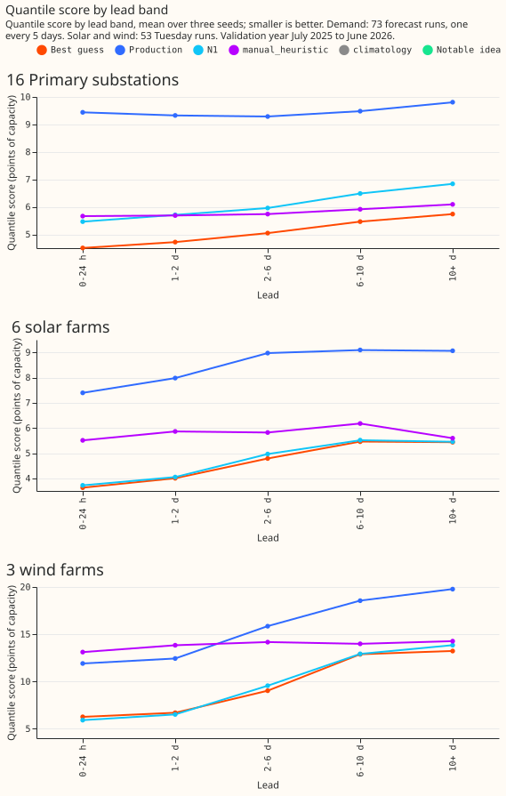

**Monthly retraining without the correction scored 5.12 on seed 0, against 5.32 for the best guess
on the same seed.** Against N1 on seed 0 (6.33) it lowers the score by 1.58 points (-2.18 to -0.86;
C12). Adding the correction to monthly retraining raised the seed-0 score from 5.12 to 5.24, and
monthly retraining with the correction scored 0.11 below N1 with the correction, an interval that
includes zero (-0.24 to +0.03; C11). Monthly retraining also gives the model 12 months of newer
data, so the page does not say whether the drift of a model frozen in June 2025 or the newer data
explains the gain, and no arm separates them. The arm has one seed and one validation year, so it is
a lead and not a ranking. The other notable demand ideas moved the score little: the weekly
analogues by -0.05 (-0.10 to -0.01; C9) and one model per type by +0.13 (+0.02 to +0.23; C10).

**For solar and wind, N1 trained on ENS scored within 0.1 and 0.3 points of the best guess over all
leads.** The best guess minus N1 is -0.08 for solar (-0.24 to +0.12; C17) and -0.32 for wind (-0.91
to +0.20; C20), both unresolved. For wind, N1 scores lower than the best guess at 0 to 24 hours
(5.91 against 6.26) and 1 to 2 days (6.51 against 6.70), and the best guess wins only from 2 days
ahead (9.02 against 9.56 at 2 to 6 days). The best guess beats `manual_heuristic` and `climatology`
for solar and wind (C18, C19, C21, C22). No notable idea resolved a gain: CAMS-trained solar -0.02
(C23), the physics hybrid 0.00 (C25), physics alone +0.08 (+0.02 to +0.16, worse; C26), and wind
with the power-over-wind-cubed column -0.05 (-0.11 to +0.02; C24).

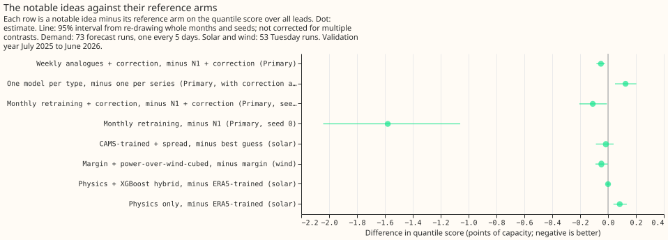

**Tail scores at `historical_p99` separate the arms only where the data allow, and the exceedance
counts show why.** The best guess differs from production on twCRPS above `historical_p99` by -0.003
for Primary demand (95% interval -0.013 to +0.006; C1), -0.004 for solar (-0.007 to -0.001; C2), and
0.000 for wind (C3). For BSP and GSP, N1 is better than production by 0.014 (-0.023 to -0.007; C13).
For solar the best guess is worse than N1 by 0.005 (+0.001 to +0.016; C17), and for Primary demand
its twCRPS and Brier score at `historical_p99` (0.063 and 0.0083) are no better than N1's (0.058 and
0.0079) or `manual_heuristic`'s (0.059 and 0.0081). At `historical_p95` the best guess is better
than production on twCRPS for all three families (-0.07, -0.24, and -0.04; C1 to C3), and for solar
it is worse than N1 (+0.023, +0.003 to +0.057; C17). The wind threshold sits near capacity, and no
arm in the event table scored a hit on wind at `historical_p99`. For Primary demand at 1 to 2 days
ahead (seed 0), the best guess flagged 168 of 417 half-hours above `historical_p99` with 164 false
alarms, against 59 hits and 106 false alarms for production and 21 hits and 22 false alarms for
`manual_heuristic`. The Brier score at `historical_p99` mainly measures the scorer's tail
assumption, an exponential decay of the exceedance probability beyond the 0.95 quantile.

**Better weather would help wind most and Primary demand least.** The ERA5 arms are ceilings for a
weather product as accurate as ERA5, because ERA5 and CAMS are estimates of past weather and arrive
days late. The ERA5 arms lowered the score by 0.11 points for Primary demand (-0.17 to -0.05; C27),
0.79 for BSP and GSP (C32), 1.05 for solar (C28), and 5.46 for wind (-6.91 to -3.90; C29). CAMS
shortwave lowered the solar score by 2.09 (C28b) and the Primary demand score by 0.18, 0.07 more
than ERA5 on all seven columns did (C31b). A demand model retrained on ERA5 and fed ERA5 lowered the
score by 0.27 against N1 (C30). The demand and solar gain is zero or slightly negative at 0 to 24
hours (C27 +0.03, C28 +0.17), and for wind it grows from 0.71 at 0 to 24 hours to 7.68 at 10 days or
more. Wind speed at 100 m alone supplies 4.24 of the 5.46 points.

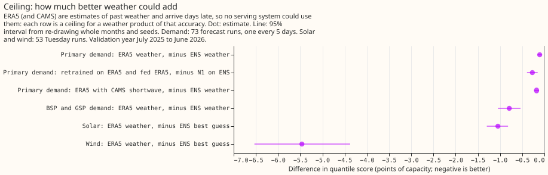

## Example forecasts

**The fan charts show the first 72 hours of one forecast run, with the best guess above production.**
Shade shows the 5% to 95% and 25% to 75% bands, the coloured line is the median, and the black line
is the observed power. Each window is chosen from the saved scores or weather and not by hand.
Generators carry anonymised labels, and the axis counts days with no calendar date.

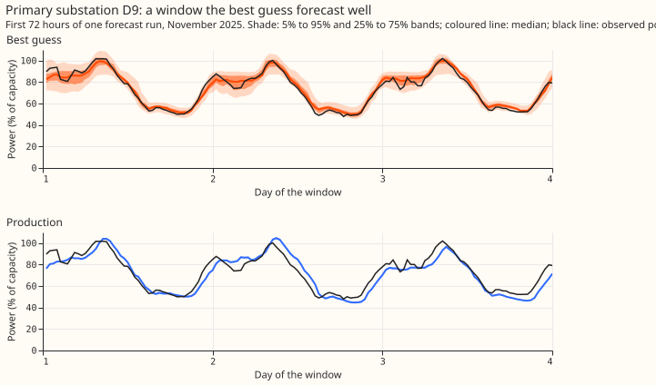

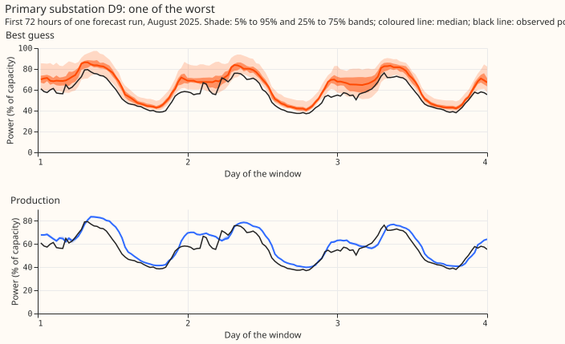

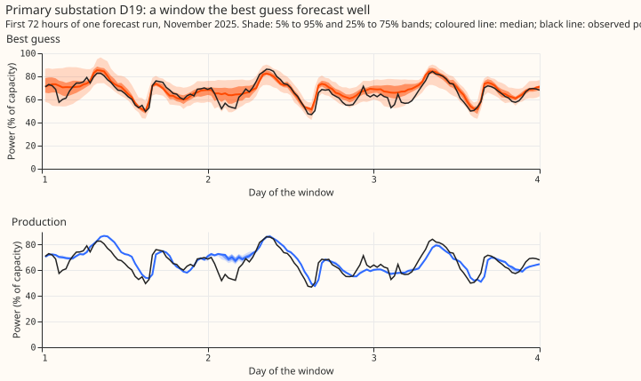

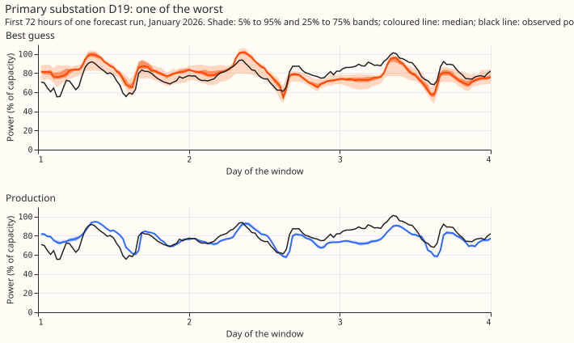

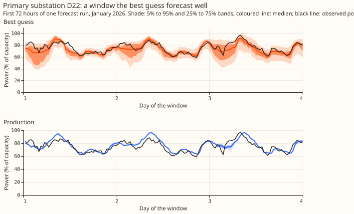

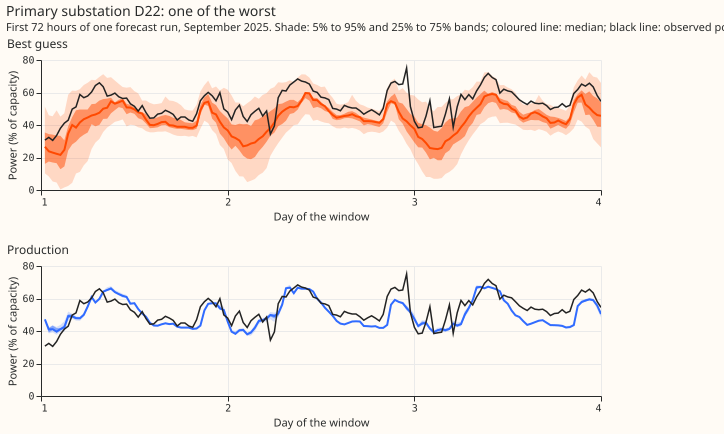

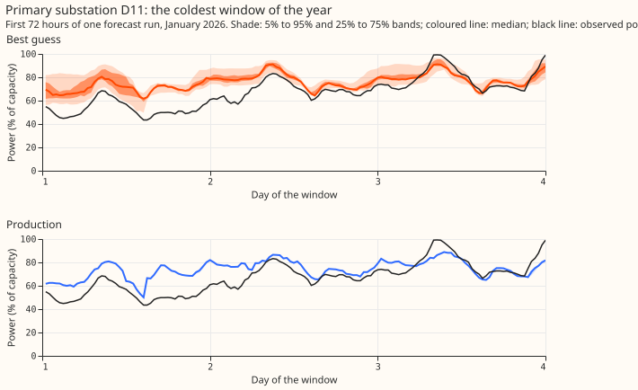

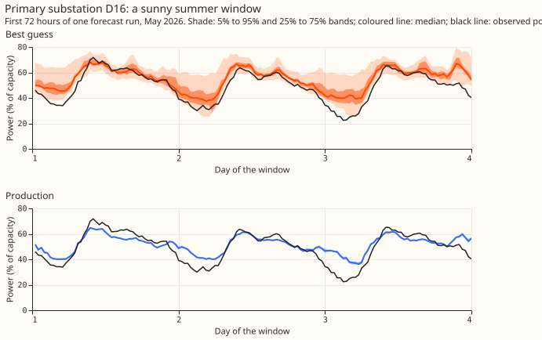

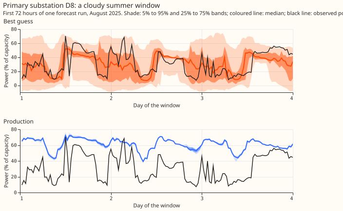

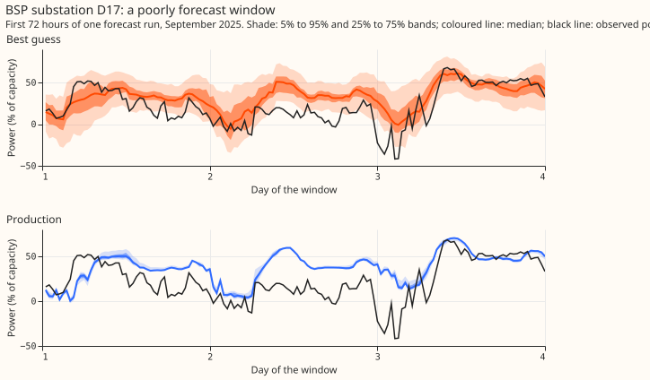

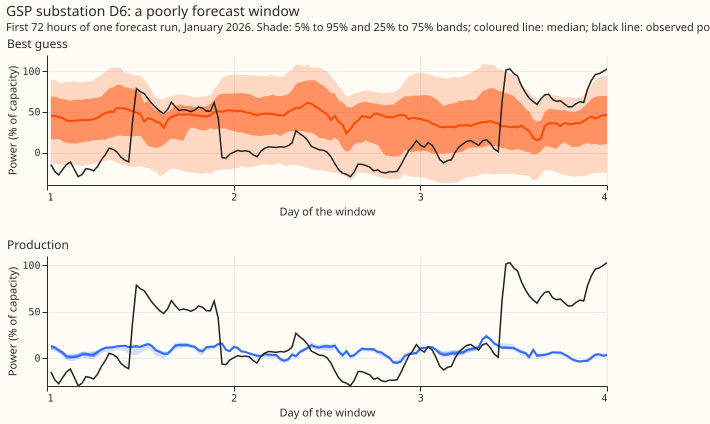

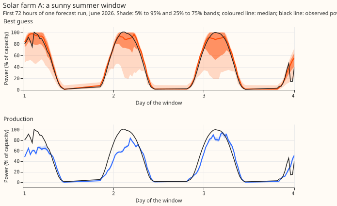

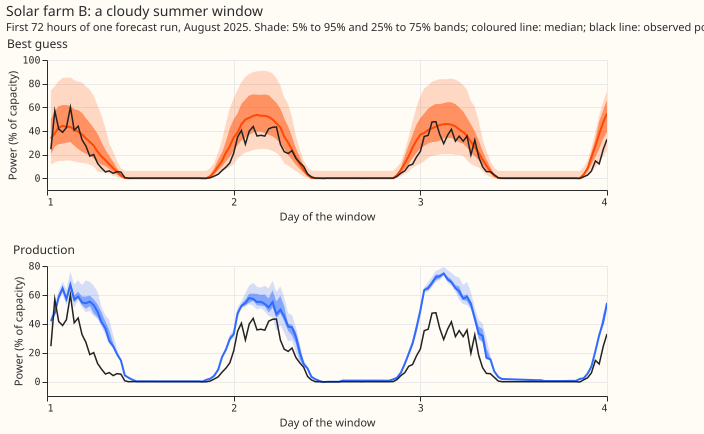

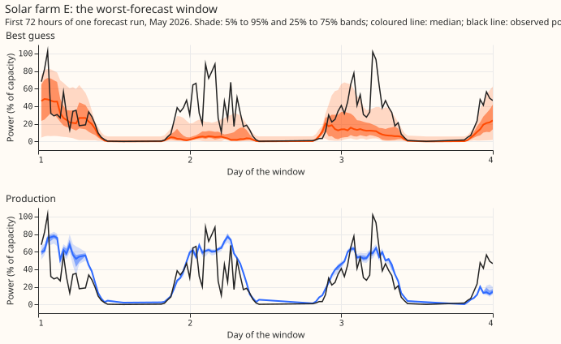

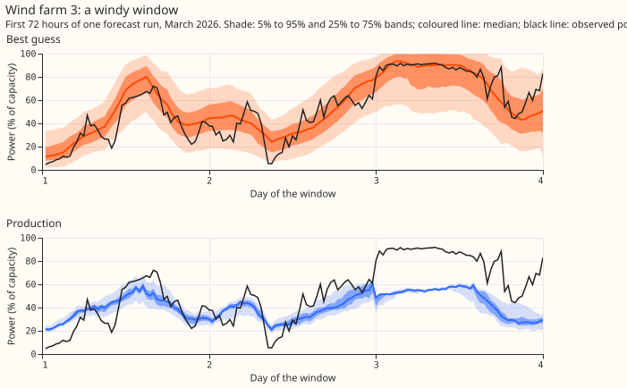

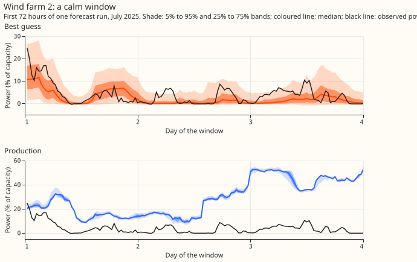

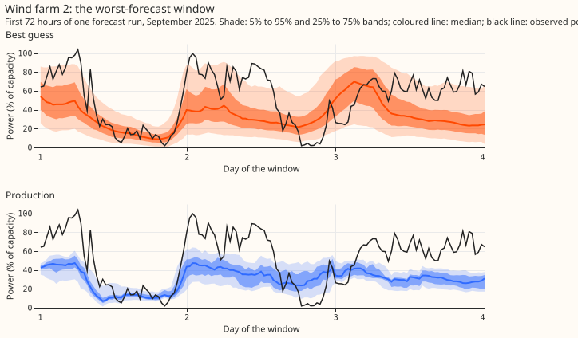

## Limits

- **The monthly-retraining arm has one seed and one validation year.** The arm's interval
  resamples months only. Its training rows after June 2025 are the control member of every daily run
  (364 runs, extracted as the stage 1 pilot did and checked to match it exactly on the run of
  2025-07-01).
- **The correction was tested on runs 5 days apart.** A daily service would build the history from
  forecasts at leads under 1 day.
- **The intervals resample months and seeds, not series.** With 3 wind farms, 6 solar farms, and 4
  BSP and GSP series, they understate the difference between farms and substations.
- **Production for the generators is the stored forecast of `xgboost_baseline`.** The stored
  members give a very narrow band, and the appendix lists `xgboost_baseline_retrain_638` and
  `xgboost_baseline_retrain_790` as exploratory rows. Production has 124 of 282,916 solar and wind
  cases without a stored forecast, and `manual_heuristic` 195.
- **The generator thresholds sit near capacity.** `historical_p99` of power over capacity ranges
  from 0.59 to 1.01 across the 29 series, so a high threshold for solar and wind grades clipping.
- **Several contrasts were expected to be inconclusive and are.** CAMS-trained solar, the physics
  hybrid, and the wind column lie within their intervals of zero.
- **The ceiling arms are not deployable.** ERA5 and CAMS are estimates of past weather and not
  ground truth, so the gap bounds the headroom of a product with their accuracy at the site's grid
  cell.

## Checks and predictions that did not hold

- **Reproduction:** the rebuilt best guess matches experiment 19's stored set exactly (maximum
  difference 0), and the refitted N1 scores 6.328 against 6.329 for experiment 13's N1.
- **Cases:** each family is scored on the cases every arm holds (Primary 768,073 of 805,410, with
  `climatology` the smallest arm); each contrast uses the cases of its own two arms. The fewest
  members of a stored arm are 51 for production and `climatology`, 1 for solar `manual_heuristic`,
  and 8 for wind `manual_heuristic`, so the exceedance rates of `manual_heuristic` carry
  finite-ensemble bias.
- **Predictions that failed:** the twCRPS and the Brier score at `historical_p99` did not rank the
  arms as the quantile score does, and the ERA5-trained generator models did not resolvably beat the
  ENS-trained N1 (C17, C20).

## All numbers

Printed by `e00033_report.py` from the saved results. Scores are in points of capacity.

### Primary: absolute scores over all leads

| Arm | Quantile score (95% interval) | MAE of the median | twCRPS at p99 | Brier at p99 | Above q90 | Above q95 | Inside q05-q95 |
|---|---|---|---|---|---|---|---|
| Best guess: N1 + correction + spread | 5.32 (4.93 to 5.68) | 7.34 | 0.063 | 0.0083 | 0.118 | 0.070 | 0.853 |
| N1 + correction | 5.34 (4.94 to 5.72) | 7.34 | 0.064 | 0.0084 | 0.148 | 0.095 | 0.801 |
| N1 | 6.33 (5.35 to 7.25) | 8.45 | 0.058 | 0.0079 | 0.184 | 0.127 | 0.801 |
| Production + correction | 8.59 (7.86 to 9.29) | 8.99 | 0.107 | 0.0127 | 0.458 | 0.448 | 0.090 |
| Production | 9.52 (8.42 to 10.55) | 9.92 | 0.067 | 0.0096 | 0.496 | 0.486 | 0.097 |
| manual_heuristic + correction | 5.91 (5.38 to 6.42) | 8.06 | 0.076 | 0.0100 | 0.148 | 0.102 | 0.787 |
| manual_heuristic | 5.89 (5.40 to 6.39) | 8.23 | 0.059 | 0.0081 | 0.160 | 0.110 | 0.809 |
| climatology + correction | 6.25 (5.74 to 6.77) | 8.59 | 0.090 | 0.0108 | 0.124 | 0.084 | 0.828 |
| climatology | 7.46 (6.54 to 8.33) | 10.33 | 0.059 | 0.0083 | 0.160 | 0.107 | 0.830 |
| Weekly analogues + correction | 5.29 (4.90 to 5.66) | 7.27 | 0.065 | 0.0086 | 0.148 | 0.095 | 0.798 |
| One model per type + correction + spread | 5.47 (5.13 to 5.80) | 7.65 | 0.062 | 0.0081 | 0.087 | 0.043 | 0.921 |
| Monthly retraining, no correction | 5.12 (4.72 to 5.59) | 7.12 | 0.058 | 0.0077 | 0.147 | 0.092 | 0.840 |
| Monthly retraining + correction | 5.24 (4.90 to 5.58) | 7.24 | 0.063 | 0.0084 | 0.134 | 0.083 | 0.820 |

### BSP: absolute scores over all leads

| Arm | Quantile score (95% interval) | MAE of the median | twCRPS at p99 | Brier at p99 | Above q90 | Above q95 | Inside q05-q95 |
|---|---|---|---|---|---|---|---|
| Best guess: N1 | 8.06 (7.61 to 8.62) | 11.26 | 0.047 | 0.0091 | 0.159 | 0.112 | 0.812 |
| N1 + correction | 8.29 (7.80 to 8.80) | 11.59 | 0.042 | 0.0082 | 0.158 | 0.111 | 0.792 |
| Production | 12.43 (11.57 to 13.31) | 13.40 | 0.052 | 0.0108 | 0.474 | 0.462 | 0.141 |
| manual_heuristic | 8.86 (8.38 to 9.42) | 12.34 | 0.050 | 0.0099 | 0.148 | 0.101 | 0.804 |
| climatology | 9.29 (8.74 to 9.91) | 13.03 | 0.050 | 0.0102 | 0.131 | 0.082 | 0.842 |

### GSP: absolute scores over all leads

| Arm | Quantile score (95% interval) | MAE of the median | twCRPS at p99 | Brier at p99 | Above q90 | Above q95 | Inside q05-q95 |
|---|---|---|---|---|---|---|---|
| Best guess: N1 | 19.52 (16.66 to 22.28) | 27.40 | 0.381 | 0.0255 | 0.159 | 0.116 | 0.792 |
| N1 + correction | 20.05 (17.04 to 23.10) | 27.64 | 0.374 | 0.0255 | 0.146 | 0.110 | 0.755 |
| Production | 29.78 (25.76 to 33.60) | 31.77 | 0.405 | 0.0288 | 0.446 | 0.435 | 0.127 |
| manual_heuristic | 20.81 (17.73 to 23.66) | 29.81 | 0.372 | 0.0251 | 0.168 | 0.119 | 0.768 |
| climatology | 21.18 (18.37 to 23.81) | 30.52 | 0.382 | 0.0257 | 0.161 | 0.094 | 0.821 |

### solar: absolute scores over all leads

| Arm | Quantile score (95% interval) | MAE of the median | twCRPS at p99 | Brier at p99 | Above q90 | Above q95 | Inside q05-q95 |
|---|---|---|---|---|---|---|---|
| Best guess: ERA5-trained + spread | 5.03 (3.73 to 6.52) | 7.35 | 0.042 | 0.0090 | 0.069 | 0.036 | 0.905 |
| N1 | 5.11 (3.82 to 6.51) | 7.49 | 0.037 | 0.0084 | 0.062 | 0.033 | 0.931 |
| Production | 8.85 (6.52 to 11.37) | 9.52 | 0.046 | 0.0111 | 0.409 | 0.387 | 0.197 |
| manual_heuristic | 5.82 (4.33 to 7.43) | 8.57 | 0.040 | 0.0092 | 0.073 | 0.047 | 0.891 |
| climatology | 5.81 (4.36 to 7.41) | 8.57 | 0.040 | 0.0091 | 0.041 | 0.018 | 0.947 |
| CAMS-trained + spread | 5.02 (3.72 to 6.46) | 7.28 | 0.042 | 0.0090 | 0.077 | 0.043 | 0.904 |
| Physics + XGBoost hybrid | 5.03 (3.73 to 6.50) | 7.34 | 0.039 | 0.0088 | 0.056 | 0.025 | 0.948 |
| Physics only | 5.11 (3.79 to 6.56) | 7.26 | 0.039 | 0.0088 | 0.037 | 0.014 | 0.966 |

### wind: absolute scores over all leads

| Arm | Quantile score (95% interval) | MAE of the median | twCRPS at p99 | Brier at p99 | Above q90 | Above q95 | Inside q05-q95 |
|---|---|---|---|---|---|---|---|
| Best guess: ERA5-trained + margin + spread | 11.04 (9.66 to 12.40) | 15.65 | 0.020 | 0.0077 | 0.130 | 0.068 | 0.912 |
| N1 | 11.36 (9.90 to 12.79) | 16.07 | 0.020 | 0.0076 | 0.111 | 0.071 | 0.880 |
| Production | 17.31 (15.73 to 18.97) | 18.95 | 0.020 | 0.0076 | 0.352 | 0.331 | 0.185 |
| manual_heuristic | 14.06 (12.24 to 15.94) | 19.54 | 0.020 | 0.0077 | 0.177 | 0.125 | 0.771 |
| climatology | 13.61 (11.71 to 15.42) | 19.27 | 0.020 | 0.0078 | 0.151 | 0.090 | 0.861 |
| Margin + power-over-wind-cubed | 11.01 (9.64 to 12.38) | 15.58 | 0.020 | 0.0074 | 0.140 | 0.078 | 0.893 |

### Planned contrasts on the quantile score, over all leads

| Id | Family | Groups | Treatment minus reference | Difference | Planned interval (level) | 95% interval |
|---|---|---|---|---|---|---|
| C1 | decisive | Primary | `n1_cs` minus `production` | -4.890 | -5.663 to -4.060 (98.33%) | -5.542 to -4.204 |
| C2 | decisive | solar | `bg_base_spread` minus `production` | -3.810 | -5.072 to -2.636 (98.33%) | -4.840 to -2.839 |
| C3 | decisive | wind | `bg_full` minus `production` | -6.268 | -7.654 to -5.281 (98.33%) | -7.351 to -5.415 |
| C4 | Primary demand | Primary | `n1_cs` minus `manual_heuristic` | -0.591 | -0.943 to -0.285 (99.44%) | -0.836 to -0.369 |
| C5 | Primary demand | Primary | `n1_cs` minus `n1` | -1.480 | -2.135 to -0.735 (99.44%) | -1.959 to -0.954 |
| C6 | Primary demand | Primary | `n1_cs` minus `climatology` | -2.144 | -2.930 to -1.277 (99.44%) | -2.716 to -1.533 |
| C7 | Primary demand | Primary | `n1_c` minus `n1` | -1.447 | -2.093 to -0.711 (99.44%) | -1.920 to -0.927 |
| C8 | Primary demand | Primary | `production_c` minus `production` | -1.383 | -2.100 to -0.682 (99.44%) | -1.899 to -0.866 |
| C9 | Primary demand | Primary | `a7_c` minus `n1_c` | -0.051 | -0.097 to -0.014 (99.44%) | -0.083 to -0.023 |
| C10 | Primary demand | Primary | `type_id_cs` minus `own_cs` | 0.126 | 0.018 to 0.233 (99.44%) | 0.050 to 0.203 |
| C11 | Primary demand | Primary | `monthly_c` minus `n1_c` | -0.110 | -0.240 to 0.034 (99.44%) | -0.206 to -0.009 |
| C12 | Primary demand | Primary | `monthly` minus `n1` | -1.579 | -2.180 to -0.856 (99.44%) | -2.042 to -1.060 |
| C13 | BSP and GSP | BSP+GSP | `n1` minus `production` | -7.248 | -8.459 to -6.183 (98.75%) | -8.188 to -6.389 |
| C14 | BSP and GSP | BSP+GSP | `n1` minus `manual_heuristic` | -1.036 | -2.005 to -0.091 (98.75%) | -1.793 to -0.289 |
| C15 | BSP and GSP | BSP+GSP | `n1` minus `climatology` | -1.442 | -1.934 to -0.921 (98.75%) | -1.830 to -1.039 |
| C16 | BSP and GSP | BSP+GSP | `n1_c` minus `n1` | 0.377 | -0.120 to 0.919 (98.75%) | -0.022 to 0.798 |
| C17 | generators | solar | `bg_base_spread` minus `n1` | -0.078 | -0.235 to 0.124 (99.50%) | -0.190 to 0.053 |
| C18 | generators | solar | `bg_base_spread` minus `manual_heuristic` | -0.782 | -1.037 to -0.526 (99.50%) | -0.965 to -0.603 |
| C19 | generators | solar | `bg_base_spread` minus `climatology` | -0.772 | -1.043 to -0.540 (99.50%) | -0.962 to -0.600 |
| C20 | generators | wind | `bg_full` minus `n1` | -0.322 | -0.909 to 0.197 (99.50%) | -0.719 to 0.050 |
| C21 | generators | wind | `bg_full` minus `manual_heuristic` | -3.015 | -4.475 to -1.973 (99.50%) | -3.975 to -2.221 |
| C22 | generators | wind | `bg_full` minus `climatology` | -2.563 | -3.733 to -1.521 (99.50%) | -3.385 to -1.788 |
| C23 | generators | solar | `cams_spread` minus `bg_base_spread` | -0.016 | -0.125 to 0.064 (99.50%) | -0.087 to 0.041 |
| C24 | generators | wind | `capacity_a4` minus `capacity_a0` | -0.048 | -0.107 to 0.021 (99.50%) | -0.090 to -0.002 |
| C25 | generators | solar | `physics_hybrid` minus `bg_base` | -0.000 | -0.017 to 0.021 (99.50%) | -0.012 to 0.014 |
| C26 | generators | solar | `physics_scipy` minus `bg_base` | 0.084 | 0.023 to 0.157 (99.50%) | 0.038 to 0.135 |
| C27 | weather ceiling | Primary | `w22_era5_all_c` minus `w22_ens_c` | -0.106 | -0.172 to -0.049 (99.38%) | -0.153 to -0.063 |
| C28 | weather ceiling | solar | `pw_era5_spread` minus `bg_base_spread` | -1.047 | -1.398 to -0.736 (99.38%) | -1.298 to -0.819 |
| C28b | weather ceiling | solar | `pw_cams_spread` minus `cams_spread` | -2.087 | -2.722 to -1.416 (99.38%) | -2.567 to -1.588 |
| C29 | weather ceiling | wind | `pw_era5_spread` minus `bg_full` | -5.463 | -6.913 to -3.895 (99.38%) | -6.533 to -4.376 |
| C30 | weather ceiling | Primary | `era5_retrained_c` minus `n1_refit_c` | -0.272 | -0.437 to -0.109 (99.38%) | -0.393 to -0.152 |
| C31 | weather ceiling | Primary | `cams_shortwave_c` minus `w22_ens_c` | -0.177 | -0.253 to -0.098 (99.38%) | -0.233 to -0.119 |
| C31b | weather ceiling | Primary | `cams_shortwave_c` minus `w22_era5_all_c` | -0.070 | -0.099 to -0.039 (99.38%) | -0.092 to -0.047 |
| C32 | weather ceiling | BSP+GSP | `w22_era5_all` minus `w22_ens` | -0.791 | -1.147 to -0.448 (99.38%) | -1.047 to -0.540 |

### Exploratory contrasts on the other metrics, over all leads (95% intervals)

| Id | MAE of the median | twCRPS at p99 | twCRPS at p95 |
|---|---|---|---|
| C1 | -3.195 (-3.800 to -2.557) | -0.003 (-0.013 to 0.006) | -0.068 (-0.110 to -0.030) |
| C2 | -2.170 (-2.789 to -1.598) | -0.004 (-0.007 to -0.001) | -0.236 (-0.430 to -0.089) |
| C3 | -3.303 (-4.401 to -2.274) | 0.000 (-0.000 to 0.000) | -0.041 (-0.074 to -0.011) |
| C4 | -0.910 (-1.319 to -0.522) | 0.003 (-0.005 to 0.015) | -0.006 (-0.032 to 0.024) |
| C5 | -1.641 (-2.161 to -1.056) | 0.005 (-0.001 to 0.015) | 0.008 (-0.006 to 0.027) |
| C7 | -1.641 (-2.161 to -1.056) | 0.005 (-0.001 to 0.016) | 0.008 (-0.005 to 0.029) |
| C13 | -3.225 (-4.145 to -2.306) | -0.014 (-0.023 to -0.007) | -0.187 (-0.251 to -0.128) |
| C17 | -0.142 (-0.311 to 0.051) | 0.005 (0.001 to 0.016) | 0.023 (0.003 to 0.057) |
| C20 | -0.431 (-0.967 to 0.078) | -0.000 (-0.001 to 0.000) | -0.014 (-0.040 to 0.006) |

### Quantile score by lead band

#### Primary

| Arm | 0-24 h | 1-2 d | 2-6 d | 6-10 d | 10+ d |
|---|---|---|---|---|---|
| `n1_cs` | 4.51 | 4.72 | 5.05 | 5.46 | 5.74 |
| `n1` | 5.46 | 5.71 | 5.96 | 6.49 | 6.84 |
| `production` | 9.44 | 9.33 | 9.29 | 9.48 | 9.81 |
| `manual_heuristic` | 5.66 | 5.69 | 5.74 | 5.91 | 6.09 |

#### solar

| Arm | 0-24 h | 1-2 d | 2-6 d | 6-10 d | 10+ d |
|---|---|---|---|---|---|
| `bg_base_spread` | 3.63 | 4.00 | 4.79 | 5.46 | 5.43 |
| `n1` | 3.72 | 4.05 | 4.96 | 5.52 | 5.45 |
| `production` | 7.39 | 7.98 | 8.97 | 9.09 | 9.06 |
| `manual_heuristic` | 5.51 | 5.86 | 5.82 | 6.18 | 5.59 |

#### wind

| Arm | 0-24 h | 1-2 d | 2-6 d | 6-10 d | 10+ d |
|---|---|---|---|---|---|
| `bg_full` | 6.26 | 6.70 | 9.02 | 12.88 | 13.23 |
| `n1` | 5.91 | 6.51 | 9.56 | 12.93 | 13.84 |
| `production` | 11.90 | 12.43 | 15.85 | 18.55 | 19.77 |
| `manual_heuristic` | 13.11 | 13.84 | 14.17 | 13.99 | 14.27 |

### Weather ceiling by lead band (95% intervals, quantile score)

| Id | 0-24 h | 1-2 d | 2-6 d | 6-10 d | 10+ d |
|---|---|---|---|---|---|
| C27 | 0.03 (0.01 to 0.05) | -0.00 (-0.04 to 0.04) | -0.08 (-0.12 to -0.05) | -0.14 (-0.20 to -0.07) | -0.15 (-0.23 to -0.08) |
| C28 | 0.17 (0.01 to 0.35) | 0.04 (-0.13 to 0.19) | -0.79 (-0.96 to -0.61) | -1.24 (-1.60 to -0.89) | -1.61 (-2.09 to -1.21) |
| C28b | -0.72 (-0.94 to -0.50) | -1.10 (-1.59 to -0.67) | -1.84 (-2.27 to -1.39) | -2.29 (-2.86 to -1.71) | -2.63 (-3.34 to -1.97) |
| C29 | -0.71 (-1.15 to -0.27) | -0.91 (-1.23 to -0.61) | -3.46 (-4.35 to -2.67) | -7.29 (-8.97 to -5.63) | -7.68 (-9.20 to -6.16) |
| C30 | -0.01 (-0.09 to 0.09) | -0.05 (-0.17 to 0.08) | -0.17 (-0.27 to -0.07) | -0.31 (-0.46 to -0.16) | -0.43 (-0.60 to -0.27) |
| C31 | -0.08 (-0.11 to -0.04) | -0.10 (-0.16 to -0.03) | -0.17 (-0.22 to -0.11) | -0.20 (-0.27 to -0.12) | -0.21 (-0.29 to -0.13) |
| C32 | -0.06 (-0.27 to 0.11) | -0.27 (-0.51 to -0.02) | -0.81 (-1.08 to -0.54) | -0.99 (-1.35 to -0.65) | -0.88 (-1.13 to -0.63) |

### Weather ceiling by variable (difference of mean quantile scores, no interval)

| Swap | Group | Score of the swap | Score of its reference | Difference |
|---|---|---|---|---|
| ERA5 shortwave | Primary | 5.26 | 5.35 | -0.09 |
| ERA5 temperature | Primary | 5.34 | 5.35 | -0.01 |
| ERA5 wind speed | Primary | 5.35 | 5.35 | -0.00 |
| ERA5 all seven columns | Primary | 5.24 | 5.35 | -0.11 |
| ERA5 shortwave | solar | 4.17 | 5.03 | -0.86 |
| CAMS shortwave (CAMS-trained) | solar | 2.94 | 5.02 | -2.08 |
| ERA5 100 m wind speed | wind | 6.81 | 11.04 | -4.24 |

### Threshold exceedance at 1 to 2 days and 2 to 6 days (counts summed over series and seed 0)

| Group | Threshold | Lead | Arm | Events | Hits (p >= 0.5) | False alarms |
|---|---|---|---|---|---|---|
| Primary | p99 | 1-2 d | `n1_cs` | 417 | 168 | 164 |
| Primary | p99 | 1-2 d | `production` | 417 | 59 | 106 |
| Primary | p99 | 1-2 d | `manual_heuristic` | 417 | 21 | 22 |
| Primary | p99 | 2-6 d | `n1_cs` | 1947 | 431 | 558 |
| Primary | p99 | 2-6 d | `production` | 1947 | 204 | 358 |
| Primary | p99 | 2-6 d | `manual_heuristic` | 1947 | 89 | 65 |
| Primary | p95 | 1-2 d | `n1_cs` | 2300 | 1267 | 667 |
| Primary | p95 | 1-2 d | `production` | 2300 | 869 | 610 |
| Primary | p95 | 1-2 d | `manual_heuristic` | 2300 | 685 | 373 |
| Primary | p95 | 2-6 d | `n1_cs` | 9867 | 4820 | 2513 |
| Primary | p95 | 2-6 d | `production` | 9867 | 3077 | 2173 |
| Primary | p95 | 2-6 d | `manual_heuristic` | 9867 | 2874 | 1328 |
| solar | p99 | 1-2 d | `bg_base_spread` | 136 | 14 | 22 |
| solar | p99 | 1-2 d | `production` | 136 | 0 | 9 |
| solar | p99 | 1-2 d | `manual_heuristic` | 136 | 0 | 3 |
| solar | p99 | 2-6 d | `bg_base_spread` | 559 | 37 | 31 |
| solar | p99 | 2-6 d | `production` | 559 | 2 | 33 |
| solar | p99 | 2-6 d | `manual_heuristic` | 559 | 6 | 6 |
| solar | p95 | 1-2 d | `bg_base_spread` | 560 | 240 | 102 |
| solar | p95 | 1-2 d | `production` | 560 | 159 | 194 |
| solar | p95 | 1-2 d | `manual_heuristic` | 560 | 85 | 171 |
| solar | p95 | 2-6 d | `bg_base_spread` | 2703 | 912 | 388 |
| solar | p95 | 2-6 d | `production` | 2703 | 579 | 789 |
| solar | p95 | 2-6 d | `manual_heuristic` | 2703 | 624 | 593 |
| wind | p99 | 1-2 d | `bg_full` | 37 | 0 | 0 |
| wind | p99 | 1-2 d | `production` | 37 | 0 | 0 |
| wind | p99 | 1-2 d | `manual_heuristic` | 37 | 0 | 0 |
| wind | p99 | 2-6 d | `bg_full` | 255 | 0 | 0 |
| wind | p99 | 2-6 d | `production` | 255 | 0 | 0 |
| wind | p99 | 2-6 d | `manual_heuristic` | 255 | 0 | 0 |
| wind | p95 | 1-2 d | `bg_full` | 285 | 83 | 18 |
| wind | p95 | 1-2 d | `production` | 285 | 0 | 0 |
| wind | p95 | 1-2 d | `manual_heuristic` | 285 | 0 | 0 |
| wind | p95 | 2-6 d | `bg_full` | 1318 | 241 | 57 |
| wind | p95 | 2-6 d | `production` | 1318 | 0 | 8 |
| wind | p95 | 2-6 d | `manual_heuristic` | 1318 | 0 | 0 |

### Cases per group

| Group | Shared cases | Largest arm | Smallest arm (cases) |
|---|---|---|---|
| Primary | 768,073 | 805,410 | `climatology` (768,073) |
| BSP | 100,986 | 101,040 | `climatology` (100,986) |
| GSP | 96,664 | 96,718 | `climatology` (96,664) |
| solar | 175,675 | 175,795 | `manual_heuristic` (175,675) |
| wind | 107,046 | 107,121 | `climatology` (107,046) |

Thresholds: 29 series; `historical_p99` ranges 0.592 to 1.005, `historical_p95` 0.239 to 0.923 of capacity.

## Plan, written before any code ran

One experiment compares, on one validation year, the architecture that experiments 1 to 32
recommend against the deployed recipe, three baselines, six notable ideas, and a perfect-weather
ceiling. Units are points of capacity (1 point is 1% of a series' effective capacity). The
validation rows are the 73 runs of `fold_a_every5d_v1` for the 20 demand series (16 Primary
substations, 2 BSP, and 2 GSP) and the 53 Tuesday runs of `fold_a_tuesdays_v1` for the 6 solar
farms and 3 wind farms. No valid time on or after 2026-07-01 is scored.

### Arms

**An arm whose recipe, rows, and seeds an earlier experiment already ran is read from that
experiment's stored predictions, not refitted.** `experiment_store.read_predictions` refuses sets on
a different row set, and every reused set has three seeds. The table names the source of each
reused arm. Every fit below is new code in this experiment's folder.

| Family | Arm | Source |
|---|---|---|
| Primary demand | **Best guess:** N1 + 14-day correction + spread factor 1.15 | reused: 00019 `stack_minus_h` |
| Primary demand | N1 (no correction), N1 + correction | reused: 00013 `n1`, 00019 `n1_c` |
| BSP, GSP demand | **Best guess:** N1, no correction; N1 + correction and N1 + correction + spread as arms | reused: 00013 `n1`; correction and spread computed here |
| All demand | Production (`xgboost_baseline`), `manual_heuristic`, `climatology`, each with and without the 14-day correction | reused: 00013 `production`, `manual_heuristic`, `climatology`; the correction is computed here with 00019's code |
| All demand | Notable 1: weekly analogue mean and median, with and without correction | reused: 00030 `a7`, `a7_c` |
| All demand | Notable 2: one model per substation type with the series identifier, with and without correction | reused: 00024 `type_id`, `type_id_stack`; contrast bases `own`, `own_stack` |
| Primary demand | Notable 3: N1 retrained monthly with a 0.5-year half-life, plus correction | **new fit**, below |
| Solar | **Best guess:** ERA5-trained mixture with spread factor | reused: 00020 `base-spread` |
| Wind | **Best guess:** ERA5-trained mixture with power-curve margin and spread factor | reused: 00020 `full` |
| Solar, wind | Production (`xgboost_baseline`), `manual_heuristic`, `climatology` | stored forecasts; read for the Tuesday runs, quantiles of the stored members at the 9 levels |
| Solar, wind | N1 for generators | **new fit**, below |
| Solar | Notable 4: CAMS-trained mixture with spread factor | reused: 00020 `full-no-s0` |
| Solar | Notable 6: PV physics, and the physics output as a column in the XGBoost model | reused: 00029 `scipy`, `torch-hybrid`; contrast base 00020 `base` |
| Wind | Notable 5: margin plus `top_decile_28d` and `power_to_wind3_q75_28d` | reused: 00026 `a4`, `a0` |

**Four substitutions are named here.** The stored arms differ from the notable ideas in four ways.

- Notable 4 is 00020 `full-no-s0` (CAMS-trained plus the spread factor), so that it shares the best
  guess's spread factor.
- Notable 5 is 00026's arm A4 (wind), which adds `top_decile_28d` as well as
  `power_to_wind3_q75_28d` and has the power-curve margin but no spread factor. Its contrast is A4
  minus A0 within 00026, where A0 equals 00020 `margin`.
- Notable 6 is the stored PyTorch-fitted hybrid `torch-hybrid`, because 00029 found the SciPy and
  PyTorch fits level on score (C3, -0.005, -0.020 to +0.010) and stored no SciPy hybrid. The hybrid
  has no spread factor, so its contrast is against 00020 `base`.
- Notable 2's stored arms use a half-life of 0.5 years, and `type_id_stack` adds the correction and
  the spread factor. Its contrasts are against 00024's own per-series arms (`own`, `own_stack`).

**Production for the generators is read, not refitted.** The `power_forecasts` Delta table holds
`xgboost_baseline` forecasts for all 31 series, including the 9 generators, on fold
`mid_2025_to_mid_2026`. The arm uses `experiment_name` `xgboost_baseline`, the recipe experiment 13
scored as production for demand. The table also holds `xgboost_baseline_retrain_638` and
`xgboost_baseline_retrain_790`, reported as exploratory rows. Where a stored production forecast
lacks a Tuesday run, the arm is scored on the cases all arms hold, and `result.md` states the count
of dropped cases.

**N1 for generators uses the 00013 recipe with no calendar columns.** The recipe, applied to each
generator, is one XGBoost model per farm with the nine-level quantile loss, trained on the ENS
control member of every daily run with valid times from 2024-04-01 to 2025-06-30, recency weights
with a half-life of 2 years anchored at 2025-06-30, the technology's common columns (nine for solar,
six for wind), `lead_hours`, and three power lags from the forecast origin (newest usable
observation at origin minus 3.5 hours, latest earlier same half-hour, latest earlier same weekday
and half-hour). The calendar columns are left out, because experiment 1 found calendar columns let
an ENS-trained generator model memorise valid times (+3.40 wind, +1.13 solar). The 51 member
forecasts are pooled as in 00013. No correction is applied to N1 for generators.

**Monthly retraining refits each Primary substation's N1 model on the first day of each month.**
The refits run from 2025-07 to 2026-06 with a half-life of 0.5 years anchored at the refit date,
on the ENS control member of every daily run (the NWP store holds a daily run from 2024-04-01) with
valid times at least 3.5 hours before the refit. A run is forecast by the latest refit on or before
its origin, so the refit is chosen by origin and not by valid time. The 2025-07-01 refit is close to
the half-life-0.5-year fit trained to 2025-06-30 but stops 3 hours earlier. The 14-day correction
history spans a change of model at each month boundary, and the page says so. The arm is reported
with and without the correction. Building control-member features for the daily runs after
2025-06-30 is new code; if that costs more than about 2 hours, the arm falls back to the 73
validation runs' control members and the page says so. The arm uses seed 0 only (about 1 hour for 16
series by 12 refits), so it is contrasted with the seed-0 rows of the reference arms, and its
interval resamples months only.

### Perfect-weather arms

**The perfect-weather arms measure the headroom from better weather, not a deployable model.** ERA5
and CAMS are estimates of past weather, not ground truth, so figures label the arms "ERA5-weather
ceiling". ERA5 reaches us about 5 days late and CAMS is satellite-derived after the fact, so no
serving system could use either at the target time. The page labels every perfect-weather result
"ceiling".

- **Demand:** the arms `ens`, `era5_all`, `era5_shortwave`, `era5_temperature_2m`, and
  `era5_wind_speed_10m` of 00022 are reused for all 20 series (N1H; 00019 C5 found the half-life
  neutral). Their contrasts are against 00022's own `ens`, never the 00019 set. Each is reported
  with and without the correction, and the correction and spread factor are applied here wherever
  00022's stored set lacks them. Two variants are new fits: `shortwave` from CAMS at the series'
  own location with ERA5 for the other six columns, and the model retrained on ERA5 over the same
  2024-04 to 2025-06 window and fed ERA5. For BSP and GSP the arms are N1 without correction. The
  contrasts use the forms with correction but without the spread factor, because the factor of 1.15
  was tuned for 51-member mixtures and a single input has a narrower band; the forms with the spread
  factor are reported as exploratory.
- **Solar:** the ERA5-trained model of the best guess is fed ERA5 at the valid time (one input per
  valid time, so the forecast is the model's 9 quantiles); a CAMS-trained variant is fed CAMS
  `shortwave` with ERA5 for the other eight columns. Single-variable swap: `shortwave` only.
- **Wind:** ERA5 10 m and 100 m wind speed and direction at the valid time, with the power-curve
  margin reading ERA5 100 m speed; single-variable swap: 100 m wind speed alone.
- **Spread factor:** for solar and wind, each perfect-weather arm is reported with and without the
  best guess's spread factor, refitted monthly on the arm's own earlier cases as 00020 did. A
  single-input band is narrower than a pooled mixture, so the unrefitted factor may mislead.
- **Lead bands:** 0 to 24 h, 1 to 2 d, 2 to 6 d, 6 to 10 d, 10 days or more. For solar and wind the
  perfect-weather arm does not depend on lead, so the by-lead gap is the best guess's degradation.
- **Weather available at forecast time:** neither ERA5 nor CAMS is available at forecast time.
  Lagged power uses the observation at least 3.5 hours old, as in 00013; no other lag-time weather
  enters any arm.

### Metrics

All arms store 9 quantiles at 0.05, 0.1, 0.25, 0.4, 0.5, 0.6, 0.75, 0.9, and 0.95. For
`manual_heuristic`, `production`, and `climatology`, the quantiles are those of the stored members
at the 9 levels, as 00013 took them.

- **MAE of the median:** the absolute error of `q50`.
- **Quantile score (the CRPS estimate):** as in 00019.
- **twCRPS at `historical_p99`:** replace every quantile and the observation by `max(z, r)` and take
  the quantile score. `r` is the 99th percentile of the series' power over capacity in the
  constraint direction (high positive power for demand and for generation) over the series' full
  history to 2026-06-30, as `evaluation-metrics.md` defines it. The threshold is a fixed scoring
  constant that no model sees. The page reports, per series, the count of half-hours and of distinct
  days above the threshold. For the generators the threshold sits near capacity (capacity is itself
  a P99), so `historical_p95` is a co-primary line for solar and wind and an exploratory line for
  demand.
- **Brier score at the same threshold:** the exceedance probability `p(r)` comes from the quantile
  function: linear interpolation of the level against the quantile between `q05` and `q95`; above
  `q95` the probability falls by half for every width `q95 - q90` beyond `q95`, starting from 0.05
  (an exponential tail), and is 0 beyond `q95` when `q95 = q90`; below `q05` the exceedance
  probability is `1 - 0.05 * 2^(-(q05 - r) / (q10 - q05))`. The tails are approximations, and at
  `historical_p99` most cases lie in the upper tail, so the Brier score there mainly measures the
  tail assumption. The page therefore also reports the Brier score at `historical_p95`, which is
  interpolated, and the hit rate and false-alarm count at the threshold for the 1-to-2-day and
  2-to-6-day bands. The twCRPS ignores all mass above `q95`.
- **Exceedance rates of the 0.90 and 0.95 quantiles:** the share of cases where the observation
  exceeds that quantile; the aim is 10% and 5%. The rates need no model of the tail, but they are
  calibration checks and not tail-skill rankings. The page reports each stored arm's member count;
  cases of `manual_heuristic` with fewer than 13 members are flagged, and its rates are read against
  a finite-ensemble reference.
- **Thresholds and the flexibility use case:** NGED buys flexibility ahead of an expected
  constraint, so the exceedance metrics are also reported for leads of 1 to 2 days and 2 to 6 days,
  the horizons at which procurement decisions are made. Metrics are never ranked on half-hours
  chosen by the observed load.
- **Absolute scores for every arm** are reported, not only contrasts. BSP, GSP, solar, and wind are
  reported per type and never averaged into Primary.
- **Intervals:** month-block bootstrap, whole validation months and the three seeds resampled, with
  `studies.bootstrap.bootstrap_difference_at_level` and `n_resamples` raised for the Bonferroni
  level. Intervals resample months, not series, so with three wind farms they understate
  between-farm uncertainty.

### Planned contrasts

**Only C1 to C3 decide the verdict, so only they carry the Bonferroni correction across the three
(98.33%).** The other contrasts are exploratory; each family below reads at 5% divided by its
contrast count, so a reader sees which intervals survive a correction within the family.

1. **Decisive (3):** C1 to C3, the best guess minus production for Primary demand, solar, and wind.
2. **Primary demand (9):** C4 to C6, the best guess minus `manual_heuristic`, N1, and `climatology`;
   C7, N1 + correction minus N1; C8, production + correction minus production; C9 to C11, notable
   arms 1, 2, and 3 (with correction) minus N1 + correction, `own_stack`, and N1 + correction at
   seed 0; C12, monthly retraining without correction minus N1 at seed 0.
3. **BSP and GSP (4, pooled over 4 series):** C13 to C15, N1 minus production, `manual_heuristic`,
   and `climatology`; C16, N1 + correction minus N1.
4. **Generators (10):** for solar and wind separately, C17 to C22, the best guess minus N1,
   `manual_heuristic`, and `climatology`; C23, solar notable 4 minus the best guess; C24, wind
   notable 5 (A4) minus A0; C25, solar `torch-hybrid` minus 00020 `base`; C26, solar `scipy` minus
   00020 `base`.
5. **Weather ceiling (8):** all with correction where the arm is demand. C27, the all-variable ERA5
   arm minus 00022 `ens` (both N1H) for Primary demand; C28, the ERA5 arm minus the best guess for
   solar, and C28b, the CAMS-shortwave arm minus the CAMS-trained arm; C29, the ERA5 arm minus the
   best guess for wind; C30, the demand arm retrained on ERA5 minus N1 refitted here on ENS; C31,
   the CAMS-shortwave demand arm minus 00022 `ens`, and C31b, the same arm minus 00022 `era5_all`,
   which isolates CAMS against ERA5 shortwave; C32, the BSP and GSP all-variable ERA5 arm minus
   00022 `ens`, without correction.

**Several contrasts are expected to be inconclusive.** Notable 1 (-0.05 in 00030), notable 4
(-0.009, -0.127 to +0.072 in 00020), and notable 5 (-0.048 in 00026) will not resolve at a share of
one tenth or less, and the BSP and GSP correction (+0.36, -0.19 to +0.98 in 00021) is unresolved
with 4 series. Scores by lead band, by variable, at `historical_p95`, and for the exceedance rates
are exploratory.

### Advice followed and departed from

- **Followed:** use ERA5-trained generator models with no calendar columns and no stage 2 or
  correction (00001, 00023); keep the demand correction at 14 days, additive (00019, 00021); leave
  the correction out of the best guess for BSP and GSP (00021).
- **Departed from:** 00019 C5 shows a 0.5-year half-life on a frozen model changes nothing; notable
  2 uses it because 00024 ran it, and notable 3 tests the half-life with monthly retraining, which
  00019 never did.

### Figures

- **Headline:** quantile score of every arm per family with 98.33% intervals on the decisive
  contrasts, at the top of the page.
- **Metrics:** twCRPS, Brier score, and exceedance rates of the 0.90 and 0.95 quantiles per arm.
- **By lead band:** best guess, production, N1, `manual_heuristic`.
- **Perfect weather:** gap to the best guess by lead band and by variable.
- **Fan charts (the 9 quantiles and the actual):** several series per family on good and bad days,
  sunny and cloudy, windy and calm, a cold snap; the best guess beside production. Generators carry
  anonymised labels ("Solar farm A", "Wind farm B") from `studies.anonymise`, never a name or an
  identifier; substations may be named. Generator charts follow the `dataviz` skill: the axis shows
  days 1 to 7 and no calendar date, the text gives month and year only, `aria` is off, values are
  fractions of capacity and not megawatts, and no caption gives the date of a "windy" or "cold" day.

### Checks and compute

- **Leakage checks.** Every refit stops at its stated training end; lags and the correction use
  observations at least 3.5 hours before the origin; ERA5 and CAMS values are those of the valid
  time only and are used in the perfect-weather arms alone; the thresholds are fixed scoring
  constants from each series' history to 2026-06-30, which no model sees. A reviewer checks the
  monthly-retraining code for leakage.
- **Reproduction checks.** The reused demand arms must reproduce 00019's stored scores to 3 decimal
  places on 00019's exact case set when rescored with this experiment's scorer; each family is then
  scored on its own case intersection and the page reports the dropped counts, and the refitted N1
  must match 00013's `n1` within 0.02 points.
- **Weather source at lag times.** No arm uses weather at lag times; only the power lags read the
  past, and they read observed power available at the forecast origin.
- **Compute.** About 3 hours in total on slots A and B (22 cores, one fit at a time on the GPU):
  generator N1 (9 series x 3 seeds, minutes); demand fits (N1 refit, 20 series x 3
  seeds, about 20 minutes, and the ERA5-retrained variant, about 20 minutes); monthly retraining
  (about 1 hour, seed 0, plus the feature build); generator perfect-weather predictions (minutes).
  If the fits would run more than 5 hours in total, the plan proposes a reduction to the manager
  instead of cutting arms silently.

### Sizing

- **Stored data:** prediction sets under `data/ml-experiments/00033-.../predictions/`; no table.
- **Production serving path:** not touched; the production arm is read from stored forecasts.
- **Degradation rule:** not touched.
- **Defensible designs:** more than one could compare the architectures (for example the choice
  of thresholds, the tail of the exceedance probability, and the reused-versus-refitted arms), so
  the plan is reviewed.
- **Callers:** the scripts copy the helpers of experiments 13, 19, 20, and 22; the span of code is
  wide, so the size is complex.
