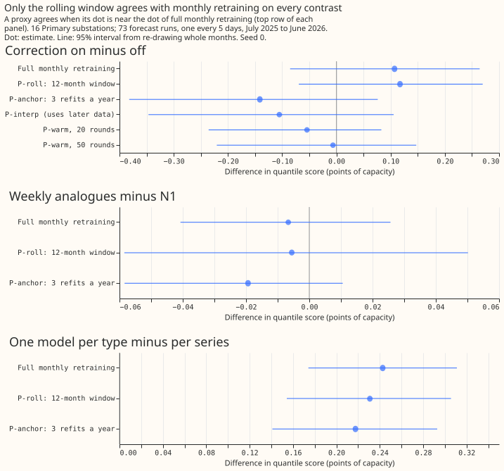

# Experiment 34: how often should the demand model be retrained?

**We asked how much a substation demand forecast improves when the model is refitted more often, and
whether a cheaper stand-in for frequent refitting gives the same answers.** For 16 Primary
substations, we refitted the same XGBoost model on the most recent data every year, six months,
quarter, month, week, or day, and scored its forecasts for 73 days spread over July 2025 to June
2026. The error is the quantile score, which rewards a forecast that is both close and honest about
its uncertainty, in percentage points of each substation's capacity (lower is better). Refitting
monthly lowered the error from 5.32 for the best earlier setup (a frozen model plus a correction
from the last 14 days of errors) to 5.12, a gain of 0.20 points that is clear at 95% confidence but
not at the stricter level we set in advance. Refitting weekly gained another 0.07, refitting daily
almost nothing more, and the correction stopped helping once the model refitted often. Of four cheap
stand-ins for monthly refitting, only refitting monthly on the latest 12 months of data (with fewer,
larger trees) gave the same answers as full monthly refitting.

**Inconclusive at the planned level, with the direction established at 95%.** The primary contrast
C1 is monthly retraining minus the best-guess stack. It scores -0.20 points (99.375% interval -0.44
to +0.08), so by the pre-registered rule the verdict is inconclusive. The 95% interval is -0.38 to
-0.01. Scores are the mean quantile score over all lead times on the 768,073 cases that every arm of
experiment 33 holds, with a spread factor of 1.15 on every arm unless it says otherwise (`_s`), and
the 14-day correction added where it says so (`_cs`). Weather is ENS forecast weather in every arm,
so the numbers are deployable. The code is in `ml-experiments/00034-*/`, and `e00034_report.py`
prints every number below.

| Arm (refits in the year) | No correction | With correction |
|---|---|---|
| Stack: frozen N1 with a 2-year half-life, correction, spread factor (3 seeds) | | 5.32 |
| Frozen, trained to 30 June 2025 (1, 3 seeds) | 6.29 | 5.32 |
| Half-yearly (2) | 5.43 | 5.28 |
| Three a year (3) | 5.46 | 5.32 |
| Quarterly (4) | 5.29 | 5.28 |
| Monthly (12, 3 seeds) | **5.12** | 5.22 |
| Weekly (52) | **5.04** | 5.27 |
| Monthly, half-life 2 years (12) | 5.14 | 5.21 |
| `manual_heuristic`, `climatology`, production | 5.89, 7.46, 9.52 | |

Arms other than the stack, the frozen model, and monthly use seed 0. The 95% intervals on each score
are about plus or minus 0.4 because they span months; the contrasts below are paired and much
tighter.

## Planned contrasts

Each contrast is a difference in quantile score on the cases both arms hold, read at 99.375%
(Bonferroni across eight). Negative favours the first arm.

| Id | Contrast | Difference | 99.375% interval | 95% interval |
|---|---|---|---|---|
| C1 | monthly minus the stack | -0.20 | -0.44 to +0.08 | -0.38 to -0.01 |
| C2 | monthly with correction minus monthly | +0.11 | -0.17 to +0.31 | -0.09 to +0.27 |
| C3 | weekly minus monthly | -0.07 | -0.18 to -0.00 | -0.15 to -0.02 |
| C4 | monthly minus frozen | -1.17 | -1.93 to -0.39 | -1.72 to -0.60 |
| C5 | monthly minus three refits a year | -0.35 | -0.61 to -0.09 | -0.54 to -0.16 |
| C6 | monthly, half-life 0.5 years, minus half-life 2 years | -0.02 | -0.05 to +0.02 | -0.04 to +0.01 |
| C7 | weekly with correction minus weekly | +0.23 | +0.03 to +0.44 | +0.09 to +0.38 |
| C8 | quarterly minus monthly | +0.17 | +0.03 to +0.38 | +0.05 to +0.31 |

**Retraining helps at every lead time, and most beyond two days.** Monthly scores 4.39 against 4.51
for the stack in the first 24 hours and 5.26 against 5.46 at 6 to 10 days.

**The gain per step shrinks as refits become more frequent.** Against the frozen model, half-yearly
retraining lowers the score by 0.86 (95% interval -1.37 to -0.35), quarterly by a further 0.14
(-0.28 to -0.03), monthly by a further 0.17 (C8), and weekly by 0.07 (C3). On the three months in
which daily retraining ran (October 2025, January 2026, April 2026, 193,621 cases) daily scores
5.15, weekly 5.16, and monthly 5.22: daily minus weekly is -0.01 (-0.04 to +0.04) and daily minus
monthly -0.06 (-0.12 to -0.02). The gain flattens at weekly cadence, not at monthly: weekly is still
0.07 below monthly, which is above the 0.05 band the plan set.

**The correction stops helping once the model is retrained, and hurts at weekly and daily cadence.**
C2 is +0.11 and unresolved at monthly cadence. At weekly cadence it costs +0.23 (C7), and on the
daily months it costs +0.52 (+0.18 to +0.78). For the 2 BSP and 2 GSP series, monthly retraining
lowers the score by 0.11 (-0.23 to +0.00) and 0.43 (-1.15 to +0.10) against the frozen model, and
the correction costs +0.24 and +0.78; these intervals are wide on two series each.

**A half-life of 0.5 years and 2 years score the same under monthly retraining** (C6, -0.02).

## Cheap proxies for monthly retraining

**Only the rolling 12-month window reproduced full monthly retraining on all three rank-test
contrasts.** The test compares each proxy's difference with full monthly retraining's, with a
tolerance of 0.05 points; seeds differ by 0.0002 on R1, so the tolerance stands. R1 is the
correction on versus off, R2 is the weekly-analogue columns of experiment 30 minus N1 (with the
correction), and R3 is experiment 24's one-model-per-type minus one-model-per-series (with the
correction). R2's difference under full monthly retraining is -0.007, below the 0.02 floor, so a
proxy is not required to match its sign.

| Regime | Score (no correction) | R1 correction | R2 weekly analogues | R3 pooled by type |
|---|---|---|---|---|
| Frozen model (experiments 30, 24, and 33 values) | 6.29 | n/a | -0.051 | +0.149 |
| **Full monthly** | 5.12 | +0.107 | -0.007 | +0.243 |
| P-roll: 12-month window, 150 rounds | 5.15 | +0.117 | -0.006 | +0.231 |
| P-anchor: three refits a year | 5.46 | -0.141 (fails) | -0.019 | +0.218 |
| P-interp: blend of anchors (uses later data) | 4.91 | -0.105 (fails) | not run | not run |
| P-warm, 20 rounds, monthly updates | 5.41 | -0.054 (fails) | not run | not run |
| P-warm, 50 rounds, monthly updates | 5.54 | -0.006 (fails) | not run | not run |

**Three results change how later experiments should run.** First, P-roll costs 0.03 points of score
and about a third of the GPU time of a full monthly refit (about 3 s against 10 s per fit); it
passes. Second, the weekly-analogue columns gained 0.05 on a frozen model but only 0.01 under
monthly retraining (R2), so a frozen reference overstates a feature that follows recent demand
level. Third, the P-warm chains get worse with more updates: 5.41 for monthly updates, 5.67 for
weekly updates, and on the daily months 7.76 for daily updates against 5.67 for the weekly chain
over the same rows (+1.55, +0.33 to +3.21). Adding rounds to a booster each update never forgets
older rows, so warm starting cannot stand in for weekly or daily refitting. P-interp scores best of
all arms (4.91) because its later anchor saw data after the forecast origin; it is a screening
device only and is never a forecast score.

## Cost of retraining cadence

N1 takes about 10 s per series for a refit on the GPU. For the 16 Primary series: a frozen arm is 16
fits (about 3 minutes); one seed of monthly retraining is 192 fits (0.63 GPU hours, 12 times as
much); weekly is 832 fits (4.7 GPU hours on a GPU shared with another session, about 2.4
uncontended, 52 times as much); the rolling-window proxy is 192 cheaper fits (0.20 GPU hours, 4
times as much); daily over the three months is 288 fits (about 1 hour). The whole experiment used
about 12 GPU hours, over the 8 hours the plan allowed, because another session shared the GPU and
the manager approved the extra stage.

## Failures and limits

- **No fit failed.** The first daily warm-start run crashed on a missing folder and was rerun.
- **The correction history spans model changes.** At each refit the 14-day correction reads
  forecasts from the previous model, which may understate the correction's value at weekly and daily
  cadence.
- **The validation rows are 5 days apart,** not daily, so the correction reads forecasts 5 days
  apart (the departure from experiment 19's advice).
- **C1 is not an independent test:** experiment 33's seed 0 suggested it on the same rows. Seeds 1
  and 2 changed C1 by under 0.01, because months, not seeds, set the interval.
- **R4 (experiment 32's fingerprints) and solar and wind were not run.** The BSP and GSP part covers
  monthly retraining only (weekly was not run).
- **Daily retraining ran on three months only,** and its warm-start version failed, so the daily
  result rests on 18 refits per series.
- **Experiments run after the plan** (seeds 1 and 2, BSP and GSP monthly, daily warm start, full
  daily refits) are post hoc.

## Recommendation for the validation protocol (for the maintainer)

- **Production:** retrain demand models monthly, and consider weekly (0.07 points lower again, 10 s
  per series). Drop the 14-day correction for Primary substations once retraining is that frequent.
- **Screening experiments:** use monthly refits on a 12-month window with 150 rounds and `eta` 0.15
  (P-roll) on seed 0, because it agrees with full monthly retraining on all three tested contrasts
  at 0.2 GPU hours per arm.
- **Release experiments:** use full monthly refits with an expanding window, testing each on the
  next month, at 0.63 GPU hours per seed.
- **Not as a protocol:** a frozen model (it overstates level-following features), three refits a
  year, an anchor blend, or warm starting.

## Reviews

**Plan review (Opus), triaged.** Accepted: gate the weekly and daily arms on the point estimate of
C1, not its interval; set the porting threshold at zero; name the score form of every contrast;
state when the correction counts as no longer helping; make daily descriptive; take the frozen arm
from the monthly fits; calibrate the rank-test tolerance on seeds; say P-warm's weights are nearly
flat and P-interp can never be the protocol; fix a money metaphor and the pooled-fit cost. Rejected:
reusing experiment 33's monthly seed 0 instead of refitting (the half-yearly, quarterly, and
three-a-year arms need the other refit dates, and the refit reproduced the stored scores to 0.001);
reducing the Bonferroni family (kept at eight, as the house style sets it).

**Code review (Opus), triaged.** All accepted and fixed before any fit ran: weekly and monthly
refits shared a folder (now separate), the assembler dropped arms whose seeds 1 and 2 were missing
(now builds from the seeds present), BSP and GSP assembly overwrote the Primary tables (now one
table per arm with every group), contrasts read three seeds where the plan said seed 0 (now seed 0
except C1 and C2), the daily arm needed the weekly arm built first, and warm-start writes were not
atomic. No leakage was found.

**Prose review (Sonnet):** see the pull request for the findings and their triage.
