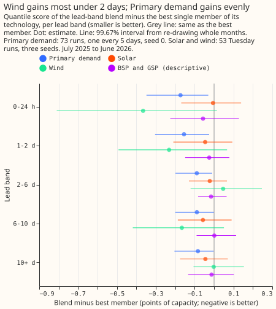

# Experiment 35: does a lead-weighted blend of quantiles beat the best single model?

We asked whether averaging the forecast ranges of several stored models, with a different weight at
each lead time, beats the best single model. We blended three stored models of demand at Primary
substations (substations that step power down to the local distribution network), and tested similar
blends for solar and wind. For Primary demand the blend lowered the error by 0.10 points of
capacity, which clears the threshold for moving it into production. For solar and wind the gains
were too small to resolve.

**Primary demand gains 0.10 points of capacity from blending; solar and wind gain too little to
resolve.** The stack is N1 (the single-stage XGBoost quantile model trained on ENS, the ensemble
weather forecast of the European Centre for Medium-Range Weather Forecasts) with the 14-day
correction and a spread factor of 1.15 (experiment 19). The lead-band blend of the monthly-retrained
N1, `a7_cs`, and the stack scores 5.025 points of capacity against 5.122 for the best member
(difference -0.097, 98.33% interval -0.187 to -0.026), so the outcome for Primary demand is "port"
(threshold 0.05). Solar is -0.039 (-0.115 to +0.031) and wind is -0.074 (-0.194 to +0.055), both
"null". The stop rule did not fire anywhere (corner cells: Primary 0 of 60, solar 6, wind 7), so the
verdict is `supported`, on Primary demand alone. The prediction held for Primary demand's size but
not its verdict (expected `small gain`, found "port"), and failed for wind, where the estimate was
-0.074 against a predicted -0.10 to -0.30. Intervals resample whole months, and for Primary demand
one seed, so they say nothing about other substations or about wind farms beyond the three scored.

## Absolute scores

**The quantile score (points of capacity, smaller is better) of every arm, over the cases that
experiment 33's final shared case sets hold.** Primary demand has 768,073 cases, solar 527,025,
wind 321,138, and BSP and GSP 592,950. The in-sample arm chooses its weights on all 12 months
and is an optimistic bound.

| Technology | Members | Equal | One weight | Lead bands | In sample |
|---|---|---|---|---|---|
| Primary demand | monthly 5.122, `a7_cs` 5.268, stack 5.318 | 5.059 | 5.020 | **5.025** | 5.008 |
| Solar | N1 5.113, best guess 5.035 | 4.978 | 4.986 | **4.996** | 4.973 |
| Wind | N1 11.359, best guess 11.042 | 10.965 | 10.941 | **10.969** | 10.907 |
| BSP and GSP (descriptive) | N1 13.665, `a7` 13.658 | 13.621 | 13.643 | 13.644 | 13.621 |

## Contrasts

- **Weights per lead band are no better than one weight.** The lead-band blend minus the one-weight
  blend is +0.005 (-0.008 to +0.023) for Primary demand, +0.009 (-0.005 to +0.028) for solar, and
  +0.028 (-0.019 to +0.082) for wind. The equal-weights blend beats the best member by -0.063 for
  Primary demand (-0.279 to +0.091), so equal weights are not resolved.
- **Primary demand gains at every lead band; wind's short-lead gains are unresolved.** The lead-band
  blend minus the
  best member for Primary demand is -0.17 at 0 to 24 h (-0.35 to -0.03) and -0.08 at 10 days or
  more (-0.20 to -0.002). Wind is -0.37 at 0 to 24 h (-0.81 to +0.02) and +0.05 at 2 to 6 days
  (-0.12 to +0.25).
- **Correct each member before blending, not the blend afterwards.** The blend with the correction
  applied afterwards scores 5.208 against 5.160 for the same blend with every member corrected
  first (+0.048, 95% interval +0.008 to +0.101; the contrast favours the corrected-first arm,
  because that arm's weights were chosen on it). Correcting the monthly-retrained N1 as well still
  scores 0.135 points worse than the headline blend, whose monthly-retrained N1 is uncorrected.
- **Against the stack of experiment 19, the Primary blend is -0.293** (-0.447 to -0.140, 95%). The
  monthly-retrained N1 alone is 0.196 below the stack on the same cases (5.122 against 5.318).

## Chosen weights

**The weights favour the member with the lower score in that band, and for wind and solar they
vary from band to band.** Mean chosen weights over the 11 months with history, by lead band from 0
to 24 h to 10 days or more: Primary demand gives the monthly-retrained N1 0.59 to 0.70, `a7_cs`
0.30 to 0.39, and the stack 0.00 to 0.05. Wind gives N1 0.68 and 0.61 under 2 days and 0.20 to 0.30
beyond. Solar gives N1 between 0.30 and 0.57. Weights lie on a 0.25 grid. The stop rule counts
corner cells over all 60 cells: Primary 0, solar 6, wind 7 (BSP and GSP 13).

## Porting cost

**A blend serves one more model per technology, and for Primary demand two more.** Wind and solar
would serve N1 beside the ERA5-trained mixture, which is a second training source and a second
feature pipeline. Primary demand would serve the monthly-retrained N1 (a refit each month for 16
series), `a7_cs` (seven weekly-analogue columns), and the stack, and a fixed weight vector of three
numbers suffices. The experiment does not decide a port; a release plan does.

## Failures and limits

- **One validation year and one seed for Primary demand.** The retrained N1 has seed 0 only.
- **Selection history is short.** Months 2 to 12 choose weights on 1 to 11 months, July 2025 uses
  equal weights, and the long-lead bands start with few cases.
- **The Primary member scores come from experiment 33's stored tables**, which that experiment may
  still be re-scoring; the case sets read here carry that experiment's `shared_keys` as of
  2026-10-15.
- **BSP and GSP are 4 series** and the result is descriptive.

## Lessons for later experiments

**See `advice` in the front matter.** In short: blend with one fixed weight vector, correct inside
the members, and test wind on more farms.
