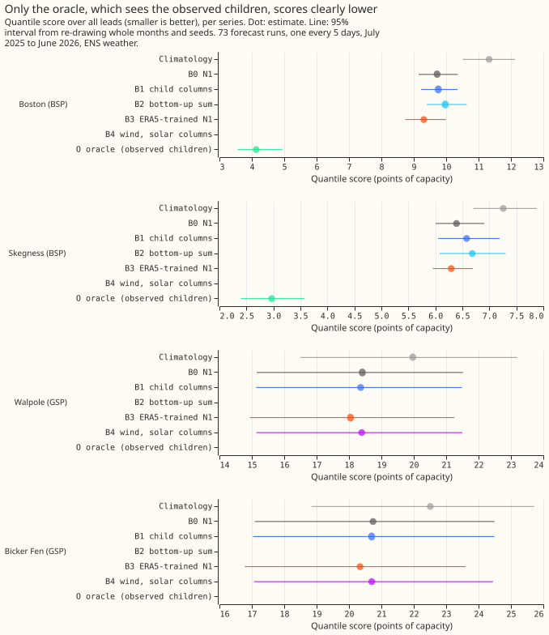
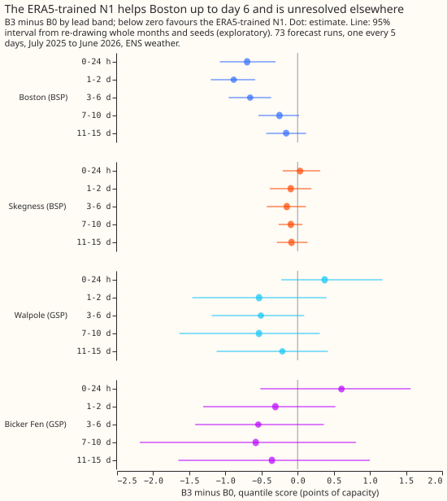

# Experiment 36: do forecasts of the series beneath a BSP or GSP lower its error?

We asked whether forecasts of the substations beneath a bulk supply point help forecast the demand
of that point, and whether adding wind and solar generation helps at a grid supply point. We added
those forecasts to a single-step model and scored 4 series: 2 bulk supply points and 2 grid supply
points. Neither addition lowered the error. A model trained on estimates of past weather lowered the
grid supply point scores by 0.36 and 0.40 points of capacity, but its intervals span -1.8 to +1.0
points.

**Verdict: inconclusive.** Adding forecasts of the series beneath a bulk supply point (BSP) to N1
(the single-stage XGBoost quantile model trained on ENS, the ECMWF ensemble weather forecast) did
not lower its quantile score, and adding wind and solar columns to a grid supply point (GSP) did not
either. The N1 trained on ERA5 (a reanalysis, an estimate of past weather) lowered the GSP scores by
0.36 and 0.40 points of capacity, but its 99.17% intervals span -1.8 to +1.0 points. Scores are in
points of capacity (1% of a series' effective capacity) on 73 forecast runs, one every 5 days, July
2025 to June 2026, with ENS weather, for four series: the BSPs Boston and Skegness and the GSPs
Walpole and Bicker Fen. The intervals describe these four series only. Attribution: Sheffield Solar
PV_Live, CC BY 4.0.

## Results

**The arms.** B0 is N1. B1 adds the summed median forecasts of the Primary substations and metered
generators beneath a BSP (the generators only at a GSP). B2 regresses the BSP on its children's
median forecasts. B3 trains N1 on ERA5 and applies it to the ENS members. B4 adds a generic wind
power curve and a PV_Live solar forecast as columns at the GSPs. O is B1 with the observed values of
the children. C1 to C6 are the six planned contrasts, in the order below.

**Per family, by the pre-registered rule: the BSP family is refuted, the GSP wind and solar family
is refuted, and the GSP ERA5-trained family is inconclusive.** All three families are not
supported, so the experiment is inconclusive. The oracle gave a gain of more than 0.5 at both BSPs,
so the stop rule did not apply and B1 and B2 were fitted.

| Series | B0 N1 | B1 child columns | B2 bottom-up sum | B3 ERA5-trained N1 | B4 wind, solar columns | O oracle | Climatology |
|---|---|---|---|---|---|---|---|
| Boston (BSP) | 9.72 | 9.76 | 9.97 | 9.31 | | 4.13 | 11.32 |
| Skegness (BSP) | 6.39 | 6.58 | 6.68 | 6.29 | | 2.97 | 7.26 |
| Walpole (GSP) | 18.41 | 18.36 | | 18.05 | 18.39 | | 19.97 |
| Bicker Fen (GSP) | 20.74 | 20.70 | | 20.34 | 20.70 | | 22.51 |

The table shows the quantile score over all leads. The refit B0 matches experiment 13's stored N1
within 0.003 points at every series.

- **C1 and C2, B1 minus B0 (BSPs):** +0.04 (99.17% interval -0.18 to +0.25) at Boston and +0.19
  (-0.10 to +0.73) at Skegness. Both lower bounds exceed -0.5, so the BSP family is refuted.
- **C3 and C4, B3 minus B0 (GSPs):** -0.36 (-1.60 to +0.43) at Walpole and -0.40 (-1.84 to +0.97)
  at Bicker Fen. The point estimates are smaller than the predicted 0.5 to 1.5, and the intervals
  are too wide to exclude zero or the -0.5 bar. By lead band the estimates are +0.37 (0 to 24
  hours), then -0.53, -0.51, -0.54, and -0.21 at Walpole, and +0.61, -0.31, -0.54, -0.58, and -0.36
  at Bicker Fen, every interval including zero (exploratory).
- **C5 and C6, B4 minus B0 (GSPs):** -0.02 (-0.06 to +0.03) at Walpole and -0.04 (-0.13 to +0.07)
  at Bicker Fen. Both lower bounds exceed -0.5, so the family is refuted.
- **The oracle (exploratory, 95%):** O minus B0 is -5.58 (-6.56 to -4.55) at Boston and -3.42
  (-4.30 to -2.62) at Skegness, and O minus B1 is -5.62 and -3.61. The share of oracle child values
  filled from forecasts is 9.8% at Boston and 9.5% at Skegness in the validation rows (11.6% and
  1.5% in the training rows), printed by `e00036_fit.py`.
- **B1 at the GSPs (exploratory, generator column only):** -0.05 (-0.14 to +0.02) at Walpole and
  -0.04 (-0.12 to +0.05) at Bicker Fen over all leads. At Bicker Fen the 0 to 24 hour band is -0.30
  (-0.44 to -0.15), which excludes zero.
- **B2 (exploratory):** B2 minus B1 is +0.21 (-0.15 to +0.59) at Boston and +0.10 (-0.68 to +0.63)
  at Skegness, inside the predicted 0.5. B2 minus B0 is +0.25 (-0.11 to +0.63) and +0.29 (-0.16 to
  +0.67).
- **B3 at the BSPs (exploratory, 95%):** -0.41 (-0.66 to -0.15) at Boston and -0.10 (-0.28 to +0.07)
  at Skegness. At Boston the gain is -0.70 (0 to 24 hours), -0.88 (1 to 2 days), and -0.66 (3 to 6
  days), and shrinks beyond day 6.

## Predictions against outcomes

- **Missed:** B1 minus B0 was predicted at -0.5 to -1.5 and was +0.04 and +0.19.
- **Met:** B2 within 0.5 of B1, and O below B1 at both BSPs.
- **Not resolved:** B3 minus B0 at the GSPs was predicted at -0.5 to -1.5, largest beyond day 2.
  The estimates, -0.36 and -0.40, fall short of the range, are worse than N1 at 0 to 24 hours, and
  have intervals that include zero, so the lead pattern is untested.
- **Missed:** B4 minus B0 was predicted at -0.2 to -0.8 and was -0.02 and -0.04.

## Lessons

**The forecast columns added nothing although the oracle's observed children added a great deal.**
One reading is that the observed children tell N1 what is happening now, and a forecast of a child
carries no more than N1 already derives from the same ENS weather and the power lags. The
experiment did not test this reading.

## Limits

- **Four series.** Two BSPs and two GSPs cannot support a release decision, and the intervals
  resample months and seeds, not series.
- **Training columns come from the control member and validation columns from each member,** so the
  ensemble spread of the children reaches the model at validation and not in training.
- **The training columns are cross-fitted by time block, not out of time.** A block's child model
  sees months both before and after the block.
- **Unforecast flows.** Four series beneath Boston have no forecast, and the GSPs carry flows from
  outside the trial area.
- **B4's bias correction was dropped,** and experiment 28 found the PV_Live member mean 1.8 to 3.0
  points of PV_Live capacity too high.
- **The 14-day correction was not applied,** because experiment 21 found it unproven at BSP and
  GSP.

## Plan, written before any code ran

Units are points of capacity (1 point is 1% of a series' effective capacity). The rows are the 73
runs of `fold_a_every5d_v1` (one run every 5 days, valid times 2025-07-01 to 2026-06-30) for four
series, each fitted with seeds 0, 1, and 2. No valid time on or after 2026-07-01 is scored.

### Why the question is worth asking

**A bulk supply point (BSP) flow is almost exactly a linear sum of the series beneath it, and N1
does not use that.** On the validation year, a least-squares fit of each BSP on the Primary
substations and metered generators beneath it gives R² 0.994 at Boston and 0.992 at Skegness, with
a residual standard deviation of 1.2 to 1.3 MW against 14 to 15 MW for the BSP itself. The two grid
supply points (GSPs) carry flows from outside the trial area (R² 0.16 at Walpole and 0.74 at Bicker
Fen against their BSP and generators), so a sum of children cannot reproduce them, but the metered
wind and solar generation beneath them is a large share of their variance. Experiment 33's interim
ceiling arms (not yet published) suggest that an N1 trained on ERA5 and fed ERA5 removes about a
fifth of the error at BSPs and GSPs, three times the gain of an ENS-trained N1 given the same ERA5
inputs. This experiment asks how much of that headroom a deployable forecast can capture.

### Series and hierarchy

NGED's hierarchy file (private, never committed) assigns each Primary substation and metered
generator to a BSP and a GSP. The series are:

| Type | Series | Beneath it |
|---|---|---|
| BSP | Boston | 9 Primary substations; 3 solar farms and 1 wind farm |
| BSP | Skegness | 7 Primary substations; 2 solar farms and 2 wind farms |
| GSP | Walpole | Boston and the series beneath Boston |
| GSP | Bicker Fen | Skegness and the series beneath Skegness |

The 16 Primary substations of the earlier demand experiments are exactly the Primaries beneath these
two BSPs. Solar farm C does not appear in the hierarchy file and is left out. Four series beneath
Boston have no forecast (a biofuel generator, a battery, a solar site, and a generator of another
type), so their flows stay in the residual. Every generator beneath Skegness has a forecast.
Generator names and identifiers never appear on the published page.

### Arms

All arms are N1 per series, with experiment 13's recipe: a nine-level quantile XGBoost model
(500 rounds, `eta` 0.05, depth 6) trained on the ENS control member of every daily run, valid times
2024-04-01 to 2025-06-30, recency weights with a 2-year half-life anchored at 2025-06-30, the
Primary column set, `lead_hours`, and the three power lags from the forecast origin. The 51 ENS
members are pooled into nine quantiles as in experiment 13. No 14-day correction is applied to a
BSP or a GSP, because experiment 21 found it unproven there.

- **B0:** N1 refitted by this experiment's code. The fit is checked against experiment 13's stored
  `n1`, and the check is printed.
- **B1, bottom-up columns:** B0 plus two columns in MW at the valid time. The Primary column is the
  sum over the Primary substations beneath of the median of experiment 13's N1 (no correction, no
  spread factor). The generator column is the sum over the metered generators beneath of the median
  of experiment 20's best-guess recipe (ERA5-trained, with the power-curve margin for wind). The
  spread factor leaves a median unchanged, so it is not applied. Each ENS member's row of the BSP or
  GSP XGBoost model receives the medians of the same member's child forecasts, so the pooled
  forecast keeps N1's member-by-member structure. At a GSP, B1 holds the generator column only, as
  the proposal for this experiment specifies.
- **B2, bottom-up sum (BSPs only):** a least-squares regression of the observed BSP power on an
  intercept and the median forecast of each child, fitted on the training rows. The regression is
  applied to each member's child medians, and the member forecasts are pooled as in B0. Each
  member's quantiles are its regression value plus the empirical residual quantiles of the training
  rows, taken per lead band. Nothing else enters B2.
- **B3, perfect prognosis:** N1 trained on ERA5 at the valid times of the same training rows (same
  window, half-life, lags, and `lead_hours`), applied to each of the 51 ENS members and pooled. All
  four series.
- **B4, regional proxies (GSPs only):** B0 plus two columns computed from the GSP's own ENS cell.
  The wind column is a generic wind power curve (0 below 3 m/s, a cubic ramp to 1 at 12 m/s, 1 to 25
  m/s, 0 above) applied to the ENS 100 m wind speed of each member. The solar column is experiment
  28's PV_Live solar share (an ERA5-trained XGBoost model of PV_Live's share of its own capacity),
  computed for each member's own weather. Training rows use experiment 28's five forward-chain
  models, whose quarters match the five blocks below and which never saw the quarter they score,
  applied to the control member of every daily run. Validation rows use the final model. The bias
  correction the proposal named is dropped: with the training column and the validation column both
  computed per member, a constant offset only shifts tree splits. Experiment 28 found the member
  mean 1.8 to 3.0 points of PV_Live capacity too high, and the page reports this as a limit.
  Attribution: Sheffield Solar PV_Live, CC BY 4.0.
- **O, oracle (BSPs only):** B1 with the observed values of the children at the valid time, and the
  same member's child forecast median where the observation is missing (in training rows, the cross-
  fitted column). The page prints the share of filled children per BSP before the stop rule is read.

A month-by-half-hour climatology row (`ClimatologyForecaster`) is scored for reference, repeated
once per seed.

### How the child columns are built without leakage

**A child's forecast in the training rows must not come from a model that saw those rows.** An
XGBoost model with 500 rounds and depth 6 reproduces its own training rows closely, so an in-sample
column would look far better in training than at validation, and B1 would learn to trust it too much.
The experiment cross-fits the training columns in time instead:

- **Blocks.** The training window is split into five blocks by valid time: 2024-04 to 2024-06,
  2024-07 to 2024-09, 2024-10 to 2024-12, 2025-01 to 2025-03, and 2025-04 to 2025-06. The column
  for a training row in block *k* comes from a child model trained without block *k* and without the
  15 days either side of it.
- **Primary substations.** Each Primary's N1 is refitted five times per seed with a block left out,
  on the same recipe as above (ENS control member, 2-year half-life).
- **Generators.** Each generator's ERA5-trained model of experiment 20 is refitted five times per
  seed with the block left out, and applied to the control-member ENS rows of the block. The
  validation columns use the full models (training to 2025-06-17), pooled over the 51 members.
- **Validation columns** for Primaries come from a sixth, full-window N1 fit per Primary and seed,
  applied member by member (experiment 13's stored `n1` holds pooled quantiles only, so it serves as
  a check). The validation columns for generators need ENS rows at the generator cells for the 73
  runs, which are not stored (the pilot stored Tuesday runs only). This experiment extracts them
  from the ENS archive with the same upsampling that `demand_build_ens.py` uses, and checks the
  refitted models against experiment 20's stored predictions on the runs the two row sets share.
  The generator full models train to 2025-06-17 and N1 to 2025-06-30, a difference inherited from
  experiments 20 and 13.
- **Same child sets everywhere.** B2's coefficients, B1's columns, and the oracle all use the same
  children.

**Training columns come from the control member and validation columns from each member.** The
BSP or GSP XGBoost model trains on one child forecast per row (the control member's) and receives
one per ENS member at validation, so it sees the same kind of column in both. The ensemble spread of
the children is therefore part of what the model receives at validation and not in training, and
the page reports it as a limit.

### Scoring

Quantile score and MAE of the median, per series, over all leads and in the five lead bands (0 to
24 h, 1 to 2 days, 3 to 6 days, 7 to 10 days, 11 to 15 days). Contrasts use
`experiment_store.losses_for_bootstrap` and `studies.bootstrap.bootstrap_difference_at_level`,
resampling the 12 validation months and the three seeds, with `n_resamples` raised for the 99.17%
level. The page reports the absolute score of every arm, per series. Intervals describe these four
series and say nothing about other BSPs or GSPs. B3 minus B0 at the BSPs, B1 minus B0 at the GSPs,
B2 minus B1, O minus B0, and the lead-band contrasts are exploratory.

### Sizing

- **Stored data:** prediction sets and cross-fitted columns under `data/ml-experiments/`; no
  production table changes.
- **Production serving path:** not touched. Porting B1 would add a dependency of the BSP model on
  the Primary and generator models in the Dagster asset graph.
- **Degradation rule:** not touched. A missing child forecast would need a degradation rule at
  porting time, and that rule is outside this experiment.
- **Defensible designs:** more than one (the child columns, the cross-fitting scheme, the regression
  in B2, and the filling rule of the oracle). Each is fixed above.
- **Callers:** the scripts copy experiment 13's N1 fit, experiment 20's generator fit, experiment
  28's PV_Live loader and solar model, and experiment 33's ENS extraction. The author could name
  each without searching.

Size: complex. Sonnet writes the plan, Opus reviews it, Sonnet implements, Opus reviews the code,
Sonnet runs the code and writes up, and Sonnet reviews the write-up.

### Earlier advice followed and departed from

- **Followed:** treat BSP and GSP findings as provisional with four series (experiments 6, 21, 24);
  report intervals over validation months (13); keep the 14-day correction off BSP and GSP (21);
  pool ERA5-trained quantiles over ENS members (2); add a climatology row (10); report the absolute
  score of every arm.
- **Departed from:** the experiment adds no calendar-placebo or shuffled-input control. The columns
  are forecasts of real series, and the oracle already bounds what a perfect column gives.

### Past weather

B3, B1, B2, B4, and every child forecast use ENS weather only, so all are deployable as far as
weather goes (ERA5 arrives about 5 days late and is used only at training times). The lag
features use observed power from the forecast origin, as in experiment 13. B4's PV_Live model trains
on ERA5 weather and PV_Live's revised values, both of which exist at training time.

### Limits

- **Four series.** Two BSPs and two GSPs cannot support a release decision alone.
- **Unforecast flows.** Four series beneath Boston are not forecast, and the GSPs carry flows from
  outside the trial area.
- **Cross-fitted training columns are out-of-sample, not out-of-time.** A block's child model sees
  months both before and after it.
