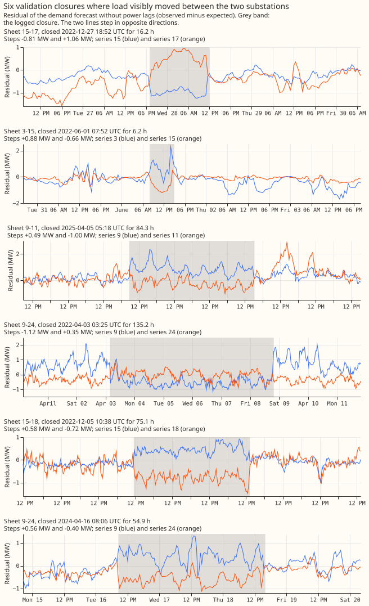
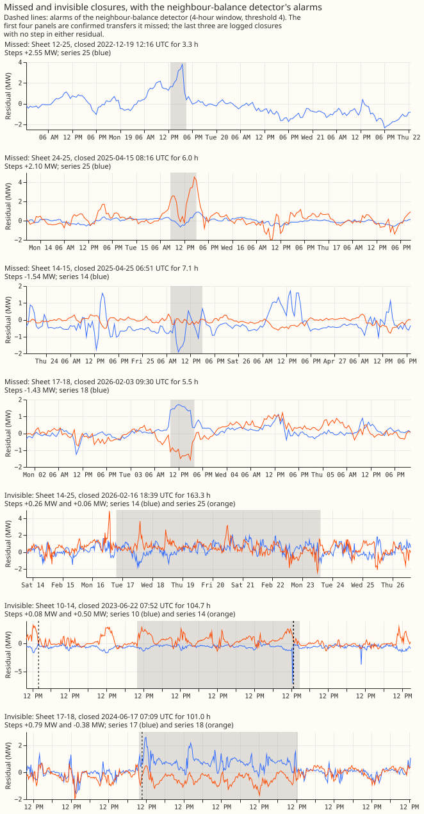
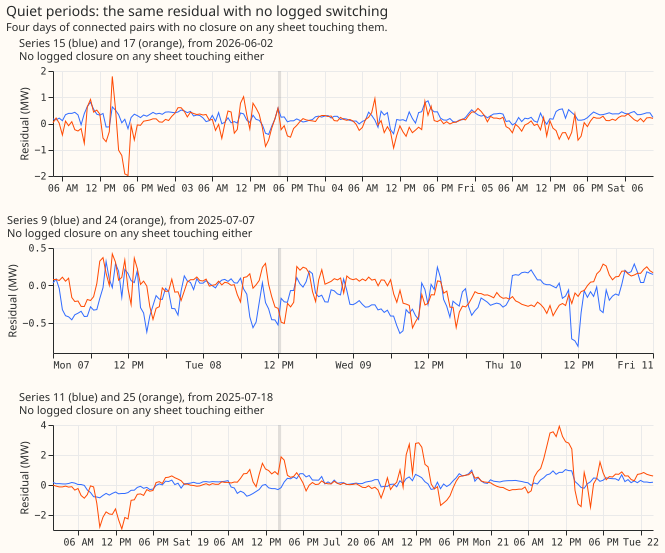
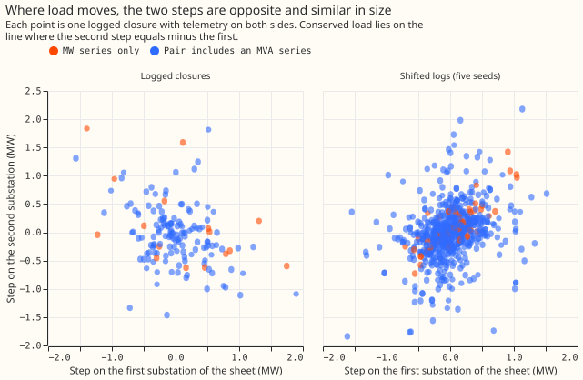
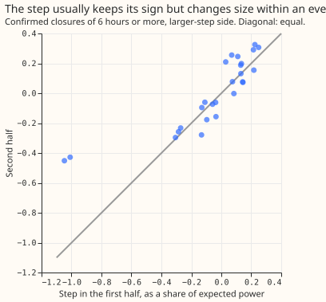
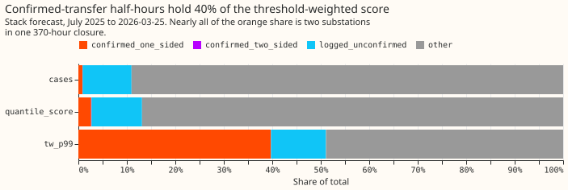
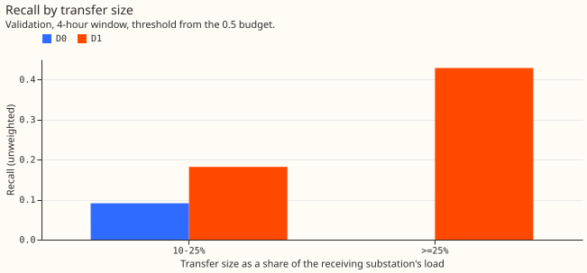

# Experiment 37: does a neighbour-balance detector find logged switching in the telemetry?

We asked whether comparing a substation with its neighbours can find the moments when load was
switched from one substation to another, which NGED's logs of closures record. We built a detector
based on the balance between neighbouring substations and a simpler detector that looks at one
series, and measured how much of the switched power each found, against how many alarms had no
logged cause. The neighbour-based detector found 0.326 of the switched power in the validation
months (the even-numbered months, kept apart from the months used to set its threshold) and beat the
single-series detector. The 18 visible switching events were too few to show whether it meets the
bar we set.

**Inconclusive: the neighbour-balance detector D1 (which flags a step in a substation that its
neighbours' steps do not balance) recovers a third of the MW of the 18 visible validation transfers,
and beats the single-series detector D0 by about +0.14 at equal alarm rates, but the small reference
set leaves the verdict between the two pre-registered bars.** D1 with a 4-hour window and a
threshold of 4 reaches a size-weighted recall (the share of switched megawatts found) of 0.326 (95%
interval 0.093 to 0.579) at 0.38 unexplained alarms (alarms with no logged closure) per
series-month. D0 reaches 0.036 (0.000 to 0.131) at 0.14, and the difference is +0.290 (+0.034 to
+0.557). The two thresholds sit at different alarm rates, so the fairer comparison is at about 0.5
alarms per series-month, where D0 reaches 0.224 and D1 0.362. Shifted logs give 0.004 for D1. D1
misses the 0.35 bar for `supported` and clears the 0.20 bar for `refuted`, so the rule gives
`inconclusive`. Of 612 logged closures of 2 hours to 60 days, 37 are confirmed, and about 6 of those
are expected by chance (shifted logs give 6.2). Eighteen of the 37 are in the validation months,
above the stop-rule minimum of 15 but not by much. Recall on all logged closures of 2 hours or more
is 0.086. All figures are on the residual of the monthly- retrained XGBoost model with ERA5 weather
and no power lags (experiment 00017's `H0.5`). ERA5 arrives about 5 days after the event, so the
detector is retrospective and cannot yet run live.

## Purposes the results speak to

1. **Lagged power in the forecast.** Not tested here. The confirmed transfers give the intervals in
   which a lag would sit inside a switching event, but no forecast uses them yet.
2. **Cleaner targets in the first model version.** Untested: no mask was applied to any training
   target. D1 at its budget finds about a third of the MW of the visible transfers, so a mask built
   from it would leave most visible events in place.
3. **A report back to NGED.** The 18 validation transfers and the 37 in total are a list of inferred
   events that NGED could check against its own logs. At 0.38 unexplained alarms per series-month, a
   reader would get about 6 candidate events a month across the 16 substations.

## Raw data first

**Where load visibly moves, the two substations step in opposite directions for the whole closure
and the steps are close in size.** The first figure shows the six validation closures in which both
residuals have a step. The second figure shows missed closures, closures with no visible step, and
the detector's alarms. The third shows quiet periods.

## Q1: which logged closures move load

**6.0% of logged closures of 2 hours to 60 days are confirmed, against 1.0% on shifted logs; the
prediction of 8% to 20% was too high.** Of 612 closures since 2022-01, 37 are confirmed: 13 have
both sides and 24 have one side. On the shifted logs, 6.2 of 608 closures are confirmed per seed.
The confirmations by duration (real against the mean of five placebo seeds, two-sided and one-sided
together) are 9 against 5.8 for 2 to 6 hours, 11 against 0.2 for 6 to 24 hours, 5 against 0.0 for 1
to 3 days, 8 against 0.0 for 3 to 14 days, and 4 against 0.2 for over 14 days. **The one-sided
confirmations of 2 to 6 hour closures are mostly chance**, because 5.6 of the 9 appear on shifted
logs.

- **The steps are conserved where both sides show one.** For the 13 two-sided confirmations the
  second step over the first step has a median of 1.09 (quartiles 0.75 and 1.30).
- **Pairs with only MW series confirm more often than pairs with an MVA series.** The rates are 3 of
  16 (19%) against 10 of 140 (7%), on small counts.
- **Large transfers are common among the confirmed, and small ones are absent.** 17 of 37 (46%) are
  25% or more of the receiving substation's load, against the predicted third at most. No confirmed
  transfer is under 10% of that load, so the small-event tail cannot be measured here, and the
  headline recall describes only transfers of 10% or more.

**The step is not constant within an event.** For 26 of the 28 confirmed closures of 6 hours or more
(two lack a usable half), the relative step (step divided by the substation's expected power) keeps
its sign between the first and second half in 25. The second-half step is within a factor of 2 of
the first-half step in 18, and the median ratio is 1.14. In 8 closures the step changes by more than
a factor of 2. Both detectors still look for a constant-MW level shift in the residual, so they
would misjudge the shape of those closures, though they only need the shift to be large enough to
alarm.

**Load that splits across several receivers is hard to check with this telemetry.** Of 849 logged
operations since 2022, 67 have a substation on two or more sheets of the same operation. Only 9 of
those have telemetry on that substation and on a receiver, and none is confirmed. In those 9, the
hub's step against the sum of the receivers' steps gives a ratio from -59 to 23, and only 4 fall in
the detector's accepted range of 0.4 to 2.5. In 7 of the 9, only one receiver has a step, so no
split was estimated. The detector reports splits for its own alarms (114 of D1's 347 alarms at the
headline threshold name two or more neighbours), but no logged operation checks them.

## Q2: does switching matter to the stack's errors

**Confirmed-transfer half-hours hold 0.9% of the stack's cases and 39.7% of its threshold-weighted
score at the 99th percentile, but 99.9% of that share lies on series 17 and 18, almost all in one
370-hour closure.** That closure is sheet 17-18 from 2025-12-30. It has a step on series 18 only,
and the step shrinks to about zero by the second half. The stack is experiment 19's N1 with the
14-day correction. The cases are July 2025 to 2026-03-25. The quantile score share of confirmed
half-hours is 2.7%. Per case, the threshold-weighted score of a confirmed half-hour is 40 times that
of a logged-but-unconfirmed half-hour and 75 times that of all non-confirmed half-hours (83 times
that of half-hours with no logged closure). The prediction that confirmed half-hours hold at least
twice the score per case of unconfirmed ones therefore holds, and the prediction that all logged
half-hours hold under 44% of the score fails (confirmed plus unconfirmed: 51%). The confirmed share
on the other substations rounds to 0.0000.

## Q3: the detectors

**At the budget fixed on odd months, D1 beats D0 at the 4-hour window on even-month transfers, and
the gain shrinks when the two are compared at equal alarm rates.** Weighted recall is the share of
the transfers' MW that the detector flags, with an alarm on either substation, or any substation of
the same operation, within 2 hours of the onset.

| Detector, window | Threshold | Alarms per series-month, tuning / validation | Size-weighted recall (95%) | Unweighted | All logged closures of 2 h or more | Shifted logs |
|---|---|---|---|---|---|---|
| D0, 4 hours | 7 | 0.23 / 0.14 | 0.036 (0.000 to 0.131) | 0.056 | 0.013 | 0.003 |
| D1, 4 hours | 4 | 0.32 / 0.38 | **0.326 (0.093 to 0.579)** | 0.278 | 0.086 | 0.004 |
| D0, 24 hours | 4 | 0.35 / 0.28 | 0.276 (0.098 to 0.524) | 0.389 | 0.056 | 0.002 |
| D1, 24 hours | 2.5 | 0.11 / 0.07 | 0.171 (0.026 to 0.383) | 0.222 | 0.033 | 0.004 |

- **Contrast.** D1 minus D0 at 4 hours is +0.290 (+0.034 to +0.557). The largest transfer holds 12%
  of the weight, and D1's recall without it is 0.373.
- **The pre-registered grid does not match the two detectors' alarm rates.** The next D0 threshold
  down (6) has 0.54 alarms per series-month on tuning, just over the budget, and a validation recall
  of 0.224 at 0.49 alarms per series-month.
- **Post hoc, a finer grid (steps of 0.25) moves both budgets.** D0 at 6.25 reaches 0.074 (0.000 to
  0.206) and D1 at 3.75 reaches 0.362 (0.127 to 0.621) at 0.50 validation alarms per series-month,
  with a difference of +0.288 (+0.030 to +0.558). At the same validation alarm rate of about 0.5, D0
  at 6 gives 0.224 and D1 at 3.75 gives 0.362, a gap of about +0.14 that has no interval. The
  verdict stays as pre-registered.
- **By size band, D1 finds more of the largest transfers.** Unweighted recall for transfers of 25%
  or more of the receiving load is 0.43 for D1 and 0.00 for D0, and for 10% to 25% it is 0.18 and
  0.09. Recall weighted by share of the receiving load, and precision by size band, are not
  reported: precision needs a reference set of every real event, which the logs do not give.
- **Detection delay.** The median offset of the alarm from the first affected stamp is 0 for D1 and
  1 half-hour for D0.
- **The month-boundary check is clean.** 2.3% to 2.6% of the 4-hour alarms fall on the first day of
  a month (chance 3.3%), and none of the 24-hour alarms do.

## Predictions against results

- **Q1** missed: 6.0% confirmed against 8% to 20%, and 46% of the confirmed at 25% or more against a
  third at most. The MW pairs confirm more often, as predicted.
- **Q2** held for the ratio and failed for the share (51% against under 44%).
- **Q3** partly held. D0 recall at 4 hours (0.036) was below the predicted 0.20 to 0.40. D1 (0.326)
  fell inside the predicted 0.30 to 0.55, near its lower edge. D1 minus D0 was at least +0.10, the
  placebo recall was under 0.08, and recall on all logged closures was under 0.10. The prediction
  that D1 reaches 0.5 or more on transfers of 25% or more of the load missed: 0.43.

## Limits

- **The confirmation label uses the same residual as the detectors**, so recall on confirmed
  transfers is an upper bound for load the residual can see at all.
- **Unexplained alarms are an upper bound on false alarms**, because real unlogged steps exist.
- **The reference set has 18 validation transfers**, 12 of them one-sided. The intervals are wide
  and a rerun with different odd and even months would move the headline.
- **Series 12 and 13 have residuals only from 2026-02**, so closures on their sheets are mostly one-
  sided.
- **The substation pair 14-25 is missing from the interconnection list**, so the detector cannot
  attribute those closures.
- **Two planned figures are not drawn**: the distribution of the oracle's step statistic against the
  placebo, and the alarm share by day of month. The Q1 and Q3 text gives the numbers they would
  show.

## Proposed next experiment

**Run F4 next: whiten the residual and score the detectors on injected transfers.** The design's
rule names no follow-up for `inconclusive`, so each candidate's own condition decides. F1 needs
`supported`, and the 40% confirmed share of the stack's threshold-weighted score sits on series 17
and 18, almost all of it in one 15-day closure from 2025-12-30. F3 needs more than a third of the
missed transfers to be grouped operations, and 2 of the 13 missed validation transfers are. F4's
condition holds: D1 misses 4 of the 7 validation transfers of 25% or more of the receiving load. D0
with a 24-hour window reaching 0.276 also points at residual noise, not missing topology, as the cap
on recall. Injected transfers remove both causes of the `inconclusive` verdict: only 18 validation
transfers, and a confirmation label built from the detectors' own residual. Choosing F4 is a
judgement, because the rule has no branch for `inconclusive`.

- **Hypothesis.** An AR(1) model per series and hour of day, fitted on odd months, whitens the
  `H0.5` residual enough that D1 finds more of the injected load at the 0.5 budget.
- **Prediction.** On injected validation transfers of 10% or more of the receiving load, D1 on the
  whitened residual reaches a size-weighted recall at least 0.10 above D1 on the raw residual, and
  at least 0.35, with a placebo recall of 0.08 or less. The prediction fails if the gain is under
  0.10 or its 95% interval includes 0.
- **Decision rule.** `supported` when both bars hold, `refuted` when the gain's interval includes 0,
  and `inconclusive` otherwise. The +0.10 bar matches experiment 37's D1-minus-D0 bar. About 600
  injected validation transfers should give an interval of roughly plus or minus 0.04 on a recall, a
  binomial estimate rather than a measurement. If supported, rerun experiment 37's verdict on its 18
  real transfers with the whitened D1, and move to F1 if that verdict is `supported`.
- **Contrasts.** Raw against whitened residual, for D0 and D1, at windows of 4 and 24 hours, each
  re-tuned on odd months to 0.5 unexplained alarms per series-month. The primary contrast is
  whitened D1 minus raw D1 at 4 hours. The other contrasts are reported and decide nothing.
- **Injection.** Transfers go into quiet periods with no logged interval within 7 days. Each moves a
  fraction of the donor's expected power, so the moved load keeps the donor's daily shape, to one or
  two interconnected neighbours with drawn split fractions. Durations are drawn from the 37
  confirmed closures, and sizes span the under 10%, 10% to 25%, and 25% or more bands. Recall is
  weighted by MW and by share of the receiving load, and the under-10% band decides nothing.
- **Stored.** Scratch tables only, under `data/ml-experiments/<id>-switching-whitened-residual/`:
  the whitened panel, the injected-event table with true split fractions, the alarm tables, and the
  recall curves.
- **Compute.** CPU only, at most 2 cores, under 1 hour.
- **Size: medium.** What gets stored: scratch tables only. Production serving path: not touched.
  Degradation rule: not touched. More than one defensible design: yes, the whitening model and the
  injection shape, both fixed above. Callers nameable without searching: yes, only the experiment's
  own folder.
- **First steps.** Copy `e00037_grid.py`, `e00037_detect.py`, and `e00037_score.py` into the new
  folder, then write a whitening script (AR(1) fit on odd months, whitened panel) and an injection
  script (quiet-period finder, shaped injection, event table), each checked on a synthetic panel
  before any real run.
