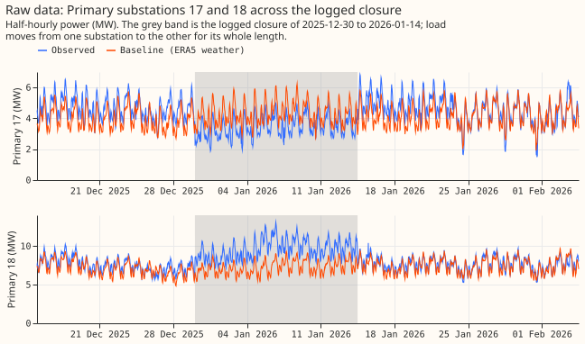
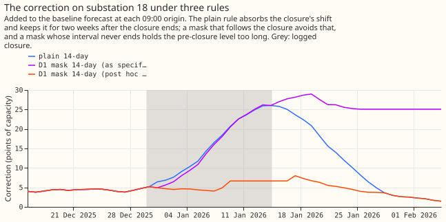
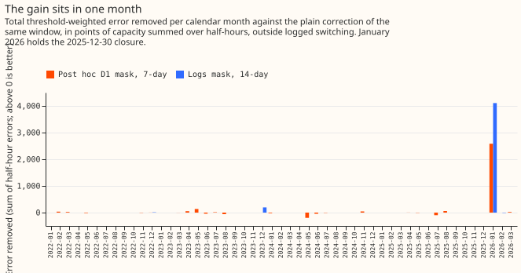
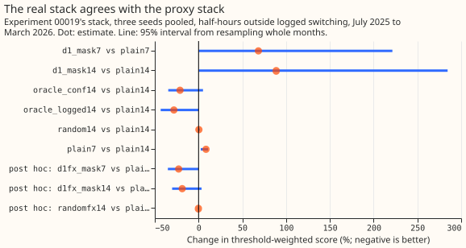
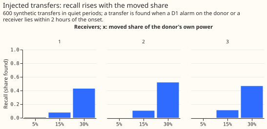
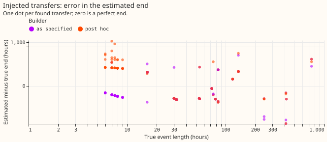
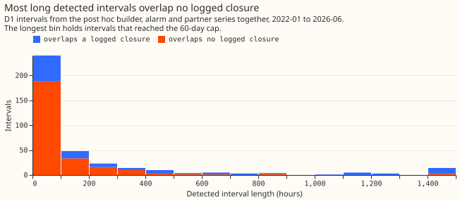
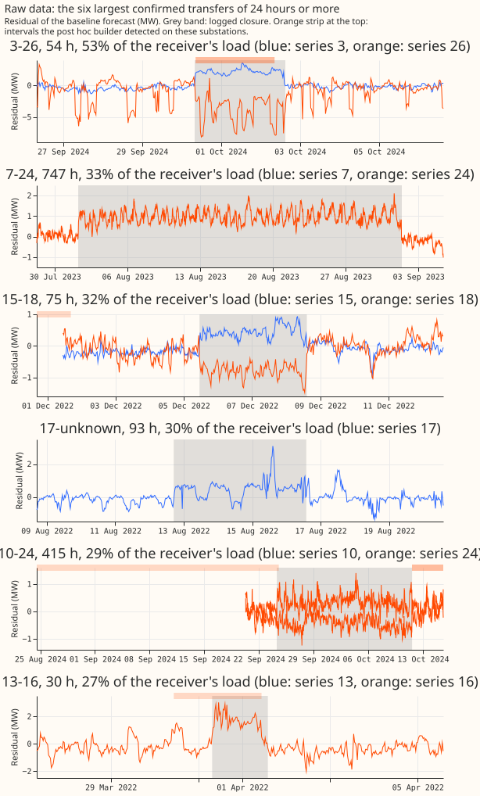

# Experiment 38: is detecting a switching event worth anything to the forecast?

**Refuted: leaving the half-hours that the neighbour-balance detector D1 flags out of the stack's
error correction made the forecast worse, not better, on half-hours outside logged switching.** The
pre-registered primary contrast, `d1_mask7` against `plain7` (threshold-weighted absolute error at
each series' P99, proxy stack, lead 4 to 48 hours, half-hours outside logged closures), is +57.1%
(95% interval +0.4% to +133.5%, from resampling whole calendar months), against the bar of -5% or
better. The oracle mask built from the logs lowers the same error by 8.9% for the 14-day window
(-21.8% to +0.0%), so the ceiling is small, and 95% of it is one month. A random mask of equal
volume changes the error by +0.1% (-0.7% to +0.5%). All numbers are from `e00038_report.py` and are
in points of capacity unless stated.

## What the arms scored

**Every pre-registered arm built on the detector fails; the oracle and the placebo behave as the
plan expected.** Tier A is experiment 00017's `H0.5` (ERA5 weather, out of sample) plus a
correction, daily 09:00 UTC origins from 2022-01-15 to 2026-03-25. **ERA5 arrives about 5 days
after the event, so the weather is not available at forecast time and the numbers are a ceiling for
the correction rule.** Lead 4 to 48 hours is counted from the newest usable observation, 4 hours
before the origin. The rows are the 1,648,578 half-hours outside logged closures (plus 2 hours
either side), the same for every arm.

| Arm | Threshold-weighted error at P99 | Change (95% interval) | Mean absolute error |
|---|---|---|---|
| `plain14` (experiment 00019's rule) | 0.0292 | reference | 5.603 |
| `plain7` (the detector-free bar) | 0.0277 | -5.2% against `plain14` (-10.8% to +0.0%) | 5.478 |
| `d1_mask7` (primary, against `plain7`) | 0.0435 | +57.1% (+0.4% to +133.5%) | 5.614 |
| `d1_mask14` | 0.0445 | +52.4% (+0.3% to +125.1%) | 5.719 |
| `d0w48_mask14` | 0.0479 | +63.8% (+21.9% to +136.3%) | 5.958 |
| `oracle_conf14` (logs, confirmed transfers) | 0.0266 | -8.9% (-21.8% to +0.0%) | 5.573 |
| `oracle_logged14` (logs, all 612 closures) | 0.0261 | -10.6% (-26.1% to +0.8%) | 5.561 |
| `random14` (placebo) | 0.0292 | +0.1% (-0.7% to +0.5%) | 5.626 |

- **The ceiling is concentrated.** January 2026, which holds the 2025-12-30 closure of Primary
  substations 17 and 18, supplies 95% of the `oracle_conf14` gain. Without it the oracle change is
  -0.5%. Odd and even months give -13.0% and -1.2% for the oracle, and +39.3% and +89.9% for
  `d1_mask7`.
- **The detector found the dominant closure, and the interval rule then lost it.** D1 raised an
  alarm on the 17-18 closure under both builders. As specified, the interval for series 18 ended on
  the first failing 24-hour block and the closure's return step then started an interval that ran
  the 60-day cap, so the correction held its pre-closure level for 60 days. On that closure,
  `d1_mask7` raised the error from 3,011 to 11,657 (sum over the closure window and 16 days after).
- **Per event, nothing improved under the as-specified builder.** Of the 17 confirmed closures of 24
  hours or more, `d1_mask7` improved 1, worsened 3, and left 13 unchanged (binomial p 0.94 with ties
  dropped; the plan's condition was 12 improved). The oracle improved 6 and worsened none. Of the 17
  windows, 6 have zero threshold-weighted error in every arm, because the load never exceeded the
  series' P99 outside the closure.
- **The cost of false alarms is large.** On the 417,213 quiet rows, more than 16 days from any logged
  closure or D1 alarm on that series, `d1_mask7` raises the mean absolute error by 0.125 points
  (the plan's bar was within +/-0.01) and the threshold-weighted error by 60.6%. A detected interval
  that overlaps no logged closure still removes real history: 75% of the 498 D1 intervals overlap no
  logged closure, and 1.0% reached the 60-day cap.
- **In the proxy stack, the 7-day window beats the 14-day window, as the exploratory pilot
  suggested.** `plain7` against `plain14` is -5.2% (-10.8% to +0.0%) in tail error and -0.12
  points in mean absolute error; the real stack disagrees (Tier B below). The lead 144 to 192 hour
  band agrees on sign for the primary (+49.8%) and oracle (-11.4%) contrasts.

## Post hoc: a revised interval builder

**Labelled post hoc, and not part of the verdict.** The diagnosis above led to four changes to the
builder, all made after seeing the first scores: the onset step comes from the first 24-hour block
(not the first 4 hours), an event ends only after two consecutive failing blocks, an alarm inside an
earlier interval of the same series or within one block after its end is skipped (it is the return
step), and `known_from` no longer moves earlier across empty blocks. The arms keep their names with
`fx` and are scored on the same rows.

- **The tail error falls, within the noise.** `d1fx_mask7` against `plain7` is -5.4% (-15.1% to
  +1.5%); `d1fx_mask14` against `plain14` is -8.9% (-22.2% to +1.3%), which equals the oracle's -8.9%.
  Without January 2026, the 7-day change is +0.3%. Per event, 3 improve, none worsen, and 14 are
  unchanged (p 0.125). `randomfx14` changes the error by +1.9% (-0.6% to +6.8%).
- **The mean absolute error still rises.** `d1fx_mask7` raises it by 0.254 points (+4.6%) outside
  logged closures and by 0.164 points on quiet rows. The tail gain and the typical-error cost come
  from the same mechanism: a masked history cannot follow the level shifts that the logs never
  recorded.
- **D0 with a 24-hour window is worse than D1 under both builders** (+63.8% as specified, +48.6%
  revised, both against `plain14`).

## The two views of the target

**The maintainer has to settle whether NGED wants the normal running arrangement (NRA) or the
metered load; this experiment cannot.** The NRA view scores half-hours outside logged closures, as
above. The metered view scores every half-hour. Under the metered view (all rows, lead 4 to 48
hours), the persistence arm, which follows the recent residual while a D1 interval is open, changes
the threshold-weighted error against `plain14` by -4.6% (-12.3% to +3.1%) as specified and -8.5%
(-18.9% to +1.3%) revised. The plain 7-day window alone gives -7.1% (-13.1% to -0.4%), so
persistence adds nothing the shorter window does not already give. At lead 144 to 192 hours the
three are -4.8%, -6.8%, and -4.6%.

## Tier B: the real stack

**The real stack agrees in sign with the proxy on the masking contrasts, and disagrees on the 7-day
window.** Experiment 00019's `n1h` arms (three seeds, runs every 5 days from July 2025, 1,397,181
half-hours outside logged closures) give +68.4% (+0.1% to +221.5%) for `d1_mask7` against `plain7`,
-21.2% (-34.6% to +5.1%) for the oracle against `plain14`, +0.4% (-0.3% to +1.4%) for the placebo,
and -22.7% (-35.1% to +0.0%) for the revised `d1fx_mask7`. The nine-level quantile score moves by
+4.3% (+0.1% to +8.7%) for `d1_mask7` and +0.03% for `d1fx_mask7`. For the 7-day window, the real
stack gives `plain7` against `plain14` of +8.5% (+2.4% to +10.7%) in threshold-weighted score and
+2.8% in quantile score, the opposite sign to the proxy's -5.2%. Only 3 to 4 closures sit in the
runs, so Tier B decides nothing alone.

## Q2: injected transfers

**The detector finds a transfer only when the moved load is about 30% of the donor's own power, and
it does not recover the split.** Six hundred synthetic transfers (1 to 3 receivers, durations drawn
from the 28 confirmed closures of 6 hours or more) were injected into quiet periods. D1's recall by
moved share is 0.5% at 5%, 8.6% at 15% (as specified), and 45.6% at 30%; it does not rise with the
number of receivers (43%, 52%, and 47% at 30% for 1, 2, and 3). Of the 39 found transfers of 2
days or more, 85% (as specified) and 87% (revised) have the end within 24 hours. The median
absolute end error is 6 hours at 30%. The pooled split fraction has a mean error of 0.64 to 0.70
because only 11% to 15% of the receivers are matched to a detected partner. Within-day variation of
the split was found for too few events to say (3 found events with a true range of 0.3 or more).

## Q3: the detected-interval table for NGED

**The tables are written but unvalidated.** D1 produced 347 alarms and 498 intervals under the
as-specified builder (alarm and partner series), and 198 alarms with 374 intervals revised. Only
25% (as specified) and 31% (revised) overlap a logged closure. The median interval is 24 and 48
hours. At 0.38 unexplained alarms per series-month in experiment 00037, the list is about 6
candidates a month across the 16 substations, mostly unexplained by the logs. The tables are
`q3_table_d1.parquet`, `q3_table_d1fx.parquet`, and `split_fractions_*.parquet` in the private
data folder.

## Process and deviations

- **Code review (Opus, one round).** Nine findings; the code was changed for seven and the
  rest are recorded here.
    - *Fixed:* the monthly-gain table was written with the wrong arm labels (figure 4 read it); the
      day 6 to 7 band was actually day 3 to 4 (now offsets 136 to 183, lead 144 to 192 hours); the
      persistence arm opened partner intervals before they exist; alarms were released at
      `onset + window + 2` when the peak test needs `onset + 2 * window + 2`; an empty block made an
      interval's end known early; ties counted as losses in the per-event test; the plain arms carried
      a correction forward when under 3 days remained, where experiment 00019 uses zero. The causality
      check now covers D0, both builders, and the open-interval start at 11 origins. The reruns moved
      no headline number by more than 0.5 points.
    - *Not changed:* the random mask wraps from 2026 into 2022 (it keeps volume exactly, which the plan
      asked for), and the quiet rows exclude 16 days around D1 alarm stamps only, as the plan words it,
      so rows inside a long false-alarm interval count as quiet, which is the cost of false alarms the
      quiet rows exist to show.
- **Deviations.** The lead bands count from the newest observation (lead 4 to 48 hours is
  `0 to 87` half-hours from the origin). The post hoc builder and every `fx` arm are labelled as
  such. The injection split estimate pools the four clock blocks (changed after seeing 0.7 errors
  from block ratios). Tier B's quantile score uses 00037's scorer, copied.
- **Sizing, as registered:** medium. Stored: scratch tables only. Production serving path and
  degradation rule: not touched. Compute: 2 cores, under 5 minutes per script.

## Lessons for later experiments

- **Masking detected switching does not help the correction, and the detector is not the reason.**
  The dominant closure was found in every variant. What failed is the interval's end, and then the
  cost of masking half-hours that the logs never recorded as switching.
- **The gain a mask could deliver is one closure.** January 2026 holds 95% to 105% of every gain,
  and removing it leaves between -0.5% and +0.3%. The write-up of any further switching
  experiment should report the result without that closure first.
- **The 7-day window is a separate question, and the two stacks disagree.** The 7-day window beat
  the 14-day window in the proxy stack and lost to it in experiment 00019's real stack, so it
  belongs in its own stack experiment and is not a finding of this one.

## Proposed next experiment

**Proposed: stop the switching line's forecasting purposes here, and run no SW1b-3 masking
experiment.** The verdict is `refuted`, and the plan's stop rule says that ends purposes 1 and 2
(lags in the forecasting model, and a normal-running-arrangement forecast in v1). The post hoc
builder does not reopen the question. Its -5.4% (-15.1% to +1.5%) has an interval that includes
zero, and becomes +0.3% once January 2026 is removed. The same mask
raises the mean absolute error by 0.25 points outside logged closures. A further masking experiment
would therefore be testing one closure of Primary substations 17 and 18, which no amount of tuning
the interval builder can turn into a general result.

**Proposed for purpose 3: offer NGED the detected-interval table as an unvalidated list.** The
table is `q3_table_d1.parquet`, about 6 candidates a month across the 16 substations, and 75% of
its intervals overlap no logged closure. The cheapest way to learn whether those unexplained
intervals are real switching is to ask NGED to check a sample of them against their own records.
That request is a decision for the maintainer to agree with NGED, not an experiment.

**Proposed separately, outside this line: test the 7-day correction window on the real stack.**
The proxy stack favours `plain7` over `plain14` (-5.2%, -10.8% to +0.0%), but the real stack in
tier B disagrees: `plain7` raises the threshold-weighted error by 8.5% (+2.4% to +10.7%) and the
quantile score by 2.8% outside logged closures. A stack experiment on the 7-day window should
therefore be scored on experiment 00019's runs, not on the proxy alone.
