# Experiment 39: can a CAMS-driven fit separate embedded solar from Primary substation demand?

We asked whether the output of solar farms embedded in the distribution network can be separated
from the demand at a Primary substation (a substation that steps power down to the local
distribution network) by fitting a model to the demand and a satellite estimate of sunlight. We
added the recorded output of real solar farms to the demand of the 8 Primary substations that meter
power in one direction, and checked how much of the added capacity the fit found again. The fit
found a median of 77% of the added capacity, and its daily version found 85%, over 218 units (every
Primary, solar farm, and season-year). We then ran the same fit on the real series with four further
checks. Our rule needed 6 of the 8 substations to pass all four checks and the first check, which
fits a placebo sky, to pass at all 8. Six of the 8 passed all four, but the placebo-sky check failed
at one substation (Wrangle T1).

**Verdict `recovers-but-confounded`: injected solar-farm output is recovered to within 25%, but the
real series pass the four checks at 6 of 8 Primaries, and the pre-registered rule needs K1 to pass
at all 8.** A fit of a calendar-plus-temperature demand term minus one CAMS-driven PV shape recovers
a median 0.773 of the capacity of real solar-farm output injected into the demand of the 8
directional Primary substations (95% interval 0.740 to 0.818). The daily version of the fit recovers
0.854 (0.815 to 0.866) and passes the recovery rule. The aim is explanation and capacity estimation,
not forecast skill. Neither CAMS irradiance nor ERA5 temperature arrives in time to drive a live
forecast, so the fit describes past data only. CAMS is the Copernicus Atmosphere Monitoring
Service's satellite estimate of sunlight.

| Contrast (medians over 218 units, 95% two-way bootstrap interval) | Prediction | Result |
|---|---|---|
| C1: M1, CAMS at the substation | 0.77 (0.70 to 0.83) | 0.773 (0.740 to 0.818) |
| C2: M1d minus M1, substation | +0.08 | +0.081 (+0.040 to +0.100) |
| C3: M1 at the farm minus M1 at the substation | +0.08 | +0.078 (+0.041 to +0.102) |
| C4: M1L (cloud term) minus M1, substation | -0.04 | -0.042 (-0.078 to -0.021) |
| Half-hourly nMAE, M1, substation | 0.12 | 0.119 (0.104 to 0.131) |
| nMAE, M1d, substation | | 0.105 (0.092 to 0.113) |

**The decision rule picks M1d.** C2 is above the +0.05 threshold and its interval is above zero, so
M1d is the model the rule scores. Its median ratio, 0.854, lies in [0.75, 1.25], its interval lies in
[0.65, 1.35], and its nMAE, 0.105, is below 0.15, so recovery passes. The 10th to 90th percentile
spread of the units is 0.763 to 0.902. The ratio does not depend on the injected size, because the
fit is linear. The known-answer self-tests passed, and the timestamp scan peaked at a shift of zero
(median ratio 0.850 at zero, 0.81 at plus or minus one half-hour, 0.73 at plus or minus two).

## Real series: 6 of 8 pass, K1 fails at Wrangle T1

**K1 to K4 are the checks that a demand confound would fail.** Injection cannot test them, because a
linear fit gives the same increment whatever demand it sits on. The expectations come from the
injected units: summer and winter fits differ by +0.011 of the capacity (K2), and adding the cloud
term multiplies the capacity by 0.937 (K3). The table shows each Primary in 2025/26.

| Primary | Capacity (MW) | K1 placebo sky | K2 season | K3 cloud term | K4 day type | All pass |
|---|---|---|---|---|---|---|
| Kirton | 2.81 | pass | fail (+0.54) | fail (0.41) | pass | no |
| Trusthorpe | 2.04 | pass | pass | pass | pass | yes |
| Spilsby | 2.22 | pass | pass | pass | pass | yes |
| Horncastle | 2.98 | pass | pass | pass | pass | yes |
| Mount Bridge Boston | 3.24 | pass | pass | pass | pass | yes |
| Wrangle T1 | 0.89 | fail | pass | fail (0.48) | fail (-0.58) | no |
| Donington | 3.16 | pass | pass | pass | pass | yes |
| Wrangle T2 | 1.87 | pass | pass | pass | pass | yes |

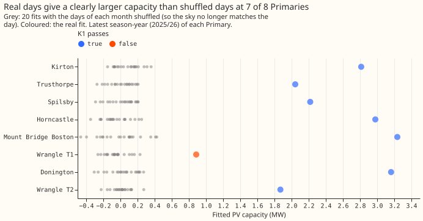

**In 2025/26 two Primaries account for the failures.** Over all 41 Primary-years, K1 passes in 38, K2
in 30, K3 in 34, K4 in 40, and all four in 27; Mount Bridge Boston, Spilsby, and Horncastle also
fail K2 or K3 in single earlier years. Kirton fails K2 in 5 of 7 years (winter capacity 29% to 54%
above summer) and K3 in 4 of 7 (the cloud term cuts its capacity by 20% to 60%). Wrangle T1 has 2
season-years and a fitted 0.89 MW. It passes the first half of K1 (its capacity is above the 95th
percentile of the placebo fits, 0.163 MW) and fails the second by a hair: the median absolute
placebo capacity, 0.099 MW, is just above one tenth of 0.886 MW. Its weekend capacity differs from
its weekday capacity by 58%. **This page does not decide which of these failures is a demand confound
and which is noise from two years of data.**

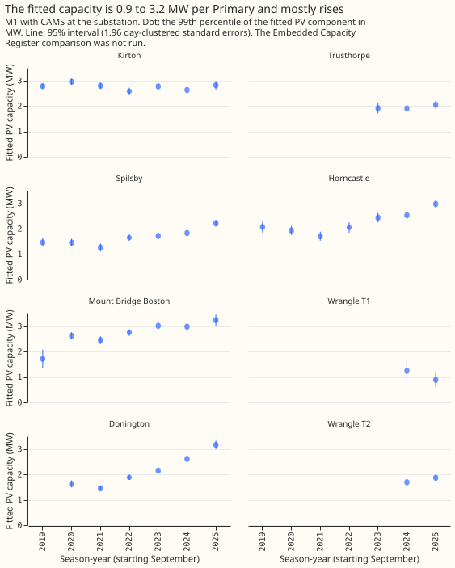

**The fitted capacity is 0.9 to 3.2 MW per Primary in 2025/26 and rose at 4 of the 5 Primaries with
4 or more years.** Dividing by the M1 recovery ratio, 0.77, gives about 1.2 to 4.2 MW of solar.
Kirton is flat. Only 2 of 33 year-to-year changes are falls larger than 2 combined standard errors
(Donington 2021, Kirton 2022). The detection limit is about 2.5% of capacity per season-year: the
median day-clustered standard error is 1.2% of the Primary's effective capacity (figure 11).

## What else the injection showed

- **Summer and winter recover alike.** Injected PV gives 0.766 in April to September and 0.770 in
  October to March at the substation (figure 12), so K2 expects no seasonal gap.
- **Farm E is the worst case.** The median ratio by farm runs from 0.70 (Solar farm E) to 0.84
  (Solar farm D) at the substation (figure 10). Farms lie 16 to 24 km from the Primaries on average.
- **Detail is lost at the peaks.** The recovered half-hourly output has a correlation of 0.88 with the
  injected output at the substation point and 0.92 at the farm point (figure 9), and the energy
  recovered is 0.80 and 0.87 of the injected energy.
- **The 8 non-directional (MVA) Primaries fold.** Stickney fits a negative capacity every year, and
  the MVA Primaries' winter and summer fits differ widely (figures 15 and 18). They are left out of
  the verdict.
- **The bulk supply points are descriptive.** The fitted capacity at Boston and Skegness lies above
  the sum of the directional Primaries and metered farms below it, as it should (figure 19).
- **The Embedded Capacity Register comparison was not run.** The register code lives in experiment
  00031's folder, which a script may not import.

## What the next experiment should answer

**The design's rule for `recovers-but-confounded` is PVDIS-2B: does a richer demand model bring K3 to
pass without lowering the recovery below 0.75?** Add demand shapes (a flat cloud term, a dawn and
dusk term, temperature by hour) and the orientation menu in `studies.pv_separation.separate`, inject
a known dull-day demand term into the real series to measure its bias, and report K1 to K4 at
Kirton and Wrangle T1 first. The failures sit at two Primaries, so a result of the 2B kind could move
the count of Primaries that pass from 6 to 8, which the arc's stop rule counts as a move of 2.

## Figures

The first figure is above. Figures 2 to 5 show the raw data, 6 to 8 the method, 9 to 12 the recovery
of injected PV, and 13 to 19 the real series.

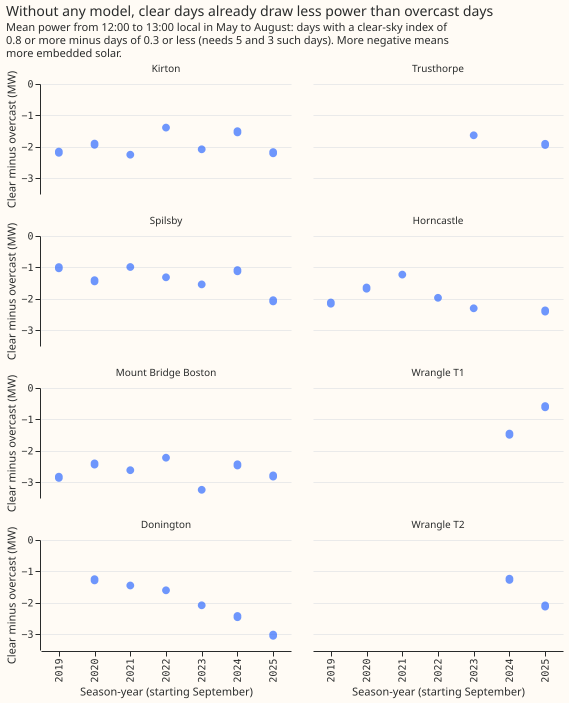

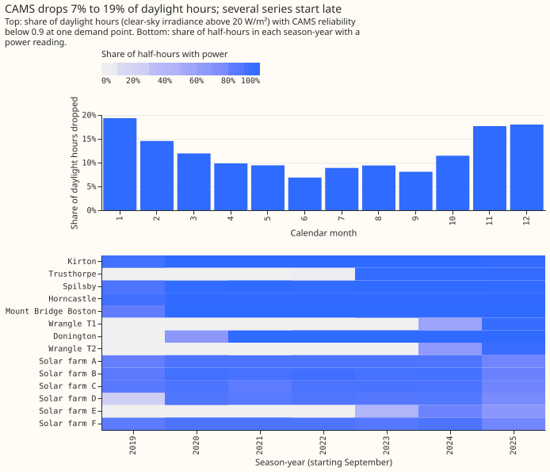

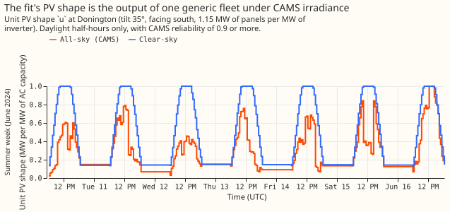

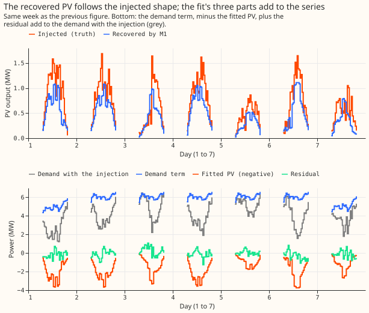

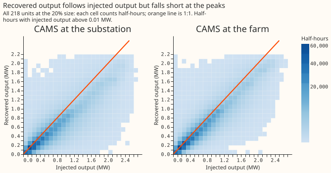

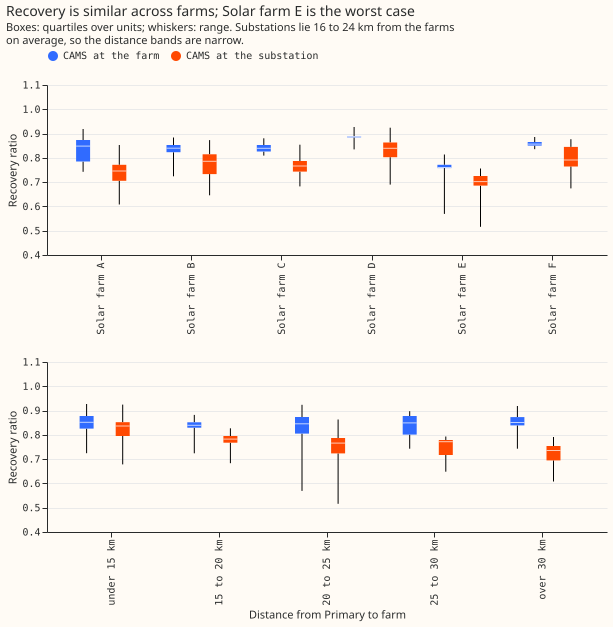

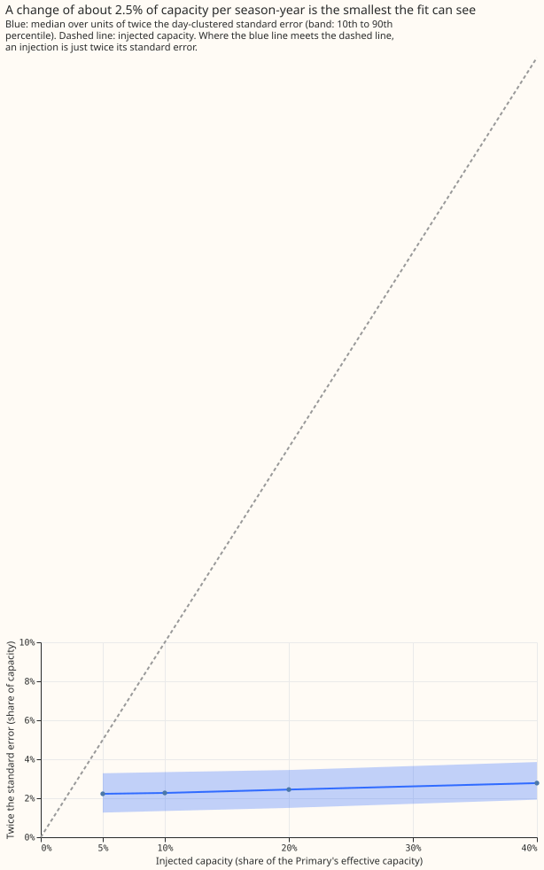

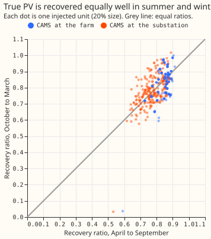

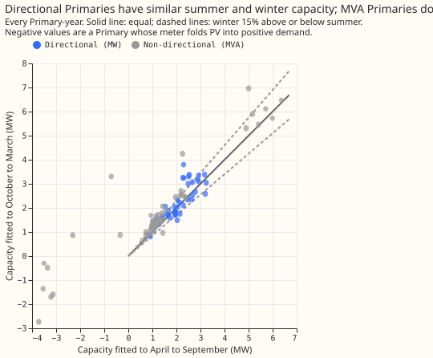

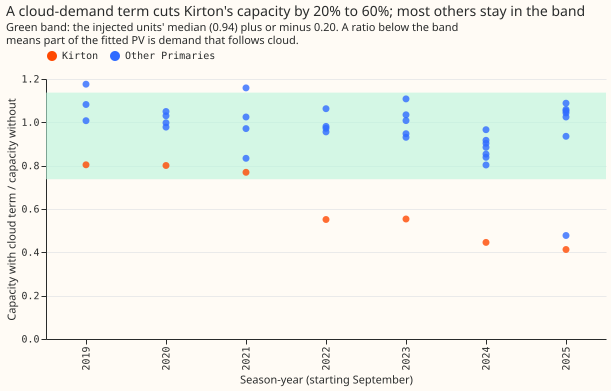

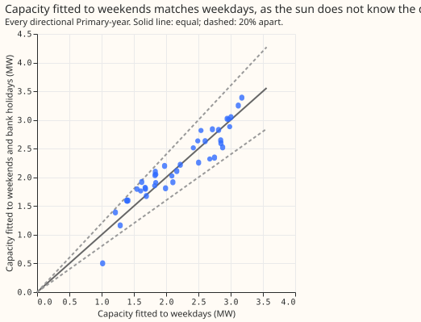

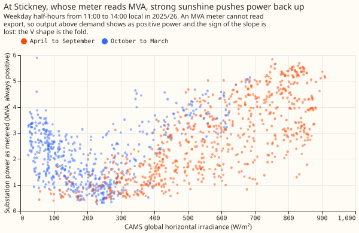

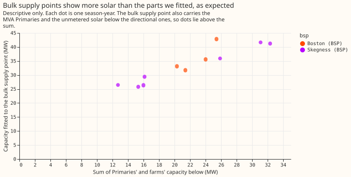

## Method and files

- **Data.** Power is the cleaned half-hourly series of each Primary and of the 6 solar farms. CAMS
  irradiance at hours with reliability 0.9 or more is spread to half-hours by the cosine of the
  zenith. Temperature is ERA5 at each Primary. Season-years run September to August, 2019/20 to
  2025/26, and a window needs 3,000 daylight half-hours.
- **Injection.** The 218 units are every Primary, farm, and season-year with enough shared rows.
  The injected output is minus the farm's output scaled so that its 99th percentile over daylight
  half-hours is 20% (also 5%, 10%, and 40%) of the Primary's effective capacity.
- **Code.** `ml-experiments/00039-pv-disaggregation-cams-injection/`, run in the order `e00039_inputs`,
  `e00039_inject`, `e00039_real`, `e00039_report`, `e00039_charts`. `e00039_report` prints every number
  on this page.
- **Differences from the plan.** The farm's 99th percentile is taken over its daylight half-hours,
  the convention that matches the unit PV shape's, and not over all half-hours.
