# Experiment 40: how far can the capacity fitted to embedded solar be trusted?

We asked how far the solar capacity fitted to the demand at a Primary substation (a substation that
steps power down to the local distribution network) can be trusted. We built a test that compares
the capacity found by six fits of the same series. The six fits differ in how much cloud-driven
demand each allows. We checked the test on solar-farm output added to demand and on extra demand
shaped like a response to cloud. The test raised a false alarm in 5.5% of the simulated trials in
which the added load was pure solar-farm output. It detected four of five cloud-shaped loads at 25%
of the true capacity. It detected a day-long cloud-shaped load in only 35% of simulated trials, so
it failed our rule that the test must detect such loads in at least 80% of trials.

**Verdict `underpowered`: the misfit test is calibrated and detects four of five cloud-driven loads
at 25% of the true capacity, but it detects a day-long cloud load in only 0.35 of simulated trials,
so the pre-registered rule that the test must detect such loads in at least 80% of trials fails.**
The test compares the capacity that six least-squares fits assign to the same series. Pure injected
solar-farm output gives a median capacity over truth of 0.992 (95% interval 0.951 to 1.032) with a
false-positive rate of 0.055. Kirton is the one directional Primary substation flagged in 2025/26,
and the other seven are unflagged. The capacity at those seven carries a bound B of 0.18 to 0.71,
and the test has almost no power at Wrangle T1, so the bound is wider than the 0.10 predicted. The
aim is explanation and capacity estimation, not forecast skill. CAMS irradiance is the only weather
input at the lag times and it arrives too late to drive a live forecast, so the fits describe past
data. CAMS is the Copernicus Atmosphere Monitoring Service's satellite estimate of sunlight.

## Results against the plan

| Quantity | Prediction | Result |
|---|---|---|
| Median capacity over truth on pure injected PV (V1) | 1.00 (0.97 to 1.03) | 0.992 (0.951 to 1.032) |
| False-positive rate | 0.05 to 0.10 | 0.055 (0.024 to 0.108) |
| Power at amplitude 0.25, lowsun | at least 0.8 at 7 of 8 Primaries | 1.00 (median), at 7 of 8 |
| Power at amplitude 0.25, evening | same | 1.00, at 7 of 8 |
| Power at amplitude 0.25, mixture | same | 1.00, at 7 of 8 |
| Power at amplitude 0.25, threshold | same | 1.00, at 6 of 8 |
| Power at amplitude 0.25, dayL | same | 0.35, at 0 of 8 |
| Kirton flagged | 2022/23 to 2025/26 | 2019/20 and 2021/22 to 2025/26 |
| Other seven unflagged in 2025/26 | at most 3 flagged Primary-years elsewhere | 0 flagged Primary-years elsewhere |
| Bound B at an unflagged Primary | at most 0.10 | 0.18 to 0.23 at five, 0.47 at Trusthorpe, 0.71 at Wrangle T1 |

**The test is calibrated.** The false-positive interval (0.024 to 0.108) comes from resampling
Primaries and farms independently, and the 218 units are the (Primary, farm, season-year) triples of
experiment 39. The ratios of one solar farm do not transfer to the others, which is a finding about
the ratio vector and not about the test. Solar farm E's ratios leave the capacity at 0.825 of truth
and its false-positive rate at 0.230, and the other five farms give a median between 0.955 and 1.046
with a false-positive rate of at most 0.087.

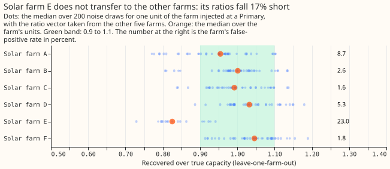

**The test finds a load with a within-day shape and misses a load that is the same all day.** Four
shapes are flagged at 25% of capacity in at least 0.997 of draws at the median Primary: low sun,
evening, a cloud threshold, and a half-and-half mixture. The shape `dayL`, the day's mean cloud on
every daylight half-hour, reaches median power 0.904 only at amplitude 0.5. The post hoc detection
limit, the smallest grid amplitude with median power at least 0.8, is 0.1 for low sun and evening,
0.25 for the threshold and the mixture, and 0.5 for `dayL`.

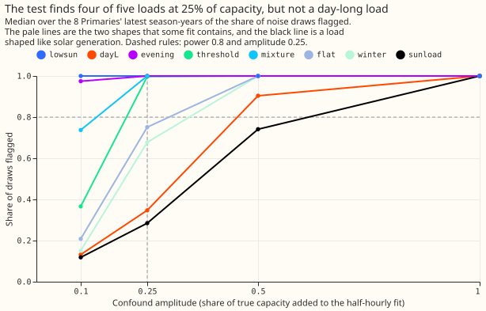

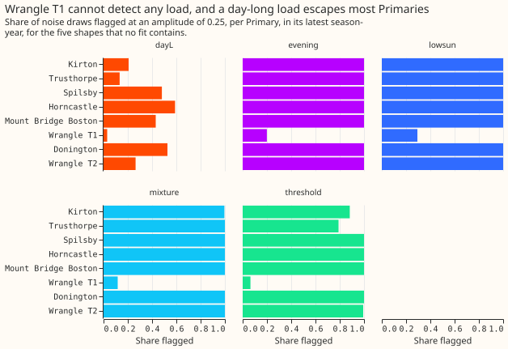

**A load that rises with sunshine escapes the test by construction.** Its shape is the solar shape,
so every fit assigns it the same negative capacity. Its median power over units is 0.055 at
amplitude 0.1, 0.175 at 0.25, and 0.74 at 0.5, and the capacity it leaves undetected is 14%, 33%,
and 64% too low.

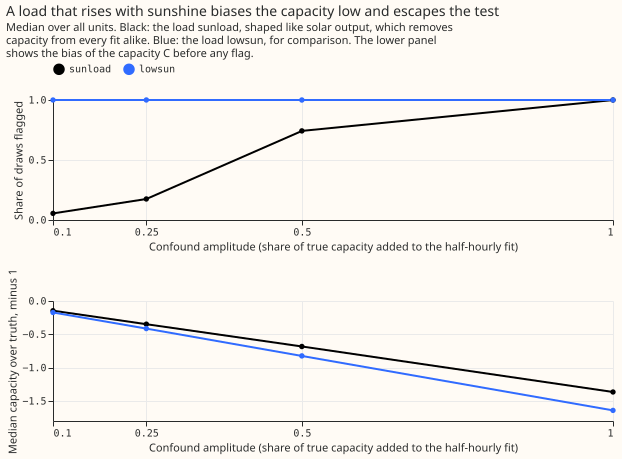

## The real series

**Kirton is flagged in 6 of 7 season-years, and no other Primary is flagged in any.** Kirton's
misfit is 0.075 and 0.098 in the two early flagged years and 0.20 to 0.31 from 2022/23, against
thresholds of 0.07 to 0.12. The capacity of 2025/26 ranges from 1.2 to 4.4 MW across the library of
confound shapes. The test cannot flag Wrangle T1, whose threshold is 1.23 against a misfit of 0.25,
so "unflagged" at Wrangle T1 means that the test has no power, and not that no load is present.

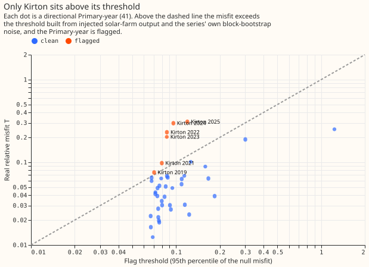

| Primary, 2025/26 | Capacity (MW) | 95% interval | Bound B | Status |
|---|---|---|---|---|
| Kirton | 3.35 | 3.02 to 4.01 | 0.41 | flagged, library range 1.2 to 4.4 MW |
| Trusthorpe | 2.48 | 2.23 to 2.88 | 0.47 | unflagged |
| Spilsby | 2.57 | 2.16 to 3.01 | 0.21 | unflagged |
| Horncastle | 3.43 | 3.04 to 3.98 | 0.21 | unflagged |
| Mount Bridge Boston | 3.86 | 3.37 to 4.55 | 0.19 | unflagged |
| Wrangle T1 | 1.41 | 0.62 to 2.07 | 0.71 | unflagged, no power |
| Donington | 3.69 | 3.20 to 4.22 | 0.18 | unflagged |
| Wrangle T2 | 2.29 | 2.10 to 2.61 | 0.23 | unflagged |

The capacity is the daily fit divided by its recovery ratio. The bound is the median error of the
no-confound capacity at the largest grid amplitude whose power is under 0.8, taken as the largest
over the five shapes no fit contains. At every Primary the day-long load sets the bound. At Wrangle
T1 the other four shapes are also undetected at amplitude 0.25. The bound moves in steps of the
amplitude grid and is an approximation of the error, not an interval.

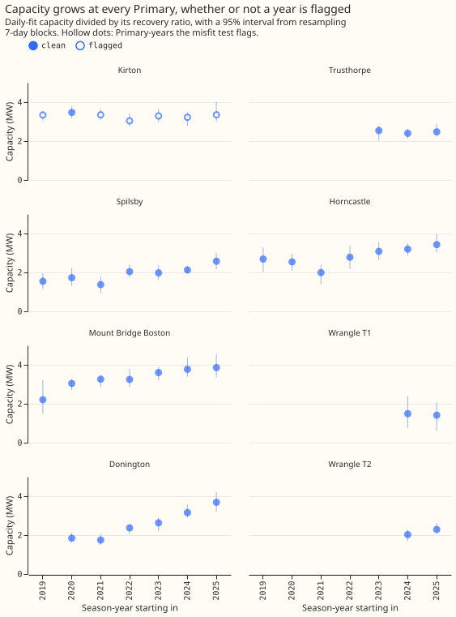

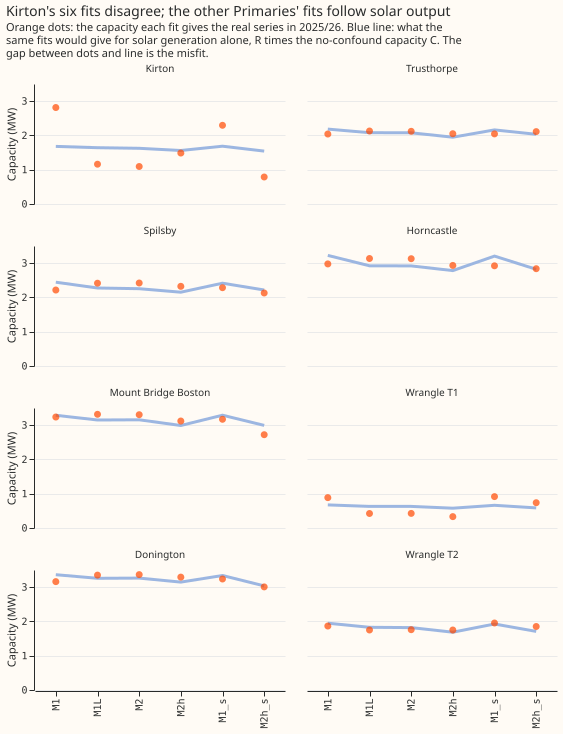

**On the continuity checks of experiment 39 the count does not move.** With the checks defined as in
experiment 39, K1 to K4 pass at 7, 7, 6, and 7 of 8 Primaries in 2025/26 and all four pass at 6.
With K1's second clause replaced by a capacity over standard error above 4, K1 passes at 8 of 8 and
all four checks still pass at 6.

## Raw data and the method

**The raw data show a cloud response that solar generation cannot explain.** Overcast days raise
Kirton's power more than Donington's in every half-hour, in winter too (figure 2). Kirton's midday
power falls with irradiance in winter as well as summer (figure 4). Evening demand, after dark,
rises with the day's cloud at some Primaries (figure 3).

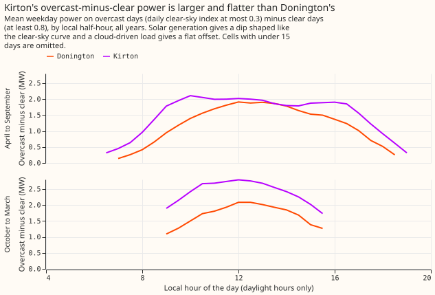

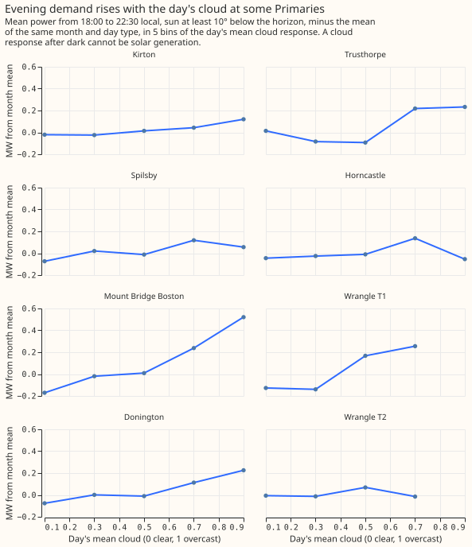

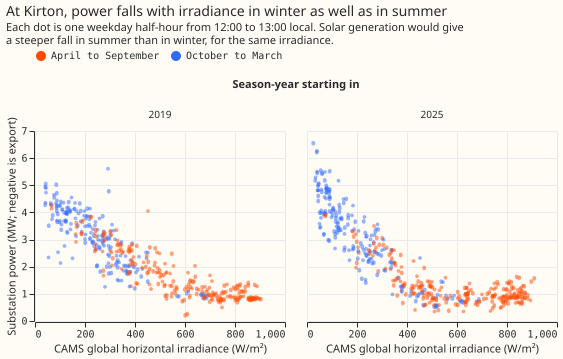

**The six fits differ in how much cloud-driven demand each allows, so a cloud load leaks into them
unequally.** The arms are M1 (calendar cells and temperature), M1L (plus a flat cloud term), M2
(cloud term by season half), M2h (cloud term by season half and three local-hour bands), and M1 and
M2h on April to September rows only. Every arm is linear, so the capacity fitted to a series plus a
load is the sum of the two fitted alone. A unit's injected solar output and each of eight loads are
therefore fitted once and added as vectors. The heat map shows each load's leakage per MW into each
fit. The daily fit cannot carry a cloud term, because after the cell means are removed the daily
sums of the solar shape and of the cloud response correlate at -0.986 to -0.977.

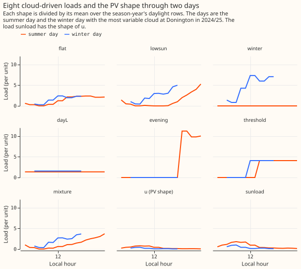

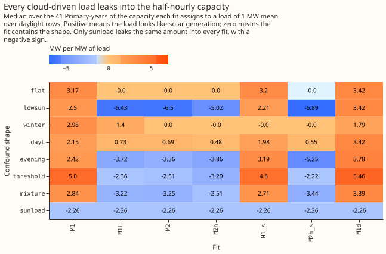

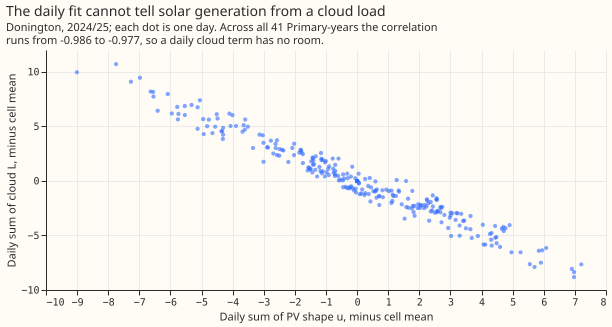

**The detector is a misfit of the six capacities to a multiple of the recovery ratios.** For a unit
of injected solar output of true capacity 1 MW, fit `a` returns `R_a`, the median over the Primary's
units of the other farms (leave-one-farm-out). For an arm vector `c`, the capacity under no
confound is `C = (R . c) / (R . R)` and the misfit is `T = sqrt(mean((c - R * C)^2)) / C`. The
noise is 200 resamples of whole 7-day blocks of each real Primary-year, minus their mean. The
threshold of a Primary-year is the 95th percentile of `T` over the units of the other farms scaled
to the real capacity, each with its own farm also left out of `R`. The real Primary-years use the
ratios of all six farms. The injected loads are `flat`, `lowsun`, `winter`, `dayL`, `evening`,
`threshold`, `mixture`, and `sunload`. The first and third are contained in some fits and are
reported, not scored. The self-tests of linearity, exact recovery, a contained shape, the sign of
`sunload`, and the false-positive rate of the threshold all passed, and the farm-point timestamp
scan of experiment 39 peaks at a shift of zero.

**The orientation menu is not identified.** The east, south, and west capacities swap from one
season-year to the next at the same Primary (figure 14), so the menu decides nothing.

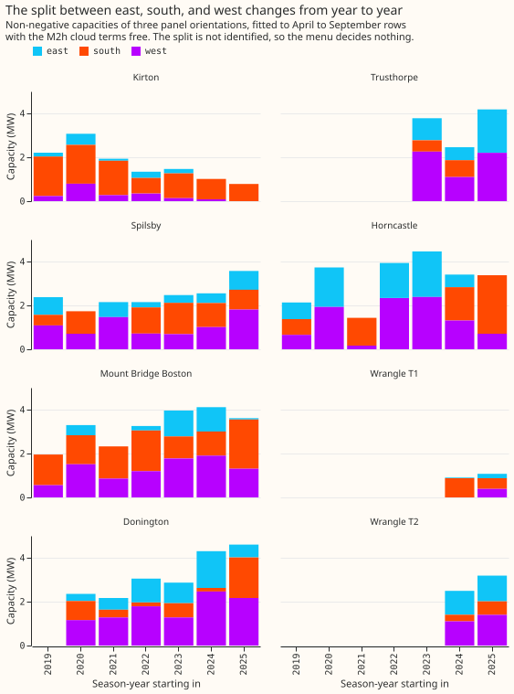

## Caveats

- **The real Primary-years use the ratios of all six farms.** Every injected unit leaves its own
  farm out of the ratios, the threshold, and the real capacity it is scaled to.
- **Solar farms are not rooftop fleets.** The ratio vector comes from six metered farms with one
  orientation each, and a fleet of mixed orientations may have a different ratio vector. Only the
  comparison with an external capacity register can test that.
- **The write-up quotes a bound with a step of the grid.** The grid is 0.1, 0.25, 0.5, 1.0.
- **The unflagged Primary-years include Wrangle T1.** The clean count of 7 includes a Primary where
  the power is under 0.3 for every shape.

## What the next experiment should answer

**The next experiment should ask whether the evening cloud response measures the daylight load
that the six fits cannot detect.** The two loads that set the bound, a day-long cloud load and a
load that rises with sunshine, are the loads the misfit test cannot see. Evening demand after dark
responds to cloud at some Primaries (figure 3), and solar generation cannot cause that
response. An experiment could inject a known day-long load into the real series, estimate its
amplitude from the evening rows alone, and test whether that amplitude predicts the bias of the
capacity. The test is whether such a covariate narrows the bound at Spilsby, Horncastle, Mount
Bridge Boston, Donington, and Wrangle T2 below 0.1. The fitting code lives in this experiment's
folder and a later experiment, or the deliverable, could move it to `packages/studies`, which needs
the maintainer's review.
