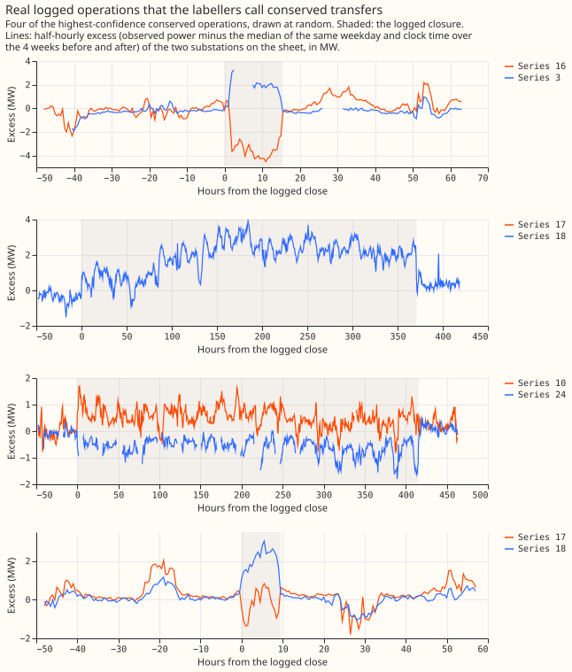

# Experiment 41, part 2 (SW2-0b): which logged switching jobs show up in the power readings?

We asked which of the electricity network's logged switching jobs since January 2022 really moved
load from one substation to a neighbour, so that later experiments have a list of real events to
test detectors against. We turned each job into a card that summarises the power readings around
it. Two separate runs of an AI language model (Sonnet) read every card. Each run said whether load
visibly moved, and when the move started and ended. A stronger model (Opus) settled the 66 cards
where the two runs disagreed or were unsure. To measure how often the labellers see a transfer we
know is there, and how often they see one that is not there, we hid 200 cards with known answers
among the real ones. Of 537 logged jobs lasting 2 hours to 60 days, 66 (12%) show load moving
between substations. The method cannot see small or short transfers, so few of the other jobs are
proven quiet, and we cannot tell which.

## What was labelled

**The set holds 1,017 cards: 817 real and 200 hidden known-answer cards.** The real cards are 537
logged operations of 2 hours to 60 days (jobs that overlap in time and share a substation count as
one operation), 42 edge cards for the first and last 72 hours of 21 closures over 60 days, 50
closures under 2 hours, 148 alarms that experiment 37's detectors raised where no closure was
logged, and 40 quiet windows with no alarm. An alarm card puts the alarm's time where the log time
would be and draws a duration from the real operations. The hidden cards are 100 placebo cards (a
real job's log time moved to a quiet period, with no transfer), 80 cards with a transfer we added
to a quiet period, and 20 more with an added transfer and a log time that is wrong by 1 to 3
hours. They are built as in [experiment 41's gate](result.md). Each card's "excess" is the power
above the usual level for that weekday and clock time.

## The hidden cards look like the real ones, except in missing data

**A two-sample test found no difference between hidden and real cards on six card-text fields, but
the hidden cards have fewer unavailable values.** The fields are the minute of the log time,
whether side B of the switching sheet is unmetered, the clock hour, the duration, the number of
neighbour rows, and the card length. The Kolmogorov-Smirnov test gives p of 0.24 or more on each.
The mean duration differs (53 hours on real cards, 36 on hidden ones), and the test cannot rule out
a difference of that size. The hidden cards were drawn to match the real cards' missing data, but
real cards still show 1.6 unavailable values per hourly row against 0.9 on hidden cards, because
real jobs sit among more gaps in the telemetry.

## The first labeller found 0.60 of the added transfers and no placebos

**The first Sonnet run called none of the 100 placebo cards visible and found 0.60 of the 80
added transfers.** It found 19 of 21 large, long transfers (25% or more of the receiving load,
lasting 6 hours or more). The table splits recall by unavailable values per row.

| Unavailable values per row | Added transfers found | Placebo cards called visible | Share of real operations |
|---|---|---|---|
| under 1 | 26 of 42 | 0 of 62 | 0.49 |
| 1 to 2 | 13 of 22 | 0 of 27 | 0.23 |
| 2 to 3 | 9 of 13 | 0 of 5 | 0.14 |
| 3 or more | 0 of 3 | 0 of 6 | 0.14 |

**Recall does not fall steadily with missing data, but only 3 hidden cards sit in the group with
the most missing data, so weighting by the real mix is unreliable.** Weighted to the real
operations' mix, recall is 0.53 against 0.60 unweighted, and the placebo rate stays 0 of 100.

## Of 537 logged operations, 66 show a transfer

**The labellers found 35 conserved and 31 one-sided transfers among the 537 operations.** A
conserved transfer is one where two substations step in opposite directions, so the load moved
rather than vanished. A one-sided transfer is one where only one substation steps. The other 471
operations are 440 not visible and 31 that cannot be assessed because power readings are missing.

- **Missing readings:** for 13 of the 35 conserved operations, one of the two substations has
  readings for under half of the event's half-hours (the substation is likely switched off or its
  meter was off), so the pair was not seen stepping together. Treat those 13 as one-sided at best.
  The figure above shows only conserved operations with readings from both substations.
- **Size:** the median transfer is 1.0 MW (10th to 90th percentile 0.55 to 2.5 MW) and 0.30 of the
  donor's usual range (its 99th minus its 1st percentile over the previous year).
- **Length:** of the 66 visible operations, 16 last 2 to 6 hours, 15 last 6 to 24 hours, and 35 last
  over 1 day.
- **Share of receiving load:** this can be computed for 16 of them, because the labellers named a
  metered receiver for only those 16: 2 under 10%, 6 from 10% to 25%, and 8 of 25% or more.
- **Edge cards:** 5 of 42 are visible (1 at the start of a long closure, 4 at the end), and 16
  cannot be assessed.
- **Short closures:** 2 of 50 closures under 2 hours are visible and 10 cannot be assessed. The gate
  treats closures under 2 hours as outside the bands it scores.

## Of 148 unexplained alarms, 9 show a transfer

**Of 148 alarms with no logged closure, 9 (6%) show a transfer, and 0 of 40 quiet windows do.** The
9 are 4 conserved and 5 one-sided, with a median transfer of 1.9 MW. The logs miss real switching,
so 6% is a lower bound on the share of alarms that are real, across all four detector settings.
Each setting raised 37 alarms that were labelled. The detector D0 with an 8-half-hour window gives
4 of 37, D1 with an 8-half-hour window gives 2 of 37, D1 with a 48-half-hour window gives 3 of 37,
and D0 with a 48-half-hour window gives 0 of 37. By the duration drawn for the card, 4 of 56 alarms
lasting 2 to 6 hours, 2 of 40 lasting 6 to 24 hours, and 3 of 52 lasting over 1 day are visible.
Size bands are not reported, because only 3 of the 9 have a share of receiving load.

## Few of the 440 not-visible operations are proven quiet

**We cannot tell which of the 440 not-visible operations moved no load.** Sonnet's recall on added
transfers is below 0.80 in every band that lasts under 1 day. The 331 not-visible operations of 2
to 24 hours (210 of 2 to 6 hours and 121 of 6 to 24 hours) are therefore don't-care operations, which
detector scoring does not count as true or false negatives. Of the 109 that last over 1 day, only
a transfer of 25% or more of the receiving load would be seen with a recall near 0.83, so those 109
operations rule out only large transfers. The 31 operations that cannot be assessed are don't-care
operations too.

## Agreement, adjudication, and cost

- **Agreement:** the two Sonnet runs agree with Cohen's kappa of 0.78 on the four labels and 0.83
  on visible against not visible (1 is perfect agreement and 0 is chance), over 529 cards: every
  card the first run called visible or unsure, plus a random quarter of the rest.
- **Opus:** adjudicated 66 cards (52 disagreements and 14 agreed unsure visible calls). After
  adjudication 15 are conserved, 17 one-sided, 25 not visible, and 9 cannot be assessed.
- **Cost:** the set cost 20.1 million subagent tokens, a third above the 15 million estimated,
  because each Sonnet run used 12,000 to 13,000 tokens per card: 12.3 million for the first run on
  all 1,017 cards, 6.8 million for the second run on 529, and 1.1 million for Opus. A subagent token
  is a token the harness charged to a helper run. With the 14.9 million of the
  [gate](result.md), experiment 41 cost 35.0 million.

## What this does not show

- **The labels depend on two runs of one model.** Both labellers are Sonnet with the same brief, so
  a shared blind spot would not show as disagreement.
- **The known-answer cards may be easier than real cards on missing data.** The hidden cards carry
  fewer gaps (0.9 against 1.6 values per row), so their recall may flatter the real cards.
- **Alarm cards use a drawn duration.** An alarm is not a closure, so its onset and end labels have
  no logged times to check against.
- **The set holds 66 visible operations and 82 visible cards in all.** Any score by band will have
  wide intervals, because so few events are visible.

The labelled set is `data/ml-experiments/00041-sw2-0a-labeller-gate/real/labelled_set.parquet`
(private, one row per card, with the labels, the moved MW with its 10th to 90th percentile, and
the two moved-load shares computed in Python). Code: `ml-experiments/00041-sw2-0a-labeller-gate/`,
with the numbers printed by `e00041_labelled_set.py`, `e00041_finalize.py`, `e00041_agreement.py`,
and `e00041_sentinel_check.py`.
