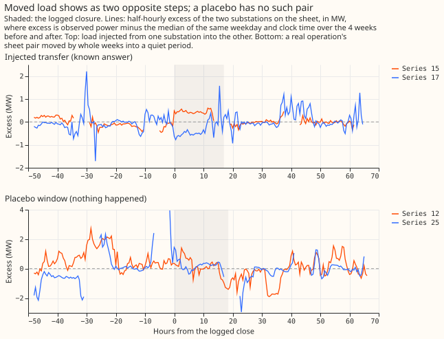

# Experiment 41: can a labeller pass a known-answer gate on load shifts?

We asked whether a program can reliably tell when electricity load really moved from one
substation to a neighbour, using only the power readings and the engineers' switching log. To test
that without knowing the real answers, we built 300 test windows of power readings. In 150 windows
we added a fake transfer of load between two substations. In 120 windows we added nothing but gave
the window the log time of a real switching job (we call these placebo windows). In the last 30 we
added a fake transfer and put the logged time 1 to 3 hours off. A labeller (here a written set of
rules, and separately the AI model Sonnet) read each window and said whether a transfer was
visible, and when it started and ended. Sonnet called none of the 120 placebo windows visible. It
found 74% of the large fake transfers (25 of 34, those of 25% or more of the receiving substation's
load lasting 6 hours or more), under our bar of 80%. In a further check that was not planned, it
found about 9 in 10 of the large, long transfers when the receiving substation has its own power
readings (46 of 52), and 6 in 10 when it does not (25 of 42).

**Partly supported: Sonnet called no placebo window visible and timed starts and ends well, but
found only 0.74 of the large, long fake transfers, under the 0.80 bar.** On 120 placebo cards Sonnet
called 0 visible (95% interval 0.00 to 0.03). It found 25 of 34 injected transfers of 25% or more of
the receiving load lasting 6 hours or more (0.74; 0.57 to 0.85), or 71 of 94 (0.76; 0.66 to 0.83)
with 60 further cards from the same band. Where a metered receiver exists the recall is 0.89 (46 of
52; 0.77 to 0.95); where the receiver is unmetered and only the donor steps it is 0.60 (25 of 42;
0.44 to 0.73). The rules-only labeller reaches 0.65 (22 of 34) with 3 of 120 placebo cards called
visible. The maintainer waived the bar for naming the receiving substations after seeing the
rules-only results, so the waiver is post hoc.

## The first test set had tells

**A Sonnet reviewer found that the first 300 test cards were easier to reject than real ones, so
all gate figures here come from a rebuilt set.** In the first set the injected cards' log times
ended in :05 or :35 only, while placebo cards carried real minutes; every injected card showed a
metered side B while 39 of 120 placebo cards showed "side B: not metered"; and the injected start
times were spread over the whole day while the placebo times kept real clock times. In the rebuilt
sets (`test2`, `testbig2`) both kinds of card take a real operation's log times, sheet sides,
duration, and clock time, shifted by whole weeks into a quiet period. The minute, side-B and
night-share distributions now match. The first set gave Sonnet a placebo rate of 1 of 120 (1 of
81 without the side-B tell) and a recall of 0.92 on its 25 large, long cards; those figures are not
used. The 100 development cards came from the first generator.

## Setup

- **The hindsight model** (a model that sees weather and the following months, so it predicts demand
  better than any live forecast could) is a leave-one-month-out XGBoost quantile model (q10, q50,
  q90) on experiment 6's 13 input columns for each of the 16 substations, with every logged closure
  (padded 24 hours) removed from training. The hindsight model is supporting evidence on a card and
  is never the deciding evidence.
- **Cards** hold the log times, step features F1 to F7 with percentiles against up to 400 quiet-week
  draws, and hourly values. The 300 test cards are 150 injected, 120 placebo, and 30 injected with
  the log time 1 to 3 hours off. A further 60 injected cards in the 25%-or-more, 6-hour-or-longer
  band were added after the first scoring, at the planning session's request, because 34 cards in
  that band give a wide recall interval.
- **The injected cards follow the real mix of sheets.** 60 of 150 injected cards sit on a sheet with
  no metered side B, so the load goes to an unmetered receiver and only the donor steps. The design
  assumed 15%; the real log has 30% to 40%.
- **Both labellers saw the same cards.** The rules-only labeller applies percentile bars (0.97 at
  the close, 0.90 at the open, 0.985 for one-sided) that were set before the first development card
  was scored and not changed. The Sonnet labeller read ten cards per run with a written brief and no
  plots. The second Sonnet labeller read the 168 test cards the first called visible or low
  confidence, plus a random quarter of the rest.

## Hindsight model checks

**Excluding logged closures removed contamination, and the hindsight model did not absorb the
closures.** In the 7 days either side of 358 side-windows of closures over 3 days, the mean
hindsight z is 0.004 (standard error 0.054), and 19.4% of observations fall outside the q10 to q90
band (nominal 20%). Training with the logged closures removed gave a lower out-of-event mean
absolute error than removing the same volume at random positions in 5 of 6 substations tested; the
gap is 0.043 MW on substation 3 (interval 0.008 to 0.081) and 0.010 MW on substation 14 (0.001 to
0.020), and the other four intervals include zero.

## Gate on 300 rebuilt test cards

| Check | Bar | Rules only | Sonnet |
|---|---|---|---|
| Placebo labelled visible | 5% or less | 3 of 120 (0.01 to 0.07) | 0 of 120 (0.00 to 0.03) |
| Placebo labelled conserved | 2% or less | 0 of 120 | 0 of 120 |
| Recall, 25% or more and 6 h or more | 0.80 or more | 0.65 (22 of 34) | 0.74 (25 of 34; 0.57 to 0.85) |
| Same band with 60 further cards | 0.80 or more | 0.64 (60 of 94; 0.54 to 0.73) | 0.76 (71 of 94; 0.66 to 0.83) |
| Onset within 1 h of truth, found injections | 90% or more | 100% (63 of 63) | 99% (77 of 78) |
| End within the larger of 2 h and 10% of duration | 80% or more | 97% | 100% |
| Moved MW, median absolute relative error | 25% or less | 22% | 11% |
| Receivers named, share 30% or more | 80% or more, waived | 53% | 35% |
| Jittered: onset nearer the truth than the log | 80% or more | 4 of 4 found | 14 of 14 found |
| Event F1 (events found against events wrongly called, matched event by event) on all injected cards | at least the rules' | 0.52 | 0.68 |
| Kappa (agreement beyond chance) between the two Sonnet labellers | 0.7 or more | not applicable | 0.79 (0.83 visible against not; bootstrap 0.74 to 0.90) |

**Sonnet's recall of 0.76 is under the 0.80 bar.** The upper end of its interval, 0.83, is above the
bar, so a recall of 0.80 is not ruled out but is not shown either. The jittered check rests on 14 of
30 cards for Sonnet and 4 of 30 for the rules, because the labeller called the rest not visible.
Sonnet found 78 of 150 injected transfers and the rules 63 of 150. Under the pre-registered rule, a
placebo rate under 10% and all bars met except recall give `partly supported`, and the bands where
recall is under 0.80 become don't-care bands, whose labels later experiments do not use to score
detectors.

**Both labellers miss small and short transfers, and Sonnet reaches 0.80 only for transfers of 25%
or more lasting over 1 day.** The over-1-day band gives Sonnet 0.83 (30 of 36; 0.68 to 0.92) and the
rules 0.75. Transfers of 25% or more lasting 6 to 24 hours give 0.71 and 0.57. Recall is 0.14 to
0.38 under 10% of the receiving load and 0.50 to 0.63 for 10% to 25%.

**Recall depends on whether a metered receiver exists.** For the 52 large, long injections with a
metered receiver Sonnet's recall is 0.89 (0.77 to 0.95) and the rules' 0.79 (0.66 to 0.88). For the
42 where only the donor steps, Sonnet's is 0.60 (0.44 to 0.73) and the rules' 0.45 (0.31 to 0.60).
This split was made after seeing the results and is not a planned row. A bar of 0.80 on the real
sheet mix fails, and on cards with a metered receiver the point estimate passes.

## Receivers named (waived bar)

**The maintainer waived the receivers-named bar after the rules-only results, so the change is post
hoc, and the figure is reported only.** Sonnet names a receiver with a share of 30% or more in 27 of
75 cases (0.36). It names the receiver in 26 of 58 cases it calls conserved (0.45) and in 1 of 17 it
calls one-sided. By count of metered receivers in the truth, it names 6 of 27 (one), 14 of 37 (two),
and 7 of 11 (three). By series type, it names 20 of 54 on MVA series and 7 of 21 on MW series, and 3
of 6 on cards with an unmetered share. The rules-only labeller names 53%.

## Token cost

**Sonnet labelling cost 14.9 million subagent tokens for 1,156 card labellings, about 12,900
each.** Labeller 1 used 10.5 million on 820 cards (100 development, 300 test, 60 further, then 300
test and 60 further after the rebuild) and labeller 2 used 4.4 million on 336 cards, as the harness
reports each subagent run. The development set and the first, flawed test set cost 8.3 million
of the total. No Opus run was needed, because the injected truth settles every disagreement.
The full run SW2-0b is about 770 cards (533 operations, 36 edge events, 50 short closures, and
about 150 alarms); at the same rate, one labeller costs about 10 million tokens and a second
labeller on half of them about 5 million more.

## What was not done

- The development set confirmed that Sonnet labels in the right schema (100 cards, event F1 0.75);
  no prompt was tuned, and the rules-only thresholds were not tuned either.
- No card used a plot. The design allowed one.
- Bank holidays are not excluded from the same-weekday reference.
- The hindsight model uses 150 trees at learning rate 0.1, shallower than experiment 17's fits.
- The absorption check against random exclusion ran on 6 of the 16 substations.
- The kappa subset is not random: it holds the 168 cards that the first labeller called visible or
  low confidence plus a random quarter of the rest, so kappa describes agreement on that enriched
  sample.
- The real-operation cards of SW2-0b have not been compared with the hidden test cards yet; that
  check comes before the full run.

## Lessons for later experiments

- Score detectors only in the band where Sonnet's recall has a point estimate of 0.80 or more: 25%
  or more of the receiving load, lasting over 1 day.
- A detector's recall against labelled events overstates its recall against all real switching,
  because Sonnet misses between a third and a half of transfers of 10% to 25% and 40% of donor-only
  transfers of 25% or more.
- The second labeller agrees with the first (kappa 0.79), so a second labeller on a sample of the
  cards in SW2-0b is plausible, though kappa was measured on an enriched sample and agreement on the
  other cards is untested.

Code: `ml-experiments/00041-sw2-0a-labeller-gate/`. Numbers above are printed by `e00041_report.py`,
`e00041_kappa.py`, `e00041_diagnose.py`, and `e00041_checks.py`.

## Known defect in the labelled set

**The labelled set's `moved_share_of_receiver` column is missing for most events.** The labeller
wrote donor and receiver series ids as text, and the calculation that turns the moved MW into a
share of the receiving load compares them with whole numbers, so the share is empty for any event
whose receivers are text. Counts of events by share band in the [labelled-set
page](labelled-set.md) were corrected for events lasting over 1 day; use
[experiment 44's](../00044-sw2-2-switching-share-of-best-guess-score/result.md) `load_events` for
every other use.
