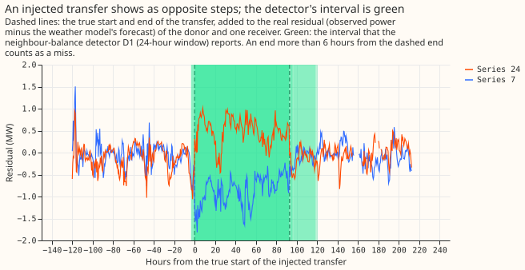

# Experiment 43: how well do the two existing switching detectors find transfers?

We asked how well two simple detectors, built in an earlier experiment, find a transfer of load
between two substations when we know it happened. We added known transfers to the real power
readings of the 16 Primary substations: 600 of them, in nine groups by size and length. A
detector gets credit for a transfer only if it puts the start within 2 hours of the truth and the
end within 6 hours (or 10% of the length). One detector looks at one substation. The other also
checks that a neighbour moves the opposite way. Each finds under a fifth of all the transfers and
under 30% in any group, and the neighbour check helps only when it looks for steps over 4 hours.

## Headline

**The neighbour check does not help over 24 hours: on large transfers lasting over a day, D1 finds
fewer than D0, so the hypothesis is refuted.** On the 160 injected transfers of 25% or more of the
receiving load lasting over 1 day, the 24-hour D0 finds 47 (0.29) and D1 finds 34 (0.21). D1 minus
D0 is -0.081 (95% interval -0.130 to -0.037, resampling whole calendar months), and the event F1
(which combines this recall with the alarms' precision) is 0.36 for D0 and 0.30 to 0.31 for D1. At
the 4-hour window the order reverses: D1 finds 40 (0.25) and D0 finds 26 (0.16), a difference of
+0.087 (+0.044 to +0.136). The pre-registered prediction that D1's 24-hour F1 lies in 0.30 to 0.60
and D0's in 0.15 to 0.45 holds, but the prediction that D1 beats D0 by at least 0.10 fails, and so
does the prediction that most misses are wrong ends: 50% to 71% of the headline events get no
interval with the right start, and a wrong end explains 13% to 21%.

## What the scoreboard measures

- **Detectors:** D0 looks at one series; D1 also requires a neighbour to step the opposite way.
  They are run at the 4-hour (8 half-hours) and 24-hour (48 half-hours) windows, at the four
  thresholds fixed in experiment 37 (D0 6.0 and D1 3.75 at 4 hours, D0 4.0 and D1 2.5 at 24 hours).
  An interval builder turns each alarm into a start and an end that a live system could know.
- **Found:** a detector interval on the donor or a receiver with a start within 2 hours of the
  truth and an end within the larger of 6 hours and 10% of the duration.
- **Event F1:** the harmonic mean of the share of injected transfers found and the alarms'
  precision. Precision comes from the real alarms, not the injections, so it does not depend on how
  many events we inject. It is a range, because the logs miss real switching.

| Setting | Alarms | Matching a logged closure | Not matching | Of the sample labelled visible | Precision |
|---|---|---|---|---|---|
| D0, 4 h window | 432 | 202 | 230 | 4 of 37 | 0.47 to 0.53 |
| D1, 4 h window | 444 | 187 | 257 | 2 of 37 | 0.42 to 0.45 |
| D0, 24 h window | 297 | 137 | 160 | 0 of 37 | 0.46 |
| D1, 24 h window | 110 | 59 | 51 | 3 of 37 | 0.54 to 0.57 |

The lower precision is the alarms that match a logged closure over all alarms. The upper adds the
unmatched alarms times the share of the labelled sample that was visible.

## Recall by band

**All four settings find more transfers that are large and long, and none exceeds 0.29 in any
band.** The table gives, for 600 injected transfers (55 per band, 160 in the headline band), the
share found, then the share whose start alone was found.

| Setting | All bands | Start only, all bands | Headline band | Start only, headline | Median end error |
|---|---|---|---|---|---|
| D0, 4 h window | 0.11 (64 of 600) | 0.16 | 0.16 (26 of 160) | 0.29 | 4.5 h |
| D1, 4 h window | 0.17 (99 of 600) | 0.22 | 0.25 (40 of 160) | 0.39 | 3.5 h |
| D0, 24 h window | 0.11 (65 of 600) | 0.18 | 0.29 (47 of 160) | 0.50 | 5.5 h |
| D1, 24 h window | 0.08 (47 of 600) | 0.13 | 0.21 (34 of 160) | 0.34 | 5.5 h |

**D1 finds almost no transfer that has no metered receiver.** In the headline band 84 of 160
transfers have no metered receiver (the load goes to a substation with no power readings). Where a
metered receiver exists, the 4-hour D0 finds 26 of 76 and D1 35 of 76, and the 24-hour D0 finds 35
of 76 and D1 32 of 76. Where none exists, the 4-hour D0 finds 0 of 84 and D1 5 of 84, and the
24-hour D0 finds 12 of 84 and D1 2 of 84. In the real operations, 28% of the sheets have no metered
side B.

**The end of a found transfer is known about a day late.** The median time from the true end to
the interval's end being known is 19.2 hours (D0, 4 h), 20.0 hours (D1, 4 h), 22.5 hours (D0, 24
h), and 24.0 hours (D1, 24 h). The post hoc variant of the interval builder from experiment 38
finds fewer at the 4-hour window (0.05 and 0.08) and about the same at 24 hours (0.11 and 0.07).

## Real labelled events

**Only 4 labelled real transfers meet the 25%, over-1-day condition, so the real-event result is a
count and carries no verdict.** They are 2 conserved and 2 one-sided (one of the one-sided was
called conserved and is reclassified because a substation's readings are mostly missing). The
24-hour D1 finds 1 of the 2 conserved, with the start found for both, and none of the one-sided. A
second set, chosen after seeing that count, is the 35 visible operations lasting over 1 day. Of the
35, the 4-hour D0 finds 1, the 4-hour D1 finds 3, the 24-hour D0 finds 2, and the 24-hour D1 finds 5
(starts alone: 2, 6, 11, and 9). Of the 10 conserved, the 24-hour D1 finds 3 and the 24-hour D0
finds 1. In which labeller band these 35 sit: 4 have a share of the receiving load of 25% or more
(the one band where the labeller finds 0.83), 5 have a known share under 25%, and 26 have an unknown
share. This recall measures a detector against what the labeller could see, not against all real
switching.

## Limits

- **Event F1 combines two sources.** Recall comes from injections and precision from the real
  alarms, so the F1 depends on the logs missing nothing that the labeller cannot see.
- **The injections are a model.** They follow experiment 41's generator (a drifting share, one to
  three receivers), added to a fixed weather model's residual, which does not refit on them.
- **The labelled alarm sample is small.** Visible counts of 0 to 4 in 37 give the upper
  precision bound wide uncertainty.
- **The residual needs ERA5 weather.** The detectors run retrospectively, about 5 days behind.

Code: `ml-experiments/00043-sw2-1-detector-scoreboard/`, with every number printed by
`e00043_report.py`. The reusable harness is `e00043_inject.py` and the matching rule
`e00043_score.py`.
