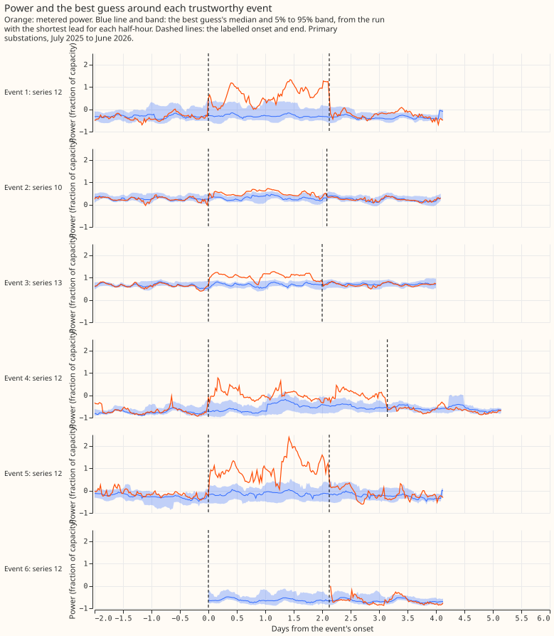
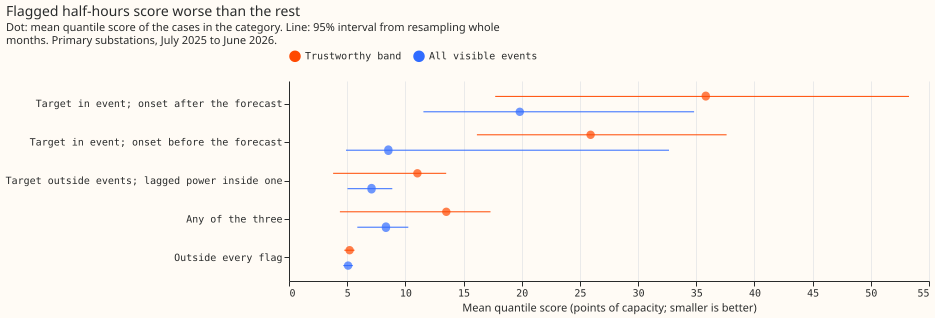
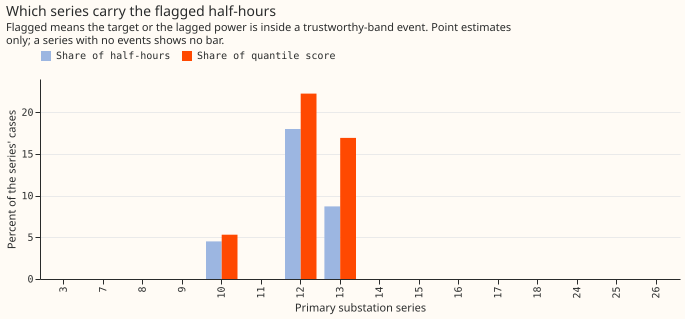
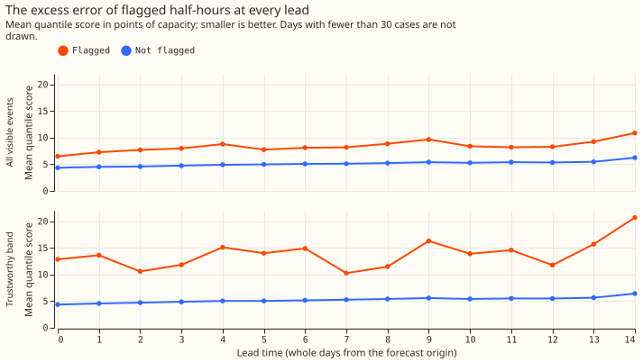

# Experiment 44: how much do labelled load shifts hurt the best guess?

Experiment 33 produced the best forecast it found of demand at the 16 Primary substations
(substations that step power down to the local distribution network), which we call the best
guess. We asked how much of the best guess's error, for July 2025 to June 2026, falls on half-hours
affected by a switching event, an operation in which engineers moved load from one substation to a
neighbouring substation. We split the summed error three ways: half-hours inside an event labelled
in experiment 41, half-hours outside every event whose lagged power (the earlier power readings the
forecast takes as inputs) falls inside one, and all other half-hours. We kept only the larger
transfers that lasted over 24 hours, the events that experiment 41's labeller finds most reliably.
The first two groups together are 1.35% of all half-hours scored and carry 3.4% of the summed error.
A perfect switching detector would lower the summed error by 0.42%, with a 95% interval from -0.47%
to 1.96%.

**Refuted: in the trustworthy band, a perfect detector would lower the quantile score by 0.42%
(95% interval -0.47% to 1.96%) and the tail score by nothing, against a threshold of 3% set in the
plan.** The *quantile score* is twice the mean pinball loss over nine quantile levels, as in
experiment 33, in points of capacity (1 point is 1% of a series' capacity). The *tail score* is the
threshold-weighted continuous ranked probability score (twCRPS) at each series' 99th percentile of
power, which counts only errors above that level. The *trustworthy band* is the visible events
that moved at least 25% of the receiving substation's load and lasted over 24 hours; experiment
41's labeller recovered 83% of the artificial transfers of that size and length that it was tested
on. The *perfect-detector bound* gives each flagged half-hour its series' mean score outside every
flag, so the bound is the largest reduction a detector could deliver. The plan is in [PR
#1261](https://github.com/openclimatefix/nged-substation-forecast/pull/1261).

Each cell below is a percentage of all half-hours scored (or of the summed quantile score), with the
95% interval in brackets. The first three rows sum to the fourth only to rounding.

| Trustworthy band | Share of half-hours | Share of quantile score | Mean quantile score |
|---|---|---|---|
| Target in an event, onset after the forecast was made | 0.12% (0.00 to 0.28) | 0.78% (0.00 to 2.04) | 35.8 (17.7 to 53.3) |
| Target in an event, onset before the forecast was made | 0.03% (0.00 to 0.07) | 0.15% (0.00 to 0.37) | 25.9 (16.1 to 37.6) |
| Target outside events, lagged power inside one | 1.20% (0.02 to 2.87) | 2.49% (0.02 to 6.26) | 11.0 (3.8 to 13.5) |
| Any of the three | 1.35% (0.04 to 3.22) | 3.43% (0.04 to 8.68) | 13.5 (4.4 to 17.3) |
| Outside every flag | 98.65% | 96.57% | 5.21 (4.76 to 5.63) |

**The prediction held for the two ratios and failed for the size.** Flagged half-hours are under 3%
of all half-hours (1.35%), and their score share is 2.5 times their half-hour share, above the
at-least-1.5 times the plan predicted. The flagged share did not reach the predicted 5% to 15%, and
the bound did not reach the predicted 1% to 5%.

**The intervals are wide because only 6 trustworthy events fall in the scored year.** The events lie
on the series with time_series_id 10, 12, and 13, with onsets in July, September, and October 2025
and June 2026. The other 13 Primary series have no trustworthy event in the year, so the result says
little about those 13 series. The intervals resample whole months of forecast origin, so they
understate that uncertainty.

## What a detector could and could not help

**Only two groups of half-hours are open to a detector.** They are the half-hours whose lagged
power falls inside an event, and those whose target falls in an event that started before the
forecast was made. The *metered view* scores the forecast against the power actually measured,
which includes the effect of the switching, and counts both groups. The *normal running
arrangement* (NRA) view scores against the power the electricity network would have carried
without the switching, so it counts only the first group, scored outside every event. The
*ceiling* also counts events that started after the forecast was made, which no detector can
anticipate.

For the quantile score, with the series-mean counterfactual, the bounds are:

- **Metered view:** 0.42% (-0.47% to 1.96%).
- **NRA view:** 0.34% (-0.51% to 1.79%).
- **Ceiling:** 0.96% (-0.30% to 3.42%).

The counterfactual that matches each flagged half-hour to unflagged half-hours of the same series,
forecast lead time, and hour of day gives the same point estimates to two decimals, and interval
ends within 0.02 points. For the tail score every bound is slightly negative (-0.85% for the metered
view), because the flagged half-hours have a lower tail score than the unflagged half-hours.

**The all-visible sensitivity, which uses every event the labeller found visible whatever its size
or duration, gives larger and far less certain figures.** In the scored year it holds 22 events on
11 series. Flagged half-hours are 7.4% of the total (3.8% to 11.3%) and carry 11.6% of the quantile
score (4.8% to 18.6%). The bounds are 2.35% (-0.22% to 5.73%) for the metered view and 4.11% (0.16%
to 8.34%) for the ceiling.

**The all-visible tail results rest on a few short events.** The flagged half-hours carry 55% of
the tail score (2% to 70%), far more than their 11.6% of the quantile score, and the metered tail
bound is 32.7% (-6.0% to 61.1%).

**Dropping the events that rest on one badly metered substation removes the effect.** Of the 22
trustworthy events in all years, 10 have a receiving or donating substation with over half its
readings missing during the event. Without them 2 trustworthy events remain in the scored year, and
every bound's point estimate lies between -0.3% and -0.1%.

## Caveats

- **Few events.** The decision rule was written in the plan before the scoring, and the verdict
  follows it. The month-resampling interval understates how little 6 events on 3 series can show.
- **The stored receiver shares are missing for most events.** The labelled set's
  `moved_share_of_receiver` is NaN (missing) for 62 of the 81 visible events that touch a Primary
  series (82 in all). The causes are that the labeller wrote some donor or receiver ids as strings
  and the share code dropped them, and that 20 events name no metered receiver. This experiment
  recomputes the share as the moved MW over the named receivers' mean absolute power in the 28 days
  before the onset. The recomputed share agrees with the stored share where both exist (for example
  0.33 against 0.34), but it ignores how the load splits between receivers, so it understates the
  share when a receiver takes only part of the load. The recomputed share exists for 61 events, of
  which 22 are 0.25 or more with a duration over 24 hours.
- **Slightly favourable detection time.** An event counts as known to a detector once the forecast
  origin (the time the forecast is made) passes its onset, but telemetry arrives 3 hours late, so
  the score is slightly too favourable for events that start less than 3.5 hours before the origin.
- **Nested lag definitions.** The correction's 14-day window (1.20% of half-hours) contains the three
  lags the forecast reads (0.48%), so the combined lagged-power group equals the window group.
- **Primary series only.** The labels cover the 16 Primary series, so the bulk supply point and
  grid supply point series, solar farms, and wind farms have no figure.

## Lessons for later experiments

- In this year, the labelled events do not justify a detector for the forecast error alone.
- Figures 2 and 4 show that the all-visible tail-score share rests on a few short events, which a
  first detector experiment could look at before it looks at the whole year.

Numbers come from `e00044_score.py` and `e00044_report.py`, and figures from `e00044_charts.py`.
