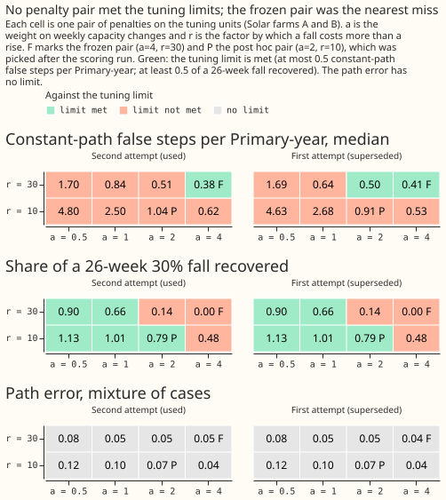
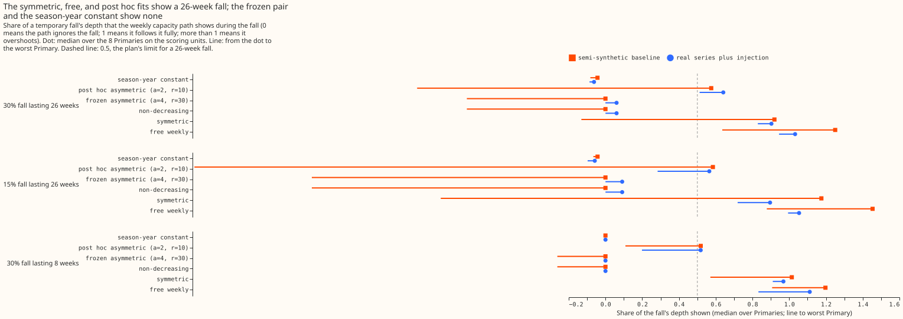
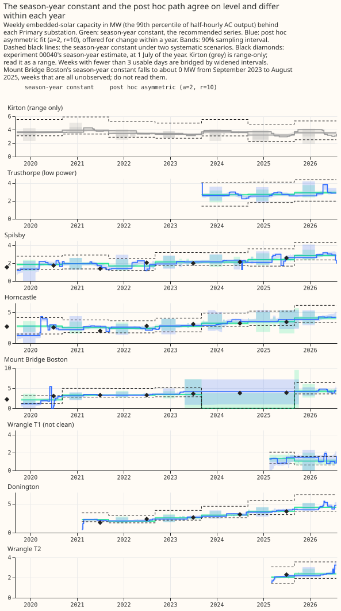

# Experiment 45 (PVDIS-4): a weekly capacity series that rises easily and falls reluctantly

**A solar-capacity estimate that may change every week did not follow injected changes better than a
capacity held constant within each season-year, and no single pair of penalty settings was both
quiet enough on noise and quick enough to follow a real fall.** We asked whether the amount of
embedded solar behind each of 8 Primary substations (substations that feed 11 kV circuits from the
33 kV network) can be tracked week by week. Embedded solar is solar connected inside the
distribution network, mostly unmetered by NGED, and its capacity here means the 99th percentile of
its half-hourly AC output, in MW. To test this, we added the recorded output of real solar farms
to each substation's demand in known amounts on known dates (steps up, ramps, and temporary
falls), and measured how far each method's weekly capacity lay from the known amount. The
measure is the path error: the mean absolute gap between the fitted and the true weekly capacity,
as a share of the true mean capacity. The median path error on ramps and steps was 0.027 for the
season-year constant (a season-year is one 12-month period), 0.040 for the frozen weekly fit
with penalties, and 0.159 for a weekly fit with no penalty.

**The result rules out one global pair of penalties, and it narrows the search to two designs.** The
penalty pair that stayed quiet on noise (the frozen pair, a=4 and r=30, defined below) never let
the capacity fall: it recovered 0.000 of a 30% fall lasting 26 weeks. It still produced a median of
0.66 false steps of 10% per Primary-year on a constant capacity, against a limit of 0.5. A looser
pair chosen after the scoring run (a=2 and r=10) recovered 0.576 of that fall, but produced a
median of 1.22 false steps per Primary-year. The designs left to try are a penalty chosen per
Primary and scaled by that Primary's weekly noise, or the season-year constant plus detection of
steps only above about 25% to 30% of capacity.

**Four further findings limit what the series can be used for.** The smallest step that any
weekly fit detected in 80% of injections is above 25% of capacity at all 8 Primaries in both
seasons. The latest week of a real-time estimate had 3.63 times the path error of the same week in
the final fit. The 90% intervals covered 0.62 of the weeks without a step and 0.35 of the weeks with
one. The three outside checks (national statistics, the Feed-in Tariff register, and the Embedded
Capacity Register) each count only part of the installed solar, so they can neither confirm nor
refute the series. The experiment could not tell whether a real fall in capacity, such as a feeder
reconfigured permanently, would be seen by a better-tuned penalty, because the one pair that
followed falls was chosen after the fact.

**The verdict is `refuted`: no pair of penalties on the grid met the pre-registered tuning limits,
so the asymmetric design is refuted on this grid.** The plan's decision rule tests its clauses in a
fixed order, and read literally that order gives `inconclusive`, because the first clause (the
smallest detectable step exceeds 25% of capacity at 5 or more Primaries in every season) holds. The
clause was evaluated on a degenerate pair. With no feasible pair, the frozen configuration fell
back to the pair nearest the limits (a=4, r=30), which scores the same as the strictly
non-decreasing fit and detects 0.28 of steps from April to September and 0.23 from October to
March. `refuted` applies for two reasons. The plan says that when no pair on the grid meets both
tuning limits, the verdict is `refuted` for the asymmetric design and the limits are not relaxed.
And the detection failure belongs to the penalty, not to the data: the free weekly fit detected
0.85 of steps from April to September and 0.75 from October to March, at the price of a median of
11.6 false steps per Primary-year.

## What was fitted, and how the tuning went wrong once

**Each weekly fit explains daylight power as a demand term minus one capacity per week times a solar
shape from the Copernicus Atmosphere Monitoring Service (CAMS), and the penalised fits charge for
each weekly change.** The frozen pair is a=4 and r=30: `a` scales the penalty on a weekly rise in
capacity (in units of one weekly standard error), and `r` is the factor by which a fall costs more
than a rise. The comparison fits are a weekly capacity with no penalty (free weekly), a symmetric
penalty (r=1), a strictly non-decreasing capacity (r=infinity), and the season-year constant. The
penalty pair was chosen on tuning units (Solar farms A to C) and scored once on scoring units
(Solar farms D to F, 1,320 of the 1,344 planned units, because Solar farm E's record is too short
for 24 injections at Mount Bridge Boston).

**The first tuning attempt was invalid and was redone.** Its semi-synthetic baseline subtracted the
real series' fitted weekly capacity, which removed the weekly noise that is correlated with the
solar shape, so the baseline was too clean. The second attempt subtracts the season-year constant
fit, which keeps that noise, and scores the fit of baseline plus injection against the known path.
The constant-path unit was also redefined after the first attempt's tuning results were seen. It
first injected a constant capacity into a baseline that still held real growth within each year, so
real rises counted as false steps. It now permutes the solar shape among the days of each calendar
month (the placebo sky), so the true path is constant. The change was made on tuning units only,
and the scoring units were never fitted before the pair was frozen. Neither attempt found a pair
that met the limits, as the table shows.

| a | r | Path error, mixture (second attempt) | Constant-path false steps, median (second attempt) | 26-week fall recovered (second attempt) | Largest excess over a limit (second attempt) | Constant-path false steps, median (first attempt) | Largest excess over a limit (first attempt) |
|---|---|---|---|---|---|---|---|
| 0.5 | 10 | 0.119 | 4.800 | 1.132 | 7.182 | 4.630 | 7.239 |
| 0.5 | 30 | 0.083 | 1.696 | 0.903 | 4.149 | 1.691 | 3.806 |
| 1 | 10 | 0.096 | 2.500 | 1.006 | 5.751 | 2.677 | 5.866 |
| 1 | 30 | 0.054 | 0.841 | 0.657 | 1.975 | 0.636 | 1.975 |
| 2 | 10 | 0.066 | 1.043 | 0.787 | 2.719 | 0.915 | 2.662 |
| 2 | 30 | 0.046 | 0.511 | 0.135 | 1.517 | 0.499 | 1.377 |
| 4 | 10 | 0.045 | 0.620 | 0.476 | 1.117 | 0.529 | 1.141 |
| 4 | 30 | 0.045 | 0.382 | 0.000 | 0.888 | 0.414 | 1.141 |

**The limits are at most 0.5 false steps at the median Primary, at most 1.0 at the worst Primary,
and at least 0.5 of a 26-week fall recovered.** The excess column gives the largest amount by which
a pair misses any limit, in the units of that limit. Pairs that follow a fall (the r=10 rows with
`a` up to 2) are far too noisy, and pairs that stay quiet (the a=4 rows) do not follow a fall.
The pair a=4, r=30 had the smallest excess in the second attempt, so the configuration was frozen
there as a fallback, and it is the pair called "frozen" below. The pair a=2, r=10 (the pair the
first attempt had frozen) was scored afterwards on the same scoring units, so every number for it is
post hoc, and it is not part of the verdict.

**Figure 6 shows that no cell of the grid is green in both rows of false steps and fall recovery.**
The frozen pair is marked F and the post hoc pair is marked P.

## Scores on held-out injections

**No weekly fit beat the season-year constant on ramps and steps in the semi-synthetic baseline,
and the free weekly fit was the worst.** The table gives each fit's absolute score on the scoring
units. Scores are medians over farm-seeds and cases within a Primary, then medians over the 8
Primaries. False steps are of 10% of capacity per Primary-year on the constant path, as median and
worst Primary. Drift is the rise of the path over 5 years on a constant path, as a share of
capacity. The fall column is the share of a 30% fall lasting 26 weeks that the path shows (0 means
the path ignores the fall and 1 means it follows the fall fully).

| Fit | Path error, ramps and steps (semi-synthetic) | Path error, ramps and steps (real series plus injection) | False steps, constant path (median, worst) | Drift on constant path | 26-week fall recovered |
|---|---|---|---|---|---|
| Season-year constant | 0.027 | 0.020 | 0.17, 0.25 | -0.037 | -0.043 |
| Frozen asymmetric (a=4, r=30) | 0.040 | 0.017 | 0.66, 1.43 | +0.137 | 0.000 |
| Strictly non-decreasing | 0.040 | 0.016 | 0.66, 1.43 | +0.137 | 0.000 |
| Symmetric (r=1) | 0.102 | 0.012 | 3.01, 6.29 | -0.026 | 0.920 |
| Free weekly | 0.159 | 0.014 | 11.60, 12.27 | -0.019 | 1.250 |
| Post hoc (a=2, r=10) | 0.064 | 0.013 | 1.22, 3.32 | +0.055 | 0.576 |

**The frozen pair fails five of the six pre-registered conditions.** Condition (i), a median path
error of at most 0.15 on ramps and steps, passes at 0.040. A flat path that detects nothing scores
0.097 there, so condition (i) is nearly trivial. Condition (ii), the relative change in path error
against the season-year constant (C2), is +0.400 (95% interval -0.078 to +0.773) and needed an
upper limit below -0.20. Condition (iii), false steps, fails at a median of 0.66 and a worst of
1.43 on the constant path (the placebo sky gives 0.07 and 0.54). Condition (iv), the drift, is
+0.137 on the constant path and +0.090 on the placebo sky against a limit of 0.05. Condition (v),
the fall, recovers 0.000 of a 26-week fall and 0.000 of an 8-week fall. Condition (vi), interval
coverage, is 0.620 of non-step weeks and 0.347 of step weeks.

**Figure 7 shows the path error by family of injected change.** For ramps the season-year constant
scores 0.032 (95% interval 0.027 to 0.053), the frozen fit 0.041 (0.034 to 0.053), and the free
weekly fit 0.151 (0.104 to 0.239). For steps the scores are 0.024 (0.018 to 0.043), 0.037 (0.026 to
0.052), and 0.164 (0.107 to 0.251). On the real series plus injection every fit scores between
0.009 and 0.026 on ramps and steps, because that scoring compares paths fitted with and without the
injection. The verdict uses the worse of the two scorings.

**The penalty does most of its work against noise: the frozen fit cut the free weekly fit's path
error by 0.12.** On steps of 10% or more, the frozen fit's path error minus the free weekly fit's
is -0.120 (95% interval -0.212 to -0.069), and on ramps -0.110 (-0.198 to -0.066). The frozen fit
and the strictly non-decreasing fit differ by 0.000 (-0.002 to 0.000) on temporary falls. The
frozen pair is the strictly non-decreasing fit in practice.

**Figure 9 shows that only the symmetric, free weekly, and post hoc fits follow a fall.** The post
hoc pair recovered 0.576 of a 30% fall lasting 26 weeks and 0.518 of one lasting 8 weeks, so it
also follows a short fall, which the plan wanted held back (below 0.5).

**The smallest detectable step is above 25% of capacity.** At the frozen pair, 6 of the 8 Primaries
have no step size (5%, 10%, 20%, or 30%) detected in 80% of injections in either season, and 2
Primaries (Donington and Wrangle T2) reach 30% from April to September only. A 10% step, which was
the step the series was meant to show, is detected in 0.00 to 0.33 of injections at every Primary.
The detection curves are in [figure 8](figure_08.svg).

**A real-time estimate is worse than the final fit.** On injections, the latest completed week of a
real-time vintage has a path error of 0.122, against 0.027 for the same week in the final fit
(ratio 3.63, limit 2.0). The ratio falls to 2.43 at 8 weeks of age, 1.95 at 13 weeks, and 1.63 at 26
weeks ([figure 12](figure_12.svg)).

**The intervals under-cover.** The 90% residual block bootstrap refits the whole path and covered
0.620 of non-step weeks and 0.347 of step weeks for the frozen pair, and 0.708 and 0.470 for the
post hoc pair, against the plan's 0.85 to 0.95 and at least 0.60 ([figure 13](figure_13.svg)).
Every interval is clipped to include the point estimate, and the clipping touched 12.0% of observed
weeks for the post hoc pair, 3.4% for the frozen pair, 1.4% for the free weekly fit, and 0.0% for the
season-year constant.

## On the real series

**On the real series the free weekly fit swings too much to read, and the season-year constant is
the series to read.** The count of weekly changes of 2% of capacity or more at Kirton is 105 rises
and 113 falls for the free weekly fit over 359 weeks, 12 rises and 17 falls for the post hoc pair, 1
rise and 0 falls for the frozen pair, and 3 rises and 3 falls for the season-year constant. The
season-year constant rises from 2.294 to 4.400 MW at Donington and from 2.080 to 4.241 MW at Mount
Bridge Boston (means of the first and last 4 observed weeks). The recommended series for SW2-10 is
the season-year constant, chosen after the held-out scoring results were seen.

**Figure 14 shows that the two series agree on level and differ within each year.** Mount Bridge
Boston has 198 unobserved weeks of 354 (weeks with fewer than 3 usable days), and its season-year
constant falls to about 0 MW from 2023-09-04 to 2025-08-25 (104 weeks, all unobserved). Those weeks
must not be read.

**The outside checks are partial counts and are descriptive.** Of the 14 level comparisons against
the national small-scale solar statistics (DESNZ), 3 pass, 9 fail, and 2 are report-only. Of the 27
Primary-years, the season-year constant lies inside experiment 00040's interval in 18, below the
plan's 80% bar. The Embedded Capacity Register total is at or below the series' upper bound at 6 of
6 comparisons. Only the DESNZ local-authority series could be tested for growth (1 pass and 5
inconclusive), and the Feed-in Tariff register and the constituency table could not. Every source
is a floor or a partial count,
so a ratio below 1 is expected and a mismatch does not show the series is wrong
([figure 16](figure_16.svg)).

## Limits that remain

The review of the code left these limits in place. Each affects how far a number can be trusted.

- **The detection metric has no false-alarm control.** A fit that rises at every week would count
  as detecting every step.
- **Condition (i) is nearly trivial.** A flat estimator scores 0.097 on ramps and steps, against
  the limit of 0.15.
- **Path error and false steps are scored on observed weeks only.** Mount Bridge Boston has 198 of
  354 weeks unobserved.
- **The post hoc intervals are clipped to the point estimate in 12.0% of weeks.**
- **The constant-path false-step threshold is reported on two bases.** The median at the frozen pair
  is 0.66 when a step is 10% of the real series' mean capacity and 0.36 when it is 10% of the
  injected capacity. The post hoc pair gives 1.22 and 0.77. The condition uses the first basis.
- **The season-year constant's own sampling error cancels by construction,** because the baseline
  subtracts the season-year constant fit, which favours that arm on the semi-synthetic baseline.
- **The drift limit has a floor for short series,** and Wrangle T1 and T2 have only 76 and 74 weeks.
- **The post hoc pair was chosen and scored after the frozen pair failed.** No number for it
  carries the weight of a pre-registered score.

## Figures

The four figures above carry the argument. The others are linked here.

- Figure 1: [Raw: the model-free trend of the midday clear-minus-overcast gap](figure_01.svg)
- Figure 2: [Raw: one clear and one overcast week, in summer and winter](figure_02.svg)
- Figure 3: [Raw: usable daylight half-hours per Primary-week](figure_03.svg)
- Figure 4: [Raw: the free weekly capacity and its standard error by month](figure_04.svg)
- Figure 5: [Method: one injected path through five fits](figure_05.svg)
- Figure 8: [The detection curve by step size and season](figure_08.svg)
- Figure 10: [Transfers and seasonal load](figure_10.svg)
- Figure 11: [False steps on the placebo sky and the constant path, and the drift](figure_11.svg)
- Figure 12: [Real-time vintages](figure_12.svg)
- Figure 13: [Interval calibration](figure_13.svg)
- Figure 15: [The gap between the asymmetric and symmetric paths on the real series](figure_15.svg)
- Figure 16: [Outside checks](figure_16.svg)
- Figure 17: [Additivity of the fit](figure_17.svg)

The experiment's printed reports and every number on this page are in the private folder
`data/ml-experiments/00045-pvdis-4-weekly-capacity-asymmetric-l1/` (`report.txt` is the combined
report).

## Plan

### The question and why it is worth asking

**The question is whether a weekly series of embedded solar capacity behind each Primary substation
can be estimated well enough to show real steps and no invented ones.** Experiments 00039 and 00040
gave one capacity per season-year, with a detection limit near 2.5% of capacity. NGED holds almost no
information on unmetered solar, and a capacity that changes week by week would show when a large
rooftop fleet or a farm below 1 MW connects. A free capacity per week would be too noisy. The
standard error of a season-year, 1.2% of capacity, implies about 8.7% per week on average (1.2%
times the square root of 52), and far more in winter, when the sun is low. A penalty on the weekly
increments lets neighbouring weeks share evidence, so that the path steps only where the data support
a step.

**The maintainer decided that capacity may fall but reluctantly.** The fit estimates the solar that
the Primary's meter sees, which can fall when home batteries charge from midday solar, when a feeder
is permanently reconfigured, or when a solar site is switched off for repairs. A strict
non-decreasing constraint would lower past capacity to fit a fall. The penalty on a fall is
therefore heavy and finite.

**The aim is explanation and a capacity series, not forecast skill.** Nothing here touches the
production forecast. Experiments 00007, 00009, 00022, and 00031 found small or no forecast gains from
solar inputs, and PVDIS-5 tests the forecast question using the vintages this experiment produces.

### Size, answered against the five triggers

The experiment is **complex**, because three of the five triggers fire.

- **What gets stored: yes.** A private weekly capacity table and a table of real-time vintages under
  `data/ml-experiments/00045-pvdis-4-weekly-capacity-asymmetric-l1/`, which SW2-10 reads. Nothing
  enters a production Delta table.
- **The production serving path: no.** Not touched.
- **A degradation rule: no.** Not touched.
- **More than one defensible design: yes.** The estimator (half-hourly M1, daily sums, or the
  six-arm combination), the form of the penalty, the placement of the demand cells, and the
  bootstrap scheme each admit more than one defensible choice. The plan fixes each choice and
  gives the reason.
- **Code whose callers cannot be named without searching: yes**, for one work item. The register
  loader moves from experiment 00031's folder into `packages/studies`, and that change is a
  separate reviewed pull request (work item W0).

The process is therefore the full one: this Opus plan, a Sonnet code review before the run, Sonnet
runs and write-up, a Sonnet check of the write-up against the printed report, and a Sonnet prose
review. Opus reviews the result when it decides the next part of the series.

### Earlier advice, followed and departed from

**The plan follows nine items of earlier advice and departs from none.**

- **Followed:** "Divide capacities fitted with M1 by 0.77" (00039): the series is divided by a
  recovery ratio measured on injected paths. "Do not read a capacity at Kirton as PV alone" (00039):
  Kirton keeps its status flag in every output. "Leave out the 8 MVA Primaries" (00039): the
  series covers the 8 Primaries metered in MW. "Treat injection as a test of the PV shape and the
  irradiance only" (00039): a penalised, constrained fit is nonlinear, so the plan scores the
  path difference and a semi-synthetic baseline, and adds an additivity check. "Leave Wrangle T1
  out of any claim that a Primary is free of a cloud load" (00040): the status column says so. "Do
  not quote an embedded-solar capacity without a stated bound" (00040): three uncertainty terms are
  stated and never summed. "Report C as the capacity and keep M1d divided by R as a cross-check"
  (the experiment 00040 review): the weekly series is checked against C. "Calibrate ENS irradiance
  to CAMS" (00031): the weekly series uses CAMS only, and PVDIS-5 owns the calibration. "Treat the
  register as a weak prior at Primaries" (00031): the register check is a soft check.

### Hypothesis and the five design choices

**The estimator is the half-hourly fit M1, with one capacity per week and one set of demand cells
per season-year.** The fit is

power = cell(season-year, month, local half-hour, day type) + b times heating degree-days - c(w)
times u + error,

where `u` is experiment 00039's unit PV shape from CAMS (the Copernicus Atmosphere Monitoring
Service) at the Primary, `c(w)` is the capacity of
week `w` (weeks start on Monday, Europe/London), and the cells are those of experiments 00039 and
00040. A season-year is the 12-month period that experiments 00039 and 00040 used for one capacity.
Keeping the cells per season-year means a slow rise in base demand cannot leak into the
capacity, and it keeps the recovery ratio of the weekly fit comparable with the season-year ratio.
The drawback is that a step at a month boundary is partly absorbed by the cell mean, so the injections
include steps placed on month boundaries (risk 2).

**M1 is chosen over the daily fit and the six-arm combination for three reasons.** The daily fit
leaks a day-long cloud load at 3.4 MW per MW, against 2.2 for M1, so a weekly daily-sum fit has seven
points per week and the highest exposure. The six-arm combination needs a ratio vector and a
noise bootstrap for every arm at every week. The half-hourly fit recovers 0.77 of injected capacity,
which the series corrects by dividing by a measured ratio. The season-year mean of the weekly
series is checked against the six-arm C of experiment 00040 (check A0), so the series stays tied to
the estimate that carries a bound.

**The penalty is asymmetric L1 on weekly increments, with the capacity held non-negative.** The
objective is

0.5 times the squared residual, over the residual variance, plus `lambda_up` times the sum of the
rises plus `lambda_down` times the sum of the falls.

The problem is convex. The penalty is `lambda_up = a` times a Primary scale `s_P` and `lambda_down =
r` times `lambda_up`. The scale `s_P` is the median over weeks of the free weekly fit's standard
error, so that `a` is in units of one weekly standard error. For the scoring of a real-time
vintage, `s_P` and the recovery ratio are computed from data up to the vintage's origin only, never
from the full record. The grid is `a` in {0.5, 1, 2, 4} and `r` in {10, 30}, so the fall-to-rise
penalty ratio is at least 10 (the maintainer decided that falls are heavily penalised). The same
`(a, r)` applies to every Primary, to stop one Primary's noise from setting its own penalty. The
comparison fits are `r = 1` (symmetric L1), `r = 3`, `r = infinity` (strictly non-decreasing),
`a = 0` (free weekly), and the season-year constant. No convex-optimisation package
is installed, so the solver is a short ADMM routine in numpy, checked against `scipy.optimize.linprog`
in the self-tests (risk 13). The demand cells are projected out once per Primary, so the fit needs
only the weekly normal matrix (about 360 by 360) and one vector per series.

**The tuning rule picks one `(a, r)` pair on tuning units.** The pair minimises the median path
error over a mixture of ramps, steps, and a constant path, subject to two limits: at most 0.5 false
steps per Primary-year on the placebo sky and on constant injected paths from the tuning farms A to
C, and a 30% fall lasting 26 weeks recovered at 0.5 or more of its depth. Ties go to the larger
`a`. The tuning limits are the same as conditions (v) and (iii), so the scoring on farms D to F
tests generalisation to new farms and path seeds only. If no pair on the grid meets both limits,
the verdict is `refuted` for the asymmetric design, and the limits are not relaxed after any score
is seen. The pair is written to `frozen_config.json`. The tuning script and the scoring script are
separate commits, and the scoring script has never run before the commit of the frozen file.

**The capacity unit is the 99th percentile of half-hourly AC output of the fleet, as in experiments
00039 and 00040.** Installed DC capacity is larger. The conversion to DC is part of the outside
check against DESNZ.

### Data, weeks, and masks

- **Series.** The 8 Primaries metered in MW (time series 7 Trusthorpe, 8 Horncastle, 10 Spilsby, 12
  Wrangle T1, 13 Wrangle T2, 16 Mount Bridge Boston, 17 Kirton, and 18 Donington) and the 6 solar
  farms as injection sources. The farms appear only
  as "Solar farm A" to "Solar farm F" (`studies.pv_dataset.pv_sites()` labels), and their output is
  always normalised by the farm's own 99th percentile, never published in megawatts.
- **Inputs.** The `frame.parquet` of experiment 00039 (cleaned power, CAMS unit shape and
  irradiance at reliability 0.9 or more, ERA5 temperature, zenith under 75 degrees), read from
  `data/ml-experiments/00039-pv-disaggregation-cams-injection/work/`. Reading another
  experiment's private output is allowed. Importing its code is not, so the model code is copied
  into this folder for the third time (risk 7).
- **Weeks.** 361 weeks from Monday 2019-09-02 to Monday 2026-07-27 (the last has 5 days). Each
  Primary starts at its first week with at least 3 usable days. A week with fewer than 3 usable
  days is `unobserved`: the fit has no data term there, the penalty interpolates, and the output
  marks the row and widens its interval.
- **Switching mask.** The logged closures, padded by 24 hours, are removed from every fit. The
  intervals come from experiment 00037's `intervals.parquet`, and the log ends on 2026-03-25.
  SW2-0b's labels replace the logs once they exist. Unlogged transfers stay in the data and are
  injected as a case. The first unit (U1) found four facts that the design must handle:
    - The logged-closure mask removes 40 to 48% of the daylight half-hours at Mount Bridge Boston,
      Wrangle T1, and Wrangle T2.
    - 871 of the 2,166 farm-weeks drop out of injection, mostly at Solar farm E.
    - Kirton's correlation of power with `u` peaks at 08:00 UTC, not near 12:00 UTC.
    - The weekly fits must therefore tolerate weeks in which most daylight half-hours are masked,
      and Kirton is reported without a pass or fail.
- **Polygons.** The check already run in `e00045_polygon_check.py` found 16 valid Primary polygons,
  overlaps under 0.3% of the smaller polygon, Mount Bridge Boston's point 95 m outside its
  polygon, and Wrangle T1 and T2 sharing one polygon. Wrangle T1 and T2 keep separate fits and are
  summed for any comparison against the shared polygon.
- **Validation before fitting.** Row counts per Primary-week, duplicate keys, the hour-of-day
  profile of the correlation of power with `u` (peak near 12:00 UTC), the share of CAMS hours
  dropped per week, the timestamp scan (the injected recovery must peak at shift zero), and the
  count of unobserved weeks. The same step prints each of the six solar farms' date coverage
  against the 361 weeks. A farm-week in which the farm's output is missing on more than 2 days
  is dropped from that farm's injection units, and the number dropped is reported.
  The `data-validation` skill lists the checks.

### Known-answer injection design

**Every scored result comes from injected paths whose truth is known, scored on farms and path
seeds that were not used for tuning.** The hold-out is by farm and path seed only. The tuning
and scoring units share the same 8 Primaries, dates, baseline noise, and demand cells, so the
scoring tests generalisation to new farms and path seeds at the same Primaries, not to new
Primaries. The main interval therefore resamples Primaries, and results are reported per Primary.
The design has five parts.

- **The baseline is semi-synthetic.** For each Primary, the baseline series is the real power minus
  the full-record fitted PV component (so it holds demand, noise, and any confound), plus a known
  baseline PV path equal to the Primary's 2025/26 capacity from experiment 00040 times `u`. The true
  capacity of every week is then known, level included. Removing the fitted PV component also
  removes any confound that is correlated with the PV shape, so recovery on this baseline is
  optimistic against experiment 00039's recovery ratio of 0.77 on real data. A second scoring uses
  the real series with the injected path added, and compares the fitted path with and without the
  injection, because the production series is fitted to real data that already holds unknown
  solar. Condition (i) is scored on both baselines and both are reported; the verdict uses the
  worse. The gap between the two scorings measures the departure from additivity.
- **Injected change.** The injected output is minus the normalised output of one solar farm scaled
  by the true path, so that its 99th percentile equals the path's value in MW. Farm output is
  normalised, never published in megawatts.
- **Cases.** Each path is drawn with a fixed seed.
    - Ramp: a rise of 25% or 50% of the baseline over 52 weeks.
    - Step: a rise of 5%, 10%, 20%, or 30% at a random week, with half the steps placed in April to
      September, half from October to March, and one in four on a month boundary.
    - Temporary fall: 30% for 8 weeks and 30% for 26 weeks, and a 15% fall for 26 weeks.
    - Transfer: a share of 0.3 of another Primary's net power (including its solar) added for 30
      days, once inside the 24-hour padded mask and once outside it, so that the size of the error
      from an unlogged transfer is measured. The truth is the share times the donor's baseline capacity.
    - Seasonal load: a daytime load (08:00 to 20:00 local) of 10% of the baseline capacity with a
      summer-weighted yearly cycle, once independent of the weather and once scaled by the clear-sky
      index (a load that rises with sunshine). The truth is the unchanged baseline, so the score
      is the seasonal swing that creeps into the capacity path.
    - Constant path: a constant capacity equal to the baseline. Its false steps and ratchet drift
      are scored, together with the placebo sky. **Design change: the constant-path unit is built on
      the placebo sky, not from a farm's injected output.** The PV shape `u` is permuted among the
      days of each calendar month, and the baseline capacity times the permuted shape is subtracted
      from the real power. The real series' own growth is then uncorrelated with the permuted shape,
      so the true path is constant. The recovery ratio of the constant-path unit is fixed at 1,
      because the unit is built from the PV shape itself and not from a farm's output. The farm and
      the path seed still change the rows that the farm's gaps leave, and the path seed also
      changes the permutation.
- **Hold-out.** The tuning units use Solar farms A, B, and C and path seeds 0 to 3. The scoring
  units use Solar farms D, E, and F and path seeds 1000 to 1003, at all 8 Primaries. The unit count
  is 3 farms times 4 seeds times 8 Primaries times 14 cases (2 ramps, 4 steps, 3 temporary falls,
  2 transfers, 2 seasonal loads, and 1 constant path) = 1,344 units in each set. Solar farm E, the
  worst case at 0.70 recovery, falls in the scoring set on purpose, and results are also reported
  without it. The recovery ratio of each Primary is measured on tuning units with a constant
  injected path and applied unchanged to the scoring units.
- **Intervals.** The main interval is a cluster bootstrap that resamples the 8 Primaries, 2,000
  draws, at the 95% level. A two-way cluster bootstrap (Primaries and farms resampled
  independently) is reported beside it. With three scoring farms the farm margin is coarse, so the
  write-up also reports the seed-level spread.

**Real-time vintages are scored on the same semi-synthetic units.** The fit is repeated at origins
every 4 weeks over the last 3 years of the record, each truncated at its origin, with the Primary
scale `s_P` and the recovery ratio recomputed from data up to that origin, and the latest
complete week of each vintage is scored against the truth. The write-up reports the path error of
that week against the same week in the final fit, and the revision of the first estimate by the
age of the week (1, 2, 4, 8, 13, and 26 weeks).

**The bootstrap is a residual block bootstrap that refits the whole path.** Each draw resamples
whole 7-day blocks of the penalised fit's residuals, taken from the same calendar month of any
year of the Primary's record (so that winter noise stays winter-sized), adds them to the fitted
values, and refits the path with the frozen penalties. Missing half-hours take a residual of zero.
Each Primary and variant gets 200 draws for the real series, and each injection unit gets 100.
The 5th and 95th percentiles give the 90% interval, and the 25th and 75th and the 10th and 90th
give the calibration curve. The coverage of the truth is scored on 96 scoring units (the case
families with a step, a ramp, a fall, and a constant path), separately at weeks with no true step
and at weeks within 2 weeks of a true step. A bootstrap of a penalised fit at a boundary tends to
under-cover, and the decision rule counts that as a finding. If coverage at non-step weeks is under
0.85, the write-up reports an inflation factor chosen on tuning units, labelled post hoc.

**False steps are counted on two skies.** One is experiment 00039's placebo sky, which permutes
the PV shape `u` across days within each month (200 permutations per Primary) and leaves the
power in place, so that the day-to-day link between cloud and power is broken and any step is false
by construction. A placebo step is also ignored in any week within 4 weeks of a rise of 10% or more
in the unpermuted real series, so that a real growth step is not counted as false. The other is the
constant injected path, whose baseline holds no real growth. A false step is a rise of at least 10%
of the Primary's mean real capacity over any 4 consecutive weeks (5% is reported as well). Both
skies also report the ratchet drift. Conditions (iii) and (iv) are scored on both skies, on farms D
to F for the constant path and on permutation seeds 1000 to 1099 for the placebo sky. Tuning uses
farms A to C and permutation seeds 0 to 99.

**The detection limit** of each Primary is the smallest step on the grid (5%, 10%, 20%, 30%) that
the path shows as a rise of at least half the step within 3 weeks of the true date in at least 80%
of the scoring injections. It is reported for April to September and for October to March
separately.

### Real series, three uncertainty terms, and the gap diagnostic

**The real weekly series is fitted on all of a Primary's data, then divided by that Primary's
recovery ratio.** The production-style output is the real-time vintage at weekly origins, so a
forecast date reads only what was known on that date.

**The uncertainty statement keeps three terms apart and never sums them.**

1. Sampling: the 90% residual-block-bootstrap interval of the weekly capacity.
2. Transfer from farms to rooftops: a scenario of plus or minus 10%, from experiment 00040's
   clean-Primary ratio of the daily to the six-arm capacity (0.92) and its per-farm spread.
3. Undetected demand: two named scenarios from experiment 00040's table, an undetected day-long
   cloud load (capacity too high by the Primary's bound B at amplitude 0.25) and a load that rises
   with sunshine (capacity too low by 33% at amplitude 0.25).

**The gap diagnostic compares the asymmetric path with the symmetric one on the real series.** A
Primary is flagged when the mean gap between the two paths is 5% of its capacity or more, or when
the symmetric path falls by at least 10% for 8 weeks or more and the asymmetric path does not. The
5% threshold is the weekly detection floor predicted for a summer step. The flagged falls are listed
for SW2-0b to check against switching labels. The write-up never presents a held fall as a real
fall.

**Status per Primary is carried from earlier results.** Kirton is `flagged` and its series appears
with a grey band and the library range of experiment 00040 (1.2 to 4.4 MW in 2025/26). Trusthorpe is
`low-power`. Wrangle T1 is `left-out` of any claim that a Primary is free of a confound. The others
are `clean`. Most coastal Primaries (Skegness, Ingoldmells, and Chapel St Leonards) are metered in
MVA and outside this experiment.

### Outside checks and tolerances, stated before any comparison

**Three outside checks and one internal check are run, in order of strength. None alters the verdict.**

**None of the outside photovoltaic datasets is complete.** The DESNZ tables, the Ofgem Feed-in
Tariff (FiT) register, and the Embedded Capacity Register (ECR) each count a subset of the installed
capacity, and the FiT database has not been updated for several years. Each outside figure is
therefore a floor or a partial count. A mismatch between an outside figure and the weekly series
does not show that the series is wrong, so every outside check is descriptive and cannot decide
the verdict. The measured coverage gaps are these. The FiT report covers accreditations from 1
April 2010 to 31 March 2025, and its latest photovoltaic commissioning date is 24 March 2021 (the
scheme closed to new applicants on 31 March 2019). The DESNZ constituency table is published for
August 2026 and covers domestic installations only. The DESNZ local-authority table is at the end
of 2025. The ECR as-of date is printed by the check, and the check reports it beside its result.

1. **DESNZ small-scale solar, at constituency and local-authority level.** DESNZ publishes no table
   by lower-layer super output area (LSOA). We searched the DESNZ "Solar photovoltaics deployment"
   workbook (Energy Trends table 6.3), the "Renewable electricity by local authority" workbook, and
   the DESNZ sub-regional statistics pages, and found tables by parliamentary constituency
   (domestic installations only) and by local authority (all sizes, end of 2025). The LSOA files
   were downloaded for the area shares of the Primary polygons but are not joined to the DESNZ
   figures. Each Primary polygon meets 1 to 4 constituencies, and a constituency or local
   authority is scaled by the share of its area inside the polygon, so the check is coarse. The
   tolerance is wide and is fixed here, before any comparison. The expected peak AC output is the
   DC capacity times 0.70, with a range of 0.60 to 0.80 (experiment 00029 fitted farm DC-to-AC
   ratios of 1.12 to 1.42, an AC-to-DC ratio of 0.70 to 0.89, and a fleet of mixed orientations
   peaks lower than one farm). **Tolerance:** the ratio of the series' mean over the 12 months to
   the snapshot date to the expected peak lies in [0.67, 1.5], read at the constituency level for
   domestic capacity and at the local-authority level for all sizes. The comparison is reported for
   Spilsby, Horncastle, Mount Bridge Boston, Donington, Trusthorpe, and Wrangle T1 plus T2 against
   the shared polygon, and Kirton is reported without a range. The factor of 1.5 is the root of the
   summed squares of the stated uncertainties: sampling (15%), farm to rooftop (10%), undetected
   load (25%), and conversion (14%), about 33%. The check can catch only a gross failure, and
   because the tables are partial counts, a ratio above 1 is less alarming than a ratio below 1.
   Installations of 1 MW or more are metered by NGED and already removed from the Disaggregated
   Demand series, so the local-authority figure for all sizes is the less direct comparison.
2. **The Ofgem FiT register, as a second descriptive check.** Each postcode district is allocated
   to the Primary polygons by the share of its postcode units that lie inside the polygon
   (Ordnance Survey Code-Point Open gives the unit positions, and no open polygon boundary for
   postcode districts was found). The register has three uses. First, a dated baseline of
   small-scale capacity before April 2019, summed over the districts of each polygon by commissioning
   date. Second, a growth curve of cumulative declared net capacity (the Ofgem name for AC capacity)
   up to 2019, compared with the weekly series over the same weeks: the signs of the growth must
   agree and the ratio must lie within a factor of 2. Third, the share of FiT capacity in
   installations under 50 kW, which the Embedded Capacity Register misses. There are two caveats.
   The FiT took no new installations after 2019, so the register is a floor from then on. Postcode
   districts do not align with the polygons, so the allocation adds error. The check has no pass
   or fail range of its own and is reported beside check 1.
3. **The Embedded Capacity Register (ECR) as a soft prior, not a floor.** The check uses only
   connected solar sites of 50 kW to under 1 MW, dated before each week, and first prints which date
   columns the register holds and what each records (the reader lists a `Last Updated` column,
   which is not a connection date). **Tolerance:** the register's total for a Primary does not
   exceed the series' upper 90% bound at 5 or more of the 6 comparisons. The register's median was
   0.08 of effective capacity against 0.33 from the data in experiment 00031, so the check expects
   the register to sit well below the series. The step-date check uses only sites larger than the
   Primary's detectable step and compares the series' rise in the 4 weeks around each date with
   the rise at 1,000 random placebo dates. It is run only if the register holds a connection date
   and at least 5 sites qualify across the six comparisons, and otherwise is reported as not
   testable.
4. **The season-year anchor (internal, A0).** The mean of the weekly series over each season-year
   lies inside experiment 00040's 95% interval of C at the clean Primaries in at least 80% of
   Primary-years.

**Growth-rate tolerances, fixed after the outside growth rates were extracted and before any
comparison with the weekly series.** The script `e00045_outside.py` first writes
`outside_growth.parquet`, which holds each outside source's fractional growth per year, and only
then compares it with the series. A fractional growth per year is the least-squares slope of the
cumulative capacity in MW per year, divided by its mean level over the window, with both curves
sampled at every Monday. The window is the overlap of the source's coverage with the Primary's
series, and a growth rate over a window shorter than 1 year is reported but never tested. Wrangle
T1 and Wrangle T2 are summed against the shared polygon. The extraction showed that three of the
four sources cannot be tested for growth, and the rules below say so in advance.

- **Ofgem FiT: no growth test.** The weekly series starts in September 2019 or later, after the
  scheme closed to new applicants, so the register's cumulative curve is flat over the whole
  overlap (growth 0.00 per year at every Primary, and under 0.2 years at Donington). The plan's
  comparison of growth up to 2019 has no weekly series to compare against. The register's use is
  therefore limited to the pre-2019 baseline against the series' first 8 weeks (reported with no
  pass or fail range, as in check 2) and the share of capacity under 50 kW.
- **DESNZ local authority (all sizes, year ends 2014 to 2025): growth test with the factor of 2.**
  Let g_s be the series' growth and g_o the source's, both over the same window of at least 1 year.
  The check **passes** if g_o is positive and 0.5 ≤ g_s / g_o ≤ 2. It **fails** if g_s / g_o > 2.
  It is **inconclusive** if g_s / g_o < 0.5 or g_s ≤ 0, because the authority total includes the
  farms of 1 MW or more that NGED meters and that the Disaggregated Demand series does not hold, so
  the source can grow faster than the series for a reason that does not impugn the series. The
  authority is allocated to a polygon by the share of the authority's FiT capacity inside it,
  because no authority boundaries are held, so the allocation is coarse. Wrangle's window is under
  1 year and is not tested.
- **DESNZ constituency (domestic only): no growth test.** The workbook holds the August 2026 table
  and the July 2026 table, one month apart, and DESNZ revises recent months upward, so a growth
  rate from them is not a growth rate. The table is used for the level check only.
- **Embedded Capacity Register: no growth test.** The register's only date column, `Last Updated`,
  holds one value, 6 August 2026 (Excel serial 46240), for all 7,211 rows. It records the release
  date of the register and not a connection date, so the step-date check in check 3 is not
  testable, and the register is used for the level comparison only.

**The level checks keep the tolerances stated above.** The domestic constituency check uses the 12
months ending 31 July 2026. The local-authority check uses the 12 months ending 31 December 2025
and the year-end 2025 figure, and a Primary with fewer than 26 weeks of series in that period is
not tested. Both pass if the ratio lies in [0.67, 1.5] at an AC-to-DC ratio of 0.70, and both
report the ratio at 0.60 and 0.80. Kirton (status range-only) and Wrangle T1 (status not-clean) are
never scored. Wrangle T1 is still added to Wrangle T2, because T2 alone against the whole polygon
would compare unlike things, and that sum is reported with its not-clean component flagged. The
season-year anchor uses experiment 00040's 95% bootstrap interval of the headline capacity
(`headline_low` to `headline_high`; that experiment publishes no interval on the six-arm C
itself), for the season-years in which the series holds at least 40 weeks.

**The outside files need maintainer attention only on licence and size.**

- **LSOA boundaries:** Office for National Statistics (ONS) LSOA (2021) generalised-clipped
  boundaries and population-weighted centroids for England and Wales, from the ONS Open Geography
  Portal. The whole boundary file is expected to be tens of megabytes and the centroids a few
  megabytes (to be confirmed at download). The plan requests only the LSOAs that intersect the
  union of the 16 polygons (a few hundred features, under 5 MB) through the portal's feature
  service, and falls back to the full file.
- **DESNZ tables:** two spreadsheets of a few megabytes.
- **Ofgem FiT report:** three workbooks of about 35 MB each, and the Code-Point Open archive of
  about 14 MB. Ofgem's copyright page releases its material under the Open Government Licence, and
  the files download with no login or terms click-through.
- **Licence:** both are published under the Open Government Licence v3.0, which needs an
  acknowledgement and no account or signature. The ONS boundaries add "Contains OS data (c) Crown
  copyright and database right". The cost is nil, well under the £30 cap. The maintainer decides
  whether using an OGL file counts as accepting a licence in someone's name before the download
  runs.

### What SW2-10 reads

**Two private parquet files, with the columns below.** The folder is
`data/ml-experiments/00045-pvdis-4-weekly-capacity-asymmetric-l1/`. Both files hold one row per
Primary, variant, and week, and both carry the same file metadata, which names the recommended
variant and defines each column.

- `capacity_weekly.parquet`, the final fit on all data, with the columns `week_start` (Date, Monday,
  Europe/London), `time_series_id` (Int32), `primary_name` (String), `variant` (`frozen`,
  `alt_post_hoc`, `season_year_constant`, or `free_weekly`), `capacity_mw` (Float64, the 99th
  percentile of the half-hourly AC output of the embedded solar, divided by the variant's recovery
  ratio), `low_mw` and `high_mw` (the 5th and 95th percentiles of the 200-draw residual block
  bootstrap, clipped to include the point estimate, and widened in unobserved weeks), `status`,
  `unobserved` (Boolean, true when the week has fewer than 3 usable days), `recovery_ratio`,
  `rooftop_low_mw` and `rooftop_high_mw` (the capacity minus and plus 10%), `scenario_dayL_mw` and
  `scenario_sunload_mw` (the capacity under each named systematic scenario, never merged into the
  interval), and `recommended` (Boolean, true for the one variant SW2-10 should read).
- `capacity_weekly_vintages.parquet`, the same columns plus `origin_monday` (Date): the fit at each
  origin using only data before that Monday, for the variants `frozen` and `alt_post_hoc`.
  Origins fall every 4 weeks over the last 3 years of the record, plus the final origin, so
  `low_mw` and `high_mw` are null in this file. **A forecast date `d` reads the rows whose
  `origin_monday` is the last origin on or before `d` and whose `week_start` is the latest week**
  (the Monday seven days before the origin), and holds that value flat for the days after it.

**The `status` column carries one label per Primary, as it appears in the file.** The labels are
`clean`, `low-power`, `range-only`, and `not-clean`. SW2-10 uses rows with status `clean` or
`low-power`, reads `range-only` rows as a range (`low_mw` to `high_mw`) and never as a value, treats
`not-clean` rows as unavailable, and skips rows with `unobserved` true when it needs a measured
week. SW2-10 uses the vintage file for any held-out scoring. The path of the finished file goes to
the "Design: Switching event detection experiments" session when it exists.

### Cores, time, and parallel work

**The whole experiment fits in 4 cores and about 2.5 hours of wall time, if all 4 cores are free.**
Each worker runs one thread (`OMP_NUM_THREADS=1`, `OPENBLAS_NUM_THREADS=1`, `POLARS_MAX_THREADS=1`),
four workers at a time, one output file per worker chunk written atomically, fixed seeds per job.
Check `uptime` first, because the slot's 4 cores are shared with PVDIS-3. If PVDIS-3 leaves only 2
cores free, the four-worker stages take twice as long and the total rises from 2.5 hours to about
4.5 hours; the implementer then runs two workers and does not start a stage that would still be
running when PVDIS-3 needs its cores back.

| Stage | Work | Workers | Estimate |
|---|---|---|---|
| Inputs and validation | read the frame, weeks, masks, figures 1 to 4 | 1 | 5 min |
| Self-tests | solver, linearity, known answers | 1 | 2 min |
| Tuning | 8 penalty pairs on 1,344 tuning units (the normal matrix is reused, so about 0.1 to 0.3 s per fit) | 4 | 10 to 15 min |
| Freeze | write and commit `frozen_config.json` | 1 | 1 min |
| Scoring and contrasts | the chosen pair and the four comparison fits on 1,344 scoring units | 4 | 15 to 20 min |
| Coverage bootstrap | 96 units times 200 draws | 4 | 15 min |
| Vintages on injections | about 38 origins times 8 Primaries times 12 units | 4 | 10 min |
| Real series | fits, 500-draw bootstrap per Primary, weekly-origin vintages, placebo sky (1,600 fits that rebuild the normal matrix) | 4 | 30 min |
| Outside checks | DESNZ, register, season-year anchor | 1 | 5 min |
| Report and charts | printed report, 17 figures | 2 | 10 min |

**What runs side by side.** Work items W0 (register move), U1 (inputs and raw figures), and U5a
(the download script) share no file and have no dependency on the solver, so three Sonnet agents
start together. The solver and self-tests (U2) come first for everything that fits. **Go/no-go
before U3:** in U2's self-tests, measure the seconds per fit at `r = 30`, `a = 0.5` (the
slowest-converging corner of the grid). If the ADMM needs more than 10 times the 0.1 to 0.3 s per
fit in the table, the implementer stops and tells the manager before starting U3. After U2, U3
(injection, tuning, scoring) and U4 (real series, vintages, placebo) run in parallel, because they
read the same solver and write different files. Within a run, the tuning units, the scoring units,
the Primaries, and the bootstrap draws are independent jobs.

### Work list, split into units a Sonnet agent can implement

Each unit is implemented by one Sonnet agent working from the files, and reviewed by a second Sonnet
agent that reads the code for leakage (tuning units reaching the scoring set), for the fit
stopping at the vintage origin, and for farm output reaching a chart in megawatts. No agent starts a
sub-agent.

| Unit | What it builds | Files | Needs |
|---|---|---|---|
| W0 | The Embedded Capacity Register loader in `packages/studies` (merged in PR 1267). The file holds only the workbook reader. The Primary-name normalisation and the connected-solar filter are not in it, so U5b writes them in `e00045_outside.py`. | `packages/studies/src/studies/ecr_reader.py` (merged in PR 1267) | nothing |
| U1 | Inputs, weeks, masks, validation, and the raw-data figures 1 to 4 | `ml-experiments/00045-.../e00045_common.py`, `e00045_inputs.py`, `e00045_raw_charts.py` | nothing |
| U2 | The weekly design, the demand-cell projection, the ADMM solver for asymmetric L1 with non-negativity, the five fits (free, symmetric, asymmetric, strictly non-decreasing, season-year constant), and the self-tests | `e00045_model.py`, `e00045_selftest.py` | U1's common module |
| U3 | The injection builder (cases, semi-synthetic baseline, hold-out split), tuning, the frozen file, scoring, the contrasts, the coverage bootstrap, and vintages on injections | `e00045_inject.py`, `e00045_tune.py`, `e00045_score.py`, `e00045_bootstrap.py` | U2 |
| U4 | Real-series fits, recovery-ratio correction, the 500-draw bootstrap, weekly-origin vintages, the placebo sky, the gap diagnostic, and the two output files | `e00045_real.py`, `e00045_placebo.py`, `e00045_outputs.py` | U2, U3's recovery ratios |
| U5a | The download scripts for the LSOA files, the DESNZ tables, and the Ofgem FiT report with Code-Point Open, following the `data-download` skill, with a generated README | `e00045_fetch_lsoa.py`, `e00045_fetch_fit.py` | the maintainer's licence decision |
| U5b | The outside checks (DESNZ, FiT, register through `studies.ecr_reader`, the season-year anchor) | `e00045_outside.py` | U4, U5a, W0 |
| U6 | The printed report (every number the page quotes) and figures 5 to 17 | `e00045_report.py`, `e00045_charts.py` | U3, U4, U5b |
| U7 | The write-up with its plain-language opening, the research-plan row and research-log entry, and the `mkdocs.yml` line | `docs/ml-experiments/00045-.../result.md`, `docs/ml-experiments/research-plan.md`, `docs/ml-experiments/research-log.md`, `mkdocs.yml` | U6 |

The order is W0, U1, and U5a together; then U2; then U3 and U4 together; then U5b and U6; then U7.
Each unit is committed separately, and the plan commit with this page and the research-plan row
comes first.

### Figures, raw data first

All charts follow the `dataviz` skill (OCF-brand palette, sized to the text column, SVG optimised
with `svgo`). Farm output is normalised and labelled Solar farm A to F. Substations may be named.

1. **Raw: the model-free trend.** For each Primary, the rolling 8-week mean of the midday gap
   between clear days (daily clear-sky index of 0.8 or more) and overcast days (0.3 or less), in
   April to September, from 2019 to 2026. Where the gap rises, the capacity rises.
2. **Raw: what a week of evidence looks like.** One clear and one overcast week in summer and in
   winter at Donington, with power and CAMS irradiance on twin axes.
3. **Raw: coverage.** A heat map of usable daylight half-hours per Primary-week, with masked closure
   days, dropped CAMS hours, and unobserved weeks marked.
4. **Raw: how much information a week holds.** The free weekly capacity with its standard error at
   Donington, and the standard error by calendar month for all Primaries, with the implied smallest
   detectable step.
5. **Method: one injected path through five fits.** A ramp, a step, and a fall at Donington with
   Solar farm D, drawn with the free, symmetric, asymmetric, strictly non-decreasing, and
   season-year fits.
6. **Method: the penalty grid.** The tuning-set error and false-step rate over `(a, r)`, with the
   chosen pair marked.
7. **Headline: path error by case family and fit,** with 95% intervals, for the scoring units.
8. **The detection curve:** the share of steps detected against step size, for April to September
   and October to March, one panel per Primary.
9. **Falls:** the share of a temporary fall recovered by depth and duration, for the symmetric,
   asymmetric, and strictly non-decreasing fits.
10. **Transfers and seasonal load:** the false step from an unlogged transfer against a masked one,
    and the seasonal swing that creeps into the path, for the weather-independent load and the
    sunshine-correlated load.
11. **False steps:** the distribution over the 200 placebo permutations per Primary, the
    constant-path injections, and the ratchet drift.
12. **Real-time vintages:** the first estimate against the final fit, and the revision by the age
    of the week, on injections and on the real series.
13. **Interval calibration:** the coverage of the truth against the nominal level (50%, 80%, and 90%)
    at step and non-step weeks.
14. **Headline on real data:** the weekly capacity of each Primary with its 90% band, experiment
    00040's season-year C as points, Kirton in grey with its library range, and the two
    systematic scenarios as separate lines.
15. **The gap between asymmetric and symmetric paths** on the real series, with held falls marked.
16. **Outside checks:** the series against the DESNZ expected peak with the tolerance band, and
    the register total.
17. **Additivity:** the fitted increment on the real series against the semi-synthetic score for
    the same injection.

### Risks

1. **Winter weeks carry almost no information.** Daylight is short and `u` is small, so the path is
   set by the penalty from about November to February. The standard error by month (figure 4) and
   the seasonal detection limit state this, and the series marks wide-interval weeks.
2. **Per-season-year cells absorb part of a step at a month boundary.** One in four injected steps
   sits on a boundary. If the recovered size is under 0.75 of the true size there, the write-up
   reports it and the penalty cannot fix it.
3. **The asymmetric penalty ratchets on noise.** Rises are lightly penalised and falls heavily
   penalised, so noise peaks stick. Decision-rule condition (iv) and figure 11 measure the drift. If
   condition (iv) fails, the next part may need a penalty on the level as well as the increments.
4. **The fit is not additive.** The production series is fitted to real data that already holds
   unknown solar, so the semi-synthetic scoring and the real-plus-injection scoring are both
   reported, the verdict uses the worse, and figure 17 shows the gap.
5. **Unlogged switching produces false steps.** The transfer case measures the size. The real
   series' detected steps must be checked against SW2-0b's labels once they exist, and a step that
   coincides with a labelled transfer is not a capacity change.
6. **A load that rises with sunshine looks like solar.** It biases the level low and, if seasonal,
   adds a swing to the path. The seasonal-load case measures the swing. Nothing in the data sizes
   the real load, so the scenario columns carry it separately.
7. **The model code is copied for the third time.** Experiments 00039, 00040, and now 00045 each
   hold a copy of the cell, window, and least-squares code. A move into `packages/studies` is
   overdue and is a separate reviewed change, outside this experiment.
8. **Only three scoring farms.** The farm margin of the two-way bootstrap is coarse. The write-up
   reports results with and without Solar farm E and the seed-level spread.
9. **The outside checks are weak and partial.** None of the DESNZ, FiT, and ECR datasets is
   complete, so each is a floor and a mismatch does not show the series is wrong. The DESNZ
   tolerance of a factor of 1.5 catches only gross failure, the DESNZ tables are constituency
   level (domestic only) and local-authority level and so need area scaling, the FiT took no new
   installations after 2019, postcode districts do not align with the polygons, and the register's
   date field may not be a connection date.
10. **The vintage end-of-record problem.** Penalised fits are least constrained at the end. The
    ERA5 temperature that production would use arrives about 5 days late, which the vintage scoring
    ignores; dropping the temperature term moved C by 0.006 of capacity in experiment 00039.
11. **Kirton and Wrangle T1.** Kirton's cloud load enters its weekly path as capacity, and Wrangle
    T1 has two years of data and a low signal. Both appear with their status, and neither supports
    a claim.
12. **CAMS dropouts.** Reliability under 0.9 drops 9.7% of hours, up to 12.6% of daylight hours in
    December, so winter weeks may fall below 3 usable days.
13. **The solver is new.** No convex-optimisation package is installed, and adding one changes
    `pyproject.toml`, which belongs to the maintainer. The ADMM routine is checked against
    `scipy.optimize.linprog` on a 30-week problem, against ordinary least squares at `a = 0`, and
    against a constant path at large `a`. A stopping tolerance that is too loose would show as a
    failed self-test.
14. **CPU contention.** The slot's 4 cores are shared with PVDIS-3. Check `uptime` before each stage.

## What the next experiment should answer

**The next experiment should ask whether a penalty set per Primary from that Primary's own weekly
noise, together with a rule that holds a fall for a stated number of weeks, can keep constant-path
false steps at or below 0.5 per Primary-year while recovering at least 0.5 of a 26-week fall and
less than 0.5 of an 8-week fall.** It should test this alongside the season-year constant plus
step detection that fires only for steps above 25% to 30% of capacity, on tuning and scoring units
fixed in advance and with the false-step limit scored on both bases of the constant-path
threshold. The comparison fits and the placebo-sky constant path should be reused, and the
interval should be rebuilt and checked for coverage on the tuning units before it is reported.
PVDIS-5 reads the season-year constant for now.
