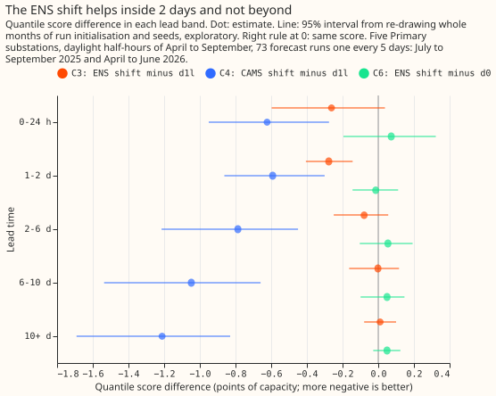
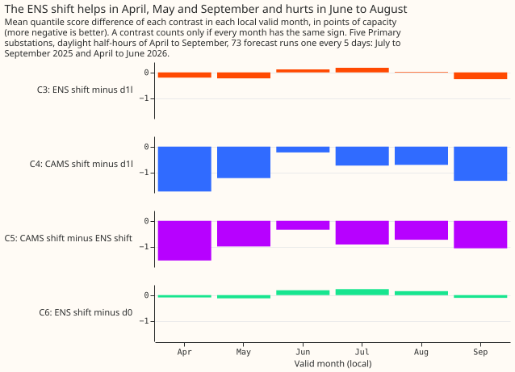
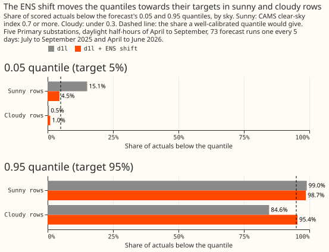
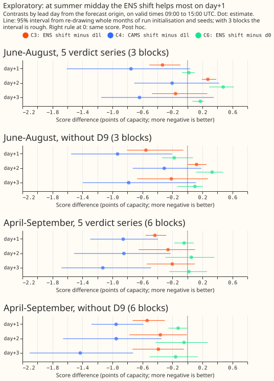

# Experiment 46: how much of the best guess's daylight error is embedded solar?

We asked how much of the error in a 0-to-10-day forecast of a Primary substation's power comes from
solar panels behind the substation's meter. A Primary substation is a 33/11 kV or 66/11 kV
substation in the electricity distribution network. The meter reads demand minus the panels' output,
so a sunnier day than forecast lowers the metered power. The demand forecast is the best-guess
recipe of experiment 00033, which normally takes shortwave and longwave radiation inputs, and which
we refitted without those inputs. We added a correction to that forecast: the panels' capacity,
estimated in [experiment 00040](../00040-pv-capacity-error-bars/result.md), times how much sunnier
or cloudier the day is than the average for that month and half-hour. We built the correction twice.
The first copy read the true sunshine, taken from the satellite-based CAMS data (the Copernicus
Atmosphere Monitoring Service), which no real forecast has. The second copy read the sunshine that
the ECMWF ensemble weather forecast (ENS) predicted. We scored both on 68,903 daylight half-hour
forecasts per random seed (3 seeds), at 5 Primary substations, in April to September. The score is
the quantile score, our probabilistic forecast error score: an estimate of the continuous ranked
probability score (CRPS), in points, where a point is 1% of the substation's capacity. Knowing the
true sunshine lowered the quantile score by about 1 point, which is about 20% of the 4.72 points
that the demand forecast without radiation inputs scores. The correction built from the weather
forecast lowered it by 0.06 points. That is within the noise, and short of the 0.35 points that the
maintainer judged worth the effort of adding the correction to the live forecast, a judgement about
the cost of porting. The verdict is `refuted`.

**The verdict is `refuted`: the ENS solar term does not reach the 0.35-point threshold.** The oracle
shows that the missing gain lies in the sunshine forecast, not in the capacity. The scores below are
the quantile score in points of capacity. Smaller is better. `d0` is experiment 00033's best-guess
recipe. `d1l` is `d0` without its `shortwave` and `longwave` columns. The two shift arms add the
solar term to `d1l`, with the coefficient fixed at 1. The oracle arm is the CAMS one. The rows are
the 5 anonymised series (named D9, D10, D11, D14, and D16) whose capacity estimate is clean;
anonymised series are labelled D followed by a number so that no metered generator or site can be
identified.

| Arm | Quantile score (95% interval) |
|---|---|
| `d0`, with radiation inputs | 4.620 (4.168 to 5.224) |
| `d1l`, without radiation inputs | 4.724 (4.252 to 5.325) |
| `d1l` + ENS shift | 4.667 (4.292 to 5.204) |
| `d1l` + CAMS shift (oracle) | 3.758 (3.484 to 4.033) |
| `d1l` + ENS shift, coefficient fitted per series and lead band (exploratory) | 4.581 (4.189 to 5.134) |
| `d1l` + CAMS shift, coefficient fitted (exploratory) | 3.667 (3.389 to 3.999) |

**Two contrasts decide the verdict at 97.5%: C3, the ENS shift minus `d1l`, and C4, the oracle minus
`d1l`.** The decision rule is: C4 must lie wholly below -0.35 (the validity gate), and then C3 sets
the verdict. C3 is -0.056 (-0.191 to +0.064), so the interval lies above -0.35 and includes zero,
which the rule calls `refuted`. C4 is -0.966 (-1.431 to -0.595), so the validity gate passes. Two
more contrasts are exploratory and read at 95%. C5, the oracle minus the ENS shift, is -0.910
(-1.209 to -0.643). C6, the ENS shift minus `d0`, is +0.048 (-0.059 to +0.141). Removing the two
radiation columns raises the quantile score by 0.104 points (`d0` minus `d1l`, from the table).

| Contrast | Treatment arm minus comparison arm | Role |
|---|---|---|
| C3 | `d1l` + ENS shift minus `d1l` | Decides the verdict |
| C4 | `d1l` + CAMS shift (oracle) minus `d1l` | Validity gate |
| C5 | `d1l` + CAMS shift minus `d1l` + ENS shift | Exploratory |
| C6 | `d1l` + ENS shift minus `d0` | Exploratory; decides the design of PVDIS-5 |

PVDIS-5 is the planned next experiment in the series. It tests the solar term again, with weekly
capacity estimates in place of the 2023/24 estimate.

**The ENS solar term scores no better than the best guess, so PVDIS-5 is a non-inferiority and
explanation test, not a gain test.** C6 is not wholly below zero, which is what the decision rule
needs for a gain test. C6 supports "no better than `d0`". It does not support "no worse than
`d0`", because the plan set no non-inferiority margin and the pooled upper end is +0.141. C6 also
changes sign. By valid month, April to September, it is -0.09, -0.12, +0.19, +0.23, +0.15, and
-0.11. By series it is wholly above zero at D10 (+0.131, +0.027 to +0.233) and D9 (+0.264, +0.024 to
+0.423), and wholly below zero at D16 (-0.248, -0.448 to -0.061). A non-inferiority test in PVDIS-5
therefore needs a margin set in advance. By lead band, C6 is +0.073 (-0.195 to +0.322) at 0 to 24
hours and -0.014 (-0.144 to +0.112) at 1 to 2 days, with 6 resampling blocks each. The other bands
are +0.054 (-0.104 to +0.192) at 2 to 6 days, +0.049 (-0.099 to +0.147) at 6 to 10 days, and +0.049
(-0.028 to +0.124) from 10 days.

## The ENS forecast carries the oracle's gain only to about 2 days

**The ENS anomaly tracks the CAMS anomaly for about 2 days, then fades.** C3 follows the same
pattern. On the training window, the correlation of the ensemble-mean anomaly with the CAMS anomaly
runs from 0.77 to 0.81 at 0 to 24 hours, 0.73 to 0.77 at 1 to 2 days, 0.56 to 0.60 at 2 to 6 days,
0.25 to 0.29 at 6 to 10 days, and 0.02 to 0.04 from 10 days, across the six series. The oracle gains
at every lead (C4 from -0.59 to -1.21). The ENS version gains -0.262 (-0.598 to +0.037) at 0 to 24
hours and -0.277 (-0.406 to -0.144) at 1 to 2 days, then -0.079, -0.002, and +0.011 in the bands
beyond. All of these intervals are at 95%, exploratory.

## Fragility of the small gains

- **Without D9, the series with the largest bound on its capacity, C3 is -0.113 (-0.230 to -0.000,
  rounded; the interval touches zero) at 97.5%.** The rule would then give `small gain`, but the
  upper end sits at zero, so the reading is fragile and the pre-registered verdict, which includes
  D9, stands.
- **C3 is not the same sign in every valid month.** It is negative in April (-0.204), May (-0.232),
  and September (-0.262), and positive in June (+0.117), July (+0.183), and August (+0.024). C4 is
  negative in all six months. The intervals resample 7 blocks, each a month of forecast start dates
  (March to September, because forecasts started in late March are valid in April).
- **C3 varies by series and sky.** It is -0.382 (-0.588 to -0.182) at D16 and positive at D5 and D9
  (+0.278 and +0.173). By sky it is -0.719 in cloudy rows, +0.225 (+0.076 to +0.329) in middle rows,
  and -0.135 in sunny rows, all exploratory at 95%.
- **A week-block bootstrap (29 blocks) gives the same answer:** C3 -0.056 (-0.197 to +0.084) and C4
  -0.966 (-1.248 to -0.663) at 97.5%.

## The fixed coefficient of 1 was too large

**The residual of `d1l`'s median has a slope of -0.771 on the oracle shift. A forecast with no solar
information would show -1.** The slope is -0.626 at 0 to 24 hours, -0.632 at 1 to 2 days, -0.709 at
2 to 6 days, -0.818 at 6 to 10 days, and -0.848 from 10 days, and it holds on odd and even months
alike (-0.780 and -0.762). By series it runs from -0.615 (D9) to -1.044 (D16). A stale capacity
that is too small would push the slope past -1, not towards zero, so staleness does not explain the
slope. About a quarter of the anomaly is probably already captured by the cloud proxies in `d1l`
(dew point, precipitation, and the lagged power columns).

A coefficient fitted on the training window, applied only in the three lead bands where the pooled
slope was weaker than -0.8 in the log's own test (0 to 24 hours, 1 to 2 days, and 2 to 6 days),
gives an exploratory C3 of -0.143 (-0.231 to -0.057) and a C4 of -1.057 (-1.401 to -0.784) at 95%.
Even the fitted version lies well above -0.35.

## Coverage

**The ENS shift moves the 0.05 quantile of sunny rows from 0.151 to 0.045, and the 0.95 quantile of
cloudy rows from 0.846 to 0.954.** The score barely changes. The table gives the share of
actuals below each quantile; a calibrated quantile gives 0.05 and 0.95. Sunny rows (CAMS clear-sky
index of 0.7 or more) number 107,169 and cloudy rows (under 0.3) number 20,706, across the 5 series
and 3 seeds.

| Arm | Sunny, 0.05 | Sunny, 0.95 | Cloudy, 0.05 | Cloudy, 0.95 |
|---|---|---|---|---|
| `d0` | 0.152 | 0.990 | 0.006 | 0.848 |
| `d1l` | 0.151 | 0.990 | 0.005 | 0.846 |
| `d1l` + ensemble-mean shift (no member spread) | 0.118 | 0.987 | 0.011 | 0.890 |
| `d1l` + ENS shift | 0.045 | 0.987 | 0.010 | 0.954 |

## Summer midday read (exploratory, post hoc)

**At midday on day+1 the ENS shift lowers the score by 0.33 to 0.55 points in all four reads, but no
interval lies wholly below the 0.35 threshold.** The later lead days disagree between reads. The
maintainer asked, after the verdict, for a read of the rows where solar matters most. It decides
nothing. The rows are valid times 09:00 to 15:00 UTC inclusive (each timestamp marks the end of its
half-hour), read twice: June to August (3 blocks, each a month of forecast start dates, so the
intervals are rough) and April to September (6 blocks). Each read is given for the 5 verdict series
and without D9. Lead days run from each run's forecast origin, with day+1 meaning 24 to 48 hours,
day+2 48 to 72 hours, and day+3 72 to 96 hours. The edges of the main bands (0-24 h, 1-2 d, 2-6 d)
do not match day+2 and day+3, so the script defines its own. The tables give the quantile score of
five arms, then the contrasts at 95%.

| Rows, series | Lead day | `d0` | `d1l` | `d1l` + ENS shift | `d1l` + CAMS shift | `d1l` + ENS shift, fitted |
|---|---|---|---|---|---|---|
| Apr-Sep, 5 series | day+1 | 4.692 | 5.082 | 4.648 | 4.225 | 4.387 |
| Apr-Sep, 5 series | day+2 | 4.503 | 4.815 | 4.556 | 3.967 | 4.253 |
| Apr-Sep, 5 series | day+3 | 5.270 | 5.492 | 5.290 | 4.363 | 4.913 |
| Apr-Sep, without D9 | day+1 | 4.725 | 5.139 | 4.601 | 4.187 | 4.409 |
| Apr-Sep, without D9 | day+2 | 4.522 | 4.838 | 4.477 | 3.889 | 4.241 |
| Apr-Sep, without D9 | day+3 | 5.357 | 5.587 | 5.199 | 4.157 | 4.939 |
| Jun-Aug, 5 series | day+1 | 4.571 | 4.923 | 4.590 | 4.170 | 4.352 |
| Jun-Aug, 5 series | day+2 | 3.910 | 4.115 | 4.387 | 3.911 | 3.914 |
| Jun-Aug, 5 series | day+3 | 4.829 | 5.159 | 5.000 | 4.519 | 4.603 |
| Jun-Aug, without D9 | day+1 | 4.701 | 5.078 | 4.524 | 4.145 | 4.422 |
| Jun-Aug, without D9 | day+2 | 3.978 | 4.185 | 4.307 | 3.876 | 3.940 |
| Jun-Aug, without D9 | day+3 | 4.926 | 5.241 | 5.025 | 4.457 | 4.702 |

| Rows, series | Lead day | C3 (ENS shift minus `d1l`) | C6 (ENS shift minus `d0`) | C4 (oracle minus `d1l`) |
|---|---|---|---|---|
| Apr-Sep, 5 series | day+1 | -0.434 (-0.559 to -0.283) | -0.044 (-0.176 to +0.083) | -0.857 (-1.297 to -0.394) |
| Apr-Sep, 5 series | day+2 | -0.259 (-0.651 to +0.102) | +0.052 (-0.293 to +0.358) | -0.848 (-1.511 to -0.226) |
| Apr-Sep, 5 series | day+3 | -0.203 (-0.541 to +0.098) | +0.020 (-0.242 to +0.262) | -1.129 (-1.679 to -0.485) |
| Apr-Sep, without D9 | day+1 | -0.538 (-0.731 to -0.302) | -0.124 (-0.251 to +0.007) | -0.952 (-1.279 to -0.587) |
| Apr-Sep, without D9 | day+2 | -0.362 (-0.775 to -0.009) | -0.046 (-0.425 to +0.269) | -0.950 (-1.659 to -0.345) |
| Apr-Sep, without D9 | day+3 | -0.388 (-0.733 to -0.049) | -0.158 (-0.506 to +0.139) | -1.430 (-2.105 to -0.725) |
| Jun-Aug, 5 series | day+1 | -0.333 (-0.510 to -0.092) | +0.019 (-0.072 to +0.099) | -0.753 (-1.608 to +0.036) |
| Jun-Aug, 5 series | day+2 | +0.272 (+0.194 to +0.383) | +0.477 (+0.290 to +0.620) | -0.205 (-0.709 to +0.423) |
| Jun-Aug, 5 series | day+3 | -0.158 (-0.474 to +0.264) | +0.172 (+0.066 to +0.217) | -0.640 (-1.150 to +0.349) |
| Jun-Aug, without D9 | day+1 | -0.553 (-0.804 to -0.055) | -0.177 (-0.338 to +0.075) | -0.933 (-1.551 to -0.205) |
| Jun-Aug, without D9 | day+2 | +0.122 (+0.004 to +0.254) | +0.329 (+0.114 to +0.478) | -0.310 (-0.730 to +0.185) |
| Jun-Aug, without D9 | day+3 | -0.216 (-0.671 to +0.274) | +0.099 (-0.136 to +0.206) | -0.784 (-1.396 to +0.115) |

- **The gain at day+1 has the same sign in all four reads, and no interval lies wholly below
  -0.35.** C3 at day+1 is -0.434 (upper end -0.283), -0.538 (-0.302), -0.333 (-0.092), and -0.553
  (-0.055) in the four reads. C6 at day+1 stays at or near zero: -0.044 and -0.124 in April to
  September, and +0.019 and -0.177 in June to August.
- **The later lead days disagree between reads.** C3 at day+2 is negative in April to September and
  positive in June to August (+0.272, +0.122). In June to August, C6 is wholly above zero, so the
  ENS shift is worse than `d0`, at day+2 (+0.477, +0.290 to +0.620) and at day+3 (+0.172, +0.066 to
  +0.217). With 3 blocks, the June-to-August intervals are probably too narrow, and the read
  supports no claim at day+2.
- **The ensemble-mean ENS anomaly keeps its correlation with the CAMS anomaly at midday.** It is
  0.75, 0.67, and 0.76 at day+1 to day+3 in June to August, and 0.76, 0.74, and 0.70 in April to
  September (5 series); without D9 the values are 0.79, 0.69, and 0.76, and 0.78, 0.75, and 0.71.
  Over all daylight hours the training-window correlation is 0.56 to 0.60 at 2 to 6 days, so the
  midday rows hold a stronger forecast of the anomaly than the all-day average, though the row sets
  differ and the two figures are not directly comparable.
- **Calibration at midday moves from too narrow to too wide.** The share of actuals below the 0.05
  quantile of sunny rows falls from 0.187, 0.188, and 0.250 for `d1l` to 0.020, 0.016, and 0.022
  with the shift (day+1 to day+3, April to September, 5 series), against a target of 0.05, so the
  lower tail overshoots from too narrow to too wide. The
  share below the 0.95 quantile of cloudy rows rises from 0.787, 0.856, and 0.817 to 0.973, 0.969,
  and 1.000, against 0.95. June to August gives the same pattern. The log prints the coverage of
  every read, and each coverage cell holds 195 to 3,624 rows over 3 seeds.

**At midday on day+1 the term scores no worse than `d0` and moves the quantiles from too narrow to
slightly too wide.** C6 at day+1 has upper ends of +0.083 and +0.007 in April to September, and
+0.099 and +0.075 in June to August. The term is not no worse than `d0` at every lead: the
June-to-August day+2 and day+3 reads above are wholly above zero. Whether the day+1 result justifies
porting the term is not decided here. A second weather forecast beside ENS may give a better
irradiance forecast than ENS alone, which is a candidate follow-up the project has not committed to.

## How the experiment departed from its plan, and what it could not show

- **Check 1 is relaxed from a 0.05-point match to 0.2 points, post hoc.** The check compares the
  refitted `d0` with experiment 00033's `n1_refit`. The 0.127 is the mean absolute gap between the
  per-row raw medians of two identical D10 `d0` fits, in points of capacity. It is not a score
  difference. The 18 comparisons printed 0.020 to 0.185 points. Check 7 (all arms hold the same
  909,414 keys) passed. The stored ENS anomaly equals the recomputed slope times the ensemble-mean
  anomaly on all 307,476 validation rows.
- **Fit noise at the score level is small next to every interval.** We measured it from the spread
  across the 3 seeds with `e00046_seed_noise.py` (log: `seed_noise.log`). On the 5 verdict series,
  the `d0` score has a standard deviation of 0.0018 to 0.0027 per series and 0.0004 pooled. The C6
  comparison has 0.0017 to 0.0050 per series and 0.00015 pooled (per seed 0.04788, 0.04764, and
  0.04762), and `d0` minus `d1l` has 0.0007 pooled. D5, which is outside the verdict series, is
  noisier (0.0058 for `d0`, 0.0060 for C6). Fit noise is therefore about 1/670 to 1/20 of C6's
  half-width (0.100), so it cannot move C6 across zero. The bootstrap draws one seed per resample,
  so its interval already covers single-fit noise. An Opus review of this write-up checked this
  reading.
- **C3 and C4 carry no fit-to-fit noise within a seed, but C3 still varies across seeds.** Both come
  from one prediction pass of one `d1l` booster, so the paired difference does not include the
  difference between two fits. C3 still varies across seeds (pooled standard deviation 0.0009, from
  the same script) because each seed's shift sits on a different booster. C6 and `d0` minus `d1l`
  compare different fits and carry fit noise.
- **The ENS climatology rests on one summer of training data.** The anomaly is each forecast minus
  the mean for that calendar month and half-hour in the same data product, so a summer that differs
  from the training summer shifts the whole anomaly. On the scored rows the mean CAMS anomaly is
  +0.0245 of unit output (output as a fraction of installed capacity), and the mean calibrated ENS
  anomaly is +0.0116, which as shifts are 0.884 and 0.416 points of capacity. By month, the mean
  CAMS shift runs from +2.877 points in April to -1.016 in July, and the mean ENS shift from 0.091
  to 0.678.
- **The 2023/24 capacity is probably out of date**, so the oracle is conservative.
- **Not supported by the logs:** the printed output holds no result for plan checks 2 to 6 (column
  counts, a zero shift, the size of the oracle shift, the ENS chain, and the training-window
  cut-off), beyond the stored-anomaly check above.

## What the next experiment should answer

**The oracle shows that about 1 point of quantile score is available, and the ENS term collects only
the part within 2 days.** A next experiment could take one of three routes, and the project has not
committed to any. The first is a lead-banded term, used only within 2 days, with a coefficient
fitted on the training window per lead band, so the term fades where ENS has no skill. PVDIS-5 could
then be a non-inferiority and explanation test overall, plus a gain test pre-registered for 0 to 48
hours only, with PVDIS-4's weekly capacity vintages in place of the 2023/24 capacity. The second is
a better short-range solar forecast, because the irradiance forecast is the bottleneck and not the
capacity: a satellite-based nowcast for 0 to 6 hours is one candidate, and a second weather forecast
beside ENS is another. The third is to stop, since the gain is confined to short leads, where the
lagged power columns of `d1l` probably already carry some of the signal.
