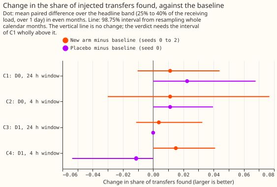
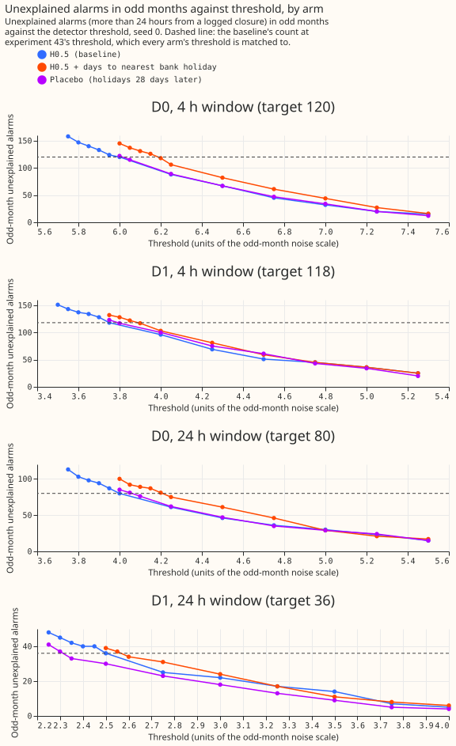

# Experiment 47: does a bank-holiday column in the demand model help the LSC find transfers?

**The result is inconclusive: adding a bank-holiday column to the demand model raised the share of
simulated load transfers the detector found by +0.011 (98.75% interval -0.010 to +0.044), and the
experiment is too small to tell that from zero.** The demand model is an XGBoost model (a
gradient-boosted decision-tree model) that predicts the power drawn at each of 16 Primary substations
(substations that step power down to the local distribution network) from the weather. The detector
raises an alarm when the average difference between measured and predicted power over 24 hours steps
up or down, which can mean that load moved to or from another substation. Demand drops on bank
holidays, the model did not expect the drop, and the drop looks like such a step. We refitted the
model with one extra column, the number of days to the nearest bank holiday, and added 600 simulated
transfers to the real readings. We set each model's alarm threshold so that both raised about the same
number of alarms in odd-numbered months that the switching log (the operators' record of planned
network switching) does not explain. We then counted how many of the 89 simulated transfers that
start in even-numbered months, move 25% to 40% of the receiving substation's load, and last over 1 day
the detector found. A transfer counts as found when the detector places its start within 2 hours and
its end within the larger of 6 hours and 10% of its duration. The result covers only the route
through the threshold: the injected transfers lie at least 2 days from any alarm of the baseline
model, so the column could help only by letting the threshold fall.

## Verdict

**C1, the new model minus the baseline model in the share of the 89 transfers found, is +0.011
(98.75% interval -0.010 to +0.044), so the verdict is inconclusive.** The baseline is H0.5, the
demand model of experiment 17 (trained on ERA5 estimates of past weather, with a half-life of 0.5
years, refitted every month). The detector is D0, which watches one substation's residual (measured
minus predicted power). D1 also requires an opposite step at a neighbouring substation. The share
found is the mean of three random seeds, 0.360 for the new model and 0.348 for H0.5. The interval
resamples whole calendar months 20,000 times, at 98.75% because of a Bonferroni correction across the
four contrasts C1 to C4. The decision rule asked for an interval wholly above zero and a higher
event F1 at both precision bounds. Event F1 is the harmonic mean of the share found and the alarms'
precision. The F1 rose by 0.010 (0.389 to 0.399) at both bounds, which are the same here. The
share found for H0.5 is 0.348 here and 0.29 in experiment 43, because this figure covers even months
only, takes the mean of three seeds, and experiment 43's 47 of 160 covers all months.

**The experiment is too small to detect a gain below about 0.04.** The C1 interval has a
half-width of about 0.027, and +0.011 is about one transfer net out of 89. Transfers whose receiving
substation is metered (48) give +0.007 (-0.019 to +0.054), and the other 41 give +0.016 (0.000 to
+0.042).

| Contrast | Detector, window | Change in share found | 98.75% interval |
|---|---|---|---|
| C1 | D0, 24 h | +0.011 | -0.010 to +0.044 |
| C2 | D0, 4 h | +0.011 | -0.030 to +0.077 |
| C3 | D1, 24 h | +0.004 | -0.011 to +0.033 |
| C4 | D1, 4 h | +0.015 | 0.000 to +0.041 |

**The detector found few real transfers with either model.** The 14 labelled real transfers that
move 25% or more of the receiving load for over 1 day are the headline-band counterpart. The
24-hour D0 finds 1, 2, and 3 of them with the new model (seeds 0 to 2) and 1, 1, and 2 with H0.5. The
35 labelled transfers over 1 day include those 14 and 21 smaller or unsized ones; the counts there
are 2, 3, and 4 against 2, 2, and 3. These counts carry no verdict.

## What held in the prediction and what did not

**The column fixed the bank-holiday errors, but the detector did not gain from it.**

- **Held: fewer unexplained alarms lie near bank holidays.** Of H0.5's 160 unexplained 24-hour D0
  alarms, 26 lie within 1 day of a bank holiday outside Christmas and New Year. With the new model
  at the matched threshold there are 141, 147, and 138 unexplained alarms (seeds 0 to 2), of which
  10, 10, and 9 lie within 1 day. The prediction was 13 or fewer.
- **Held: the demand model's error moved as predicted.** The mean absolute error of the median
  rose by 0.04 points of capacity over the whole period (prediction: under 0.05) and fell by 1.13 to
  1.19 points on bank holidays (prediction: at least 0.5). H0.5's own errors are 6.70 points over the
  whole period and 8.88 on bank holidays, and the changes are measured against H0.5 seed 0.
- **Held: event F1 rose.** It rose by 0.010 at both precision bounds.
- **Failed: the share found did not rise by 0.03 to 0.10.** C1 is +0.011.
- **Failed: the matched threshold rose instead of falling.** The prediction was a fall of 0.1 to
  0.4. The D0 24-hour threshold rose by 0.217 on average, in units of the noise scale (4.00 to 4.05
  for H0.5, 4.20 to 4.25 for the new model). That is about 2.5% in residual units, because the noise
  scale fell by about 3%. The 4-hour D0 threshold rose by 0.133, the 4-hour D1 by 0.067, and the
  24-hour D1 by 0.000.
- **Borderline: the 24-hour noise scale sits at the edge of the 3% band.** The odd-month noise
  scale fell by 3.0%, 3.2%, and 2.9% for seeds 0, 1, and 2 at the 24-hour window, so one seed is
  inside the band and two are just outside it. The 4-hour window fell by 1.3% to 1.7%, within 3%.
- **Failed: the placebo changed C1 by more than 0.02.** The placebo column moves the holiday dates
  28 days later and keeps each date's weekday. On share found alone, the shifted column did as well
  as the real one, within single-seed noise: placebo minus H0.5 is +0.022 (0.000 to +0.068) and the
  new model minus the placebo is -0.022 (-0.068 to 0.000), about 2 transfers of 89. On event F1 the
  placebo is worse than H0.5 (0.356 against 0.389 on seed 0), because its 24-hour D0 precision is 0.34
  against 0.44 to 0.46 for the other models: more of its alarms fall away from logged closures.

## Why the threshold rose

**The column probably made the residual more persistent, which makes the 24-hour step test fire more
often away from holidays.** This is a likely explanation, not a proven one. The residual's lag-48
autocorrelation (half-hours, one day apart) rose from 0.520 to 0.529 and the autocorrelation of its
daily mean from 0.760 to 0.770, while the median absolute deviation fell from 5.55 to 5.46 to 5.51
points of capacity. A more persistent residual over a smaller noise scale crosses a threshold fixed
in noise-scale units more often, which cancels the roughly 16 alarms near holidays that the column
removed. The placebo shows the same signs (whole-period error +0.136 points, lag-48 autocorrelation
0.535). The persistence matters for SW2-9, the planned whitening step that removes a residual's
autocorrelation before detection.

## Checks and limits

- **Matching fixes only the odd-month count, so the scored even months differ.** In even months the
  new model raises 66, 67, and 64 unexplained 24-hour D0 alarms (seeds 0 to 2) against 80, 76, and
  71 for H0.5 and 77 for the placebo. The new model is therefore scored at a stricter operating point,
  which biases the comparison against it.
- **The odd months show no gain.** On the 71 headline-band transfers in odd months, which set the
  thresholds through alarm counts and not through recall, the new model minus H0.5 is -0.019 (0.188
  against 0.207), and pooled over all 160 headline-band transfers it is -0.002.
- **The ceiling on the threshold route is low.** Only 4.8% of half-hours lie within 1 day of a
  qualifying bank holiday, and removing 26 of 160 unexplained alarms cannot lower the matched
  threshold far. We could have computed this ceiling from the operating-point figure before the run.
- **The injection check agrees with the fast residual.** The new model's seed-0 fits were refitted
  on injected power for the months holding a transfer of one batch, the batch with the most
  headline-band transfers. All 316 pairs of a transfer and a detector setting from that batch agree
  (1.000, bar 0.95). The 600 transfers are not all checked.
- **The residual is otherwise similar.** Logged closures hold 0.342 of H0.5's squared residual and
  0.349 of the new model's, against 0.252 of the half-hours.
- **Reproduction of experiment 43.** H0.5 seed 0 at experiment 43's thresholds gives its 120, 118,
  80, and 36 unexplained odd-month alarms and its 160 unexplained 24-hour D0 alarms.
- **The threshold search takes the lowest value of a run.** On a 0.05 grid the search stops at the
  lowest threshold whose count does not exceed 80 (the 24-hour D0 target), so the new model's odd-month
  counts are 75, 80, and 74 against 80, 80, and 78 for H0.5, which handicaps the new model slightly.
- **The precision upper bound is an assumption for the new model.** It adds the unmatched alarms
  times the visible share from experiment 41's hand-labelled sample of 37 alarms per setting, drawn
  from H0.5's alarms. The 24-hour D0 precision is 0.44 for H0.5 and 0.44 to 0.46 for the new model.

The remaining figures sit beside this page: the raw power around bank holidays (`figure_1`), the
residual's spread (`figure_2`) and autocorrelation (`figure_3`), the squared-residual shares inside
logged closures (`figure_4`), the share found by size and length band (`figure_7`), and the demand
model's error on bank holidays (`figure_9`). Code:
`ml-experiments/00047-sw2-4-better-residual-switching-detector/`, with every number printed by
`e00047_report.py`.

## What the next experiment should answer

**SW2-8 should run next, as already approved.** Its neighbour veto targets the alarms this experiment
could not turn into recall: 26 of H0.5's 160 unexplained 24-hour D0 alarms lie within 1 day of a bank
holiday, and a calendar miss shows as a same-sign step on the neighbours. A veto raises the share of
transfers found only by letting the matched threshold fall, so the SW2-8 plan should predict the size
of that fall from H0.5's odd-month alarm counts before running. SW2-8 changes the detector and not
the residual model, so its injections need no refit. SW2-8 should therefore score several hundred
headline-band transfers in the even months, not 89, and place some near bank holidays to count real
transfers the veto wrongly removes. SW2-8 should also report its even-month unexplained-alarm count,
which matching on odd months does not hold fixed.
