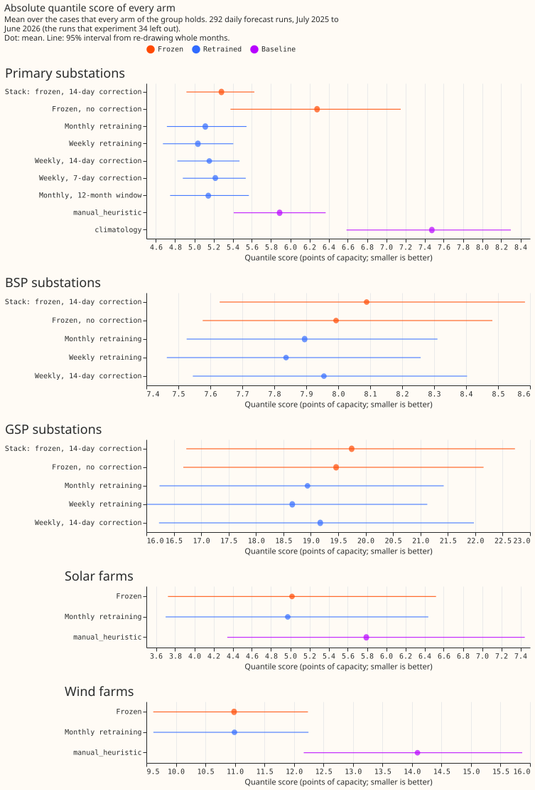
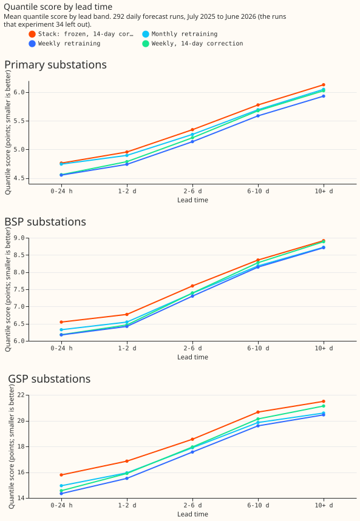
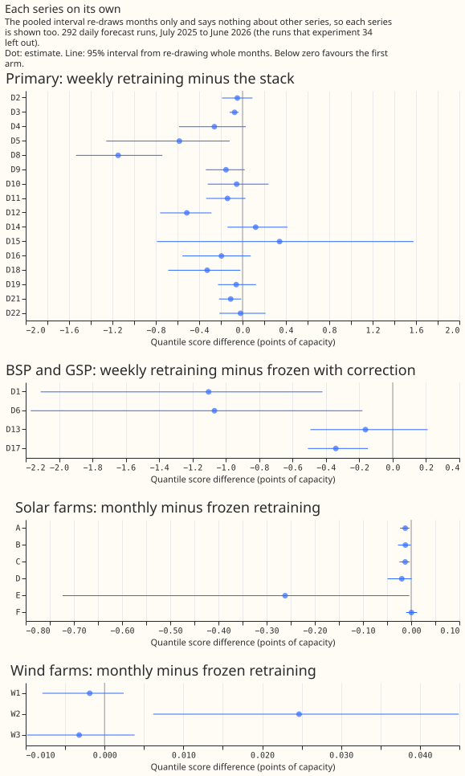

# Experiment 48: does weekly retraining still win on the runs experiment 34 left out?

**Refitting the demand forecasting model every week scored better than the best setup tested
earlier, on forecast runs the earlier experiment had not scored.** We asked whether an XGBoost model
that forecasts a substation's electricity demand improves when it is refitted (retrained from
scratch) every week on the newest data. An earlier experiment (experiment 34) had scored only 73
forecast runs, 5 days apart. Here we scored the other 292 daily runs of the same year, July 2025 to
June 2026, where each run is one day's ECMWF ensemble weather forecast (ENS) used to forecast about
14.6 days of demand. The error is the quantile score, which rewards a forecast that is both close
and honest about its uncertainty, in percentage points of the substation's capacity; smaller is
better.

**On 16 Primary substations, weekly refitting scored 5.44 and the earlier best setup scored 5.64.**
The earlier setup, called the stack below, is a model fitted once with a correction built from its
own errors over the last 14 days. The 0.20-point gap is wholly below zero at the strict level we
fixed in advance, but the gap is fragile: it crosses zero with a t-interval over the 12 months or
without one substation (see the limits). Weekly refitting also beat monthly refitting (5.57) by 0.13
points. Neither the 7-day nor the 14-day error correction helped a weekly-refitted model, although
neither was shown to hurt it at the strict level. At the 2 bulk supply point (BSP) and 2 grid supply
point (GSP) substations, which sit above the Primary substations, weekly refitting scored 0.66
points below the stack, more than we predicted. For 6 solar farms and 3 wind farms, refitting the
weather-to-power model monthly changed the score by 0.04 points or less, so this experiment found no
accuracy reason to refit generation models. The verdict is **supported**, and the open test is a
second validation year, because the 292 runs share their months and weather with the 73 that
experiment 34 scored.

**Terms used below.** The stack uses a spread factor of 1.15 that widens its forecast uncertainty;
every other arm uses the spread factor too, and uses no correction unless its name says so. Frozen
means fitted once, on data up to the end of June 2025. N1 is the one-model-per-substation XGBoost
recipe of experiment 13, trained on the ENS control member. A case is one forecast of one series at
one valid time from one run. Lead is the time between the forecast origin and the valid time. P-roll
is a monthly refit on the latest 12 months of data only. The weather-to-power model for solar and
wind is the ERA5-trained stage 1a model, where ERA5 is a weather reanalysis that arrives about 5
days late. Scores are means over the cases that every forecasting-model arm of a group holds, on
seed 0. The decision rule is in the front matter, and C1 to C8w are the contrasts it lists; "Design
as planned" below explains the choices.

**Weekly refitting beat the stack at the 99.44% level we fixed in advance.** C1, weekly minus the
stack, is -0.20 points (99.44% interval -0.40 to -0.035), so the interval lies wholly below zero.
The threshold was zero: any gain was enough, because refitting replaces the correction step at the
price of one scheduled job. C3, weekly minus monthly refitting, is -0.13 (-0.24 to -0.03). C2,
monthly minus the stack, is -0.08 (-0.33 to +0.19). Experiment 34 found monthly refitting better
than the stack on its 5-day runs, and this experiment did not resolve that gain on daily runs.

| Arm | Primary (16) | BSP (2) | GSP (2) | Solar farms (6) | Wind farms (3) |
|---|---|---|---|---|---|
| Stack: frozen, 14-day correction | 5.64 | 8.09 | 19.74 | | |
| Frozen, no correction | 7.09 | 7.99 | 19.46 | 5.02 | 10.98 |
| Monthly refits | 5.57 | 7.89 | 18.94 | 4.97 | 10.99 |
| Weekly refits | **5.44** | **7.84** | **18.66** | | |
| Weekly, 14-day correction | 5.52 | 7.95 | 19.17 | | |
| Weekly, 7-day correction | 5.60 | | | | |
| P-roll | 5.59 | | | | |
| `manual_heuristic` | 6.26 | 8.84 | 20.82 | 5.79 | 14.09 |
| `climatology` | 7.48 | | | | |

Each cell is a mean quantile score in points of capacity, and a blank cell means the arm was not run
for that group. Scores are on the cases that every forecasting-model arm of the group holds
(3,199,243 Primary cases), so differences between cells equal the paired contrasts.
`manual_heuristic` and `climatology` hold slightly fewer cases (3,197,611 and 3,049,925 for
Primary), and the solar and wind rows hold the weather-to-power model without a correction. The 95%
interval on each Primary score, over months, is about plus or minus 0.3 points; the contrasts are
paired and much tighter.

**The reproduction check passed for Primary and narrowly failed for BSP and GSP.** We forecast the
73 runs of experiment 34 again from the same refits. For the Primary arms without a correction, the
scores matched experiment 34's stored seed-0 scores to 0.001 or better. For the BSP and GSP arms the
differences were 0.0002 to 0.006 points, and 4 of those 6 rows lie outside the 0.001 tolerance. The
probable cause is that graphics-card fits are not bit-for-bit repeatable. The differences are small
against the contrasts reported here.

**An error correction was not shown to help a model that is refitted weekly.** C4, a 7-day
correction on the weekly model, raised the score by 0.16 points, which is worse (99.44% interval
-0.06 to +0.36). C5, a 14-day correction, raised it by 0.08 (-0.13 to +0.27). Neither interval
excludes zero. C6 shows that the 7-day window scored 0.09 points worse than the 14-day window
(+0.02 to +0.17), the opposite of what we predicted. The correction did help the frozen model in
this experiment: it lowered the frozen score by 1.45 points (95% interval -1.87 to -0.98).

**Weekly refitting gained more at the BSP and GSP substations than predicted, on 4 series.** C7,
weekly minus the stack, is -0.66 (-1.23 to -0.27), against a predicted range of -0.1 to -0.5. Each
of the 4 series scored lower under weekly refitting, but the interval for D13 alone includes zero
(figure 4). Weekly minus the frozen model without a correction is -0.47 (95% interval -0.87 to
-0.11). A correction on the weekly model raises the score by 0.31 points, which is worse (95%
interval +0.06 to +0.60).

**Monthly refitting changed the pooled solar score by 0.04 points, and the pooled wind score by
0.01.** C8s for the 6 solar farms is -0.044 (99.44% interval -0.158 to -0.003). By the rule we set,
that is a change, because the interval excludes zero, although the point estimate lies inside the
plus-or-minus-0.05 band. C8w for the 3 wind farms is +0.007 (-0.001 to +0.014), inside the band.

**One solar farm drives most of the solar change.** Farm E improved by 0.26 points (95% interval
-0.72 to -0.00); the other 5 solar farms moved by 0.02 points or less. One wind farm (W2) scored
0.03 points worse (+0.006 to +0.045). We predicted no change from the training-start result of
experiment 12, and these intervals are the first retraining measurement for generation in this
project's experiments.

**The weekly gain over the stack is about the same at every lead time.** C1 is -0.21 in the first
24 hours and -0.20 beyond 10 days (figure 3). The gain of weekly over monthly refitting is larger
at short leads (-0.19 in the first 24 hours, -0.12 beyond 10 days), and the BSP and GSP gain is
larger early (-0.90 in the first 24 hours, -0.62 beyond 10 days).

**Refitting monthly on a rolling 12-month window (P-roll) scored 0.03 points worse than monthly
refitting on all the data.** The difference is +0.028 (95% interval +0.014 to +0.039). Experiment 34
found the same sign.

## Predictions

- **Held:** weekly minus the stack in the range -0.10 to -0.30 (-0.20); monthly solar and wind
  within 0.05 as point estimates (-0.04 and +0.01, though the solar interval excludes zero); the 7-day
  and 14-day corrections adding +0.05 to +0.30 (+0.16 and +0.08).
- **Missed:** monthly 0.05 to 0.10 behind weekly (C3 is 0.13); the 7-day correction adding less than
  the 14-day correction (it added more); BSP and GSP weekly minus the stack in -0.1 to -0.5 (-0.66).
  The BSP and GSP prediction in the front matter reads "weekly minus frozen", and C7 uses the stack
  as the reference; weekly minus the frozen model with no correction is -0.47 and inside the range.

## Failures and limits

- **No refit failed after the restart.** The frozen model's first run, one job for all series,
  showed no output for 37 minutes and was restarted as 5 workers; no result came from the abandoned run.
- **The 292 runs share their months and weather with the 73 of experiment 34.** Each run spans about
  14.6 days, so the 73 runs already cover every valid time of the year, and the interval is set by 12
  months. The result guards against the choice of origins, not against an unusual year. Seeds were not
  varied (seed 0 only); experiment 34 found that seeds narrow its contrasts by under 0.01.
- **The correction has no history for the first days of July 2025,** so the stack and the corrected
  arms carry no correction there; the correction reads no forecast issued before 2025-07-01.
- **The generator spread factor is fitted on cases before each month's first run.** July 2025 and the
  first wind months have too few earlier cases, so both generator arms are left unscaled there.
- **Pooled intervals resample months only,** so they say nothing about other series. The BSP and GSP
  contrast rests on 4 series, solar on 6, and wind on 3.
- **The reproduction tolerance was missed on the BSP and GSP arms** (0.003 to 0.006 points on 4 rows).
- **Absolute scores differ from experiment 34's,** because the two experiments score different runs
  (stack 5.64 here, 5.32 there); only the paired contrasts compare across them. The stack's
  correction also reads forecasts from the last day here and from 5 days back in experiment 34.
- **The weather inputs are deployable.** All arms use ENS weather forecasts, and the generator arms
  train on ERA5 only up to 5 days before each refit date.

- **The C1 and C3 intervals depend on the interval method.** Both exclude zero under the month
  bootstrap we fixed in advance. A t-interval over the 12 monthly mean differences does not exclude
  zero for either: C1 is -0.43 to +0.04 and C3 is -0.26 to +0.02. Ten of the 12 months favour weekly
  refitting for C1; September and March do not.
- **Three Primary series carry most of the C1 gain.** Without D8, C1 is -0.14 (99.44% interval
  -0.34 to +0.04); without D8 and D12 it is -0.11 (-0.31 to +0.08); without D8, D12, and D5 it is
  -0.08 (-0.24 to +0.10). D15 goes the other way (+0.34, figure 4). The weekly gain is not
  established as a gain across all 16 Primary substations.
- **The July warm-up does not explain the result.** Dropping the runs before 16 July leaves C1 at
  -0.20 (99.44% interval -0.40 to -0.02).

## What remains untested

**Does weekly refitting still beat the stack on a validation year the project has not scored?** The
ENS backfill from Source Cooperative gives a second year to score. Experiment 48 answers the 7-day
correction window and solar and wind refitting at the resolution of its intervals.

## Design as planned

**Experiment 34 scored 73 forecast runs, 5 days apart, and found weekly retraining 0.28 below the
best-guess stack with no correction; this experiment asks whether the gain holds on the other 292
daily runs of the same year.** The 292 runs share their months and weather with the 73, so the test
guards against the choice of origins and seeds, not against an unusual year. Experiment 34 also left
three gaps: its correction read forecasts 5 days apart, retraining was not tried for BSP, GSP,
solar, and wind beyond monthly BSP and GSP, and the 7-day correction was not tried on a retrained
model.

**Rows.** The row set `fold_a_daily_gap_v1` holds the daily 00:00 UTC ENS runs from 2025-07-01 to
2026-06-30 that `fold_a_every5d_v1` does not. All 365 daily runs exist in the ENS archive, so the
set holds 292 runs, and the 73 of `fold_a_every5d_v1` are forecast again from the same refits as a
reproduction check. Each run spans about 14.6 days, so the 73 runs already cover every valid time of
the year: the 292 runs score the same observed demand at other origins and leads, and guard against
the choice of origins, not against the outcome data. The demand frames use the same builder as
`studies/stage1_pilot/demand_build_ens.py` (production's half-hourly upsampling, all 51 members,
lags from the observed power). No experiment scores a valid time on or after 2026-07-01. The
generators need frames for their 9 series over all 365 runs and 51 members, built the same way for
the generators' H3 cells and the technology's columns (experiment 33 holds only the 53 Tuesday
runs).

**Arms.**

- **Primary (16 series):** the stack; weekly and monthly full refits with a half-life of 0.5 years
  and an expanding window, no correction, spread factor 1.15, using experiment 34's `n1h`
  recipe and its refit times (52 weekly, 12 monthly); P-roll (12-month window, 150 rounds, `eta`
  0.15, monthly); and the weekly arm with the 7-day and the 14-day correction, built from the 365
  daily forecasts as issued: each past half-hour's forecast comes from the refit that served that
  run, never from a re-forecast by the current refit, and no correction reads a run before
  2025-07-01. The stack's frozen model is refit with experiment 33's recipe (half-life 2 years,
  anchored at 2025-06-30, 500 rounds) because it was stored only for the 73 runs, and forecasts all
  365 runs.
- **BSP and GSP (2 each):** frozen (with the correction as the deployable reference, and without),
  monthly, and weekly, with and without the correction.
- **Solar (6) and wind (3):** the ERA5-trained stage 1a (solar `base`, with no CAMS and no stage 0;
  wind `margin`, with the power-curve margin), refitted monthly on ERA5 up to 5 days before each
  refit date (when ERA5 arrives), against the frozen model trained to 2025-06-17, both applied to the
  ENS members and pooled as in experiment 33. Both arms take the spread factor the same way as
  experiment 33's `apply_spread`, fitted only on cases whose valid time precedes the origin. The
  prediction of no change rests on experiment 12's training-start result, not on a retraining
  measurement.
- **Baselines:** `manual_heuristic` and `climatology` on the same 292 runs.

**Resources.** About 5 to 7 GPU hours inside slot A (10 cores, at most 24 GB): weekly Primaries 2.4,
monthly 0.6, BSP and GSP weekly 0.6, generators 1 to 2, P-roll 0.2. The 292 new demand frames add
about 8 GB of disk, and the generator frames some more; each worker loads the runs of one refit at a
time, so memory stays inside 24 GB, and the fits run as parallel workers, one output file per refit
written atomically, so a run resumes. The GPU is shared with other sessions, so the timings are not
reproducible; the numbers are, because seeds are fixed per job.

**Sizing, by the five triggers.** Stored: predictions under `data/`, private, nothing in production.
Serving path: not touched. Degradation rule: not touched. More than one defensible design: no, the
approved ranking fixes arms and refit dates. Callers not nameable without searching: no, the scripts
are copies of experiment 33's and 34's. The experiment is complex only because it builds new
frames and a new solar and wind refit, so it gets the full review set: one plan review (Opus), one
code review (Sonnet), one write-up check (Sonnet), one prose review (Sonnet), and one result review
(Opus).

**Earlier advice followed.** Retrain monthly in the Primary stage 1 model and drop the correction
(00034); screen on P-roll (00034, used here only as a descriptive arm); read the contrasts with a
Bonferroni-level interval, because months set the width (00034). Departures: none.

**Plan review (Opus), triaged.** Accepted: state that the correction reads forecasts as issued and
nothing before 2025-07-01; predict a smaller Primary gap because the daily stack's correction is
fresher; set C3's threshold to zero; split C8 into solar and wind and make "no change" conditional
on the interval; name which frozen reference C7 uses; report each series; limit the reproduction
check to arms without a correction; add the generator frame builder, the disk and memory budget, and
the spread-factor rule. Rejected: none.

**Code review (Sonnet), triaged.** No leakage found. Accepted: run `--check` on the frames, cap
threads through environment variables, split the frozen fit across workers, and note the
correction's July warm-up and the generator spread factor's first months. Rejected: relabelling C6
and C7 in the report script, because the page states the rule for each.

**Write-up check and prose review (Sonnet), triaged.** Accepted: the absolute scores now use the
cases the contrasts use (the baselines had shrunk the shared case set, so the table and C1 had
disagreed), the prediction list, the lead-band claim, the reproduction counts, and the opening's
undefined terms. Rejected: moving this section to the pull request, because the plan review is a
record of what changed the design.

**Result review (Opus), triaged.** No leakage and no scoring mismatch; the verdict stands. Accepted:
the limits on the interval method and on D8, D12, and D5, the 99.44% level, and the upper bound of
C1 (-0.035). Rejected: none.
