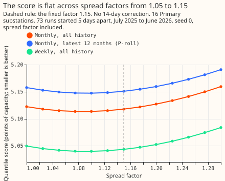

# Experiment 49: which Primary demand components still improve the score under monthly retraining?

**We asked which parts of the Primary substation demand forecast still lower the forecast error once
its XGBoost model is refitted every month on the latest 12 months of data.** A Primary substation
steps power down to the local distribution network. Only averaging the forecasts of five XGBoost
models clearly helped: the average's quantile score (an error that rewards forecasts that are both
close and honest about their uncertainty, in points, where 1 point is 1% of a substation's capacity)
was 0.08 below the best single model's. Four other changes each moved the score by under 0.05
points, and the experiment could not tell any of them from zero, meaning that each interval included
zero. Those changes were re-choosing the spread factor that widens the uncertainty band (the factor
is 1.15 in the forecast we use now), adding recent-window statistics of each substation (its
"fingerprint") to a pooled model trained on many substations at once, dropping the column that marks
the 14 days around 25 December, and giving older training rows a half-life of 2 years instead of 0.5
years. One more change could not be tested: the indicator for the 2020 to 2021 lockdowns is always 0
inside a 12-month training window. The next experiments could test the blend with weekly refits, and
the Christmas column on a second winter.

**Supported, on the blend alone.** Scores are the quantile score over all leads, in points of
capacity, for 16 Primary substations, 73 runs started 5 days apart from July 2025 to June 2026, with
weather from ENS (the European Centre for Medium-Range Weather Forecasts ensemble), seed 0, with the
spread factor 1.15 applied and without the 14-day error correction. P-roll is a cheaper
approximation to the full monthly refitting of experiment 34: refit monthly on the latest 12 months,
150 rounds, `eta` 0.15. Stage 0 re-used predictions that experiments 33 and 34 stored, and stage 1
refitted P-roll. The screening reference stays monthly P-roll, and a weekly result from experiment
48 would not change the stage 0 findings. B1's stack member is the frozen N1 with the 14-day
correction, so B1 is not a blend of retrained models alone. The code is in `ml-
experiments/00049-*/`, and `e00049_stage0.py` and `e00049_stage1.py` print every number below.

| Id | Contrast | Difference | 99.17% interval | State |
|---|---|---|---|---|
| D0 | spread factor chosen on earlier months minus fixed 1.15, monthly refits | -0.0001 | -0.012 to +0.018 | null; no gain |
| B1 | five-model blend minus best single model | -0.076 | -0.135 to -0.023 | port (threshold -0.05) |
| C1 | P-roll without the Christmas column minus P-roll | -0.017 | -0.058 to +0.007 | unresolved |
| C2 | P-roll without the COVID indicator minus P-roll | +0.0002 | -0.003 to +0.003 | rule says removable; untestable (indicator constant) |
| C3 | P-roll with a half-life of 2 years minus 0.5 years | -0.003 | -0.034 to +0.027 | unresolved |
| F1 | pooled P-roll with fingerprints minus without | +0.009 | -0.037 to +0.050 | not worth porting |

## Absolute scores

| Arm | Score | 95% interval (months resampled) |
|---|---|---|
| Blend of five models, one weight vector per month | 4.968 | 4.634 to 5.329 |
| Weekly refits, all history (best single model) | 5.044 | 4.688 to 5.430 |
| Weekly-analogue model, monthly refits | 5.084 | 4.715 to 5.503 |
| Monthly refits, all history | 5.118 | 4.724 to 5.575 |
| P-roll, no Christmas column | 5.134 | 4.742 to 5.588 |
| P-roll, half-life 2 years | 5.148 | 4.751 to 5.602 |
| **P-roll (the screening reference)** | **5.150** | 4.760 to 5.604 |
| P-roll, no COVID indicator | 5.151 | 4.760 to 5.604 |
| Pooled by type, monthly refits, all history | 5.288 | 4.933 to 5.678 |
| Pooled P-roll | 5.307 | 4.955 to 5.690 |
| Pooled P-roll with fingerprints | 5.316 | 4.973 to 5.695 |
| Stack (frozen N1, 14-day correction, spread 1.15) | 5.318 | 4.943 to 5.686 |
| `manual_heuristic` | 5.888 | 5.392 to 6.389 |
| `climatology` | 7.462 | 6.556 to 8.341 |

The intervals on each score come from resampling the 12 validation months, and are about plus or
minus 0.4 points for the XGBoost models and wider for the baselines. The P-roll rows use this
experiment's refits, which differ from experiment 34's stored scores (5.151 and 5.308) by under
0.001. The contrasts are paired and much tighter. Refitting P-roll with this experiment's code
reproduced experiment 34's stored scores to within 0.0007 points for both reference arms (P-roll and
pooled P-roll), so the drop-one contrasts are not noise from the refit.

## Stage 0: stored predictions

**The spread factor needs no re-tuning for a retrained model.** The score is flat from 1.05 to 1.15:
monthly refits score 5.113 at their best factors, 1.075 and 1.10, and 5.118 at 1.15. The factor
chosen on earlier months ranged from 1.025 to 1.125 from August 2025 (July uses 1.15). It moved
further from 1.15 than the prediction of at most 0.10, but moved the score by only -0.0001 (D0).
Weekly refits gave -0.002 and P-roll +0.0004. The factors chosen from August 2025 all sat below
1.15, and the in-sample best is 1.075 to 1.10, so 1.15 is indistinguishable from the best factor,
not preferred to it. The factor 1.15 was chosen in experiment 19 on validation months that overlap
these, so D0 is not fully out of sample.

**Blending still helps after retraining, by almost as much as in experiment 35 (-0.097).** B1
averages the quantiles of five XGBoost models: weekly refits, monthly refits, the weekly-analogue
model, the pooled model, and the stack. In 10 of the 11 months with history the weights were 0.5 for
weekly refits, 0.25 for the weekly-analogue model, and 0.25 for the stack, with zero for monthly
refits and the pooled model; in October 2025 the weekly-analogue model took 0.5 and weekly refits
0.25. The gain, -0.076, is smaller than experiment 35's -0.097. The three-member blend of experiment
35's design (monthly refits, the weekly-analogue model, the stack) scores -0.096 against its best
member, so the gain is unchanged for that design. The smaller figure appears only against the
stronger reference, weekly refits. The prediction's reason, that retrained members differ less, is
therefore not supported.

**Neither the weight rule nor the two extra models adds a resolvable gain.** Descriptive contrasts
at 95%: weights per lead band -0.062 (-0.100 to -0.025) against the weekly refits, equal weights
-0.060 (-0.115 to -0.012), and experiment 35's three members with a retrained N1 (monthly refits,
the weekly-analogue model, the stack) -0.096 (-0.139 to -0.058) against its best member, the weekly-
analogue model. The five-model blend minus the three-model blend is -0.021 (-0.051 to +0.005), so
the two extra models add nothing resolvable. Weekly minus monthly refits is -0.074 (-0.146 to
-0.018), and monthly refits minus the stack -0.201 (-0.379 to -0.004), the same contrasts as in
experiment 34, recomputed on this row set.

## Stage 1: P-roll drop-one arms and fingerprints

**P-roll could not resolve whether the Christmas column or the longer half-life matters.** Dropping
the Christmas column lowered the score by 0.017 points (-0.058 to +0.007). The prediction was that
the column stays worth keeping; the estimate points the other way. The column is set only within 14
days of 25 December, and the validation year holds one winter. A half-life of 2 years changed the
score by -0.003 (-0.034 to +0.027). Neither interval fits inside the plus or minus 0.03 margin set
in advance, so both are unresolved.

**The COVID indicator cannot be tested under P-roll.** The 12-month training window holds no
lockdown days, so the indicator is 0 in every training row and in every forecast, and C2 is +0.0002
by construction. The finding says nothing about full-history models that still train on 2020 and
2021.

**Substation fingerprints did not help the pooled model.** The 7 training-window statistics are
constant for each series within a refit, so they duplicate the series identifier, and F1 tests the 3
recent-window statistics in effect. F1 is +0.009 points (-0.037 to +0.050), in line with experiment
32's frozen-model result (changes of at most 0.02 points) and far from the -0.10 needed to port a
recent-window statistic. Experiment 34's fourth rank-test contrast (R4, fingerprints in the pool)
was not run with full monthly refits, so whether P-roll matches full refits on fingerprints is
untested.

## Failures and limits

- **No fit failed.** The two reference refits reproduced the stored scores.
- **One validation year with 12 months sets every interval,** and the seed is 0 for every arm.
- **B1's best member is chosen with hindsight,** which makes the contrast stricter, never looser.
  The blend's weights are chosen on earlier months only.
- **D0 is not fully out of sample,** because the factor 1.15 came from experiment 19's
  validation months, which overlap these.
- **The stage 1 arms are P-roll, not full monthly refits,** so a contrast that experiment 34's
  rank test did not cover (the COVID indicator, the half-life under a 12-month window) may differ
  under full refits.
- **Five members at weights in steps of a quarter** give 70 weight vectors per month.

## What the next experiment should answer

**Test the blend in its serving form: weekly-retrained N1, the weekly-analogue model refitted
weekly, and the stack, with fixed weights 0.5, 0.25, and 0.25.** The weights settled there in 10 of
11 months, and the weekly-analogue model has only been refitted monthly so far. Separately, test the
Christmas column on a second winter, using the second validation year that the ENS backfill allows
(experiment R11, the second validation year). Experiments that screen a level-following input take
P-roll (5.150 here) as their reference row.

## Reviews

**Plan review (Sonnet), triaged.** Accepted: take every drop-one contrast against a fresh refit of
P-roll and add a pooled reference refit; state the fingerprint cutoffs; name the stored files and
the 768,073 shared cases; one weight vector per month throughout, and the first-month weights;
remove the unreachable "small gain" for the spread factor and the unusable "refuted" verdict; fix
prose faults. Rejected: none.

**Number check (Sonnet), triaged.** Accepted: the reproduction tolerance is 0.0007, the factor
range, grading prediction (a), the like-for-like comparison with experiment 35, the advice that
credited a three-model blend nobody scored, the F1 advice limited to P-roll, the interval widths,
and the research-log wording. Rejected: none.

**Result review (Opus), triaged.** No leakage found, and the verdict follows the rule. Accepted: the
stack member of B1 carries the correction (stated on the page), the lessons line about adding gains,
the fingerprint block that duplicates the series identifier, and the weak reason in the D0 advice.
Not run: a sensitivity check of B1 with an uncorrected stack, because no uncorrected stack arm is
stored.

**Prose review (Sonnet), triaged.** Accepted: a plain opening paragraph that defines every term, the
split of the blend paragraph, and the rewording of unclear referents. Rejected: none.
