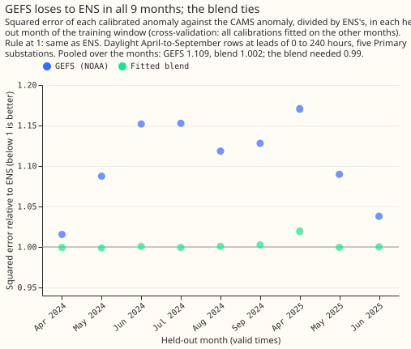
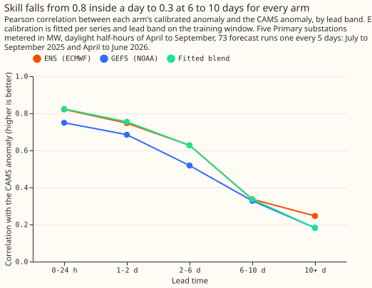
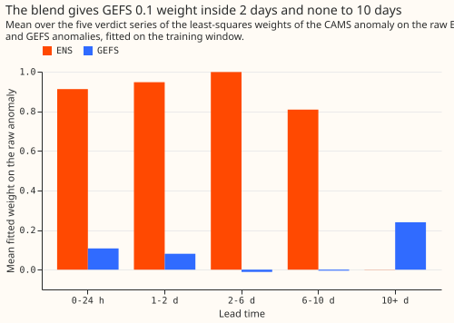

# Experiment 50: does a second weather forecast give a better forecast of the solar anomaly than ENS?

**We asked whether a second weather forecast, the American Global Ensemble Forecast System (GEFS),
predicts how much sunnier or cloudier than usual a day will be better than the European Centre for
Medium-Range Weather Forecasts (ECMWF) ensemble (ENS) that the demand forecast uses today.**
Experiment 46 had found that a correction for embedded solar panels lowered the demand forecast's
error by about 20% when it used the true sunshine (taken from the satellite- based Copernicus
Atmosphere Monitoring Service (CAMS) data), and by almost nothing when it used the ENS forecast of
sunshine. We scored three forecasts of the sunshine anomaly (ENS, GEFS, and a weighted blend of the
two) against the CAMS sunshine, at five substations that meter in MW, and planned to lay the best
one into experiment 46's correction only if it beat ENS. Neither GEFS nor the blend did. In
cross-validation on 9 held-out months, GEFS made 10.9% more squared error than ENS and the blend
made 0.2% more. On the 6 validation months, GEFS correlated with the true sunshine anomaly less well
than ENS in every lead band, and the blend matched ENS. The experiment therefore stopped before the
demand forecast was tested.

**The verdict is `refuted`: no tested forecast beats ENS by the 1% the gate requires, so the demand
contrasts C7 and C7s were not run.** The rule is in the front matter. Each calibration is a slope
(or a pair of weights) fitted per substation and lead band on the training window, and the gate
scores April-to-September daylight half-hours at leads of 0 to 240 hours.

## Results

**Stage 1 gate, training window only.** Fifteen month-block folds fit every calibration on the other
months and predict the held-out month. Nine folds hold April-to-September rows. The pooled mean
squared error against the CAMS anomaly is 0.03194 for ENS, 0.03542 for GEFS (1.109 times ENS's),
0.03201 for the blend (1.002 times), and 0.04422 for a zero anomaly. GEFS is worse than ENS in all 9
months, and the blend beats ENS in 4 of 9 months by at most 0.1%. The gate needs the blend or GEFS
at 0.99 or lower.

**Absolute skill on the validation year (exploratory; the gate decided the verdict).** The
correlation of each calibrated anomaly with the CAMS anomaly, pooled over the five verdict series,
with 68,903 scored rows in total (the printed report gives the rows in each band):

| Lead band | ENS | GEFS | Fitted blend | GEFS minus ENS (95% interval) | Blend minus ENS (95% interval) |
|---|---|---|---|---|---|
| 0 to 24 h | 0.822 | 0.749 | 0.824 | -0.072 (-0.100 to -0.039) | +0.002 (-0.001 to +0.006) |
| 1 to 2 d | 0.747 | 0.685 | 0.754 | -0.062 (-0.141 to -0.003) | +0.007 (+0.000 to +0.010) |
| 2 to 6 d | 0.628 | 0.518 | 0.627 | -0.109 (-0.204 to -0.031) | -0.001 (-0.001 to +0.000) |
| 6 to 10 d | 0.337 | 0.328 | 0.336 | -0.009 (-0.077 to +0.050) | -0.001 (-0.001 to +0.000) |
| 10+ d | 0.247 | 0.182 | 0.181 | -0.064 (-0.201 to +0.098) | -0.065 (-0.201 to +0.097) |

The intervals resample the 7 months in which runs were started, so they are wide. The calibration
slope of the CAMS anomaly on each calibrated anomaly (1 is ideal) is 0.98 for ENS and 1.09 for GEFS
at 0 to 24 hours, and 1.21 for ENS and 2.01 for GEFS at 6 to 10 days. The mean-squared-error skill
against a zero anomaly for ENS is 0.676, 0.555, 0.400, and 0.118 in the first four bands. Averaged
to 3-hour windows (exploratory), the correlations are higher for all three arms and keep the same
order: at 0 to 24 hours ENS 0.883, GEFS 0.810, blend 0.886.

**The raw data.** In bins of each forecast's raw anomaly, the mean CAMS anomaly rises with both. The
slope of the CAMS anomaly on the raw GEFS anomaly is 0.87 at 0 to 48 hours, so GEFS's raw anomaly is
about 15% too large, while the slope for ENS is 0.98 to 1.07.

**The blend learns to ignore GEFS.** The mean fitted weight on GEFS is 0.107 at 0 to 24 hours and
0.080 at 1 to 2 days, and -0.012 and -0.008 at 2 to 6 and 6 to 10 days, where the blend is ENS
alone. At 10+ days the weights (0.24 on GEFS, 0.01 on ENS) are fitted on little skill. Ten of the 30
weight pairs have a negative weight; they were kept and flagged. An equal-weight average of the two
calibrated anomalies (exploratory) correlates 0.814 at 0 to 24 hours, below ENS, and 0.357 at 6 to
10 days, above it (0.337); neither difference was tested.

**Predictions against results.** The plan predicted GEFS correlations of 0.68, 0.63, 0.50, and 0.20
in the first four bands against ENS's 0.79, 0.75, 0.58, and 0.27. The results are GEFS 0.749, 0.685,
0.518, and 0.328 against ENS's 0.822, 0.747, 0.628, and 0.337, so the ordering held. GEFS was more
skilful than predicted in every band, and ENS in three of the four (at 1 to 2 days ENS was 0.747
against 0.75 predicted). The plan predicted blend gains of +0.01 to +0.03 at 0 to 6 days, and the
results are +0.002, +0.007, and -0.001.

## Data validation, and what is unverified

**The GEFS archive and the conversion passed seven checks (`e00050_validate_gefs.py`).**

- All 821 00 UTC runs from 2024-04-01 to 2026-06-30 are complete (31 members, 9 grid cells, no
  duplicate keys, no `NaN` after lead 0).
- De-accumulation: 2.55% of the 3-hour means are below -1 W/m² (lowest -20.0), and clipping them at
  zero removes 0.057% of the positive energy.
- The half-hours of each native window average to the native mean, and the daily profile's centre of
  mass lies within 0.10 half-hours of CAMS's.
- The true cell weights beat the latitude-mirrored mapping at the five sites that mirroring changes.
- The chain test gives 0.999 on window means at every site and 0.91 to 0.93 on half-hours (planned
  bound 0.95; see the implementation notes).
- The 99th percentile of the clear-sky index is 1.081, and GEFS irradiance is 6% to 22% above CAMS's
  by month, which the anomaly removes. The monthly ratio stepped by 19.4% into November 2025, a
  warning that did not persist as a lasting change.

**The latency check is unverified.** The check needs observations between 07:00 and 09:00 UTC on
three dates. The session ran at 15:00 UTC, so `results/latency_decision.json` records the same-day
00 UTC run as an assumption. The same-day run is the optimistic case for GEFS, so the verdict also
holds for the previous day's run. Today's run was present in the store at 14:59 UTC. For D16 the
crop covers 0.898 of the cell, and the weights were renormalised.

## Lessons

**ENS stays the source of the solar anomaly.** A second global ensemble shares the errors of ENS at
the leads that matter. The first 2 days hold nearly all of the skill (correlation 0.75 to 0.82), and
there GEFS is worse and the blend adds at most 0.007. GEFS's raw anomaly needs a calibration slope
of about 0.87 where ENS's slope is 0.98 to 1.07.

## What the next experiment should answer

**Does a product of a different kind than a global ensemble, such as a high-resolution regional
model at the substations' own points or a satellite-based nowcast of the next few hours, raise the
correlation with the CAMS anomaly above ENS's 0.82 at 0 to 24 hours?** This experiment found that a
second global ensemble adds nothing there, so the next test should use a source with independent
errors at short range, calibrated in-fold as here and scored first without any demand fit. The live
UKV differs statistically from the CEDA UKV archive, so the product must be the same in training and
serving. Beyond 6 days, none of the products on disk that we considered is likely to beat ECMWF, so
a gain there is not worth a test.

## Not done

The demand contrasts C7, C7s, C3b, and C6b were not run, because the pre-registered gate stopped the
experiment. `e00050_predict.py` and `e00050_stats.py` are written, are tested against experiment
46's stored arm (a rebuild matches to 1.2e-7), and stay unrun. No prediction set was written, since
no demand arm exists.

## Plan

**Sizing.** Each of the five triggers gets one line.

- **What gets stored:** private intermediate tables and about five prediction sets under
  `data/ml-experiments/`; no production table changes.
- **The production serving path:** not touched. Adoption would add an ingest, which a later
  production issue would own.
- **A degradation rule:** not touched. Adoption would need a rule for a late or missing GEFS run,
  which a later issue would own.
- **More than one defensible design:** yes. The choices are the product, the blend form, same-day or
  previous-day runs, the climatology window, and how the member spread is handled. This plan fixes
  each.
- **Code whose callers could not be named without searching:** no. The scripts copy named
  experiment 46 helpers, call `_upsample_nwp_to_half_hourly` as experiment 46 does, and call
  `geo.h3.compute_h3_grid_weights`.

The size is complex. The process is a plan review, a code review for leakage (training-window
cut-offs, the selection running before the predictions, and the choice of GEFS run), a run and
write-up with a prose review, and a review of the result.

**Earlier advice followed.** Experiment 46's advice is followed in four places: fit the solar
coefficient by lead band instead of fixing it at 1; limit any gain test to leads of 0 to 48 hours
(C7s); check the sign of a contrast in every valid month before reading its pooled interval; and
compare arms that share one fitted booster. The experiment departs from none of it.

**The second product is GEFS, with GFS as the one fallback.** GEFS (31 members, 00 UTC runs, 0.25
degrees) is on disk for 2020-10 onward, comes from Dynamical.org like the ENS ingest, and was the
same operational GEFS v12 product throughout. NOAA's deterministic GFS is the fallback if GEFS
fails the latency check or a data-validation check; its radiation windows run from 1 to 6 hours and
need a running-mean de-accumulation, which this plan does not implement unless the fallback is
used. ECMWF's AIFS model is ruled out: its shortwave field is missing before 2025-02-24, and two
model versions fall inside the validation year. The CEDA UKV archive and the Open-Meteo archives
are ruled out for different reasons: the CEDA UKV differs from the live UKV, and the Open-Meteo
archives are held at the generator meter points and reach at most 5 days. No download is needed.

**GEFS radiation is a 6-hour mean at 00, 06, 12, and 18 UTC and a 3-hour mean at 03, 09, 15, and 21
UTC, so the means are de-accumulated before use.** The 3-hour mean ending at a 6-hourly label `L`
is `2 * v(L) - v(L - 3 h)`. Means below zero are clipped to zero and counted (the first look
found 5.2% of 3-hour means below -1 W/m², and the full sample 2.55%). Beyond a lead of 144 hours
pairs of 3-hour means are averaged into 6-hour means, which gives the same schedule as ENS's native
radiation windows, so the conversion passes the production resampler's schedule check. Each
Primary's H3 cell is area-weighted over the GEFS grid cells; for D16 only 0.898 of the cell lies
inside the downloaded crop, so its weights are renormalised, and the write-up says so.

**The run used depends on a latency check made before any score.** Production's forecast origin is
the 00 UTC run plus 9 hours. `e00050_latency.py` records, on three or more dates between 07:00 and
09:00 UTC, whether the store already holds that day's 00 UTC GEFS run. If it always does, the arms
use the same-day run. Otherwise they use the previous day's run, and lead bands stay measured from
the forecast origin. The decision is written to `results/latency_decision.json` before any GEFS
input is built.

### Stage 1: the anomaly

**Three calibrated anomalies are scored against the CAMS anomaly.** The anomaly of a source is its
unit PV shape `u` minus its own month-by-half-hour climatology over the training window. The `ens`
arm is slope times the ENS ensemble-mean anomaly (experiment 46's). The `gefs` arm is slope times
the GEFS ensemble-mean anomaly. The `blend` arm regresses the CAMS anomaly on both ensemble-mean
anomalies with two weights and no intercept. Slopes and weights are fitted per site and lead band;
a negative weight is kept and flagged. An equal-weight average of the two calibrated anomalies is an
exploratory fourth arm and takes no part in the selection.

**The gate and the scores use different data.** The selection gate is the cross-validation of the
decision rule and uses the training window only. The validation-year scores fit once on the whole
training window and report, by lead band and pooled over the five verdict series: the correlation
(A1), the calibration slope (A2), and the mean-squared-error skill against a zero anomaly (A3).
The difference in correlation between each arm and ENS has a 95% interval from resampling the 7
initialisation months of the runs. These reads are exploratory and decide nothing. A second
exploratory read repeats A1 on 3-hour mean anomalies, free of any difference in resampling shape.

### Stage 2: the demand contrasts

**Every demand arm is a shift of experiment 46's saved `d1l` boosters, so nothing is refitted.**
The shift of ENS member `m` is `-K(site, band) * C * (central + (a_m - mean(a))) / capacity`, where
`C` is experiment 40's 2023/24 capacity, `K` is experiment 46's fitted lead-band coefficient (1 in
bands where none was fitted), `central` is the arm's calibrated anomaly, and `a_m - mean(a)` is
the raw ENS member's deviation from the ENS mean. The arms differ only in `central`. The 14-day
correction and the spread factor 1.15 are applied to each arm as in experiment 46.

| Id | Contrast | Read | Predicted |
|---|---|---|---|
| C7 | selected arm's shift minus ENS shift, all scored rows | decides, 97.5% | -0.02 (-0.06 to +0.01) |
| C7s | the same, scored rows at leads of 0 to 48 hours | decides, 97.5% | -0.04 (-0.10 to 0.00) |
| C3b | selected arm's shift minus `d1l` | exploratory, 95% (experiment 46's fitted C3 was -0.143) | -0.16 |
| C6b | selected arm's shift minus `d0`, all leads and 0 to 48 hours | exploratory, 95% | +0.02, and -0.05 at 0 to 48 hours |

**C7 compares two shifts of one booster, so it has no GPU fit noise but also little contrast.** The
difference between the two central anomalies is expected to have about a third of the standard
deviation of the ENS shift. Scaling experiment 46's C3 intervals by that third gives an expected
97.5% half-width of 0.03 to 0.05 points for C7 and 0.05 to 0.10 for C7s. C7s can therefore clear
-0.1 only if the true gain is about 0.15 to 0.2, roughly three times the predicted gain. The
statistics script prints the realised half-widths. PVDIS-5's test is a gain test at 0 to 48 hours
only if C6b is wholly below zero there.

**Exploratory reads (95%, labelled so):** C7 by lead band, by valid month (the sign must match in
every month before a pooled read is believed), by series, and without D9; the other arms' shifts,
including the equal-weight blend; the coverage of the 0.05 and 0.95 quantiles in sunny and cloudy
rows; and a week-block bootstrap.

### Checks before any read

**Data validation of GEFS** (`e00050_validate_gefs.py`, with each number printed):

1. Every 00 UTC run from 2024-04-01 to 2026-06-30 is present with 31 members, the expected lead
   times, and 9 grid cells, with no duplicate keys; every `NaN` shortwave value after lead 0 is
   listed.
2. De-accumulation: clipping removes under 1% of the positive energy, windows that are dark
   throughout hold under 10 W/m² at each of the six sites (a post hoc bound, see the implementation
   notes), and twice a 6-hour mean equals the sum of its two 3-hour halves.
3. Each native window's mean equals the mean of its half-hours to within the 13-bit quantisation
   step.
4. The centre of mass of the hour-of-day profile of GEFS irradiance in the first 48 hours lies
   within one half-hour of CAMS's, which would fail if windows were labelled by their start.
5. The true cell weights give a higher cloud-driven correlation with CAMS than the
   latitude-mirrored mapping at every site whose mapping the mirroring changes.
6. CAMS irradiance, presented as GEFS windows and passed through the GEFS chain, reproduces the
   window means of the CAMS anomaly at leads up to 360 hours (3-hour windows to 144 hours, 6-hour
   windows after; correlation 0.99 or more), and the half-hour correlation is printed against the
   planned 0.95 and against CAMS smoothed to the same windows.
7. The 99th percentile of the clear-sky index is at most 1.3. The monthly ratio of mean GEFS to
   mean CAMS irradiance, over every run, is printed with a warning, not a gate, for a step over 15%
   between neighbouring months.

**Experiment checks:** (1) the rebuilt `d1l_ens_shift_fitted` matches experiment 46's stored arm to
within 1e-5 on every quantile and key; (2) a blend with weights (ENS slope, 0) reproduces the `ens`
central anomaly bit for bit; (3) all arms hold the same scored keys; (4) every climatology, slope,
weight, and fold uses valid times up to 2025-06-30 23:30 only, which the code asserts; (5) the
latency decision is recorded before stage 1 runs; (6) stage 1's selection is written before any
script reads an anomaly for the demand stage.

**Stop rule.** The experiment stops without a verdict if experiment check 1, 2, 5, or 6 fails and
one revision does not fix it. Nothing is tuned after the scores or any contrast is read: the bands,
the folds, the 1% selection margin, `K`, `C`, and the threshold are fixed here.

### Compute and amendments

**The run fits in 4 cores, and the GPU is optional.** Reading and converting GEFS takes minutes
(four worker processes, one Polars thread each). Prediction from the boosters runs on the CPU, one
thread per worker, at about 1.5 to 3 minutes per series-and-seed job; the shifts and the bootstrap
take minutes.

**Amendments from the plan review, accepted:** clip the de-accumulated means at zero and state the
clip; add "neither wholly below zero" to `refuted`, so that `small gain` and `refuted` cannot both
hold; fit the ENS calibration, each climatology, and the blend weights inside each fold; check the
publication time of the GEFS run; and verify the D16 crop coverage in the private store. **Rejected:**
skipping the demand stage, because the brief requires repeating experiment 46's C3 and C6, and a
fixed 50/50 blend as the only blend, because the fitted blend is one of the three pre-registered
arms (the fixed blend is added as an exploratory arm). **Open:** the Bonferroni correction across
C7 and C7s widens both intervals; both stay at 97.5% unless the maintainer rules otherwise.

**Implementation notes (post hoc, labelled so).** Check 6 gates on window means because averaging
CAMS to 3-hour or 6-hour windows discards its within-window cloud detail, which caps the half-hour
correlation near 0.91 to 0.95 whatever the chain does; a smoke run gave 0.98 or more on window means
and 0.91 to 0.93 on half-hours. The dark-window bound of check 2 is 10 W/m², set after a smoke run
found up to 8.0 W/m² across the six sites, because the archive's 3-hour and 6-hour windows are not
exactly consistent near dusk, and the PV model returns 0 when the sun is below the horizon. The
monthly-ratio step of check 7 reached 19.4% (into November 2025, in low winter irradiance) over
every run, which is why that read is a warning. The calibration of the 10+ d lead band uses every
training lead to 351 hours, and the cross-validation gate uses leads to 240 hours. Rows without a
GEFS value are dropped from the stage 1 scores and counted, so that no arm is scored on a fallback
to ENS.
