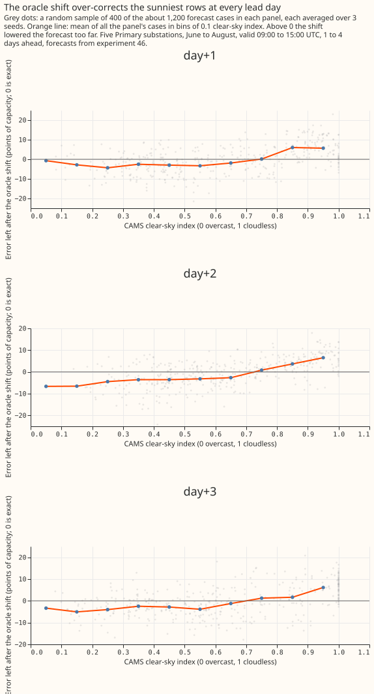
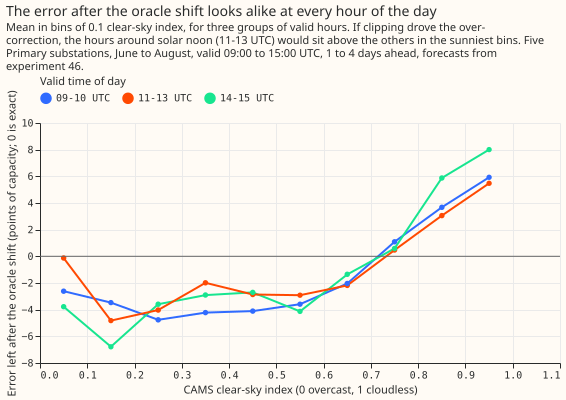
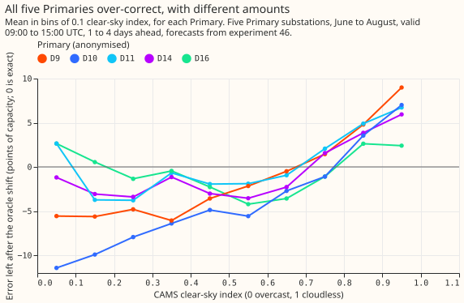
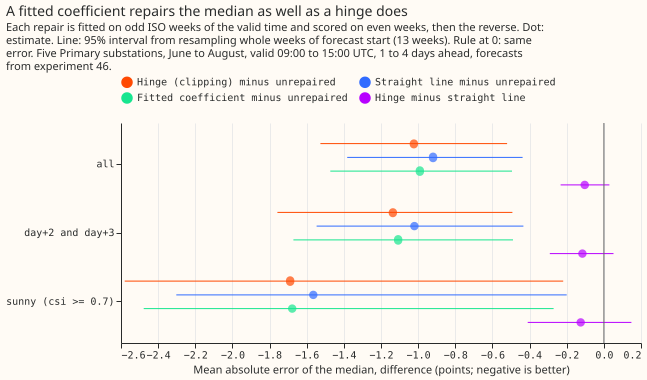
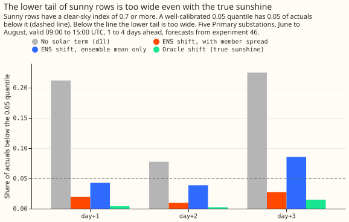

# Experiment 51: why does the solar term lose at sunny summer middays?

We asked why a correction for rooftop solar panels made a forecast of a Primary substation's power
worse around midday in summer. A Primary substation is a 33/11 kV or 66/11 kV substation in the
electricity distribution network. [Experiment
46](../00046-embedded-solar-share-of-primary-forecast-error/result.md) lowered each forecast by the
panels' estimated capacity times how much sunnier the day was than the average for that month and
half-hour. At 09:00 to 15:00 UTC in June to August, 2 days ahead, the corrected forecast had a
quantile score (our probabilistic forecast error score, in points where 1 point is 1% of the
substation's capacity) 0.48 points worse than the baseline forecast (`d0`) that kept its own
radiation inputs and had no correction. We tested three explanations on the forecasts experiment 46
had stored, without fitting a new weather-to-power model: (a) the panels' inverters, which convert
direct current to alternating current, cap their output on sunny days, (b) the correction is too
large, or (c) the 51 members of the European Centre for Medium-Range Weather Forecasts ensemble
forecast (ENS) add noise. The correction built from the sunshine that actually occurred (the oracle
shift) is too large: the actual power fell by only 0.4 to 0.7 of the amount the correction removed,
in every month and time of day. A cap on inverter output could not be told apart from a too-large
correction, and the ensemble members accounted for 0.13 points of the loss.

**The verdict is `partly supported`: one leg of the hypothesis survives, and the other two do
not.** The hypothesis said the loss comes mainly from a coefficient that is too large for the
sunniest rows, which an inverter clips, and not from noisy ENS members. The coefficient is too large
(cause b met). A clipping knee is not distinguished from a straight line (cause a not met). The
members' noise adds to the loss (cause c met), so the "not noise" leg fails. The decision rule is in
the front matter of this page, and the plan, which stated it, was committed before any result was
read. The rule does not say why the coefficient is too large, and the page does not claim to know.

| Prediction made in the plan | Result |
|---|---|
| Knee between 0.6 and 0.9 at 3 or more of the 5 series | Not met: 2 of 5 (D14 at 0.60 and D16 at 0.65) |
| A clip lowers the median's error by 0.05 to 0.15 points | Not met: the hinge lowers it by 1.02 points, almost all through its intercept |
| The ensemble-mean shift removes under a third of the ENS shift's excess over `d1l` | Not met: it removes 0.129 points, more than the whole 0.057-point excess |

All figures are for 5 Primary substations (anonymised as D9, D10, D11, D14, and D16, as in
experiment 46), June to August, valid 09:00 to 15:00 UTC, 1 to 3 days after the forecast origin.
There are 3,575 forecast cases: each one is a Primary, a valid half-hour, and a forecast run, with
its quantiles averaged over the 3 random seeds of the XGBoost fit. The cases come from 13 weeks of
forecast start. Intervals are 95% bootstrap intervals from resampling whole weeks of forecast start.
With so few weeks the intervals are probably somewhat narrow.

## Raw data: the error left after the oracle shift

**The oracle shift is too large on cloudy rows as well as sunny ones, in every lead day, hour, and
Primary.** Let *e* be the actual power minus the forecast after the oracle shift, in points of
capacity. A value of 0 means the shift was exactly right, and a positive value means the shift
lowered the forecast too far. The mean of *e* is negative on cloudy rows (about -3 to -4 points,
where the shift raised the forecast too far), crosses 0 near a clear-sky index (irradiance from the
Copernicus Atmosphere Monitoring Service, CAMS, over clear-sky irradiance) of 0.7, and reaches +5 to
+7 points between 0.9 and 1.0. A negative value on cloudy rows points to a scale error, because a
cap on output would not act there. The grey dots are a sample of the cases, and the line is the mean
of all of them.

## The correction's coefficient is too large (cause b)

**In every month and hour bin the actual power falls by 0.4 to 0.7 of what the oracle shift removes,
so a coefficient of 1 over-corrects.** A coefficient of 1 would give a slope of -1 of the `d1l`
residual (the actual power minus the forecast before any solar correction) on the shift. The slope
is between -0.42 and -0.69 in each of the 6 cells of month by hour bin (09-12 then 12-15 UTC: June
-0.42 and -0.51, July -0.69 and -0.65, August -0.69 and -0.60), by lead day -0.61, -0.54, and -0.61,
and by Primary -0.52 to -0.81. In 4 of the 6 cells the interval lies wholly above -0.85, which meets
the rule's count; the 2 August cells have lower ends of -1.03 and -1.12. Each cell holds only about
4 to 5 weeks of forecast start, so these intervals are the least reliable in the page. A coefficient
fitted per series and hour bin on half the weeks lowers the median's mean absolute error on the
other half by 0.991 points (-1.473 to -0.495), against the oracle shift with coefficient 1.

**The slope below 1 has several possible causes that these data cannot separate.** The panels'
estimated capacity may be too large. Error in the CAMS sunshine pulls the slope towards 0. The `d1l`
forecast already absorbs part of the sunshine through its temperature and lagged-power inputs.
Clipping flattens the response on sunny rows. Demand that rises with sunshine, such as cooling,
offsets the panels' output. Panel temperature lowers the output on hot days. A coefficient fitted on
CAMS is also not the coefficient used in service, where the shift comes from ENS and is attenuated
more at longer leads.

## A clipping knee is not distinguished from a straight line (cause a)

**A hinge that is flat below a knee and rises above it fits no better than a straight line out of
fold, and adds nothing after the coefficient repair.** The hinge lowers the median's error against
the unrepaired oracle shift by 1.023 points (-1.526 to -0.521), but a straight line in the clear-sky
index lowers it by 0.920 (-1.382 to -0.437). The hinge is lower than the line by 0.103 points
(-0.233 to +0.030), and the rule needed an interval wholly below 0. Both repairs lower the error
mostly through a free intercept, so the 1.023 alone is not evidence of clipping. The comparison also
could not separate the causes: the shift is itself S-shaped in the clear-sky index, so a hinge
traces it even when the only fault is a scale error. A post hoc test is sharper: a hinge fitted to
what the coefficient repair leaves behind changes the out-of-fold error by +0.003 points (-0.071 to
+0.084), so no knee remains once the scale is fixed.

**The fitted knees do not look like clipping.** The slope above the knee is positive at all 5
series, with intervals above 0, but the knees lie between a clear-sky index of 0.40 and 0.65 with
wide intervals (0.40 to 0.78), and the knee of D9 sits at the lowest value the search allowed. The
CAMS shape gives the panels' output as a fraction of their direct-current capacity, and the inverter
caps output near that fraction at the knee, so the knee implies a ratio of direct-current to
alternating-current (DC:AC) capacity of 1.8 to 3.2. We expect rooftop inverters to sit well below
that, which is a judgement this page did not check against a source. The page therefore reports no
per-Primary knee for PVDIS-6 (the planned test of panel orientations, which a knee would feed). The
test could also not have found the effect the plan predicted: the interval on hinge minus line has a
half-width of about 0.13 points, so an effect of 0.19 points would be needed for 80% power, and the
plan predicted 0.05 to 0.15.

| Series | Knee (clear-sky index) | Slope above the knee (points per unit index, 95% interval) | Implied DC:AC |
|---|---|---|---|
| D9 | 0.40 | 24.1 (19.6 to 32.9) | 3.2 |
| D10 | 0.575 | 32.2 (18.7 to 55.1) | 2.1 |
| D11 | 0.55 | 20.7 (15.6 to 33.2) | 2.2 |
| D14 | 0.60 | 24.1 (17.4 to 45.7) | 2.0 |
| D16 | 0.65 | 15.3 (9.8 to 24.4) | 1.8 |

## Splits for sunshine-dependent demand, and the temperature read

**The splits do not show that the knee comes from demand that rises with sunshine, or that it does
not.** Demand such as cooling or visitor load at coastal resorts rises with sunshine and would mimic
a clipping knee. Of the 5 Primaries, 2 are within 10 km of the open coast, so the coastal split
compares 2 series with 3. The slope above each series' own knee is 24.1 at the 2 coastal series and
22.7 at the other 3. It is 25.2 on term-time weekdays and 17.3 on school-holiday weeks and weekends;
these are point estimates with no intervals. The hinge is lower than the line by 0.161 points
(-0.282 to -0.038, 10 weekly blocks) in holiday-and-weekend rows, and by 0.081 points (-0.253 to
+0.097) on term-time weekdays. Of the 7 scopes read (all rows, day+2 and day+3, sunny, coastal,
inland, term-time weekdays, and holiday-and-weekend), this is the only one whose interval excludes
0. Chance alone would produce about 1 such interval in 7. The holiday period (22 July to 31 August)
also covers most of August, so the split confounds holiday demand with the month.

**At fixed clear-sky index, the sunniest rows' error rises with 2 m temperature, and demand is only
one explanation.** The rise is 0.67 points per kelvin (0.21 to 1.15), from the mean of *e* in three
temperature bands within each series and 0.1-wide index bin (-2.27, -0.17, and +2.49 points in the
coolest, middle, and warmest band). Demand that rises with heat could cause it. So could panel
temperature: output of crystalline-silicon panels falls by roughly 0.4% per kelvin, so a shift that
ignores cell temperature over-states the panels' output on hot days. This page did not check whether
the CAMS unit output models cell temperature. Hot rows also cluster in few weeks (8 weekly blocks in
the warmest sunny band), and `d1l` already takes temperature as an input.

## Noisy ENS members add to the loss (cause c)

**The member spread adds 0.129 points to the ENS shift's score at day+2 and day+3, which is under
half of the 0.324-point loss of the ENS shift against `d0`.** The table gives the quantile score of
the first arm minus the second, at day+2 and day+3 pooled (2,340 cases), with its interval. Cause c
is met as the rule is written, because the interval of the ENS-shift-minus-ensemble-mean-shift row
lies wholly above 0 and 0.129 exceeds half of the ENS-shift-minus-`d1l` difference (0.057). The rule
compares with `d1l`, and the lead above compares with `d0`. The test is weak: the interval of the
ENS-shift-minus-`d1l` row spans 0, so almost any positive spread effect would pass it.

| Contrast (negative favours the first arm) | Difference (95% interval) |
|---|---|
| ENS shift minus `d0` (experiment 46's C6) | +0.324 (-0.144 to +0.761) |
| ENS shift minus `d1l` (experiment 46's C3) | +0.057 (-0.495 to +0.570) |
| ENS shift minus ensemble-mean shift (cause c) | +0.129 (+0.057 to +0.212) |
| Ensemble-mean shift minus `d1l` | -0.072 (-0.625 to +0.441) |
| Fitted-coefficient ENS shift minus ENS shift (post hoc) | -0.435 (-0.689 to -0.139) |
| Fitted-coefficient ENS shift minus `d0` (post hoc) | -0.111 (-0.348 to +0.110) |

The loss that prompted the experiment reproduces: experiment 46's C6 is +0.477 (+0.057 to +0.842) at
day+2 and +0.172 (-0.580 to +0.807) at day+3. Over the two days pooled, the interval of C6 includes
0 when 13 weeks are resampled, so the loss is small and uncertain here. The fitted-coefficient shift
of experiment 46, fitted on its training window, removes the loss: it scores +0.004 (-0.255 to
+0.241) against `d0` at day+2 (post hoc, with a wide interval). The oracle shift puts too few sunny
actuals below the 0.05 quantile as well (0.002 to 0.015, against 0.05; the ENS shift puts 0.010 to
0.027 there), so member noise cannot be the only source of a lower tail that is too wide.

## What it could not show

- **The hinge test has little power.** Its half-width is 0.13 points, as set out under cause a.
- **The folds are weeks of the valid time.** One forecast run spans up to 3 valid middays and can
  fall into both folds, which mildly favours every repair. The intervals resample fixed fits and are
  somewhat narrow. The free intercept of the hinge and the line favours both against the coefficient
  repair.
- **Hour of day and month are untested as causes.** The 2 hour bins differ by at most 0.09 within a
  month, and the month differences come from one summer.
- **The coastal flag rests on a coarse coastline** (7 coastline points and a 10 km threshold), and 2
  of 5 Primaries qualify.
- **The experiment cannot say which of the six causes of a slope below 1 is at work.** Several can
  act together.

## What the next experiment should answer

**A design for PVDIS-5 (the planned retest of the solar term with weekly capacity estimates) could
fit the solar coefficient per lead band and season on the ENS shift, test non-inferiority against
`d0`, and report no clipping knee.** The margin of 0.10 points of capacity was set in the plan: it
is about 2% of `d0`'s mean quantile score of 4.62 points, and close to the 0.104 points by which
`d0`'s radiation inputs improved on `d1l` over April to September. A margin as large as the whole
effect of the radiation inputs is generous. On these summer-midday rows the gap between `d1l` and
`d0` is about 0.27 points. The PVDIS-5 plan could confirm 0.10 or halve it to 0.05 after a power
calculation. Non-inferiority means the upper end of the 95% interval of (solar term minus `d0`) lies
below the margin. The fitted shift's upper end here is +0.110 over 13 weeks at day+2 and day+3 (post
hoc), and the half-width of about 0.23 would fall to about 0.16 with 25 weeks, so a pass at 0.10
needs a true difference below about -0.06. Resampling at least 25 weeks of forecast start (April to
September) and repeating the test for 0 to 48 hours separately would be sensible. A per-Primary
clipping knee would need a different design: rows at or near the inverters' rated output, such as
the clearest days at midday, a hinge fitted after the coefficient repair, and more than two coastal
series.
