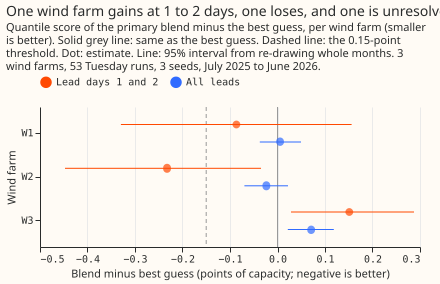

# Experiment 52: do more weather forecasts lower the wind farms' error at 1 to 2 days ahead?

We asked whether two further weather forecasts, ICON-EU (the German weather service's European
model) and IFS 0.25 degree (the European Centre's high-resolution forecast), help the wind-farm
forecast one to two days ahead. The current best guess feeds the 51 members of the European
Centre's ensemble forecast (ENS) to a model trained on ERA5, an estimate of past weather. We fed the
same trained model each extra forecast's wind, and averaged the resulting forecast ranges with the
best guess's, using weights chosen only on earlier months. At 1 to 2 days the average scored 0.055
points of capacity better than the best guess, but the 95% interval (-0.200 to +0.072) includes
zero, so the experiment cannot say whether the extra forecasts help.

**Inconclusive: the primary blend minus the best guess is -0.055 points of capacity at lead days 1
and 2 (95% interval -0.200 to +0.072; C1), against a threshold of -0.15.** C1 is the only contrast
that decides the verdict. Over all leads the difference is +0.018 (-0.020 to +0.054; C2). The
interval resamples whole months and the 3 seeds, so it describes these 3 farms and cannot speak for
other farms. The prediction (-0.2 to -0.4 at days 1 and 2) was too large. A lead day counts
calendar days from the date of the ENS run, so lead days 1 and 2 are the two days after the run's
date.

## Absolute scores

**The quantile score (twice the mean pinball loss over nine levels, in points of capacity; smaller
is better) of the best guess and the primary blend.** Cases hold 3 farms and 3 seeds; the 95%
coverage columns are the share of cases inside the 5% to 95% band.

| Scope | Best guess | Primary blend | Cases | Coverage, best guess | Coverage, blend |
|---|---|---|---|---|---|
| Lead day 0 | 6.722 | 6.525 | 13,695 | 0.902 | 0.903 |
| Lead days 1 and 2 | 6.701 | 6.646 | 44,328 | 0.909 | 0.901 |
| Lead days 3 to 6 | 9.702 | 9.824 | 88,716 | 0.909 | 0.917 |
| Lead days 7 and later | 13.154 | 13.154 | 174,624 | 0.916 | 0.916 |
| All leads | 11.037 | 11.054 | 321,363 | 0.912 | 0.914 |

Per farm over all leads, the best guess scores 10.67, 12.38, and 10.06 (W1, W2, W3) and the
primary blend 10.68, 12.36, and 10.13. From lead day 7 onwards no product exists, so the two arms are identical.

## What else the numbers show

- **The farms disagree at days 1 and 2 (exploratory).** The primary blend minus the best guess is
  -0.087 (-0.330 to +0.156) at W1, -0.233 (-0.447 to -0.035) at W2, and +0.151 (+0.028 to +0.287)
  at W3.

  

- **The blend does harm at lead days 3 to 6 and may help at day 0 (exploratory).** The primary blend
  minus the best guess is +0.122 (+0.028 to +0.221) at days 3 to 6 and -0.197 (-0.460 to +0.051) at
  day 0. At day 0, GFS (from the same archive) gains 0.229 (-0.371 to -0.090).
- **No single extra product helps at days 1 and 2 (exploratory).** ICON-EU alone gives -0.053
  (-0.199 to +0.079), IFS alone +0.071 (-0.034 to +0.185), and GFS alone -0.069 (-0.172 to +0.034).
- **Each product alone is far worse than the best guess at days 1 and 2.** After a spread factor,
  ICON-EU alone scores 2.469 points worse (the figure for IFS is 1.264 and for GFS 1.853). In the
  first 6 months the stop rule (a product more than 1.0 points worse) fired for all three, which
  the plan said would drop a product from the exploratory arms. The experiment ran those arms
  anyway, so their rows stay, and the primary arm was fixed in advance.
- **The weights stayed mostly on the best guess.** At days 1 and 2 the chosen weights averaged 0.72
  for the best guess, 0.24 for ICON-EU, and 0.05 for IFS. One weight for all leads (-0.060 at days 1
  and 2) did no better than weights per lead day.
- **The extra spread factor did not help (exploratory).** Without it, the primary blend minus the
  best guess is -0.080 (-0.217 to +0.039) at days 1 and 2 and -0.018 (-0.043 to +0.005) over all
  leads. The factors ranged 1.0 to 1.25 for days 0 to 2 and 1.0 to 1.65 for days 3 and later.
- **The placebo scores worse than the best guess.** Shuffling the product forecasts among cases of
  the same farm, month, lead day, and time of day gives +0.343 (+0.061 to +0.762) at days 1 and 2,
  so the blend's small gain does not come from averaging two correlated forecasts alone.

## How the experiment was run, and where it departs from the plan

- **Cases and benchmark:** the 53 Tuesday runs of experiment 33's wind best guess (`bg_full`), 3
  farms and 3 seeds, scored on its stored half-hourly cases. A farm is labelled W1 to W3.
- **Product forecast:** experiment 33's ERA5-trained wind model, refitted per seed on valid times
  before 2025-06-17, fed each product's wind at the farm's grid point from Open-Meteo's Previous
  Runs archive. A case at lead day d reads `previous_day(d+1)`, which the archive defines as a run
  initialised at least that many days before the hour, so the run was initialised no later than
  00 UTC on the ENS run's date. The experiment did not check that definition against the archive
  itself; the matched-lead study checked it on GFS for 2 days. A case beyond a product's horizon
  (ICON-EU after lead day 3) or with a missing value keeps the best guess.
- **Blend:** the average of each quantile level, with weights on a grid of quarters chosen per lead
  band on earlier months only, then a spread factor fitted on earlier cases. The plan said the
  spread factor would be fitted per lead band; it was fitted for lead days 0 to 2 pooled and days 3
  and later pooled, so that each fit has enough cases. A half-hour valid time takes its speed and
  direction from the averaged u and v components of the two hours either side.
- **Dropped from the plan:** the solar arm (the matched-lead study found no solar gain at this lead)
  and AIFS (it needs its own rows because of its model-version changes). The climatology row was not
  computed.
- **Mean 100 m wind speed:** ICON-EU 8.90, IFS 7.56, and GFS 8.00 m/s at the cases each covers,
  against 8.18 for ERA5 over the validation year. The case sets differ, so this flags a bias
  without measuring it. ICON-EU's 100 m wind is Open-Meteo's rescaling of its 120 m level.
- **Code:** `ml-experiments/00052-more-nwp-products-for-wind-farms/`. One Opus plan review and one
  Sonnet code review found no leakage; the code review noted that the availability check in
  `e00052_fit.py` cannot fire, because the lead rule already guarantees it, and that the first
  placebo kept some real product information. The placebo was rebuilt.

## What the next experiment should answer

**Whether more than 3 farms would resolve the day 0 gain.** The day 0 contrasts lie closest to
resolving (-0.197 for the blend, -0.239 for ICON-EU alone), the day 3 to 6 contrasts are harmful,
and the farm-to-farm spread is as large as the pooled effect. A test of ICON-EU at lead day 0 needs
more wind farms, which the 3 metered farms cannot supply.
